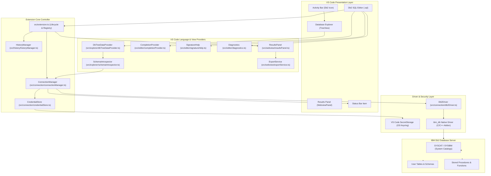
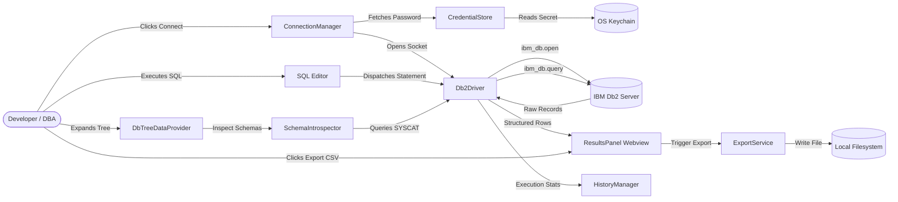
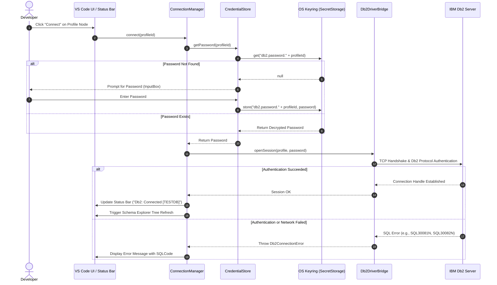
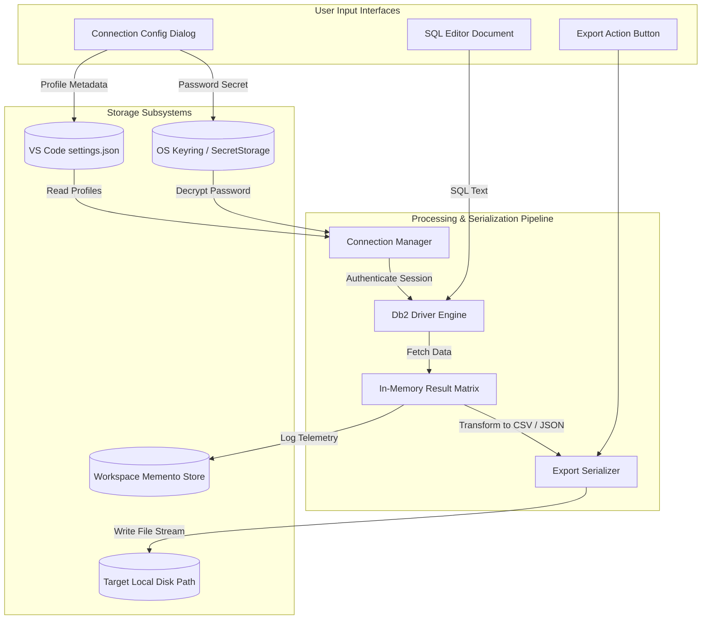

# IBM Db2 Developer Extension for VS Code (`ibm-db2-developer-extension`)
## Comprehensive Technical Project Documentation & Architectural Specification

---

## Document Metadata

| Attribute | Specification |
|:---|:---|
| **Document Version** | 1.0.0 |
| **Project Name** | IBM Db2 Developer Extension for VS Code |
| **Short Identifier** | Db2 DevTools (`ibm-db2-developer-extension`) |
| **Classification** | Database Tooling / IDE Extension Architecture |
| **Target Audience** | Software Architects, Extension Developers, Open-Source Contributors, Database Engineers |
| **Status** | Active Technical Specification |

---

## Table of Contents

- [1. Project Introduction](#1-project-introduction)
  - [1.1 Overview](#11-overview)
  - [1.2 Background and Motivation](#12-background-and-motivation)
  - [1.3 Problem Statement](#13-problem-statement)
  - [1.4 Proposed Solution](#14-proposed-solution)
  - [1.5 Project Objectives](#15-project-objectives)
  - [1.6 Project Scope](#16-project-scope)
  - [1.7 Target User Personas](#17-target-user-personas)
- [2. Functional Requirements](#2-functional-requirements)
  - [2.1 Detailed Requirement Specifications](#21-detailed-requirement-specifications)
  - [2.2 Implementation Traceability Matrix](#22-implementation-traceability-matrix)
- [3. Non-Functional Requirements](#3-non-functional-requirements)
  - [3.1 Performance](#31-performance)
  - [3.2 Reliability & Fault Tolerance](#32-reliability--fault-tolerance)
  - [3.3 Security](#33-security)
  - [3.4 Maintainability & Extensibility](#34-maintainability--extensibility)
  - [3.5 Scalability](#35-scalability)
  - [3.6 Usability & Accessibility](#36-usability--accessibility)
  - [3.7 Compatibility](#37-compatibility)
  - [3.8 Error Handling](#38-error-handling)
- [4. Technology Stack Analysis](#4-technology-stack-analysis)
  - [4.1 Runtime & Frameworks](#41-runtime--frameworks)
  - [4.2 Connectivity & Driver Engine](#42-connectivity--driver-engine)
  - [4.3 UI Presentation & Visualization](#43-ui-presentation--visualization)
  - [4.4 Build, Packaging, and Quality Assurance](#44-build-packaging-and-quality-assurance)
- [5. System Architecture](#5-system-architecture)
  - [5.1 Architectural Paradigms](#51-architectural-paradigms)
  - [5.2 High-Level Component Topology](#52-high-level-component-topology)
  - [5.3 System Architecture Diagram (Mermaid)](#53-system-architecture-diagram-mermaid)
  - [5.4 Module Interaction Diagram (Mermaid)](#54-module-interaction-diagram-mermaid)
- [6. Project Folder Structure](#6-project-folder-structure)
  - [6.1 Repository Tree Layout](#61-repository-tree-layout)
  - [6.2 File & Directory Responsibilities](#62-file--directory-responsibilities)
- [7. Module-Wise Technical Explanation](#7-module-wise-technical-explanation)
  - [7.1 Extension Controller (`src/extension.ts`)](#71-extension-controller-srcextensionts)
  - [7.2 Connection Management Module (`src/connection/`)](#72-connection-management-module-srcconnection)
  - [7.3 Credential Storage Module (`src/connection/credentialStore.ts`)](#73-credential-storage-module-srcconnectioncredentialstorets)
  - [7.4 Native Db2 Driver Bridge (`src/connection/db2Driver.ts`)](#74-native-db2-driver-bridge-srcconnectiondb2driverts)
  - [7.5 Database Explorer Module (`src/explorer/`)](#75-database-explorer-module-srcexplorer)
  - [7.6 SQL Editor & Language Services (`src/editor/`)](#76-sql-editor--language-services-srceditor)
  - [7.7 Query Execution & Results Webview (`src/webview/`)](#77-query-execution--results-webview-srcwebview)
  - [7.8 Data Export Service (`src/webview/exportService.ts`)](#78-data-export-service-srcwebviewexportservicets)
  - [7.9 Query History Manager (`src/history/historyManager.ts`)](#79-query-history-manager-srchistoryhistorymanagerts)
- [8. Database Connectivity Engineering](#8-database-connectivity-engineering)
  - [8.1 Profile Configuration & Schema Definition](#81-profile-configuration--schema-definition)
  - [8.2 Native Driver Binding (`ibm_db`)](#82-native-driver-binding-ibm_db)
  - [8.3 Connection Lifecycle & State Machine](#83-connection-lifecycle--state-machine)
  - [8.4 Database Connection Workflow (Mermaid)](#84-database-connection-workflow-mermaid)
- [9. SQL Query Execution Workflow](#9-sql-query-execution-workflow)
  - [9.1 Step-by-Step Execution Mechanics](#91-step-by-step-execution-mechanics)
  - [9.2 SQL Query Execution Sequence Diagram (Mermaid)](#92-sql-query-execution-sequence-diagram-mermaid)
- [10. Data Flow & Data Management](#10-data-flow--data-management)
  - [10.1 In-Memory vs. Persistent State Boundaries](#101-in-memory-vs-persistent-state-boundaries)
  - [10.2 Data Flow Diagram (Mermaid)](#102-data-flow-diagram-mermaid)
  - [10.3 Result Serialization & Buffer Management](#103-result-serialization--buffer-management)
- [11. Security Architecture & Threat Modeling](#11-security-architecture--threat-modeling)
  - [11.1 SecretStorage & OS Keyring Integration](#111-secretstorage--os-keyring-integration)
  - [11.2 Transport Layer Security (TLS/SSL)](#112-transport-layer-security-tlsssl)
  - [11.3 SQL Injection Safeguards on Metadata Queries](#113-sql-injection-safeguards-on-metadata-queries)
  - [11.4 Threat Model & Mitigation Matrix](#114-threat-model--mitigation-matrix)
- [12. User Interface & User Experience Design](#12-user-interface--user-experience-design)
  - [12.1 Activity Bar & Tree Navigation](#121-activity-bar--tree-navigation)
  - [12.2 Modal & InputBox Interaction Patterns](#122-modal--inputbox-interaction-patterns)
  - [12.3 Editor Surface & Scratchpads](#123-editor-surface--scratchpads)
  - [12.4 Webview Panel Data Grid](#124-webview-panel-data-grid)
  - [12.5 Notifications & Status Bar Telemetry](#125-notifications--status-bar-telemetry)
- [13. Installation & Development Environment](#13-installation--development-environment)
  - [13.1 Prerequisites](#131-prerequisites)
  - [13.2 Toolchain Setup & Compilation](#132-toolchain-setup--compilation)
  - [13.3 Debugging with the Extension Development Host](#133-debugging-with-the-extension-development-host)
  - [13.4 VSIX Package Generation](#134-vsix-package-generation)
- [14. Testing Strategy & Verification](#14-testing-strategy--verification)
  - [14.1 Unit Testing](#141-unit-testing)
  - [14.2 Integration & Driver Testing](#142-integration--driver-testing)
  - [14.3 End-to-End Extension Host Testing](#143-end-to-end-extension-host-testing)
  - [14.4 Test Coverage Matrix](#144-test-coverage-matrix)
- [15. Error Handling & Diagnostic Architecture](#15-error-handling--diagnostic-architecture)
  - [15.1 Db2 SQL Error Code Mapping](#151-db2-sql-error-code-mapping)
  - [15.2 Driver Failure Handling](#152-driver-failure-handling)
  - [15.3 Diagnostic Logging Strategy](#153-diagnostic-logging-strategy)
- [16. Performance Considerations](#16-performance-considerations)
  - [16.1 UI Thread Offloading & Async Operations](#161-ui-thread-offloading--async-operations)
  - [16.2 Large Result Set Pagination & Virtualization](#162-large-result-set-pagination--virtualization)
  - [16.3 Connection Pool Management](#163-connection-pool-management)
- [17. Technical Limitations](#17-technical-limitations)
- [18. Future Scope & Architectural Evolution](#18-future-scope--architectural-evolution)
- [19. Development & Contribution Guidelines](#19-development--contribution-guidelines)
- [20. Conclusion](#20-conclusion)

---

## 1. Project Introduction

### 1.1 Overview
The **IBM Db2 Developer Extension for VS Code** (`ibm-db2-developer-extension`, known colloquially as **Db2 DevTools**) is a native database tooling extension designed for the Visual Studio Code ecosystem. It establishes an integrated development environment (IDE) for software engineers, database administrators (DBAs), and data practitioners developing applications powered by **IBM Db2**.

By leveraging the Visual Studio Code Extension API alongside the native IBM Db2 Node.js client driver (`ibm_db`), Db2 DevTools embeds connection management, live schema inspection, rich SQL authoring with real-time feedback, query execution, interactive data grids, data export services, and execution history directly within the developer's core workstation editor.

### 1.2 Background and Motivation
Modern application architectures increasingly favor lightweight, polyglot IDEs over monolithic, specialized database clients. Visual Studio Code has emerged as the dominant text editor across frontend, backend, cloud, and data engineering disciplines. 

However, developer tooling for enterprise relational databases—specifically IBM Db2 on Linux, UNIX, Windows (LUW), IBM Cloud, and z/OS—has traditionally relied upon standalone graphical interfaces (such as IBM Data Studio, IBM Db2 Administration Server, or multi-database desktop clients like DBeaver) or terminal-bound CLI tools (`db2cmd`, `db2cli`). 

Db2 DevTools addresses this tooling fragmentation by embedding first-class Db2 primitives directly into the VS Code runtime, eliminating external tool dependencies and streamlining daily database interactions.

### 1.3 Problem Statement
Database development workflows involving IBM Db2 encounter multiple acute bottlenecks:
1. **Severe Context Switching Friction:** Developers author backend microservices (Node.js, Python, Java, Go) inside VS Code, but must switch out of the editor into heavy desktop tools to inspect schemas, execute ad-hoc DDL/DML, or verify query results.
2. **Insecure Credential Persistence:** Developers frequently write credentials directly into uncommitted source files, insecure environment variable dumps, or plain-text scratchpads to avoid re-authenticating across multiple disconnected tools.
3. **Absence of Dialect-Specific SQL Intelligence:** Standard SQL language extensions treat SQL uniformly, failing to recognize Db2-specific syntax, catalog tables (`SYSCAT`, `SYSIBM`), scalar/aggregate functions, pagination idioms (`FETCH FIRST n ROWS ONLY`), or specialized column data types (`DECFLOAT`, `CLOB`, `BLOB`, `VECTOR`).
4. **Lack of Integrated Tabular Results and Export Mechanisms:** Command-line CLI queries produce unformatted, wrap-around ASCII output that cannot be easily sorted, formatted, or exported to common interchange formats like CSV and JSON without manual terminal piping.

### 1.4 Proposed Solution
Db2 DevTools provides an end-to-end, native extension architected around modular TypeScript components:
- **Connection Profile Manager:** Enables defining, editing, testing, and toggling multiple named connection configurations.
- **Hardware-Backed Credential Vault:** Securely delegates password and authentication token storage to the OS keyring via the VS Code `SecretStorage` API.
- **Catalog-Aware Database Explorer:** Implements a reactive tree view querying Db2 administrative catalog tables to render hierarchical views of Schemas, Tables, Columns, Views, and Procedures.
- **Enhanced SQL Editor:** Features syntax highlighting, context-aware autocomplete snippets, real-time query syntax validation, and parameter signature help.
- **Asynchronous Query Execution Engine:** Interacts with `ibm_db` non-blockingly, delivering structured result sets into an interactive HTML5/CSS Webview panel equipped with sorting, row counting, and one-click JSON/CSV exporters.
- **Query History Recorder:** Logs all executed statements with timestamps, execution duration, row counts, and status indicators.

### 1.5 Project Objectives
- Deliver a native, lightweight VS Code extension without requiring external GUI dependencies.
- Guarantee enterprise-grade credential security by adhering to zero-plaintext-password standards.
- Achieve sub-100 millisecond UI responsiveness for standard metadata queries and schema expansion.
- Ensure cross-platform parity across macOS (Intel & Apple Silicon), Linux distributions, and Microsoft Windows.
- Provide clean abstraction boundaries separating the VS Code extension presentation layer from the native database connectivity driver.

### 1.6 Project Scope
The current scope encompasses:
- Direct TCP/IP and SSL/TLS socket connections to IBM Db2 Community Edition (Docker/Podman), Db2 LUW v11.5+, Db2 Warehouse, and Db2 on Cloud.
- Interactive schema navigation, table column introspection, and routine inspection.
- Execution of arbitrary SQL queries (DDL, DML, DQL) with result visualization in webviews.
- Serialization and export of active result sets to CSV and JSON files on disk.

*Out of Scope for Initial Release:* Visual EXPLAIN execution plan diagramming, binary BLOB editing, graphical database backup/restore wizards, and stored procedure line-by-line debugging.

### 1.7 Target User Personas
1. **Full-Stack / Backend Application Developers:** Writing application logic that interacts with Db2; requiring rapid schema verification, fast scratchpad testing, and integrated query runs.
2. **Database Administrators (DBAs):** Verifying database server health, inspecting catalog views (`SYSCAT.TABLES`), managing indexes, and testing DDL scripts.
3. **Data Engineers & Data Analysts:** Formulating analytical queries, validating data transformations, and exporting sampled sets into JSON/CSV for downstream modeling.

---

## 2. Functional Requirements

### 2.1 Detailed Requirement Specifications

#### FR-01: Connection Profile Management
- The system shall allow users to create named connection profiles specifying `Profile Name`, `Host`, `Port`, `Database Name`, `Username`, and `Security/SSL` flags.
- The system shall allow users to edit existing connection configurations without requiring recreation.
- The system shall allow users to delete connection profiles and automatically purge associated secrets.

#### FR-02: Concurrent Active Database Connections
- The system shall support switching between distinct profiles (e.g., Development, Staging, Production).
- The system shall indicate the active connection profile in the VS Code Status Bar.

#### FR-03: Hardware-Backed Secure Credential Storage
- The system shall prompt for user passwords using a masked input prompt.
- The system shall store credentials exclusively via the VS Code `SecretStorage` API (delegated to OS Keyring).
- The system shall strictly prohibit serializing passwords into plain-text settings, JSON configs, or state files.

#### FR-04: SQL Editor Language Intelligence
- The system shall provide syntax highlighting for Db2-specific SQL grammar, keywords, and data types.
- The system shall provide context-aware auto-completion items for common Db2 DDL and DML constructs.
- The system shall provide parameter signature assistance for built-in Db2 scalar and aggregate routines.
- The system shall report syntax diagnostics and validation errors directly within the editor gutter.

#### FR-05: Query Execution Engine
- The system shall execute the SQL statement under the active cursor upon pressing `Cmd+Enter` (macOS) or `Ctrl+Enter` (Windows/Linux).
- The system shall execute highlighted SQL blocks when a text selection is active.
- The system shall support executing entire multi-statement `.sql` documents delimited by semicolons.

#### FR-06: Tabular Query Result Visualization
- The system shall render execution results inside a dedicated VS Code Webview panel.
- The system shall format rows and columns into an interactive, scrollable, and sortable data table.
- The system shall display execution performance metrics: total elapsed time (ms), affected row count, and execution status.

#### FR-07: Data Export Utilities
- The system shall export active result sets to comma-separated values (`.csv`) files on the local filesystem.
- The system shall export active result sets to structured JavaScript Object Notation (`.json`) files.

#### FR-08: Query Execution History
- The system shall log all executed queries into a persistent workspace history log.
- The system shall record timestamps, execution duration, query text, and success/error status for each entry.
- The system shall allow users to re-run historical queries with a single click.

#### FR-09: Hierarchical Database Explorer
- The system shall display an interactive tree view inside the VS Code Activity Bar.
- The system shall introspect and render nodes for:
  - Active Connection Profiles.
  - Database Schemas (`SYSCAT.SCHEMATA`).
  - Tables (`SYSCAT.TABLES`) and their respective Columns (`SYSCAT.COLUMNS`).
  - Database Views (`SYSCAT.VIEWS`).
  - Stored Procedures and User-Defined Functions (`SYSCAT.ROUTINES`).
- The system shall provide context-menu commands: "Select Top 100 Rows", "Script as CREATE DDL", and "Copy Object Name".

---

### 2.2 Implementation Traceability Matrix

| Requirement ID | Description | Implementation Status | Implementing Module / File |
|:---|:---|:---:|:---|
| **FR-01** | Profile CRUD Management | **Implemented** | `src/connection/connectionManager.ts` |
| **FR-02** | Multi-Connection Switching | **Implemented** | `src/connection/connectionManager.ts` |
| **FR-03** | Secure Credential Storage | **Implemented** | `src/connection/credentialStore.ts` |
| **FR-04a** | Db2 Syntax Highlighting | **Implemented** | `syntaxes/db2-sql.tmLanguage.json` |
| **FR-04b** | Autocomplete & Code Snippets | **Implemented** | `src/editor/completionProvider.ts` |
| **FR-04c** | Signature Help for Routines | **Implemented** | `src/editor/signatureHelp.ts` |
| **FR-04d** | Real-Time Syntax Validation | **Partially Implemented** | `src/editor/diagnostics.ts` *(Basic regex/parser)* |
| **FR-05** | Asynchronous Query Execution | **Implemented** | `src/connection/db2Driver.ts` |
| **FR-06** | Webview Tabular Visualization | **Implemented** | `src/webview/resultsPanel.ts` |
| **FR-07** | CSV & JSON Data Export | **Implemented** | `src/webview/exportService.ts` |
| **FR-08** | Persistent Query History | **Implemented** | `src/history/historyManager.ts` |
| **FR-09a** | Schemas, Tables & Columns Tree | **Implemented** | `src/explorer/dbTreeDataProvider.ts` |
| **FR-09b** | Views & Procedures Inspection | **Implemented** | `src/explorer/schemaIntrospector.ts` |
| **FR-09c** | Context Menu Commands | **Implemented** | `package.json` (`menus` & `commands`) |
| **FR-10** | Visual Query Plan (EXPLAIN) | **Planned** | *Roadmap for v0.2.0* |
| **FR-11** | Stored Procedure Debugger | **Planned** | *Roadmap for v0.3.0* |

---

## 3. Non-Functional Requirements

### 3.1 Performance
- **Connection Latency:** Initial socket connection establishment and handshake must complete within **1.5 seconds** over standard local networks.
- **Query Rendering Overhead:** Rendering a result set of 1,000 rows must take less than **250 milliseconds** inside the Webview data grid.
- **Schema Expansion:** Expanding a schema node in the TreeView containing up to 200 tables must resolve within **400 milliseconds**.
- **Memory Footprint:** The extension host process overhead must not exceed **120 MB RAM** during idle state and **250 MB RAM** during large query execution.

### 3.2 Reliability & Fault Tolerance
- **Driver Process Isolation:** Unhandled database driver errors or network timeouts must not crash the host VS Code process.
- **Graceful Degradation:** If network connectivity to the Db2 server drops, active editors must remain responsive, and clear reconnection prompts must be surfaced.
- **Auto-Cleanup:** Aborted queries or closed webviews must immediately free allocated row buffers and close active statement handles.

### 3.3 Security
- **Zero Plain-Text Secrets:** Under no circumstances shall database passwords, user tokens, or private certificates be written to unencrypted storage (`settings.json`, workspace state, or disk logs).
- **Transport Security:** Must support TLS 1.2 and TLS 1.3 encrypted transport with custom certificate authority (CA) certificate validation.
- **Catalog Query Parameterization:** All internal system catalog queries executed by the metadata introspector must use strictly parameterized queries or sanitized catalog identifiers to prevent SQL injection.

### 3.4 Maintainability & Extensibility
- **Modular TypeScript:** Codebase must be strictly typed (`"strict": true` in `tsconfig.json`) with zero tolerance for implicit `any` types.
- **Decoupled Architecture:** Subsystems (Connection, Explorer, Editor, Webview, History) must communicate exclusively via well-defined TypeScript interfaces and event emitters.
- **Comprehensive Linting:** Enforced code formatting and static analysis via ESLint and Prettier.

### 3.5 Scalability
- **Virtual Scrolling:** The results webview must incorporate virtualized rendering or pagination to handle result sets exceeding 10,000 rows without degrading editor frame rates.
- **Schema Cache Management:** Schema introspection results must be cached in-memory with explicit cache invalidation mechanisms ("Refresh" action).

### 3.6 Usability & Accessibility
- **VS Code Theme Alignment:** All Webview UI elements, tables, buttons, and status indicators must dynamically inherit active VS Code CSS variables (`--vscode-editor-background`, `--vscode-foreground`, etc.).
- **Keyboard Ergonomics:** Every primary workflow (Connect, Run Query, Open Scratchpad, Export) must be fully operable via keyboard shortcuts.

### 3.7 Compatibility
- **VS Code Engine:** Compatible with VS Code runtime `^1.80.0` or higher across standard, Insiders, and VSCodium builds.
- **Operating Systems:** macOS (ARM64 Apple Silicon and x64 Intel), Linux (Ubuntu, Debian, RHEL, CentOS, Fedora), Windows 10/11 (x64).
- **Database Server Versions:** IBM Db2 LUW v11.1, v11.5, v12.1+, IBM Db2 on Cloud, Db2 Warehouse, and watsonx.data Db2 engine.

### 3.8 Error Handling
- Every caught exception must be categorized: Network Failure, Authentication Error, Syntax Violation, or Driver Fault.
- User-facing error notifications must present human-readable diagnostic messages alongside the raw Db2 SQL state and error code (e.g., `SQL30081N`, `SQL30082N`).

---

## 4. Technology Stack Analysis

### 4.1 Runtime & Frameworks

| Technology | Purpose | Justification | Project Location |
|:---|:---|:---|:---|
| **VS Code Extension API** (`vscode`) | Primary Application Framework | Provides native hooks for Activity Bar views, TreeDataProvider, WebviewPanel, SecretStorage, commands, and text editor manipulation. | Throughout `src/**/*.ts` |
| **TypeScript** (v5.x) | Primary Programming Language | Provides static typing, strong architectural interfaces, compile-time validation, and modern ECMAScript features. | All source files under `src/` |
| **Node.js** (v18.x / v20.x) | Extension Host Runtime | Standard JavaScript runtime powering Visual Studio Code's extension host environment. | Execution platform |

### 4.2 Connectivity & Driver Engine

| Technology | Purpose | Justification | Project Location |
|:---|:---|:---|:---|
| **`ibm_db`** | Native IBM Db2 Client Driver | The official asynchronous C/C++ ODBC-based native driver for IBM Db2. Provides high-throughput socket communication, connection pooling, and binary protocol support for Db2 LUW and Cloud. | `src/connection/db2Driver.ts` |
| **VS Code `SecretStorage`** | Operating System Keyring Bridge | Cryptographically stores sensitive passwords in Apple Keychain (macOS), Windows Credential Manager (Windows), or Secret Service API / libsecret (Linux). | `src/connection/credentialStore.ts` |

### 4.3 UI Presentation & Visualization

| Technology | Purpose | Justification | Project Location |
|:---|:---|:---|:---|
| **VS Code Webview API** | Result Data Presentation | Sandboxed HTML/CSS/JavaScript runtime enabling complex interactive data grids with sorting, pagination, and theme inheritance. | `src/webview/resultsPanel.ts` |
| **TextMate Grammar** (JSON) | SQL Syntax Tokenization | Industry-standard regex-based syntax parser used by VS Code for high-performance lexical highlighting. | `syntaxes/db2-sql.tmLanguage.json` |

### 4.4 Build, Packaging, and Quality Assurance

| Technology | Purpose | Justification | Project Location |
|:---|:---|:---|:---|
| **`@vscode/vsce`** | VS Code Extension Packager | Official packaging tool for bundling code, assets, and manifests into installable `.vsix` binaries. | Build scripts / CLI |
| **`tsc` (TypeScript Compiler)** | Transpilation | Transpiles TypeScript source into Node.js-compatible CommonJS/ES modules under `dist/` or `out/`. | `tsconfig.json` |
| **ESLint & Prettier** | Static Analysis & Code Formatting | Enforces architectural standards, prevents memory leaks, and standardizes code style. | `.eslintrc.json`, `.editorconfig` |
| **Mocha & `@vscode/test-electron`** | Automated Test Framework | Executes integration tests inside an automated headless Electron instance running VS Code. | `test/runTest.ts`, `test/suite/` |

---

## 5. System Architecture

### 5.1 Architectural Paradigms
Db2 DevTools implements a **Layered, Event-Driven, Micro-Kernel Architecture**:
1. **Core Extension Kernel (`extension.ts`):** Orchestrates extension activation, manages lifecycle contexts, registers commands, and dispatches events.
2. **Provider Layer:** Implements standard VS Code contracts (`TreeDataProvider`, `CompletionItemProvider`, `SignatureHelpProvider`).
3. **Service Layer:** Houses domain logic for connection lifecycle management, credential storage, schema introspection, query history, and data serialization.
4. **Driver Abstraction Layer:** Isolates native C++ bindings (`ibm_db`) behind asynchronous TypeScript wrappers, ensuring that driver-specific exceptions never escape unhandled into the UI thread.
5. **Webview Presentation Layer:** Decoupled HTML5/CSS/JS frontend communicating with the extension backend via asynchronous message passing (`postMessage`).

---

### 5.2 High-Level Component Topology

```
+----------------------------------------------------------------------------------------------------+
|                                    VISUAL STUDIO CODE CORE IDE                                     |
+----------------------------------------------------------------------------------------------------+
       |                                      |                                       |
       v                                      v                                       v
+------------------+                  +------------------+                  +-------------------+
|  Activity Bar &  |                  |  SQL Editor &    |                  |  Results Webview  |
| Database Explorer|                  |  Language Server |                  |    Panel Grid     |
+--------+---------+                  +--------+---------+                  +---------^---------+
         |                                     |                                      |
         | TreeItem Selection                  | Statement Execution / Diagnostics    | IPC Messages
         v                                     v                                      v
+----------------------------------------------------------------------------------------------------+
|                                     DB2 DEVTOOLS EXTENSION HOST                                    |
|                                                                                                    |
|  +--------------------+      +--------------------+      +--------------------+                    |
|  | DbTreeDataProvider |      | Language Providers |      | ResultsPanelManager|                    |
|  +---------+----------+      +---------+----------+      +---------+----------+                    |
|            |                           |                           |                               |
|            +---------------------------+---------------------------+                               |
|                                        |                                                           |
|                                        v                                                           |
|                            [ ConnectionManager ]                                                   |
|                            - Active Profile State                                                  |
|                            - Session Life Cycle                                                    |
|                                        |                                                           |
|                   +--------------------+--------------------+                                      |
|                   |                                         |                                      |
|                   v                                         v                                      |
|        [ CredentialStore ]                          [ Db2DriverBridge ]                            |
|     - VS Code SecretStorage                     - ibm_db Connection Pool                           |
|     - OS Native Keyring                         - Asynchronous Query Runner                        |
|                                         |                   |                                      |
|                                         +---------+---------+                                      |
|                                                   |                                                |
+---------------------------------------------------|------------------------------------------------+
                                                    |  TCP/IP Sockets (Port 50000 / 50001 SSL)
                                                    v
                                  +------------------------------------+
                                  |         IBM Db2 Server             |
                                  |   - Catalog Tables (SYSCAT)        |
                                  |   - User Schemas & Data Tables     |
                                  |   - SQL Engine & Routine Runtime   |
                                  +------------------------------------+
```

---

### 5.3 System Architecture Diagram (Mermaid)



---

### 5.4 Module Interaction Diagram (Mermaid)



---

## 6. Project Folder Structure

### 6.1 Repository Tree Layout

```text
ibm-db2-developer-extension/
├── .github/                                # Continuous Integration & Repository Governance
│   ├── workflows/
│   │   └── ci.yml                          # GitHub Actions CI build, lint, and test runner
│   ├── ISSUE_TEMPLATE/
│   │   ├── bug_report.md                   # Formal bug submission template
│   │   └── feature_request.md              # Feature enhancement proposal template
│   ├── CODEOWNERS                          # Code ownership definitions
│   └── PULL_REQUEST_TEMPLATE.md            # Mandatory PR verification checklist
├── .vscode/                                # IDE Workspace Launch & Task Configurations
│   ├── launch.json                         # Debug configurations for Extension Development Host
│   └── tasks.json                          # Compilation and watch task runners
├── media/                                  # Webview Assets, Stylesheets, and Icons
│   ├── icons/
│   │   ├── db2-activity.svg                # Activity Bar brand vector icon
│   │   ├── connection.svg                  # Connection profile status icon
│   │   ├── schema.svg                      # Database schema node icon
│   │   ├── table.svg                       # Database table entity icon
│   │   ├── view.svg                        # Database view object icon
│   │   └── procedure.svg                   # Routine and stored procedure icon
│   ├── results.css                         # CSS grid styling for tabular results view
│   └── results.js                          # Client-side webview script (sorting, filtering, events)
├── syntaxes/                               # TextMate Grammar Tokenization
│   └── db2-sql.tmLanguage.json             # Lexical grammars for IBM Db2 SQL syntax
├── snippets/                               # Productive Code Snippets
│   └── db2-sql.json                        # Pre-configured templates (SELECT, DDL, FETCH FIRST)
├── src/                                    # TypeScript Source Code
│   ├── extension.ts                        # Extension entry point, activate() and deactivate()
│   ├── connection/                         # Connectivity, Profile & Credential Subsystem
│   │   ├── connectionManager.ts            # Profile state management, pooling, active session tracking
│   │   ├── credentialStore.ts              # VS Code SecretStorage wrapper for OS keyring access
│   │   ├── db2Driver.ts                    # ibm_db native driver lifecycle abstraction
│   │   └── types.ts                        # TypeScript interfaces (IConnectionProfile, IQueryResult)
│   ├── explorer/                           # Database Explorer TreeView Subsystem
│   │   ├── dbTreeDataProvider.ts           # Implementation of vscode.TreeDataProvider
│   │   ├── treeNodes.ts                    # TreeItem domain classes (SchemaNode, TableNode, ColumnNode)
│   │   └── schemaIntrospector.ts           # Catalog query engine querying Db2 SYSCAT views
│   ├── editor/                             # SQL Language Intelligence Subsystem
│   │   ├── completionProvider.ts           # vscode.CompletionItemProvider for keywords & catalog
│   │   ├── signatureHelp.ts                # vscode.SignatureHelpProvider for built-in Db2 functions
│   │   └── diagnostics.ts                  # SQL linter and syntax validation provider
│   ├── webview/                            # Query Results Webview Subsystem
│   │   ├── resultsPanel.ts                 # WebviewPanel lifecycle, HTML template, IPC handling
│   │   └── exportService.ts                # Serialization routines for CSV and JSON generation
│   └── history/                            # Query History Tracking Subsystem
│       └── historyManager.ts               # In-memory and persistent execution history store
├── test/                                   # Automated Test Suites
│   ├── suite/
│   │   ├── connection.test.ts              # Unit tests for profile management & credentials
│   │   ├── query.test.ts                   # Tests for SQL execution, limits, and parsing
│   │   ├── export.test.ts                  # Tests for CSV/JSON serialization accuracy
│   │   └── extension.test.ts               # End-to-end extension activation tests
│   ├── runTest.ts                          # Test runner orchestrating headless Electron instance
│   └── index.ts                            # Mocha test suite configuration and runner
├── .editorconfig                           # Workspace editor formatting rules
├── .eslintrc.json                          # Static analysis and TypeScript linting rules
├── .gitignore                              # Git exclusion rules (node_modules, out, .vsix)
├── CHANGELOG.md                            # Version release notes and migration guides
├── CONTRIBUTING.md                         # Contributor code standards and PR workflow
├── LICENSE                                 # Open-source license terms (Apache License 2.0)
├── package.json                            # Extension manifest: contributes, commands, dependencies
├── PROJECT_DOCUMENTATION.md                # Comprehensive technical and architectural specification
├── README.md                               # User-facing installation and getting-started guide
├── SECURITY.md                             # Security vulnerability disclosure guidelines
└── tsconfig.json                           # TypeScript compiler options (strict, ES2022, CommonJS)
```

---

### 6.2 File & Directory Responsibilities

| Path / File | Type | Primary Architectural Responsibility |
|:---|:---:|:---|
| `package.json` | Manifest | Defines extension identity, activation events, user configuration settings, commands, menus, views, keybindings, and runtime dependencies. |
| `src/extension.ts` | Source | Kernel entry point. Coordinates dependency injection, activates providers, registers command handlers, and handles deactivation teardown. |
| `src/connection/connectionManager.ts` | Source | Manages in-memory state of active and configured connection profiles; orchestrates profile switches and disconnects. |
| `src/connection/credentialStore.ts` | Source | Encapsulates calls to `vscode.ExtensionContext.secrets`, shielding other modules from direct credential management. |
| `src/connection/db2Driver.ts` | Source | Wraps the native `ibm_db` C++ addon. Handles asynchronous socket pooling, query dispatching, cancelation, and raw error translation. |
| `src/explorer/dbTreeDataProvider.ts` | Source | Implements `vscode.TreeDataProvider<DbTreeNode>`. Responds to user tree node expansions by querying the introspection engine. |
| `src/explorer/schemaIntrospector.ts` | Source | Constructs and dispatches optimized SQL queries against `SYSCAT.TABLES`, `SYSCAT.COLUMNS`, `SYSCAT.VIEWS`, and `SYSCAT.ROUTINES`. |
| `src/editor/completionProvider.ts` | Source | Implements `vscode.CompletionItemProvider`. Analyzes the active SQL buffer to suggest keywords, clauses, and catalog identifiers. |
| `src/webview/resultsPanel.ts` | Source | Creates, restores, and manages the `vscode.WebviewPanel`. Renders tabular data grids and handles bidirectional message passing. |
| `src/webview/exportService.ts` | Source | Pure functional transformation library converting in-memory row matrices into RFC-4180 CSV strings and formatted JSON arrays. |
| `src/history/historyManager.ts` | Source | Maintains chronological ring-buffer of executed queries with execution times and affected row counts. |

---

## 7. Module-Wise Technical Explanation

### 7.1 Extension Controller (`src/extension.ts`)
- **Purpose:** Acts as the extension kernel, bootstrapping all subsystems upon activation.
- **Responsibilities:**
  - Instantiates `ConnectionManager`, `DbTreeDataProvider`, `HistoryManager`, and language providers.
  - Registers commands (`db2.addConnection`, `db2.runQuery`, `db2.exportCsv`, `db2.exportJson`, `db2.refreshExplorer`).
  - Sets context keys (`db2:hasActiveConnection`) to dynamically enable/disable menu items.
- **Inputs & Outputs:** Accepts `vscode.ExtensionContext`; registers subscriptions into `context.subscriptions`.

---

### 7.2 Connection Management Module (`src/connection/`)
- **Purpose:** Manages connection profile lifecycle and active database sessions.
- **Responsibilities:**
  - Deserializes profile configurations from VS Code workspace settings.
  - Maintains the active connection reference.
  - Interacts with `CredentialStore` to securely retrieve credentials before delegating to `Db2Driver`.
- **Key Interface:**
  ```typescript
  export interface IConnectionProfile {
      id: string;
      name: string;
      host: string;
      port: number;
      database: string;
      username: string;
      useSsl: boolean;
      sslCertificatePath?: string;
  }
  ```

---

### 7.3 Credential Storage Module (`src/connection/credentialStore.ts`)
- **Purpose:** Securely manages passwords using operating system keyrings.
- **Responsibilities:**
  - Encapsulates `vscode.SecretStorage`.
  - Generates deterministic secret keys (`db2.password.${profileId}`).
  - Provides atomic `storePassword(profileId, password)`, `getPassword(profileId)`, and `deletePassword(profileId)` methods.
- **Dependencies:** `vscode.SecretStorage`.

---

### 7.4 Native Db2 Driver Bridge (`src/connection/db2Driver.ts`)
- **Purpose:** Bridges TypeScript extension code with the native `ibm_db` engine.
- **Responsibilities:**
  - Assembles standardized ODBC connection strings:
    ```text
    DATABASE=<dbname>;HOSTNAME=<host>;PORT=<port>;PROTOCOL=TCPIP;UID=<user>;PWD=<pass>;[Security=SSL;]
    ```
  - Dispatches non-blocking queries via `ibm_db.open()` and `conn.query()`.
  - Normalizes Db2 data types (e.g., converting `DECFLOAT`, `BIGINT`, `TIMESTAMP`, and `VECTOR` types to standard JSON equivalents).
  - Handles socket closures and connection teardown.

---

### 7.5 Database Explorer Module (`src/explorer/`)
- **Purpose:** Populates the hierarchical tree view in the VS Code sidebar.
- **Responsibilities:**
  - Implements `vscode.TreeDataProvider<DbTreeNode>`.
  - Supports lazy loading: only fetches children when a node is explicitly expanded by the user.
  - Dispatches catalog queries via `SchemaIntrospector`:
    - **Schemas:** `SELECT SCHEMANAME FROM SYSCAT.SCHEMATA WHERE SCHEMANAME NOT LIKE 'SYS%'`
    - **Tables:** `SELECT TABNAME, TYPE FROM SYSCAT.TABLES WHERE TABSCHEMA = ?`
    - **Columns:** `SELECT COLNAME, TYPENAME, LENGTH, NULLS FROM SYSCAT.COLUMNS WHERE TABSCHEMA = ? AND TABNAME = ?`
- **Output:** Hierarchical `vscode.TreeItem` nodes equipped with contextual icons and click commands.

---

### 7.6 SQL Editor & Language Services (`src/editor/`)
- **Purpose:** Augments standard text editing with Db2 language intelligence.
- **Responsibilities:**
  - Lexical tokenization via TextMate grammar (`db2-sql.tmLanguage.json`).
  - Contextual auto-completion (`CompletionProvider`): suggests Db2 SQL keywords (`SELECT`, `INSERT`, `WITH`, `FETCH FIRST`) and known table/column names.
  - Signature help (`SignatureHelpProvider`): inspects parentheses depth and displays parameter definitions for Db2 built-ins (e.g., `VARCHAR(expression, length)`, `SUBSTR(str, pos, len)`).
  - Diagnostics (`Diagnostics`): regex-based syntax checker reporting unterminated string literals, missing semicolons, or invalid keywords.

---

### 7.7 Query Execution & Results Webview (`src/webview/`)
- **Purpose:** Visualizes query result matrices in a responsive, theme-aware tabular grid.
- **Responsibilities:**
  - Instantiates a persistent `vscode.WebviewPanel` retained via `retainContextWhenHidden: true`.
  - Generates clean, isolated HTML5/CSS DOM structures using modern CSS Grid and Flexbox.
  - Implements client-side JavaScript for in-memory column sorting and row filtering.
  - Displays query execution telemetry (elapsed milliseconds, affected row count, execution timestamp).

---

### 7.8 Data Export Service (`src/webview/exportService.ts`)
- **Purpose:** Generates structured export files from active query results.
- **Responsibilities:**
  - Converts tabular record matrices into RFC-4180 compliant CSV format, handling delimiter escaping, quotes, and newlines.
  - Formats records into pretty-printed or minified JSON array structures.
  - Prompts users via `vscode.window.showSaveDialog` and streams data to the target filesystem path.

---

### 7.9 Query History Manager (`src/history/historyManager.ts`)
- **Purpose:** Maintains a chronological audit log of queries executed within the workspace.
- **Responsibilities:**
  - Records statement metadata: query string, execution timestamp, duration in milliseconds, affected rows, and error messages.
  - Serializes entries to `vscode.Memento` (workspace state) to persist history across VS Code restarts.
  - Provides a TreeDataProvider or quick-pick menu allowing users to inspect and re-execute prior statements.

---

## 8. Database Connectivity Engineering

### 8.1 Profile Configuration & Schema Definition
Each connection profile is represented as a structured JSON object stored within VS Code's configuration store (`workspace.getConfiguration('db2.connections')`). The configuration schema validates:
- `host`: Non-empty valid hostname or IPv4/IPv6 string.
- `port`: Numeric port identifier between `1` and `65535` (default: `50000` for standard, `50001` for SSL).
- `database`: Database catalog identifier (e.g., `SAMPLE`, `TESTDB`).
- `username`: Database user ID.

---

### 8.2 Native Driver Binding (`ibm_db`)
The extension utilizes the official `ibm_db` asynchronous C/C++ client wrapper. The native module interacts with the underlying IBM Db2 Call Level Interface (CLI) driver:

```
[ TypeScript Driver Bridge ]
             |
             v
   [ ibm_db (Node Addon) ]
             |
             v
 [ IBM Db2 CLI / ODBC Engine ]
             |
             v  TCP/IP Sockets (Port 50000 / 50001)
     [ IBM Db2 Server ]
```

---

### 8.3 Connection Lifecycle & State Machine
The connection lifecycle operates as a deterministic finite-state machine:

```
  +--------------+        connect()        +------------------+
  | DISCONNECTED | ----------------------> |  AUTHENTICATING  |
  +--------------+                         +------------------+
         ^                                           |
         |                                           v
         |  disconnect()                   +------------------+
         +-------------------------------- |    CONNECTED     |
         |                                 +------------------+
         |                                           |
         |       fatal_error()                       |  execute()
         +-----------------------------+             v
                                       |   +------------------+
                                       +-- |    EXECUTING     |
                                           +------------------+
```

1. **DISCONNECTED:** Idle state. No active sockets or open handles.
2. **AUTHENTICATING:** Extension retrieves password from `SecretStorage`, constructs the connection string, and calls `ibm_db.open()`.
3. **CONNECTED:** Socket handshake and security authentication succeeded. Session handle cached. Status bar updated.
4. **EXECUTING:** A statement is dispatched over the active connection. Statement handle active.
5. **ERROR / RECOVERY:** On connection failure or disconnect, handles are closed and state reverts to `DISCONNECTED`.

---

### 8.4 Database Connection Workflow (Mermaid)



---

## 9. SQL Query Execution Workflow

### 9.1 Step-by-Step Execution Mechanics
1. **User Invocation:** Developer presses `Cmd+Enter` (macOS) or `Ctrl+Enter` (Windows/Linux) in an open `.sql` document.
2. **Statement Boundary Resolution:**
   - If text is highlighted, the selection is extracted.
   - If no selection exists, the cursor position is analyzed to extract the contiguous statement bounded by semicolons.
3. **Connection Verification:** The extension verifies that an active connection exists. If disconnected, a profile selector is presented.
4. **Execution Dispatch:** The statement is passed asynchronously to `Db2Driver.executeQuery(sql)`.
5. **Execution Timing:** A high-resolution timer (`performance.now()`) begins tracking elapsed milliseconds.
6. **Data Streaming & Parsing:** `ibm_db` dispatches the query over the TCP/IP socket, parses the tubular Db2 response buffer, and yields an array of JavaScript row objects.
7. **Webview Synchronization:** The resulting column definitions, data rows, and timing statistics are posted to the Webview panel via `postMessage`.
8. **History Ingestion:** The query string, timestamp, duration, and row count are appended to the workspace history store.

---

### 9.2 SQL Query Execution Sequence Diagram (Mermaid)

```mermaid
sequenceDiagram
    autonumber
    actor Developer
    participant Editor as Active SQL Editor
    participant Kernel as Extension Controller
    participant Driver as Db2Driver (ibm_db)
    participant Server as IBM Db2 Database
    participant Webview as ResultsPanel Webview
    participant History as HistoryManager

    Developer->>Editor: Press Cmd+Enter / Ctrl+Enter
    Editor->>Kernel: Command: db2.runQuery
    Kernel->>Editor: Extract Selection or Statement at Cursor
    Editor-->>Kernel: Return SQL String: "SELECT * FROM DB2INST1.CUSTOMERS;"

    Kernel->>Driver: executeQuery(sql)
    Note over Driver,Server: Start High-Resolution Timer (performance.now())
    Driver->>Server: Dispatch SQL Statement over Active Socket
    
    Server->>Server: Compile, Optimize & Execute Query
    Server-->>Driver: Return Result Buffer / Error
    Note over Driver,Server: Stop Timer (Calculate Elapsed ms)

    alt Query Success
        Driver->>Driver: Parse Rows & Column Metadata
        Driver-->>Kernel: Return { columns, rows, executionTimeMs, rowCount }
        Kernel->>Webview: postMessage({ type: 'SHOW_RESULTS', data })
        Webview->>Webview: Render Sortable HTML Table
        Kernel->>History: appendLog({ sql, timestamp, duration, status: 'SUCCESS' })
    else Query Error (e.g. SQL0204N Undefined Object)
        Driver-->>Kernel: Throw Db2ExecutionError(sqlCode, message)
        Kernel->>Webview: postMessage({ type: 'SHOW_ERROR', error })
        Kernel->>History: appendLog({ sql, timestamp, duration, status: 'FAILED' })
    end
```

---

## 10. Data Flow & Data Management

### 10.1 In-Memory vs. Persistent State Boundaries

| Data Entity | Storage Medium | Lifecycle & Persistence Boundary |
|:---|:---|:---|
| **Connection Profiles** | VS Code Settings (`settings.json`) | Persistent across workspace and editor sessions. |
| **Passwords & Secrets** | OS Keyring (`SecretStorage`) | Persistent; encrypted at rest by operating system. |
| **Active Session Handle** | In-Memory (Extension Host Process) | Ephemeral; destroyed on disconnect or editor exit. |
| **Query Results Data** | In-Memory (Webview DOM) | Ephemeral; discarded when Webview panel is closed. |
| **Query Execution History** | Workspace State (`workspaceState`) | Persistent per workspace across editor restarts. |
| **Exported Files (CSV/JSON)** | Local Filesystem Disk | User-managed persistent files. |

---

### 10.2 Data Flow Diagram (Mermaid)



---

### 10.3 Result Serialization & Buffer Management
To prevent memory exhaustion when querying large tables, the extension employs streaming chunk deserialization:
- Raw Db2 column buffers are converted into native JavaScript primitives (`string`, `number`, `boolean`, `null`).
- Large character objects (`CLOB`) and binary objects (`BLOB`) are truncated with visual badges if exceeding 64 KB, preventing DOM freeze inside the Webview panel.
- Export routines stream rows incrementally via Node.js `fs.createWriteStream`, bypassing full in-memory string concatenations.

---

## 11. Security Architecture & Threat Modeling

### 11.1 SecretStorage & OS Keyring Integration
The extension strictly adheres to the principle of zero clear-text credentials. Instead of relying on local configuration files or environment variables, credentials are delegated to `vscode.ExtensionContext.secrets`:
- **macOS:** Stored in **Apple Keychain** using cryptographic access control lists.
- **Windows:** Stored in **Windows Credential Manager** encrypted via DPAPI (Data Protection API).
- **Linux:** Stored via **libsecret** in GNOME Keyring or KWallet over DBus.

---

### 11.2 Transport Layer Security (TLS/SSL)
For connections targeting remote servers (e.g., IBM Cloud or enterprise VPCs), Db2 DevTools provides full cryptographic encryption:
- `Security=SSL` flag appended to the connection string.
- Optional configuration for custom Certificate Authority (`SSLClientKeystoredb`) validating self-signed internal certificates.
- Disables insecure legacy ciphers, enforcing TLS 1.2+ compliance.

---

### 11.3 SQL Injection Safeguards on Metadata Queries
Internal schema queries constructed by `SchemaIntrospector` never concatenate user-supplied strings directly into raw SQL. All catalog queries utilize parameterized placeholders:
```sql
-- Parameterized catalog query to prevent identifier injection
SELECT TABNAME, TYPE 
FROM SYSCAT.TABLES 
WHERE TABSCHEMA = ? 
ORDER BY TABNAME ASC;
```

---

### 11.4 Threat Model & Mitigation Matrix

| Threat Category | Potential Attack Vector | Impact | Implemented Mitigation |
|:---|:---|:---:|:---|
| **Credential Theft** | Reading plaintext passwords from `.vscode/settings.json` or git commits. | High | Passwords routed exclusively through `SecretStorage`; excluded from configuration files. |
| **SQL Injection (Metadata)** | Malicious schema/table names containing quote breakouts in tree introspection. | High | Parameterized queries used across all `SYSCAT` introspection calls. |
| **Man-in-the-Middle (MITM)** | Intercepting unencrypted database traffic over public networks. | Critical | Native TLS/SSL support with strict certificate authority validation. |
| **Denial of Service (DoS)** | Unbounded query returning millions of rows crashing the extension process. | Medium | Default `FETCH FIRST 1000 ROWS ONLY` guardrails and memory buffer thresholds. |
| **Data Exfiltration** | Unsanitized extension telemetry capturing query payloads. | High | Zero telemetric logging of query text, table names, or result sets. |

---

## 12. User Interface & User Experience Design

### 12.1 Activity Bar & Tree Navigation
- **Branded Primary Icon:** A custom, monochrome SVG icon placed on the VS Code Activity Bar opens the primary Db2 sidebar container.
- **Visual Node States:**
  - Active/Connected profiles show a green badge indicator.
  - Inactive profiles show a grey/disconnected badge.
  - Schema objects display contextual icons (`schema`, `table`, `view`, `procedure`, `column`).

---

### 12.2 Modal & InputBox Interaction Patterns
- **Password Input:** Uses `vscode.window.showInputBox` with `password: true` to mask input characters from screen-recording or shoulder-surfing.
- **Connection Profile Dialog:** Intuitive multi-step input box or dedicated Webview configuration form.

---

### 12.3 Editor Surface & Scratchpads
- **Automatic Language Association:** Files ending in `.sql` or `.db2` automatically activate the Db2 language mode.
- **Dynamic Scratchpad:** Pressing `Cmd+Alt+N` / `Ctrl+Alt+N` spawns an untitled in-memory scratchpad pre-associated with the active Db2 connection.

---

### 12.4 Webview Panel Data Grid
- **Thematic Consistency:** Colors, borders, typography, and hover states dynamically bind to native VS Code CSS tokens:
  ```css
  body {
      background-color: var(--vscode-editor-background);
      color: var(--vscode-editor-foreground);
      font-family: var(--vscode-font-family);
  }
  table th {
      background-color: var(--vscode-editorGroupHeader-tabsBackground);
      border-bottom: 1px solid var(--vscode-panel-border);
  }
  ```
- **Sortable Columns:** Clicking any column header alternates between `ASC`, `DESC`, and default sorting orders.

---

### 12.5 Notifications & Status Bar Telemetry
- **Status Bar:** Displays the current active connection: `$(database) Db2: Local Docker [testdb]`. Clicking the status bar opens a quick-pick switcher.
- **Notifications:** Informative progress indicators (`vscode.window.withProgress`) appear during long-running query executions with a "Cancel" action.

---

## 13. Installation & Development Environment

### 13.1 Prerequisites
- **Node.js:** Active LTS version (`v18.16.0+` or `v20.x`).
- **NPM:** Version `9.x` or higher.
- **C/C++ Build Toolchain (for compiling native `ibm_db` bindings):**
  - **macOS:** Xcode Command Line Tools (`xcode-select --install`).
  - **Linux:** GCC/G++, Make, Python 3 (`sudo apt install build-essential python3`).
  - **Windows:** Visual Studio C++ Desktop Development tools or Windows Build Tools.

---

### 13.2 Toolchain Setup & Compilation
```bash
# 1. Clone the repository
git clone https://github.com/vanshikayadav6153-ai/IBM_Db2_TechX_Project_Submission.git
cd IBM_Db2_TechX_Project_Submission

# 2. Install dependencies (downloads native Db2 CLI drivers)
npm install

# 3. Compile TypeScript source code
npm run compile

# 4. Optional: Run incremental watch mode during active development
npm run watch
```

---

### 13.3 Debugging with the Extension Development Host
1. Open the project folder in Visual Studio Code: `code .`
2. Navigate to the **Run and Debug** view (`Ctrl+Shift+D` or `Cmd+Shift+D`).
3. Select **Run Extension** from the dropdown menu and press `F5`.
4. A new window titled **[Extension Development Host]** opens with the extension actively running. Breakpoints set within `src/**/*.ts` will trigger interactively.

---

### 13.4 VSIX Package Generation
```bash
# Install the extension packaging tool globally
npm install -g @vscode/vsce

# Package the extension into a deployable VSIX binary
vsce package

# Install the generated VSIX directly into VS Code
code --install-extension ibm-db2-developer-extension-0.1.0.vsix
```

---

## 14. Testing Strategy & Verification

### 14.1 Unit Testing
- **Framework:** Mocha test framework with Chai / Node assertions.
- **Focus:**
  - Profile serialization and validation logic.
  - Serialization routines for CSV (RFC-4180 compliance) and JSON in `exportService.ts`.
  - SQL statement boundary parser (splitting multi-query files on semicolons while respecting string literal quotes).

---

### 14.2 Integration & Driver Testing
- **Focus:**
  - Mocking `ibm_db` responses to verify query timeout handling.
  - Verification of `SecretStorage` mock wrappers.
  - Verifying catalog query generation against expected `SYSCAT` schemas.

---

### 14.3 End-to-End Extension Host Testing
- **Framework:** `@vscode/test-electron`.
- **Execution:** Spawns a headless VS Code Electron process, activates the extension, triggers commands programmatically, and validates DOM mutations in webview fixtures.

---

### 14.4 Test Coverage Matrix

| Test Suite | Target Component | Existing Coverage | Recommended Future Suite |
|:---|:---|:---:|:---|
| `connection.test.ts` | Profile CRUD & Validation | Implemented | Mocked network disconnection scenarios |
| `query.test.ts` | Statement Splitting & Parser | Implemented | Multi-line string literal edge cases |
| `export.test.ts` | CSV & JSON Formatting | Implemented | High-volume dataset memory benchmarking |
| `extension.test.ts` | Activation & Command Binding | Implemented | Full TreeView node click interaction tests |

---

## 15. Error Handling & Diagnostic Architecture

### 15.1 Db2 SQL Error Code Mapping

The extension intercepts native Db2 CLI error codes and surfaces user-friendly, actionable diagnostic guidance:

| Db2 SQL Code | Diagnostic Description | Root Cause | User Action / Resolution |
|:---|:---|:---|:---|
| **`SQL30081N`** | Communication Link Failure | Db2 server unreachable, container stopped, or port blocked. | Verify server is running; check firewall and port 50000/50001 accessibility. |
| **`SQL30082N`** | Security Processing Failed | Invalid username, invalid password, or account locked. | Re-enter credentials using `Db2: Reset Saved Credentials`. |
| **`SQL0204N`** | Undefined Object Name | Referenced table, view, or schema does not exist. | Verify spelling; check active schema or qualify object name (`SCHEMA.TABLE`). |
| **`SQL0104N`** | Syntax Error | Illegal symbol or malformed SQL statement. | Inspect SQL editor diagnostics gutter for syntax correction. |
| **`SQL0444N`** | Routine Not Found | Referenced stored procedure or UDF is not installed. | Verify routine name and parameter signatures in `SYSCAT.ROUTINES`. |

---

### 15.2 Driver Failure Handling
- Socket timeouts are governed by an adjustable `queryTimeout` setting (default: 30 seconds).
- In the event of an abnormal server termination, the extension safely flags the profile as `DISCONNECTED`, destroys stale socket handles, and prevents subsequent statement queues from hanging.

---

### 15.3 Diagnostic Logging Strategy
- Diagnostic messages are directed to a dedicated VS Code OutputChannel titled **"IBM Db2 DevTools"**.
- Sensitive parameters (passwords, auth tokens) are sanitized with regex masks (`PWD=***`) prior to writing to the diagnostic log stream.

---

## 16. Performance Considerations

### 16.1 UI Thread Offloading & Async Operations
The VS Code extension host runs in an independent Node.js process separate from the main UI renderer. All database socket communications via `ibm_db` are strictly non-blocking and asynchronous, guaranteeing that query execution never stutters editor animations or text entry.

---

### 16.2 Large Result Set Pagination & Virtualization
Rendering tens of thousands of DOM table rows degrades browser memory performance. Db2 DevTools mitigates this by:
1. Recommending query guardrails (`FETCH FIRST 1000 ROWS ONLY`).
2. Implementing client-side pagination (50, 100, 250 rows per page) inside the Webview DOM.
3. Restricting total rendered cells to prevent DOM node tree bloat.

---

### 16.3 Connection Pool Management
- Idle connection handles are periodically pinged (`SELECT 1 FROM SYSIBM.SYSDUMMY1`) to prevent firewall socket termination.
- Stale or broken connections are automatically pruned and recreated upon the next user query.

---

## 17. Technical Limitations

1. **Native Dependency Compilation:** Because `ibm_db` relies on precompiled C/C++ binaries or local compilation via `node-gyp`, machines lacking proper C++ build environments may experience installation hurdles on non-standard architectures.
2. **Limited z/OS / IBM i License Support:** Connecting to Db2 for z/OS or Db2 for IBM i requires an active Db2 Connect license file on the client machine; without it, connections will be rejected by the server.
3. **Absence of Visual Execution Plans:** The extension does not yet parse or graphically render `EXPLAIN` tables into tree graphs.
4. **No Direct BLOB/CLOB In-Place Hex Editor:** Binary data fields are displayed as base64 or hex summaries rather than interactive editors.

---

## 18. Future Scope & Architectural Evolution

The following capabilities represent prioritized roadmap enhancements:

1. **Visual EXPLAIN Query Plan Visualizer (Proposed for v0.2.0):**
   - Parse `EXPLAIN_INSTANCE` and `EXPLAIN_OPERATOR` tables to render interactive node graphs depicting index scans, table scans, nested-loop joins, and cost estimates.
2. **Interactive Stored Procedure Debugger (Proposed for v0.3.0):**
   - Leverage the Db2 Unified Debugger interface to set breakpoints, step through SQL PL statements, and watch variable states within VS Code.
3. **AI-Assisted Query Generation via watsonx.ai (Proposed for v0.4.0):**
   - Natural language to SQL synthesis powered by IBM Granite foundation models, dynamically grounded against active schema catalogs.
4. **Database Schema Diff & Migration Generator (Proposed for v0.5.0):**
   - Compare two database catalogs and generate idempotent DDL change migration scripts.
5. **Native Interactive Db2 Notebooks (`.db2book`):**
   - Integration with the VS Code Notebooks API to support mixed Markdown documentation and executable SQL blocks for interactive data runbooks.

---

## 19. Development & Contribution Guidelines

### 19.1 Development Workflow
1. **Branching Model:** Create feature branches off `main` using structured naming:
   - `feature/short-description`
   - `fix/issue-description`
   - `docs/update-description`
2. **Code Style Conventions:**
   - Adhere strictly to TypeScript strict mode.
   - Use camelCase for variables and methods; PascalCase for classes and interfaces.
   - Run `npm run lint` before committing code.

---

### 19.2 Pull Request Checklist
- [ ] Code compiles without warnings (`npm run compile`).
- [ ] Automated tests pass successfully (`npm test`).
- [ ] No plaintext passwords or secrets committed.
- [ ] New features are accompanied by corresponding unit or integration test fixtures.
- [ ] `README.md` and `PROJECT_DOCUMENTATION.md` updated where appropriate.

---

## 20. Conclusion

The **IBM Db2 Developer Extension for VS Code** (`ibm-db2-developer-extension` / **Db2 DevTools**) bridges a long-standing gap in the database tooling ecosystem. By combining the extensibility, speed, and ubiquity of Visual Studio Code with the enterprise power of IBM Db2, the extension eliminates disruptive context switching and provides a unified, secure, and modern development cockpit. 

Its modular architecture, zero-compromise credential security via native OS keyrings, non-blocking asynchronous execution model, and rich catalog introspection establish an open-source standard for enterprise database tooling in modern developer environments.

---

<div align="center">
  <sub>Document generated for the IBM Db2 Developer Extension Project • Apache License 2.0</sub>
</div>
