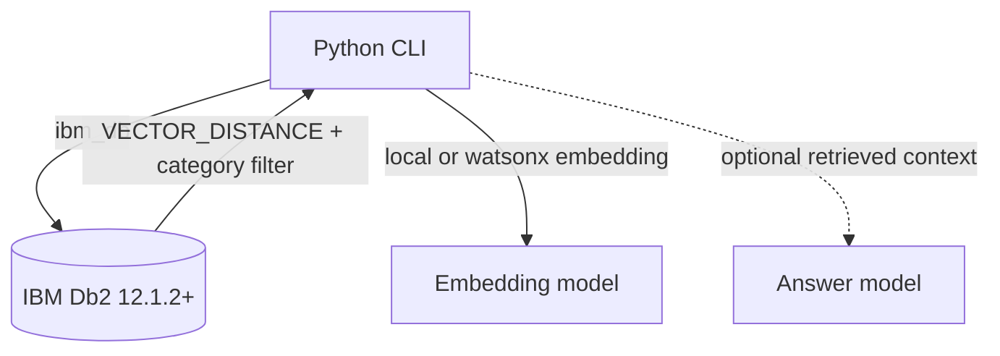

# System Architecture

## Overview

Db2 Support RAG keeps the knowledge base and nearest-neighbour retrieval in IBM Db2. A small Python CLI handles ingestion and query orchestration; an optional answer model can consume only the rows returned by Db2.



## Components

1. **CLI layer:** `seed.py` creates the table and inserts articles; `query.py` accepts a question and optional category.
2. **Embedding layer:** `db2_support.embed()` provides a deterministic offline baseline. Production deployments can swap in a managed embedding model.
3. **Db2 layer:** `db2_support.py` uses `ibm_db` connection APIs, bound parameters, a `VECTOR(8, FLOAT32)` column, and `VECTOR_DISTANCE(..., COSINE)`.
4. **Answer layer:** optional and intentionally outside the database boundary; it receives only retrieved context.

## Data Flow

1. The seed command creates `DB2SUPPORT.SUPPORT_ARTICLES` and stores support articles with embeddings.
2. A user question is converted into an embedding vector.
3. Db2 filters by category, computes cosine distance, sorts, and returns the top five rows.
4. The CLI prints evidence. A future LLM adapter can summarize those rows while preserving source titles.

## Db2 Schema

```sql
CREATE TABLE DB2SUPPORT.SUPPORT_ARTICLES (
    id INTEGER GENERATED ALWAYS AS IDENTITY PRIMARY KEY,
    title VARCHAR(200) NOT NULL,
    body CLOB NOT NULL,
    category VARCHAR(40) NOT NULL,
    embedding VECTOR(8, FLOAT32) NOT NULL
);
```

Retrieval uses a parameterized statement:

```sql
SELECT title, body, category,
       VECTOR_DISTANCE(embedding, VECTOR(?, 8, FLOAT32), COSINE) AS distance
FROM DB2SUPPORT.SUPPORT_ARTICLES
WHERE 1 = 1 AND category = ?
ORDER BY distance
FETCH FIRST 5 ROWS ONLY;
```

## Security

Credentials are read only from environment variables. Questions and category values are bound parameters. `.env.example` contains placeholders only, and no credentials or API tokens are needed for the offline tests.
