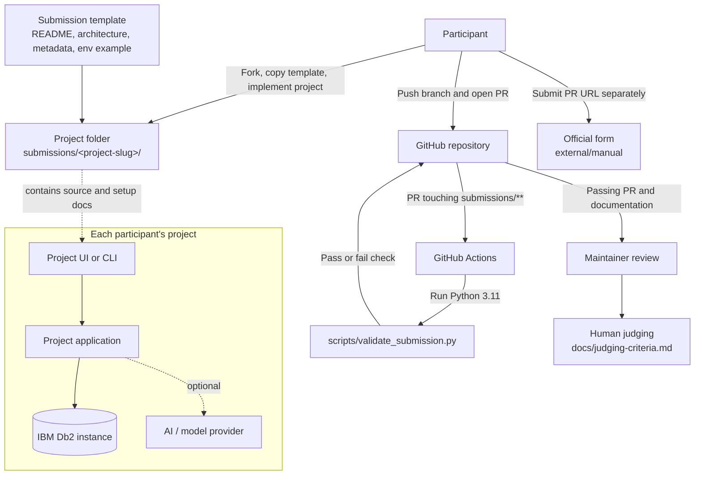

# Repository Architecture and MVP

## Purpose and scope

This repository is the submission and review hub for the IBM Db2 TechX Summit 2026 hackathon. It is not itself a deployed application and does not run a shared Db2 service. Each participant supplies an independently runnable project under `submissions/<project-slug>/`; that project is responsible for its own Db2 integration.

## Architecture

### Components and responsibilities

| Component | Responsibility |
|---|---|
| `submissions/_template/` | Starter documentation, metadata, environment-variable example, and source/test folders for a participant project. |
| `submissions/<project-slug>/` | Isolated deliverable for one team. Its README and architecture document explain how to install, run, and verify its Db2-backed project. |
| `scripts/validate_submission.py` | Standard-library Python checks for required files, slug and metadata consistency, and certain secret-bearing file names/extensions. |
| `.github/workflows/validate-submission.yml` | Runs the validator on pull requests to `main` that change submissions, the workflow, or validation scripts. |
| Maintainers and judges | Review the PR and evaluate the project against the rubric in `docs/judging-criteria.md`. |
| Official submission form | Captures the PR URL outside GitHub; the current repository docs identify this as a separate required step. |

### Submission and review flow

1. A participant copies the template into a new kebab-case folder and implements their project there.
2. The participant documents setup, Db2 use, metadata, and configuration, then pushes a branch and opens a PR.
3. GitHub Actions runs the submission validator. The check currently validates every non-template submission folder, rather than only the folder changed by the PR.
4. Maintainers review a passing PR. Judges assess the working project using the published 100-point rubric.
5. The participant submits the PR URL through the official form. That step is currently outside the automated GitHub workflow.

## MVP

### MVP goal

Let a participant submit one reproducible Db2-backed project, give maintainers a reliable minimum automated quality gate, and give judges enough evidence to evaluate it.

### MVP scope

1. **One isolated project per submission:** a new `submissions/<project-slug>/` folder based on the template.
2. **Reproducible project handoff:** README with prerequisites and run/test steps, architecture and Db2 data flow, valid `submission.json`, and `.env.example` with placeholders.
3. **Functional Db2 evidence:** the project actually connects to IBM Db2 and performs a documented operation; a prose-only Db2 mention is insufficient.
4. **Automated PR gate:** enforce folder naming, required files, metadata shape and consistency, and basic committed-secret checks.
5. **Human review and judging:** maintainers verify the project and its Db2 evidence; judges score it with the existing rubric.
6. **Submission completion:** participant submits the PR URL through the official form.

### Already present

- Template and per-project submission layout.
- Submission guide, PR template, metadata example, and judging rubric.
- A Python validator and a GitHub Actions workflow that invokes it on relevant pull requests.
- Separate documentation for the required PR-URL form step.

### Gaps to close for a dependable MVP

- The validator does not execute submitted projects or establish that a Db2 connection and operation work. Keep this as an explicit review/demo requirement unless a safe, standardized test environment is introduced.
- The current secret check rejects selected file names and extensions, but does not scan file contents for credentials.
- The validator currently checks all non-template submissions on each matching PR, which can make an unrelated pre-existing failure block a new submission.
- The official form URL remains a placeholder in repository documentation; the organizers must supply and verify the live URL.

## Out of scope for the MVP

- A custom submission website, account system, or database for the hub.
- Automatic deployment, scoring, or acceptance of participant projects.
- A shared Db2 instance or a single mandated application framework.
- Mandatory AI/LLM usage; it is optional and should remain project-specific.
