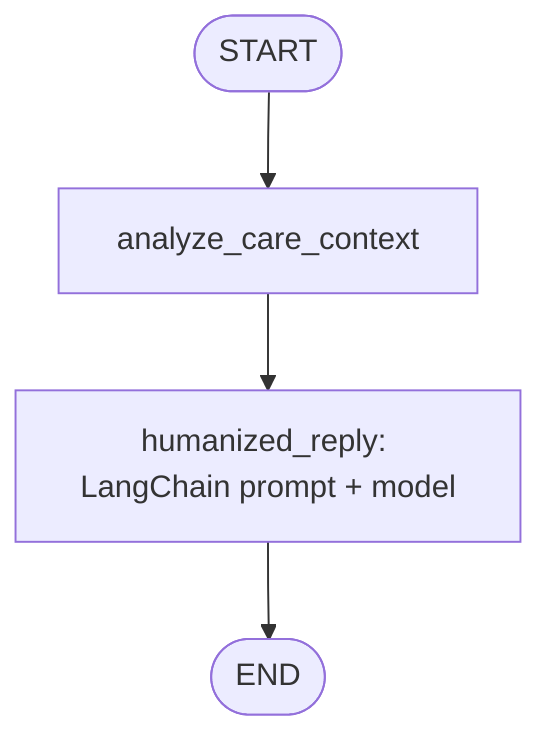

# Aethel architecture and Db2 integration

## Components

- **Frontend:** Jinja2-rendered HTML, CSS, and browser JavaScript served by FastAPI.
- **API:** FastAPI validates profile, reminder, chat, and community requests. A signed `aethel_session` cookie scopes private records to one browser session.
- **Persistence:** `Db2Store` uses the IBM `ibm_db_dbi` driver and parameterized SQL. The default schema contains four Aethel tables.
- **Agentic workflow:** LangGraph composes a `CompanionState` graph. `analyze_care_context` classifies the user's current intent into a bounded care context; `humanized_reply` uses LangChain's prompt/model/parser chain to generate a supportive response.
- **Model provider:** `ChatOpenAI` uses the configured OpenAI-compatible model. The API persists both sides of each chat turn through the same storage adapter.

## End-to-end Db2 data flow

1. Browser requests `/api/status`; FastAPI creates or resumes the signed browser session.
2. The API passes the session identifier to `Db2Store`.
3. Profile preferences are inserted/updated in `AETHEL_PROFILE`.
4. User-authored reminders are inserted in `AETHEL_TASK`; due reminders are claimed once by setting `NOTIFIED_AT`, and completion updates `STATUS`.
5. For chat, FastAPI loads the profile and recent conversation history from Db2, passes them into the LangGraph state, then writes the user and assistant messages to `AETHEL_LOG`.
6. Public community notes are read from and written to `AETHEL_REVIEW`.

All SQL values are bound as parameters (`?`) rather than interpolated into SQL strings.

## Db2 tables

| Table | Purpose | Key fields |
|---|---|---|
| `AETHEL_PROFILE` | User preferences | `SESSION_ID` primary key, display name, IANA time zone, check-in preference |
| `AETHEL_TASK` | User-authored reminders | `TASK_ID` primary key, session ID, type, description, due timestamp, status, notified timestamp |
| `AETHEL_LOG` | Conversation history | Identity `LOG_ID`, session ID, speaker, message, created timestamp |
| `AETHEL_REVIEW` | Public community notes | `REVIEW_ID` primary key, session ID, display name, message, created timestamp |

## Agent graph

The graph uses the profile and recent conversation history fetched by the API. The current graph is a bounded, two-node conversational workflow, not an autonomous multi-tool agent. It does not diagnose, prescribe, select medicines, or claim that a reminder was acted on.

## Storage modes

- **Db2 mode:** `REQUIRE_DB2=true`; startup fails if Db2 is not configured, reachable, or initialized. Use this mode for the hackathon evidence and final demo.
- **Local development fallback:** `REQUIRE_DB2=false`; if Db2 is unavailable, in-memory storage is used. This mode is for UI development only, is not durable, and must not be presented as proof of Db2 integration.

## Operational limitations

The browser polls due reminders every 30 seconds while the Companion page is open. There is no background delivery when the tab is closed. Session cookies are not user accounts. Community notes are public. This prototype is not a medical device or emergency service.
