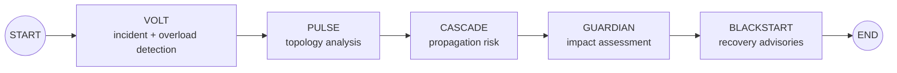
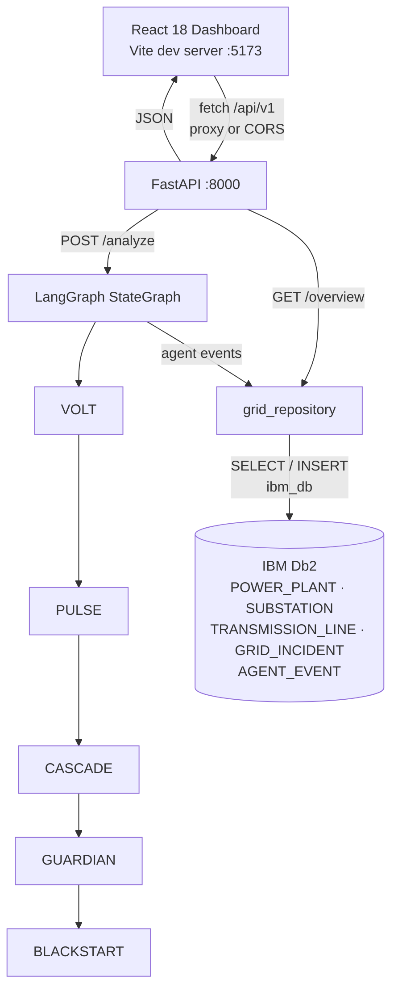
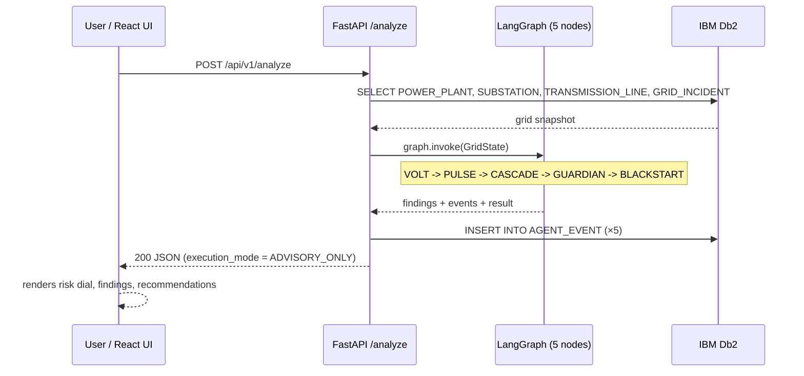
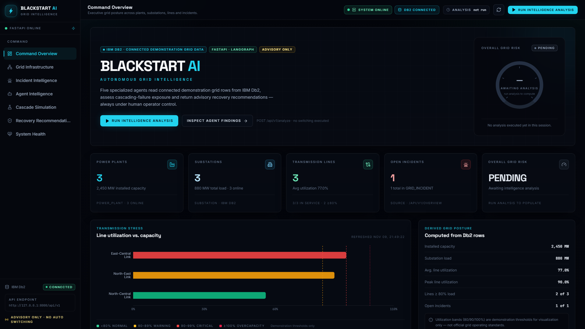
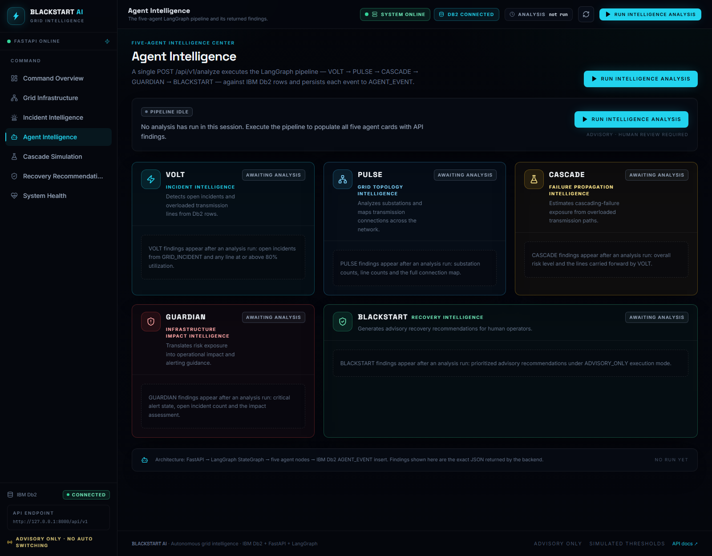
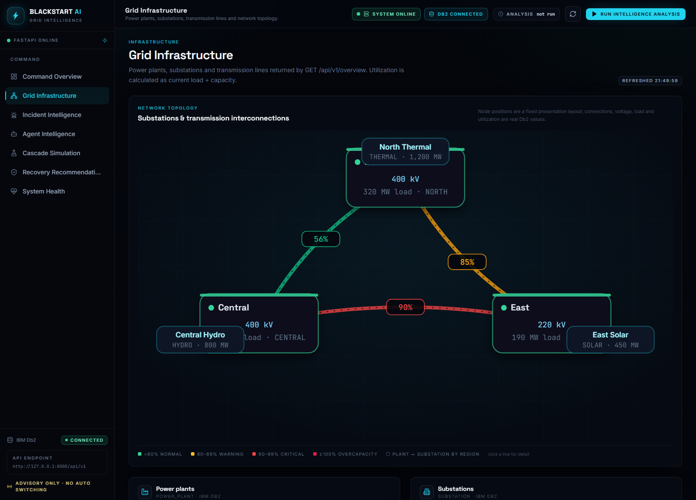
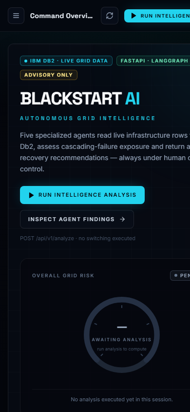

# BLACKSTART AI

> **One-Line Pitch:** An autonomous power-grid intelligence copilot — five LangGraph agents (VOLT → PULSE → CASCADE → GUARDIAN → BLACKSTART) read IBM Db2 grid telemetry and return overload, cascade-risk, and recovery findings in **advisory-only** mode.


---

## Table of Contents
- [Problem Statement](#problem-statement)
- [Solution Overview](#solution-overview)
- [IBM Db2 Integration](#ibm-db2-integration)
- [AI / LLM Architecture](#ai--llm-architecture)
- [Tech Stack](#tech-stack)
- [Prerequisites](#prerequisites)
- [Setup & Installation](#setup--installation)
- [Configuration](#configuration)
- [Running the Project](#running-the-project)
- [API Reference](#api-reference)
- [Testing & Verification](#testing--verification)
- [Architecture & Data Flow](#architecture--data-flow)
- [Project Structure](#project-structure)
- [Screenshots & Demo](#screenshots--demo)
- [Demonstration & Safety Notice](#demonstration--safety-notice)
- [Known Limitations & Future Roadmap](#known-limitations--future-roadmap)

---

## Problem Statement

Power-grid operators face cascading failures that propagate in seconds: one overloaded transmission line trips, sheds load onto neighbors, and can black out regions before humans can react. Existing tooling is either a raw SCADA/EMS console that shows numbers without synthesis, or heavyweight simulation packages that require offline studies.

**Who it is for:** grid operators, reliability engineers, and utility data teams evaluating how an AI copilot can sit *in front of* — never *instead of* — human judgment.

**Why existing tooling is insufficient:** operators must mentally correlate incidents, line utilization, and topology across several screens. BLACKSTART AI correlates them automatically in one deterministic, auditable pipeline and returns ranked findings plus advisory recommendations, with every agent event persisted to IBM Db2 for audit.

---

## Solution Overview

BLACKSTART AI is a full-stack application: a React dashboard over a FastAPI backend, orchestrated by a **five-agent LangGraph pipeline**, persisted in **IBM Db2**.

**Core features (seven dashboard pages):**

| Page | Route | What it does |
|---|---|---|
| Command Overview | `/` | Executive posture: plants, substations, lines, incidents, overall risk dial, KPI cards |
| Grid Infrastructure | `/infrastructure` | Power plants, substations, transmission lines + SVG network topology with interactive nodes |
| Incident Intelligence | `/incidents` | Open incidents read directly from Db2 `GRID_INCIDENT` |
| Agent Intelligence | `/agents` | The five-agent pipeline with per-agent findings, roles, and event history |
| Cascade Simulation | `/cascade` | Transmission utilization bands + demonstration cascade risk (**Demonstration only**) |
| Recovery Recommendations | `/recovery` | Advisory recommendations requiring human operator review (**Advisory only**) |
| System Health | `/health` | FastAPI status, IBM Db2 connectivity, API latency, analysis history |

**Cross-cutting:**
- `POST /api/v1/analyze` runs the whole agent pipeline and writes one `AGENT_EVENT` row per agent to Db2.
- Dashboard is responsive (390 px → 1920 px), zero console errors, no horizontal overflow on any route.
- Everything is labeled honestly: the grid dataset is synthetic demonstration data, cascade output is `DEMONSTRATION_ONLY`, recommendations are `ADVISORY_ONLY`.

---

## IBM Db2 Integration

- **Db2 Edition & Environment:** Local IBM Db2 development instance on `127.0.0.1:50000` (the submission runs against a WSL-forwarded local Db2; any reachable Db2 instance works).
- **Connector / Driver:** [`ibm_db`](https://pypi.org/project/ibm-db/) `3.3.0` (pure IBM C driver bindings) — no ORM; explicit SQL in the repository layer.
- **Configuration:** single connection string `DB2_DSN` read at runtime by `pydantic-settings` from `src/backend/.env` (never committed).

### Schema / Data Models

Five tables, queried/written by `app/database/repositories/grid_repository.py`:

| Table | Purpose | Columns (as read by the app) |
|---|---|---|
| `POWER_PLANT` | Generation assets | `plant_id, plant_name, plant_type, capacity_mw, status, region` |
| `SUBSTATION` | Substations | `substation_id, substation_name, voltage_kv, load_mw, status, region` |
| `TRANSMISSION_LINE` | Lines + loading | `line_id, line_name, from_substation, to_substation, capacity_mw, current_load_mw, status` |
| `GRID_INCIDENT` | Open incidents | `incident_id, incident_type, severity, location, description, status, detected_at` |
| `AGENT_EVENT` | Agent audit log | `agent_name, event_type, finding, confidence` |

### Key Queries & Operations

```sql
-- Read path: every analysis starts with four full-table reads
SELECT * FROM POWER_PLANT;
SELECT * FROM SUBSTATION;
SELECT * FROM TRANSMISSION_LINE;
SELECT * FROM GRID_INCIDENT;

-- Write path: one audit row per agent per analysis run
INSERT INTO AGENT_EVENT (AGENT_NAME, EVENT_TYPE, FINDING, CONFIDENCE)
VALUES (?, ?, ?, ?);
```

Each `SELECT` currently opens and closes its own `ibm_db` connection (`fetch_all`), which is simple and robust but adds latency — see [Known Limitations](#known-limitations--future-roadmap).

---

## AI / LLM Architecture

- **Framework:** **LangGraph** `1.2.20` (LangChain ecosystem) — a compiled `StateGraph` with a typed `GridState`.
- **Pipeline:** deterministic, sequential, fully auditable:



| Agent | Node function | What it computes | Event type |
|---|---|---|---|
| **VOLT** | `volt()` | Open incidents; lines at **≥ 80 %** utilization | `INCIDENT_DETECTION` |
| **PULSE** | `pulse()` | Substation/line counts, online status, line connections | `TOPOLOGY_ANALYSIS` |
| **CASCADE** | `cascade()` | Risk = `HIGH` if any line ≥ **90 %**, `MODERATE` if any overloaded, else `LOW` | `CASCADE_SIMULATION` |
| **GUARDIAN** | `guardian()` | Critical alert flag + operator assessment text | `INFRASTRUCTURE_IMPACT` |
| **BLACKSTART** | `blackstart()` | Ranked recommendations + final `ADVISORY_ONLY` result | `RECOVERY_RECOMMENDATION` |

- **Model provider:** none in the request path — **this version runs no LLM calls**. The analysis is deterministic rule-based reasoning over Db2 rows, so results are reproducible, testable, and free of hallucination risk. `.env.example` carries optional `WATSONX_*` / `OPENAI_*` placeholders for future augmentation; they are unused today.
- **Context flow:** Db2 rows → `GridState.grid` → each node appends `findings` + `events` → `BLACKSTART` emits the final result → all events are persisted to `AGENT_EVENT`.

---

## Tech Stack

| Layer | Technology (verified versions) |
|---|---|
| Language / runtime | Python **3.12.10**, Node.js (frontend toolchain) |
| Backend | FastAPI **0.162.2**, Uvicorn **0.54.0**, Pydantic **2.14.3**, pydantic-settings **2.16.2** |
| Database | IBM Db2 via **ibm_db 3.3.0** |
| AI orchestration | **LangGraph 1.2.20**, langchain-core **1.7.6** (LangChain ecosystem) |
| Frontend | React **18.3.1**, React Router **6.28.1**, Recharts **2.15.0**, lucide-react **0.469.0** |
| Build tooling | Vite **6.0.11**, TypeScript **5.7.3**, Tailwind CSS **3.4.17** |
| Verification | `tsc --noEmit`, `vite build`, HTTP smoke tests, headless-Chrome E2E audit |

---

## Prerequisites

- **Python 3.11+** (verified on **3.12.10**)
- **Node.js 18+** with npm
- A reachable **IBM Db2** instance (local, Docker, or IBM Cloud) with the five tables above
- Windows PowerShell, macOS, or Linux shell (commands below shown for **PowerShell**)

---

## Setup & Installation

### 1. Backend

```powershell
# From the submission root
cd "src\backend"

# Create and activate a virtual environment
python -m venv .venv
.\.venv\Scripts\Activate.ps1        # macOS/Linux: source .venv/bin/activate

# Install pinned dependencies
pip install -r requirements.txt
```

### 2. Frontend

```powershell
cd "..\frontend"
npm install
```

---

## Configuration

Copy the example env files and fill in **your own** values:

```powershell
# From the submission root
Copy-Item .env.example .\src\backend\.env
Copy-Item .\src\frontend\.env.example .\src\frontend\.env   # optional; defaults work locally
```

`src/backend/.env` (placeholders only — real values stay on your machine):

```ini
# The one variable the backend actually reads (ibm_db DSN format):
DB2_DSN=DATABASE=<db>;HOSTNAME=<host>;PORT=<port>;PROTOCOL=TCPIP;UID=<user>;PWD=<password>;

# Optional LLM keys — unused by the current deterministic pipeline
WATSONX_APIKEY=
WATSONX_PROJECT_ID=
OPENAI_API_KEY=
```

`src/frontend/.env`:

```ini
# Defaults to http://127.0.0.1:8000/api/v1 — only change it if your backend is elsewhere
VITE_API_BASE_URL=http://127.0.0.1:8000/api/v1
```

> **Security:** never commit `.env` or real credentials. `.env` is git-ignored; `.env.example` contains placeholders only.

---

## Running the Project

Open **two terminals** from the submission root.

**Terminal 1 — FastAPI backend** (port `8000`):

```powershell
cd "src\backend"
.\.venv\Scripts\python.exe -m uvicorn app.main:app --host 127.0.0.1 --port 8000
```

**Terminal 2 — React dashboard** (port `5173`):

```powershell
cd "src\frontend"
npm run dev
```

Open **http://localhost:5173**. The Vite dev server proxies `/api` → `http://127.0.0.1:8000` (or set `VITE_API_BASE_URL` explicitly).

Quick sanity checks:

```powershell
curl.exe http://127.0.0.1:8000/api/v1/health
curl.exe http://127.0.0.1:8000/api/v1/db2/status
```

---

## API Reference

Interactive Swagger UI: **http://127.0.0.1:8000/docs**

### `GET /` — service banner

```json
{"name": "BLACKSTART AI", "status": "online", "database": "IBM Db2"}
```

### `GET /api/v1/health` — liveness

```json
{"status": "healthy", "application": "BLACKSTART AI", "version": "1.0.0"}
```

### `GET /api/v1/db2/status` — Db2 connectivity

```json
{"connected": true, "message": "IBM Db2 connection successful."}
```

### `GET /api/v1/overview` — full grid snapshot

Returns all rows from the four read tables (real response abridged):

```json
{
  "plants": [
    {"plant_id": 1, "plant_name": "North Thermal Plant", "plant_type": "THERMAL", "capacity_mw": "1200.00", "status": "ONLINE", "region": "NORTH"},
    {"plant_id": 2, "plant_name": "East Solar Plant", "plant_type": "SOLAR", "capacity_mw": "450.00", "status": "ONLINE", "region": "EAST"},
    {"plant_id": 3, "plant_name": "Central Hydro Plant", "plant_type": "HYDRO", "capacity_mw": "800.00", "status": "ONLINE", "region": "CENTRAL"}
  ],
  "substations": [ "...3 rows: North / East / Central Grid Substation..." ],
  "lines": [
    {"line_id": 1, "line_name": "North-East Link", "from_substation": 1, "to_substation": 2, "capacity_mw": "400.00", "current_load_mw": "340.00", "status": "ONLINE"},
    {"line_id": 2, "line_name": "East-Central Link", "from_substation": 2, "to_substation": 3, "capacity_mw": "350.00", "current_load_mw": "315.00", "status": "ONLINE"},
    {"line_id": 3, "line_name": "North-Central Link", "from_substation": 1, "to_substation": 3, "capacity_mw": "500.00", "current_load_mw": "280.00", "status": "ONLINE"}
  ],
  "incidents": [
    {"incident_id": 1, "incident_type": "OVERLOAD", "severity": "HIGH", "location": "East Grid Substation", "description": "Demonstration incident: transmission load approaching capacity.", "status": "OPEN", "detected_at": "2026-11-09T14:00:03.791752"}
  ]
}
```

### `POST /api/v1/analyze` — run the five-agent pipeline

```powershell
curl.exe -X POST http://127.0.0.1:8000/api/v1/analyze
```

Real response (abbreviated to the keys that matter):

```json
{
  "system": "BLACKSTART AI",
  "overall_risk": "HIGH",
  "agents_executed": ["VOLT", "PULSE", "CASCADE", "GUARDIAN", "BLACKSTART"],
  "findings": {
    "volt": {
      "open_incidents": [
        {"incident_id": 1, "incident_type": "OVERLOAD", "severity": "HIGH", "location": "East Grid Substation", "status": "OPEN", "detected_at": "2026-11-09T14:00:03.791752", "description": "Demonstration incident: transmission load approaching capacity."}
      ],
      "overloaded_lines": [
        {"line": "North-East Link", "utilization": 85.0},
        {"line": "East-Central Link", "utilization": 90.0}
      ]
    },
    "pulse": {
      "substation_count": 3,
      "transmission_line_count": 3,
      "online_substations": 3,
      "line_connections": [
        {"line": "North-East Link", "from": 1, "to": 2},
        {"line": "East-Central Link", "from": 2, "to": 3},
        {"line": "North-Central Link", "from": 1, "to": 3}
      ]
    },
    "cascade": {
      "risk_level": "HIGH",
      "overloaded_line_count": 2,
      "at_risk_lines": [
        {"line": "North-East Link", "utilization": 85.0},
        {"line": "East-Central Link", "utilization": 90.0}
      ],
      "simulation_mode": "DEMONSTRATION_ONLY"
    },
    "guardian": {
      "risk_level": "HIGH",
      "open_incident_count": 1,
      "critical_alert": true,
      "assessment": "Immediate operator review recommended."
    }
  },
  "recommendations": [
    "Ask grid operators to inspect high-utilization transmission lines.",
    "Review load distribution and available reserve capacity.",
    "Escalate for immediate human operator assessment.",
    "Do not execute switching or recovery actions automatically."
  ],
  "execution_mode": "ADVISORY_ONLY",
  "data_source": "IBM Db2"
}
```

Side effects: five rows are inserted into `AGENT_EVENT` (one per agent) on every successful run.

Errors: `GET /overview` → `503` if Db2 is unreachable; `POST /analyze` → `500` on pipeline/DB failure.

---

## Testing & Verification

### Static checks (frontend)

```powershell
cd "src\frontend"
npm run typecheck      # tsc --noEmit — must exit clean
npm run build          # tsc --noEmit && vite build — must exit 0
```

### HTTP smoke tests (backend must be running)

```powershell
curl.exe http://127.0.0.1:8000/api/v1/health
curl.exe http://127.0.0.1:8000/api/v1/db2/status     # expect "connected": true
curl.exe http://127.0.0.1:8000/api/v1/overview
curl.exe -X POST http://127.0.0.1:8000/api/v1/analyze
```

Expected: `healthy` / `connected: true` / grid rows / `execution_mode: "ADVISORY_ONLY"` with all five agents listed.

> Note: `GET /overview` and `POST /analyze` each open fresh Db2 connections and can take **~10 s** locally — the dashboard waits up to 30 s. Give slow requests time before retrying (rapid hard-reloads can queue behind a sync Db2 call).

### Browser audit (performed during development)

Headless-Chrome checks confirmed: 7/7 routes render, SPA navigation works, run-analysis flow completes, console error count = 0, no horizontal overflow at 390 px / 1366 px / 1920 px.

The unit-test directory `tests/` is scaffolded; the current verification layer is the type-check + build + HTTP suite above.

---

## Architecture & Data Flow

### Component diagram



### Data-flow sequence



---

## Project Structure

```
Blackstart AI/
├── README.md                     # this file
├── architecture.md               # system architecture doc
├── submission.json               # competition submission metadata
├── .env.example                  # placeholder environment template
├── docs/
│   └── screenshots/              # dashboard screenshots embedded below
├── tests/                        # unit-test scaffold
├── scripts/                      # helper scripts (scaffold)
└── src/
    ├── backend/
    │   ├── requirements.txt      # pinned Python dependencies
    │   └── app/
    │       ├── main.py           # FastAPI app + CORS + / , /db2/status
    │       ├── api/v1/
    │       │   ├── health.py     # GET /health
    │       │   └── analysis.py   # GET /overview, POST /analyze
    │       ├── orchestration/
    │       │   └── graph.py      # LangGraph StateGraph + 5 agent nodes
    │       ├── agents/           # agent packages (volt pulse cascade guardian blackstart)
    │       ├── database/repositories/
    │       │   └── grid_repository.py   # SELECT ×4 + AGENT_EVENT insert
    │       ├── integrations/db2/client.py  # ibm_db connection + status probe
    │       ├── core/config.py    # pydantic-settings (DB2_DSN, app name/version)
    │       ├── schemas/  services/  models/  monitoring/   # extension scaffolds
    │       └── simulation/       # cascade-simulation scaffolds
    └── frontend/
        ├── package.json  vite.config.ts  tsconfig.json  tailwind.config.js
        ├── index.html
        └── src/
            ├── pages/            # 7 routes (overview, infrastructure, incidents,
            │                     #   agents, cascade, recovery, health, 404)
            ├── components/
            │   ├── layout/       # AppShell, Sidebar, TopBar
            │   ├── dashboard/    # MetricCard, RiskDial
            │   ├── agents/       # AgentCard, AgentPipelineStrip
            │   ├── grid/         # NetworkTopology (SVG)
            │   ├── visualizations/ # LineUtilizationChart (Recharts)
            │   └── ui/           # shared bits + loading/error states
            ├── services/api.ts   # typed fetch client (30 s timeout)
            ├── state/DashboardContext.tsx
            ├── types/api.ts
            └── lib/              # routes, formatting helpers
```

---

## Screenshots & Demo

Captured from the running application:

| Screenshot | Path |
|---|---|
| Command Overview (desktop) | `docs/screenshots/command-overview.png` |
| Command Overview (mobile, 390 px) | `docs/screenshots/command-overview-mobile.png` |
| Agent Intelligence | `docs/screenshots/agent-intelligence.png` |
| Grid Infrastructure | `docs/screenshots/grid-infrastructure.png` |









Swagger UI: http://127.0.0.1:8000/docs (while the backend is running).

---

## Demonstration & Safety Notice

- **Synthetic dataset.** All plants, substations, lines, and incidents are demonstration records. The dashboard labels them **“connected demonstration grid data”** — not a live utility feed.
- **`DEMONSTRATION_ONLY` cascade.** Cascade risk is an illustrative computation for the demo dataset, not a grid-certified stability study.
- **`ADVISORY_ONLY` recovery.** Recommendations always require human operator review. The pipeline explicitly includes: *“Do not execute switching or recovery actions automatically.”*
- **No autonomous control.** This application cannot and does not issue switching commands, protection actions, or any control-plane operations.
- **No live-utility claims.** Nothing here should be used for real grid operation without domain validation, hardening, and utility-grade certification.

---

## Known Limitations & Future Roadmap

**Current limitations**
- `GET /overview` opens **four sequential Db2 connections** (one per table); a local run takes ~10 s and the synchronous `ibm_db` calls block the uvicorn event loop during that time.
- Deterministic rule-based agents only — no LLM inference in the request path (watsonx/OpenAI env keys are placeholders, unused).
- Demo thresholds (80 % / 90 % utilization) are tuned for the small demonstration dataset, not production settings.
- `CORS allow_origins=["*"]` for local development; not hardened for public deployment.
- No authentication/authorization on the API.
- Unit-test suite is scaffolded (`tests/`), not populated.

**Roadmap**
- Reuse pooled Db2 connections and move analysis to `run_in_threadpool` (or async driver) to cut latency and unblock the event loop.
- Optional watsonx.ai LLM enrichment of findings (human-readable narrative), keeping the deterministic core as ground truth.
- Time-series trend storage in Db2 and historical risk charts.
- Auth (API keys / OIDC), rate limiting, and a locked-down CORS policy.
- Parallel LangGraph node execution for independent branches (VOLT ∥ PULSE).
- Populated pytest suite + CI workflow.

---

## Credits

Built as a full-stack demonstration of LangGraph agent orchestration on IBM Db2 with a React operations dashboard. Dependencies: FastAPI, LangGraph, ibm_db, React, Recharts, Tailwind CSS (see `src/backend/requirements.txt` and `src/frontend/package.json` for exact versions).
