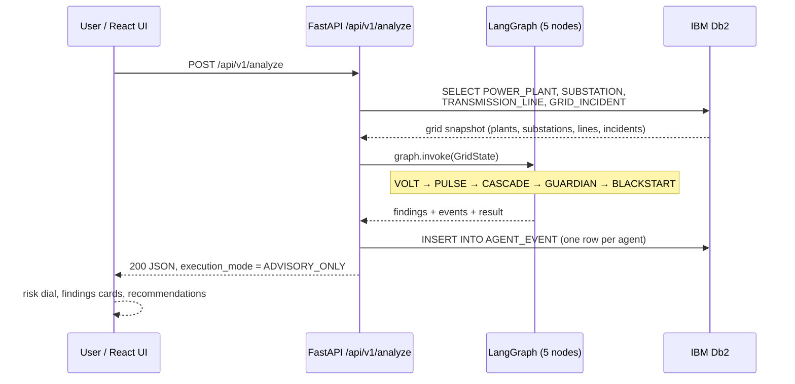

# BLACKSTART AI — System Architecture

## Overview

BLACKSTART AI is a full-stack grid-intelligence copilot: a React dashboard calls a FastAPI backend, which reads IBM Db2 grid telemetry and runs a five-agent **LangGraph** pipeline that returns advisory overload, cascade-risk, and recovery findings. Every agent run is persisted to Db2 for audit.

---

## Architecture Diagram

```mermaid
graph TD
    subgraph Client["Client layer"]
        UI[React 18 + TypeScript dashboard<br/>Vite dev server :5173]
    end

    subgraph Backend["Application layer — FastAPI :8000"]
        API[app/main.py<br/>CORS + routers]
        H[GET /health]
        O[GET /overview]
        A[POST /analyze]
        G[LangGraph StateGraph<br/>app/orchestration/graph.py]
    end

    subgraph Agents["Five agent nodes (sequential)"]
        V[VOLT] --> P[PULSE] --> C[CASCADE] --> GU[GUARDIAN] --> B[BLACKSTART]
    end

    subgraph Data["IBM Db2"]
        DB[(POWER_PLANT · SUBSTATION<br/>TRANSMISSION_LINE · GRID_INCIDENT<br/>AGENT_EVENT)]
    end

    UI -->|/api/v1 (proxy or CORS)| API
    API --> H
    API --> O -->|SELECT ×4| DB
    API --> A --> G
    G --> V
    G -->|INSERT AGENT_EVENT ×5| DB
    API -->|JSON result| UI
```

**Key source files**

| Concern | File |
|---|---|
| FastAPI app, CORS, root/status routes | `src/backend/app/main.py` |
| Health + overview + analyze endpoints | `src/backend/app/api/v1/health.py`, `analysis.py` |
| LangGraph workflow and agent logic | `src/backend/app/orchestration/graph.py` |
| Db2 queries (SELECT ×4, AGENT_EVENT insert) | `src/backend/app/database/repositories/grid_repository.py` |
| `ibm_db` connection + status probe | `src/backend/app/integrations/db2/client.py` |
| Settings (`DB2_DSN`, app name/version) | `src/backend/app/core/config.py` |
| Typed API client (30 s timeout) | `src/frontend/src/services/api.ts` |
| Dashboard routes (7 pages) | `src/frontend/src/lib/routes.ts` |

---

## Data Flow



1. **Ingestion** — `GET /overview` or `POST /analyze` triggers four full-table reads (`fetch_all`, one connection per table).
2. **Orchestration** — the compiled LangGraph state graph runs the five agents in a fixed sequence; each appends `findings` and an audit `event` to `GridState`.
3. **Persistence** — `save_agent_events` inserts one `AGENT_EVENT` row per agent (`AGENT_NAME, EVENT_TYPE, FINDING, CONFIDENCE`).
4. **Delivery** — the final JSON (`overall_risk`, `findings`, `recommendations`, `execution_mode: ADVISORY_ONLY`, `data_source: IBM Db2`) is returned to the dashboard.

---

## Component Breakdown

1. **Client layer** — React 18 SPA (7 routes): Command Overview, Grid Infrastructure, Incident Intelligence, Agent Intelligence, Cascade Simulation, Recovery Recommendations, System Health. Typed fetch client with 30 s timeout; Recharts + SVG topology visualizations.
2. **Application layer** — FastAPI `0.162.2` served by Uvicorn; two routers under `/api/v1`; CORS open for local development.
3. **Agent orchestration** — LangGraph `1.2.20` `StateGraph` (`GridState` typed dict). Deterministic rule-based nodes (no LLM calls in the request path); thresholds 80 % / 90 % utilization.
4. **Database layer** — IBM Db2 via `ibm_db` `3.3.0`; five tables; explicit SQL, parameterized inserts, no ORM.

---

## IBM Db2 Schema & Storage Design

| Table | Columns (as read by the app) | Role |
|---|---|---|
| `POWER_PLANT` | `plant_id, plant_name, plant_type, capacity_mw, status, region` | Generation assets |
| `SUBSTATION` | `substation_id, substation_name, voltage_kv, load_mw, status, region` | Substations |
| `TRANSMISSION_LINE` | `line_id, line_name, from_substation, to_substation, capacity_mw, current_load_mw, status` | Lines + loading |
| `GRID_INCIDENT` | `incident_id, incident_type, severity, location, description, status, detected_at` | Open incidents |
| `AGENT_EVENT` | `agent_name, event_type, finding, confidence` | Agent audit log |

```sql
-- Read path (app/repository layer)
SELECT * FROM POWER_PLANT;
SELECT * FROM SUBSTATION;
SELECT * FROM TRANSMISSION_LINE;
SELECT * FROM GRID_INCIDENT;

-- Write path (one audit row per agent per analysis run)
INSERT INTO AGENT_EVENT (AGENT_NAME, EVENT_TYPE, FINDING, CONFIDENCE)
VALUES (?, ?, ?, ?);
```

---

## Security & Secrets Management

- All connection secrets live in `src/backend/.env` (git-ignored) and are read at runtime by `pydantic-settings` (`DB2_DSN`); `.env.example` ships placeholders only.
- `AGENT_EVENT.FINDING` inserts are parameterized (`ibm_db.prepare` / `execute`) with a 1000-character cap.
- No credentials appear in the repository, README, or submission metadata.
- Known gaps for production: CORS is `allow_origins=["*"]`, no authn/authz, no rate limiting — documented in the README roadmap.
