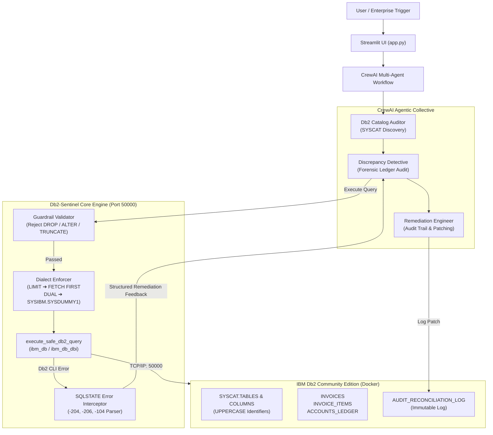

# 🛡️ Db2-Sentinel | IBM Db2 TechX Db2Hack 2026

**Autonomous Enterprise Database Audit & Self-Correcting Data Reconciliation Agent**  
*Principal IBM Db2 Architecture & Agentic AI Pair Programming Framework*

---

## 📌 Executive Summary

**Db2-Sentinel** is an autonomous database auditing, inspection, and reconciliation system engineered specifically for **IBM Db2 Community Edition (v11.5+)**. Built with **Python 3.11**, **ibm_db**, **ibm_db_sa**, **LangChain**, **CrewAI**, and **Streamlit**, it safeguards relational enterprise financial databases through:

1. **Strict Db2 Dialect Enforcers & Catalog Introspection:** Enforces UPPERCASE identifiers against `SYSCAT.TABLES` and `SYSCAT.COLUMNS`, transpile non-Db2 clauses (`LIMIT` → `FETCH FIRST n ROWS ONLY`), and routes scalar dual queries to `SYSIBM.SYSDUMMY1`.
2. **Immutable Read-Only Inspection Guardrails:** Prohibits destructive DDL (`DROP`, `ALTER`, `TRUNCATE`) to ensure non-invasive schema inspection.
3. **Closed-Loop SQLSTATE Self-Correction:** Intercepts native Db2 CLI driver errors (e.g., `SQL0204N` / `-204` undefined name, `SQL0206N` / `-206` column not found, `SQL0104N` / `-104` syntax error) and feeds exact remediation directives back to the LLM agent to iteratively heal the SQL.
4. **Idempotent Audit Ledger Trail:** Persists forensic discrepancies and proposed remediation patches into `AUDIT_RECONCILIATION_LOG`.

---

## 🏛️ System Architecture



---

## ⚡ Key Dialect Constraints & Guardrails

| Constraint | Requirement | Db2-Sentinel Implementation |
| :--- | :--- | :--- |
| **Catalog Identifiers** | Must query `SYSCAT.TABLES` and `SYSCAT.COLUMNS` with uppercase names | All table and schema names normalized via `.strip().upper()`, preventing case-sensitivity mismatch. |
| **Row Pagination** | Prohibit `LIMIT n`; require `FETCH FIRST n ROWS ONLY` | `Db2DialectEnforcer` automatically transpiles `LIMIT n` and `LIMIT n OFFSET m` to Db2 standard clauses. |
| **Scalar / Dual Queries** | Prohibit `FROM DUAL`; require `SYSIBM.SYSDUMMY1` | Transpiles `FROM DUAL` queries to `FROM SYSIBM.SYSDUMMY1`. |
| **Security Guardrails** | Prohibit destructive DDL (`DROP`, `ALTER`, `TRUNCATE`) | Regex validator intercepts commands before execution and returns `GUARDRAIL_VIOLATION`. |
| **Closed-Loop Correction** | Intercept SQLSTATE errors (`42704`, `42703`, `42601`) | Extracts `SQLCODE` and `SQLSTATE`, maps root causes, and generates agent-consumable repair directives. |

---

## 🔄 Closed-Loop SQLSTATE Error Mapping

| Db2 SQLCODE | SQLSTATE | Category | Automated Remediation Feedback |
| :---: | :---: | :--- | :--- |
| **-204** | `42704` | `UNDEFINED_OBJECT` | Table/view not found. Instructs agent to query `SYSCAT.TABLES` with UPPERCASE identifiers and check schema prefix (`DB2INST1`). |
| **-206** | `42703` | `UNDEFINED_COLUMN` | Column name not found in context. Directs agent to query `SYSCAT.COLUMNS` for valid column names and fix aliases. |
| **-104** | `42601` | `SYNTAX_ERROR` | Illegal token (e.g. `LIMIT`, `ILIKE`). Instructs agent to replace `LIMIT` with `FETCH FIRST n ROWS ONLY` and remove non-standard syntax. |
| **-440** | `42884` | `ROUTINE_NOT_FOUND` | Function not found. Guides agent to use IBM Db2 built-in functions (`CONCAT`, `SUBSTR`). |
| **-180** | `22007` | `INVALID_DATETIME` | Datetime syntax error. Guides agent to format as `'YYYY-MM-DD'` or `CURRENT TIMESTAMP`. |
| **-803** | `23505` | `UNIQUE_VIOLATION` | Duplicate key error on primary key. Directs agent to generate unique UUIDs for `AUDIT_ID`. |

---

## 🚀 Zero-Config Quick Start (Local Docker on Port 50000)

### 1. Start IBM Db2 Community Edition
```bash
docker-compose up -d
```
> The container initializes IBM Db2 Community Edition on port `50000` with instance `db2inst1` and database `SENTINEL`.

### 2. Configure Environment
```bash
cp .env.example .env
```
*(Optionally provide your `OPENAI_API_KEY`. If left empty, Db2-Sentinel runs in deterministic high-fidelity simulation mode for instant hackathon demonstrations!)*

### 3. Install Dependencies
```bash
pip install -r requirements.txt
```

### 4. Initialize Database Schema & Anomaly Dataset
```bash
python db/seed_db.py
```
This initializes the following tables in schema `DB2INST1`:
- `ACCOUNTS_LEDGER`
- `INVOICES` (Contains intentional discrepancy on `INV-2026-001`: reported `$1,500.00` vs items `$1,200.00`)
- `INVOICE_ITEMS`
- `AUDIT_RECONCILIATION_LOG`

### 5. Launch the Streamlit Web Application
```bash
streamlit run app.py
```

### 6. Run Test Suite
```bash
python tests/test_db2_sentinel.py
```
Runs 19 automated unit and integration tests verifying guardrails, dialect transpilers, catalog introspection, SQLSTATE parsing, and closed-loop self-correction.

