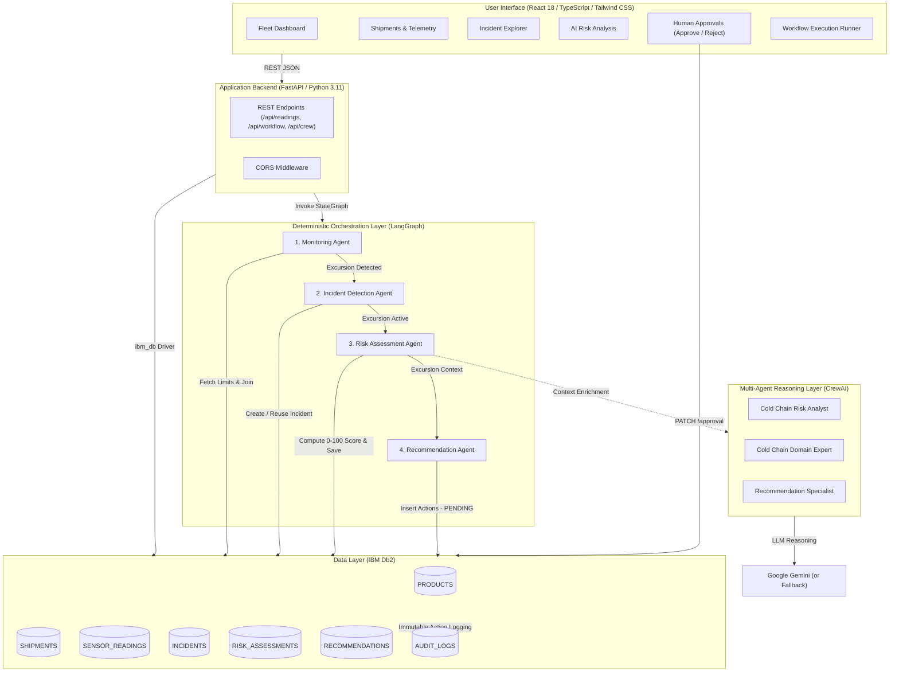

# System Architecture

## Overview
**ColdChain Guardian** is an enterprise-grade agentic AI platform for real-time cold-chain logistics monitoring. The platform pairs **IBM Db2** as the authoritative single source of truth with a dual-layer AI architecture: **LangGraph** for deterministic workflow state orchestration and **CrewAI** for collaborative multi-agent reasoning, fronted by a modern **React + Vite + TypeScript + Tailwind CSS** dashboard for human-in-the-loop decision making.

---

## Architecture Diagram



---

## Component Breakdown

1. **User Interface / Client Layer (React 18 + Vite + Tailwind CSS)**:
   - Modern enterprise dark navy dashboard (`#0a0f1e`).
   - Recharts visual analytics for fleet risk distribution and shipment time-series temperature trends.
   - Interactive human-in-the-loop governance interface to approve or reject remediation actions.
   - Manual workflow runner for ad-hoc sensor reading simulation.

2. **Application Backend Layer (FastAPI + Python 3.11)**:
   - RESTful routing under `/api/products`, `/api/shipments`, `/api/readings`, `/api/incidents`, `/api/recommendations`, `/api/workflow`, and `/api/crew`.
   - Comprehensive CORS configuration for local Vite development.
   - Safe parameterization across all queries using native `ibm_db` driver functions.

3. **Database Layer (IBM Db2)**:
   - Primary data store and single source of truth for all operational records, telemetry, and audit logs.
   - 8 relational tables with IDENTITY columns, primary/foreign key constraints, and performance indexes.
   - Conditional insert logic using `SYSIBM.SYSDUMMY1` to prevent duplicate active incidents or recommendations.

4. **AI & Workflow Orchestration Layer (LangGraph + CrewAI)**:
   - **LangGraph StateGraph:** Manages deterministic agent transitions (`Monitoring` → `Incident` → `Risk Assessment` → `Recommendation`).
   - **CrewAI Multi-Agent Team:** Three collaborative specialist agents (*Risk Analyst*, *Domain Expert*, *Recommendation Specialist*) providing root-cause explanations and mitigation strategies.
   - **Offline / Graceful Fallback:** Operates seamlessly even if LLM API keys are omitted or rate-limited.

---

## Data Flow

```
[IoT Sensor Telemetry]
       │
       ▼ (POST /api/readings/)
[FastAPI Ingestion]
       │
       ├─► (INSERT SENSOR_READINGS) ──► [IBM Db2]
       │
       ▼ (Execute run_workflow)
[LangGraph Workflow]
       │
       ├─► [Monitoring Agent] ──► Query thresholds against [PRODUCTS] in Db2
       │         │
       │         ├── (Normal) ──► Complete (Status: SUCCESS, End)
       │         │
       │         └── (Violation)
       │                  │
       │                  ▼
       │           [Incident Agent] ──► INSERT/REUSE [INCIDENTS]
       │                  │
       │                  ▼
       │           [Risk Assessment Agent] ──► Calculate 0-100 Score & INSERT [RISK_ASSESSMENTS]
       │                  │
       │                  ▼
       │           [Recommendation Agent] ──► Generate Prioritized Actions & INSERT [RECOMMENDATIONS]
       │                  │
       │                  ▼
       │           [CrewAI Team] ──► Collaborative AI Reasoning (Optional Gemini LLM)
       │
       ▼
[React UI] ──► Real-Time Alert & Risk Dashboard
       │
       └─► Logistics Operator Approves/Rejects Action
                 │
                 ▼ (PATCH /api/recommendations/{id}/approval)
            [IBM Db2] ──► Updates Status to APPROVED/REJECTED + Writes to AUDIT_LOGS
```

---

## IBM Db2 Schema & Storage Design

```sql
-- 1. PRODUCTS
CREATE TABLE PRODUCTS (
    product_id INTEGER NOT NULL GENERATED ALWAYS AS IDENTITY PRIMARY KEY,
    product_name VARCHAR(200) NOT NULL,
    product_category VARCHAR(100),
    min_temperature FLOAT NOT NULL,
    max_temperature FLOAT NOT NULL,
    sensitivity_level VARCHAR(50)
);

-- 2. SHIPMENTS
CREATE TABLE SHIPMENTS (
    shipment_id INTEGER NOT NULL GENERATED ALWAYS AS IDENTITY PRIMARY KEY,
    product_id INTEGER NOT NULL,
    vehicle_id VARCHAR(100),
    source_location VARCHAR(200),
    destination_location VARCHAR(200),
    shipment_status VARCHAR(50),
    departure_time TIMESTAMP,
    expected_arrival TIMESTAMP,
    FOREIGN KEY (product_id) REFERENCES PRODUCTS(product_id) ON DELETE CASCADE
);

-- 3. SENSOR_READINGS
CREATE TABLE SENSOR_READINGS (
    reading_id INTEGER NOT NULL GENERATED ALWAYS AS IDENTITY PRIMARY KEY,
    shipment_id INTEGER NOT NULL,
    temperature FLOAT NOT NULL,
    humidity FLOAT,
    recorded_at TIMESTAMP NOT NULL,
    FOREIGN KEY (shipment_id) REFERENCES SHIPMENTS(shipment_id) ON DELETE CASCADE
);

-- 4. INCIDENTS
CREATE TABLE INCIDENTS (
    incident_id INTEGER NOT NULL GENERATED ALWAYS AS IDENTITY PRIMARY KEY,
    shipment_id INTEGER NOT NULL,
    incident_type VARCHAR(100),
    severity VARCHAR(20),
    description CLOB,
    status VARCHAR(20),
    created_at TIMESTAMP DEFAULT CURRENT_TIMESTAMP,
    FOREIGN KEY (shipment_id) REFERENCES SHIPMENTS(shipment_id) ON DELETE CASCADE
);

-- 5. RISK_ASSESSMENTS
CREATE TABLE RISK_ASSESSMENTS (
    assessment_id INTEGER NOT NULL GENERATED ALWAYS AS IDENTITY PRIMARY KEY,
    incident_id INTEGER NOT NULL,
    risk_score FLOAT NOT NULL,
    risk_level VARCHAR(20) NOT NULL,
    explanation CLOB,
    assessed_at TIMESTAMP DEFAULT CURRENT_TIMESTAMP,
    FOREIGN KEY (incident_id) REFERENCES INCIDENTS(incident_id) ON DELETE CASCADE
);

-- 6. RECOMMENDATIONS
CREATE TABLE RECOMMENDATIONS (
    recommendation_id INTEGER NOT NULL GENERATED ALWAYS AS IDENTITY PRIMARY KEY,
    incident_id INTEGER NOT NULL,
    action VARCHAR(200) NOT NULL,
    justification CLOB,
    priority INTEGER,
    approval_status VARCHAR(20) DEFAULT 'PENDING',
    created_at TIMESTAMP DEFAULT CURRENT_TIMESTAMP,
    FOREIGN KEY (incident_id) REFERENCES INCIDENTS(incident_id) ON DELETE CASCADE
);

-- 7. KNOWLEDGE_DOCUMENTS
CREATE TABLE KNOWLEDGE_DOCUMENTS (
    document_id INTEGER NOT NULL GENERATED ALWAYS AS IDENTITY PRIMARY KEY,
    title VARCHAR(200) NOT NULL,
    category VARCHAR(100),
    content CLOB,
    source VARCHAR(200),
    embedding BLOB
);

-- 8. AUDIT_LOGS
CREATE TABLE AUDIT_LOGS (
    log_id INTEGER NOT NULL GENERATED ALWAYS AS IDENTITY PRIMARY KEY,
    incident_id INTEGER,
    agent_name VARCHAR(100),
    action_taken VARCHAR(200),
    details CLOB,
    timestamp TIMESTAMP DEFAULT CURRENT_TIMESTAMP,
    FOREIGN KEY (incident_id) REFERENCES INCIDENTS(incident_id) ON DELETE CASCADE
);

-- Indexes for high-concurrency lookups
CREATE INDEX idx_sensor_shipment ON SENSOR_READINGS(shipment_id);
CREATE INDEX idx_incident_shipment ON INCIDENTS(shipment_id);
CREATE INDEX idx_risk_incident ON RISK_ASSESSMENTS(incident_id);
CREATE INDEX idx_rec_incident ON RECOMMENDATIONS(incident_id);
```

---

## Security & Secrets Management
- All database credentials (`DB2_HOST`, `DB2_USER`, `DB2_PASSWORD`, `DB2_DATABASE`) and LLM API keys (`GEMINI_API_KEY`) are loaded dynamically from environment variables via `python-dotenv`.
- Actual credentials files (`.env`, `.env.local`) are explicitly excluded from version control via `.gitignore`.
- Template files (`.env.example`) contain only non-sensitive placeholder configurations.
