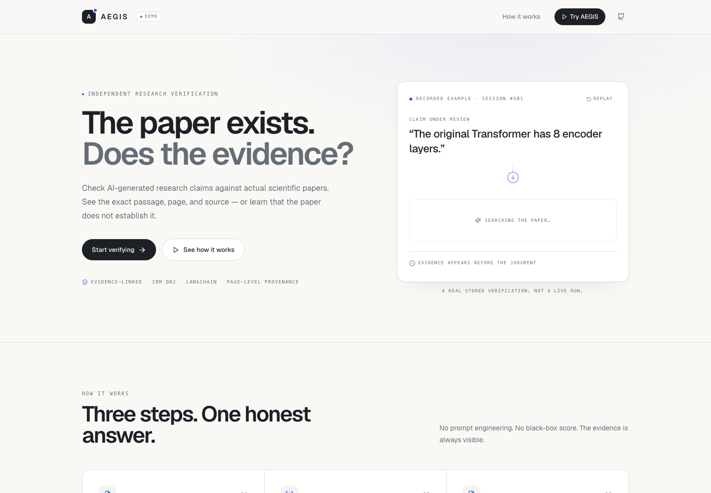
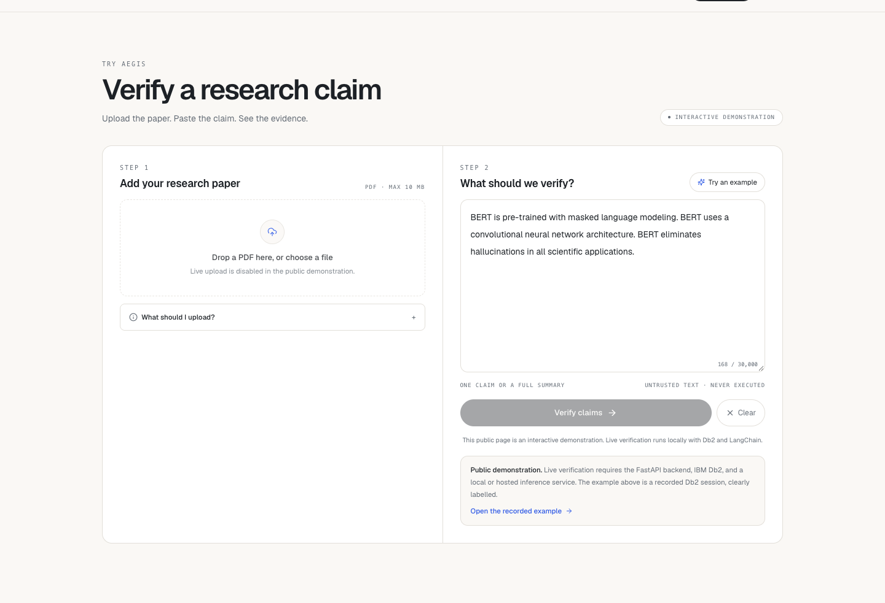
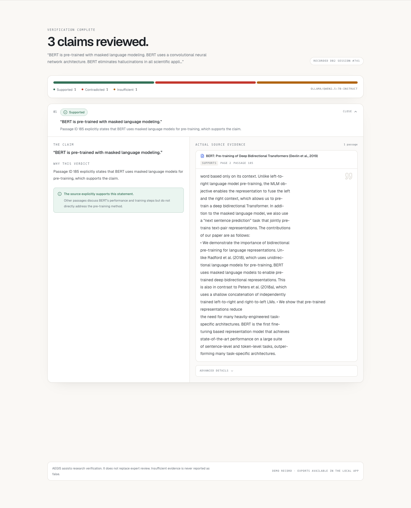
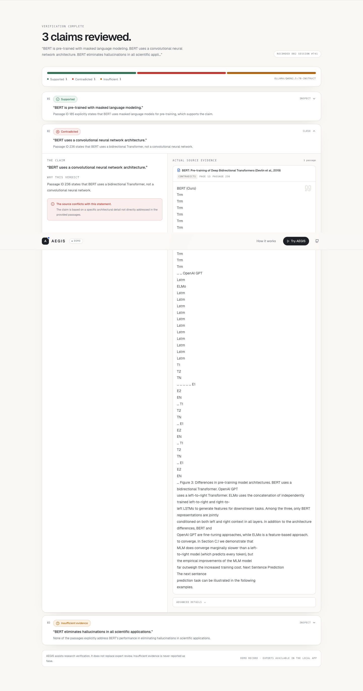
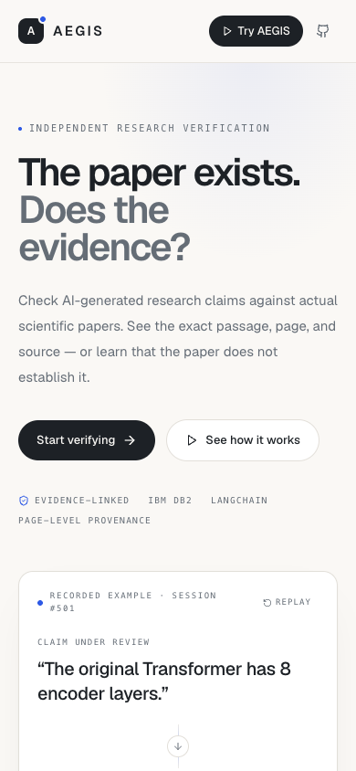

# AEGIS — AI Evidence Grounding & Integrity System

> **One-line pitch:** AEGIS verifies research claims against the actual source document and shows the exact supporting or conflicting passage, instead of asking an LLM whether a claim “sounds right.”

AEGIS is a research-verification application: upload papers, submit a draft or set of
claims, and receive `SUPPORTED`, `CONTRADICTED`, or `INSUFFICIENT_EVIDENCE` judgments
with page-level Db2-backed evidence links, explanations, limitations, and numeric checks.
A report can be exported as JSON or Markdown.

- **Repository:** https://github.com/sakethdonepudi/aegis-ai-safety
- **Public interactive demo:** https://aegis-research-verification.vercel.app (recorded Db2 session #741; live upload/inference runs locally)
- **Model used for reported results:** local Ollama `qwen2.5:7b-instruct`, temperature 0.

## Problem statement

LLM-assisted literature review can produce confident statements that the cited paper
never made. Generic RAG demos retrieve a chunk and let the model answer; they do not
validate that the cited passage exists, that it belongs to the selected document, or
that the claim is not contradicted elsewhere. AEGIS targets the verification step:

- preserve page and passage provenance for every claim;
- abstain when the document does not establish the claim;
- surface conflicting evidence instead of silently choosing one side;
- keep a reproducible audit trail in IBM Db2.

Target users: researchers, students, technical writers, and review teams checking a
draft against primary sources.

## Solution overview

1. **Ingest:** upload a text-based PDF, TXT, or MD file. PyMuPDF extracts page text and
   AEGIS stores document/passage provenance in Db2.
2. **Extract:** LangChain turns the submitted text into atomic claims.
3. **Retrieve:** Db2 supplies candidate passages for the selected documents; BM25 ranks
   them in Python. No vector database is required.
4. **Verify:** LangChain receives only the claim and the top candidate passages. Strict
   JSON requires a classification, explanation, limitations, and passage IDs.
5. **Guard:** deterministic checks validate cited IDs, reject boilerplate/irrelevant
   support, compare simple numeric values, and abstain on absence, noncomparable
   conflicts, scope mismatch, and mismatched citations.
6. **Persist and export:** claims, results, evidence links, relationships, and numeric
   analysis are written to Db2; JSON and Markdown reports are downloadable in the UI.

## IBM Db2 integration

- **Edition/environment:** IBM Db2 Community Edition 12.1.5, run locally in a Podman
  container (`aegis-db2`, port 50000, database `TESTDB`).
- **Connector:** IBM `ibm_db` with prepared statements and an explicit transaction
  wrapper. On macOS, AEGIS uses `ibm_db.prepare` + `bind_param` + `execute` rather than
  `exec_immediate` with parameters to avoid a driver segfault.
- **Schema:** `AEGIS`, six relational tables:
  `DOCUMENTS`, `PASSAGES`, `VERIFICATION_SESSIONS`, `CLAIMS`,
  `VERIFICATION_RESULTS`, `EVIDENCE_LINKS`.
- **Features used:** relational joins, foreign keys with cascade, unique constraints,
  check constraints, indexes, identity columns, CLOB/VARCHAR text, parameterized SQL,
  and multi-statement transactions with rollback.
- **Persistence path:** document ingestion, session state, extracted claims, every
  classification, numeric analysis, and evidence links all round-trip through Db2. The
  verification history and report export are reconstructed from Db2.
- **Schema bootstrap:** `database/init_db.py` applies `schema.sql`, idempotent migrations,
  and `indexes.sql`. `make db-init` is the supported path.

Db2 is not decorative: removing it removes the documents, evidence, history, and export
capability. Retrieval queries run against `PASSAGES` joined to `DOCUMENTS`; results and
evidence are written back in the same request lifecycle.

## AI / LangChain architecture

- **Framework:** LangChain (`ChatPromptTemplate | ChatOpenAI | StrOutputParser`).
- **Providers:** any OpenAI-compatible endpoint through environment variables; reported
  runs used local Ollama `qwen2.5:7b-instruct`. No hosted key is required for the local
  demo.
- **Claim extraction:** one structured JSON call produces atomic claims.
- **Verification:** one structured call per claim over the top retrieved passages.
  Prompt rules distinguish support from absence, comparable from noncomparable conflict,
  and explicit contradiction from “the passage does not discuss this.”
- **Deterministic guardrails:** citation-ID validation, evidence-term overlap, numeric
  comparison, absence/scope/citation guards, and conflict detection. Guards can downgrade
  an overconfident model output to `INSUFFICIENT_EVIDENCE`; they cannot invent support.
- **Failure behavior:** malformed JSON is repaired/retried once; provider failure becomes
  `VERIFICATION_ERROR`, never a false support claim.

## Tech stack

- **Backend:** Python 3.11, FastAPI, Pydantic, Uvicorn, `ibm_db`, PyMuPDF, LangChain.
- **Database:** IBM Db2 Community Edition 12.1.5.
- **Frontend:** Next.js 14 App Router, TypeScript, Tailwind CSS, Lucide.
- **Evaluation:** Python harness for SciFact, controlled real-paper cases, baselines, and
  benchmark-integrity checks.
- **Local runtime:** Podman (Db2), Ollama (local model).

## Prerequisites

- macOS/Linux with Python 3.11+, Node.js 20+, npm
- Podman (or Docker) able to run the Db2 Community Edition image
- Ollama with `qwen2.5:7b-instruct` **or** an OpenAI-compatible API key/endpoint
- ~8 GB RAM recommended for the local 7B model

## Setup and installation

```bash
# From the submission folder
cd src

# 1. Python
python3 -m venv .venv
source .venv/bin/activate
pip install -r backend/requirements-dev.txt

# 2. Frontend
cd frontend
npm ci
cd ..

# 3. Configuration
cp .env.example .env
# edit DB2_PASSWORD and LLM_* values

# 4. Start Db2 (Podman example; any Db2 instance works)
podman run -d --name aegis-db2 -p 50000:50000 \
  -e LICENSE=accept -e DB2INST1_PASSWORD=<password> \
  icr.io/db2_community/db2:12.1.5.0

# 5. Create schema/indexes
make db-init

# 6. Optional local model
ollama pull qwen2.5:7b-instruct
```

## Configuration

Copy `.env.example` to `.env`. Key settings:

```bash
DB2_HOST=localhost
DB2_PORT=50000
DB2_DATABASE=TESTDB
DB2_USERNAME=db2inst1
DB2_PASSWORD=change-me
DB2_SCHEMA=AEGIS

# Local Ollama
LLM_PROVIDER=ollama
LLM_MODEL=qwen2.5:7b-instruct
LLM_API_KEY=ollama
LLM_BASE_URL=http://localhost:11434/v1

# Or a hosted OpenAI-compatible provider
# LLM_PROVIDER=openai
# LLM_MODEL=gpt-4o-mini
# LLM_API_KEY=...
```

Never commit `.env` or real credentials.

## Running the project

```bash
# terminal 1 — backend
source .venv/bin/activate
cd backend
uvicorn app.main:app --host 127.0.0.1 --port 8000

# terminal 2 — frontend
cd frontend
npm run dev -- --hostname 127.0.0.1 --port 3000
```

Open `http://127.0.0.1:3000`. Health checks:
`GET /health`, `GET /api/db/health`.

## Testing and verification

```bash
# backend unit/API
cd backend && ../.venv/bin/python -m pytest

# real Db2 integration
cd backend && AEGIS_TEST_DB2=1 ../.venv/bin/python -m pytest tests/test_integration_db2.py -v

# evaluation utilities
.venv/bin/python -m pytest experiments/tests

# frontend
cd frontend && npm run typecheck && npm run lint && npm run build
```

Measured on the final release branch:

- backend: **64 passed, 2 skipped**; real-Db2 integration: **2 passed**
- evaluation utilities: **9 passed**
- frontend typecheck, lint, production build: **pass**
- GitHub Actions backend and frontend jobs: **pass**
- final smoke test: one BERT PDF ingested; 3 claims returned
  **1 SUPPORTED / 1 CONTRADICTED / 1 INSUFFICIENT_EVIDENCE**, 0 errors;
  JSON and Markdown exports both generated (session #741).

### Benchmark results and honest limitations

- **SciFact:** macro F1 **0.678**, accuracy **0.700**, contradiction
  precision/recall **0.714 / 0.500**, Recall@5 **0.76**, Recall@10 **0.77** on the
  reported **100-claim development subset** (first 100 by benchmark claim ID; no
  gold-label selection). This is a development subset, not the hidden-label test split.
- **Controlled 40-case suite:** **40/40** after the fixes. This is a small controlled
  suite over three arXiv papers, **not general accuracy** and not a representative
  scientific benchmark.
- **Hallucination/false-positive suite:** **10/10** controlled cases. Again, small and
  hand-written.
- An earlier report used a gold-balanced 100-claim subset and scored 0.615 macro F1; that
  selection method is no longer used. On the 87 claims shared by both runs, same-claim
  pre-fix vs final macro F1 is 0.660 → 0.671.
- Local 7B runs are slow (mean ~36.6 s/claim on SciFact), single-run, and not a claim of
  statistical significance. No hosted-provider performance is claimed.
- No vector retrieval; lexical BM25 is intentional and auditable. No public deployment.

Full reports: `src/reports/AEGIS_TESTING_MASTER_REPORT.md`,
`src/reports/scifact_analysis.md`, `src/reports/benchmark_integrity.md`.

## Screenshots and demo

Desktop and mobile screenshots are in `docs/screenshots/`.











A five-minute demo script is in `src/docs/demo-script.md`. The public Vercel page is a clearly labelled interactive demonstration using the recorded Db2 session #741. The full live flow (upload, inference, Db2 history, exports) runs locally from `src/`.

## Known limitations and roadmap

- Verification is evidence-grounded but not a truth oracle; the local 7B model and
  pattern-based guards can still miss contradiction or over-abstain.
- SciFact development-subset performance is modest; contradiction recall is the main
  weakness.
- The numeric checker covers simple literal values, not statistical inference or unit
  conversion.
- No authentication, rate limiting, malware scanning, or multi-tenant isolation.
- No native Db2 vector search or hybrid retrieval yet.
- No hosted Db2/backend/frontend deployment; a public demo would require network access
  to a hosted Db2 instance.

## Team

| Name | GitHub | Role |
|---|---|---|
| Saketh Donepudi | [@sakethdonepudi](https://github.com/sakethdonepudi) | Full-stack, AI/LangChain, IBM Db2 integration, evaluation |

Built for the IBM Db2 TechX Summit 2026 / Db2Hack challenge. Application code is MIT
licensed; SciFact dataset rights remain with its authors (CC BY-NC 2.0).
