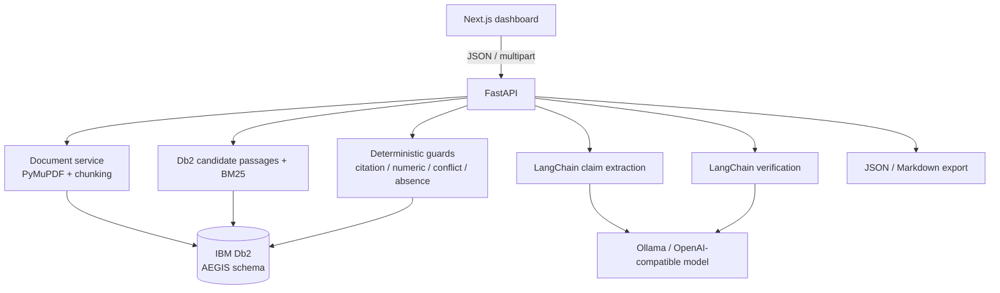

# AEGIS System Architecture

## Overview

AEGIS is a modular monolith with three runtime pieces:

1. **Next.js 14 dashboard** — upload/paste research text, select evidence documents,
   inspect claims/evidence, reopen history, download reports.
2. **FastAPI backend** — validation, claim extraction, retrieval, verification,
   guardrails, report generation, and persistence.
3. **IBM Db2 Community Edition 12.1.5** — the primary store for documents, passages,
   sessions, claims, results, and evidence links.

LangChain is the model boundary. The local reported configuration uses Ollama
`qwen2.5:7b-instruct` through an OpenAI-compatible endpoint; hosted providers are a
configuration choice, not a code change.

## Component breakdown

| Component | Responsibility |
| --- | --- |
| `frontend/` | Upload, evidence selection, claim cards, evidence inspector, history, exports |
| `backend/app/main.py` | App factory, CORS, timeout, error envelopes |
| `backend/app/db/connection.py` | Db2 prepared statements, transactions, cleanup |
| `backend/app/db/repository.py` | All SQL: documents, passages, sessions, claims, results, evidence |
| `backend/app/services/document_processing.py` | PDF/TXT/MD validation, PyMuPDF extraction, chunking |
| `backend/app/services/claim_extraction.py` | LangChain structured claim extraction |
| `backend/app/services/evidence_retrieval.py` | Db2 lexical candidates + BM25 ranking |
| `backend/app/services/claim_verification.py` | LangChain assessment + guardrails |
| `backend/app/services/numerical_verifier.py` | Deterministic literal numeric comparison |
| `backend/app/services/report_generator.py` | JSON and Markdown reports |
| `backend/app/services/pipeline.py` | End-to-end orchestration and failure states |

## Data flow

1. User uploads a text-based PDF or pastes research text and selects evidence documents.
2. `POST /api/documents` validates the file, extracts page text, chunks passages, and
   stores `DOCUMENTS` + `PASSAGES` (content-hash deduplicated).
3. `POST /api/verify` inserts a `VERIFICATION_SESSIONS` row with status `PROCESSING`.
4. LangChain extracts atomic claims; they are persisted in `CLAIMS`.
5. For each claim, Db2 returns candidate passages from the selected documents using
   parameterized `LIKE` predicates; BM25 ranks them.
6. LangChain verifies the claim against the top passages and must return passage IDs.
7. Guards validate every ID, reject unrelated/boilerplate support, compare simple
   numbers, detect comparable conflicting evidence, and downgrade unsupported
   certainty to `INSUFFICIENT_EVIDENCE`.
8. Results, relationships, numeric analysis, duration, and status are written to Db2 in
   one transaction.
9. `GET /api/verifications/{id}/export` reconstructs a JSON/Markdown report from Db2.

## IBM Db2 schema

Schema: `AEGIS`.

| Table | Key columns | Role |
| --- | --- | --- |
| `DOCUMENTS` | `DOCUMENT_ID` PK, title, filename, unique content hash, source type | Uploaded evidence sources |
| `PASSAGES` | `PASSAGE_ID` PK, `DOCUMENT_ID` FK, text, page, index, char offsets | Page-level evidence |
| `VERIFICATION_SESSIONS` | `SESSION_ID` PK, submitted text, model, status, timestamps | Audit envelope |
| `CLAIMS` | `CLAIM_ID` PK, `SESSION_ID` FK, original/normalized text, type | Atomic claims |
| `VERIFICATION_RESULTS` | `RESULT_ID` PK, `CLAIM_ID` FK, classification, explanation, limitations, numeric analysis | One judgment per claim |
| `EVIDENCE_LINKS` | `EVIDENCE_LINK_ID` PK, result/passage FKs, relationship, relevance | Cited evidence |

Constraints include foreign keys with cascade, unique `(RESULT_ID, PASSAGE_ID)`, a
check constraint on classification, and indexes for document passages, session claims,
evidence lookup, status filtering, and recent ordering. `database/init_db.py` applies
schema, migrations, and indexes idempotently.

Key operations are fully parameterized. On macOS the driver uses
`ibm_db.prepare` + `bind_param` + `execute` to avoid a known `exec_immediate`
segfault with bound parameters.

## AI / LangChain flow

- `ChatPromptTemplate | ChatOpenAI | StrOutputParser` performs every model call.
- Provider, model, base URL, timeout, retries, and token limits are environment
  settings.
- Claim extraction returns strict JSON; verification returns classification,
  explanation, limitations, and cited passage IDs.
- Evidence text is delimited as untrusted data; prompt-injection text is not executed.
- JSON parsing tolerates code fences/prose and repairs unescaped quotes inside quoted
  evidence; one parse retry is attempted.
- A model/provider failure becomes `VERIFICATION_ERROR`; it is never silently converted
  into support.

## Guardrails

| Guard | Behavior |
| --- | --- |
| Citation validation | Unknown passage IDs are discarded; definitive labels require a valid citation |
| Boilerplate/relevance | Author metadata or unrelated text cannot support a claim |
| Numeric check | Unambiguous literal conflicts can override an inconsistent model result |
| Conflict detection | Both sides are preserved; comparable unresolved conflict → `INSUFFICIENT_EVIDENCE` |
| Absence guard | “Does not address/mention/discuss” is not contradiction |
| Scope guard | Universal claim about a category the passage never discusses → abstain |
| Citation guard | A specific author/year must appear in the cited evidence |
| Exclusivity guard | Explicit “in addition to … also” can contradict an “only” claim |

## Security and secrets

- Credentials and API keys come only from environment variables; `.env` is gitignored.
- SQL uses prepared statements; schema identifiers are validated.
- Uploads are checked for size, extension, content type, PDF header, and extractable
  text; path traversal and SQL injection are covered by tests.
- CORS is restricted to configured origins; errors are sanitized.
- Document text is treated as data, never as instructions.
- No authentication or multi-tenant isolation is implemented; this is a local
  single-user research tool, not a hardened public service.

## Deployment posture

- Local development is the primary workflow.
- The frontend is Vercel-buildable; the backend needs Python plus outbound access to the
  model and Db2.
- No hosted Db2, backend, or frontend is configured. A public demo would require a
  hosted Db2 instance and network allow-list; none is claimed.
