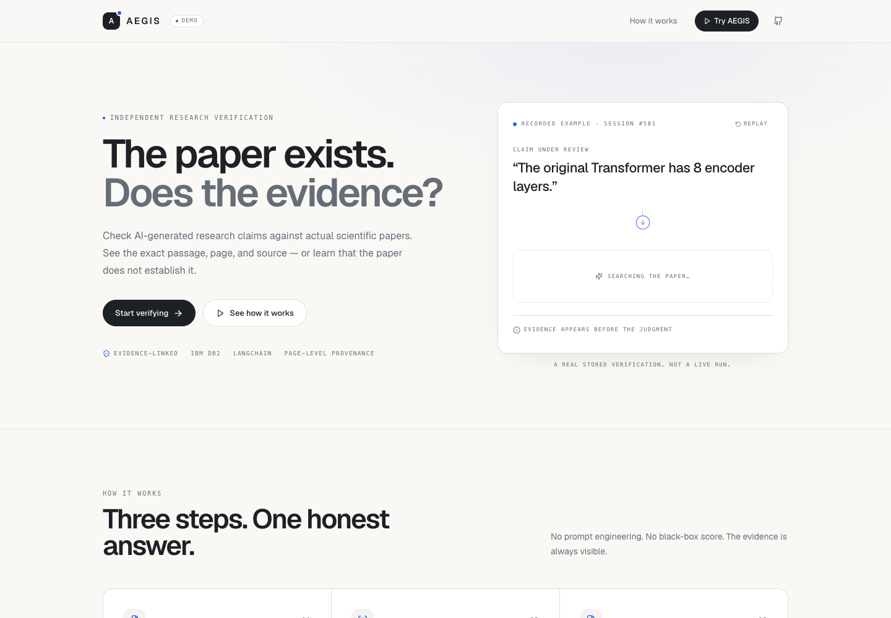
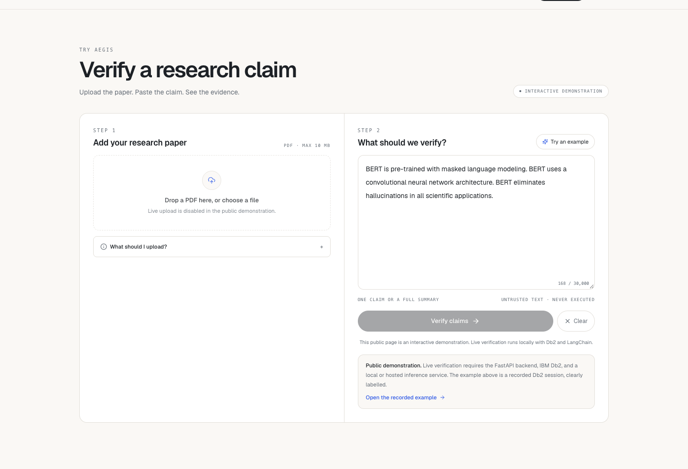
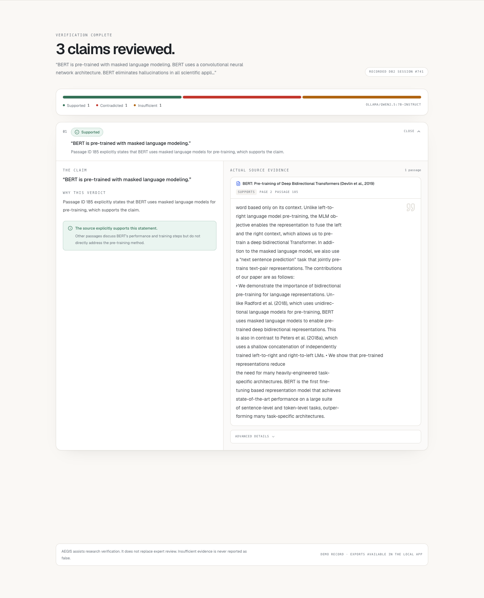
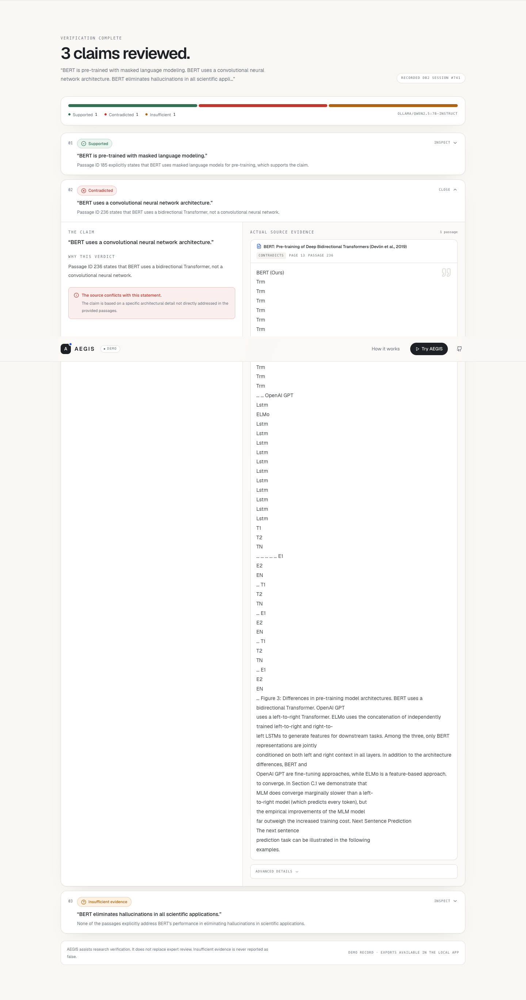
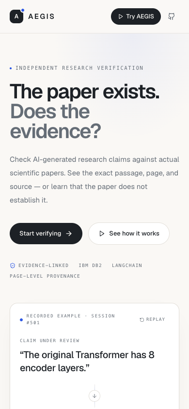

# AEGIS

**Verify before you trust.**

AEGIS is an independent AI safety and research verification application. It accepts
AI-generated research text, extracts atomic factual claims, retrieves evidence passages
from documents you supply, and records an evidence-linked judgment for every claim.

AEGIS is not a general-purpose chatbot. It exists to evaluate information produced by
other AI systems, preserve provenance, and support reproducible evaluation.

**Public interactive demonstration:** https://aegis-research-verification.vercel.app

The public site is an honest **interactive demonstration** built from the real recorded
Db2 session #741. Live upload, inference, and verification remain available through the
local application documented below; the public page does not pretend to be connected to
the local Db2 or Ollama instance.












## What works today

| Area | Status |
| --- | --- |
| Next.js research workspace (light editorial UI, responsive, reduced-motion support) | Working |
| Public interactive demonstration on Vercel | Live; recorded example, no fake live inference |
| FastAPI API with Pydantic request/response schemas | Working |
| IBM Db2 12.1.5 persistence (six tables, FKs, indexes) | Working; initialized and integration-tested |
| PDF / TXT / MD evidence ingestion with PyMuPDF | Working |
| LangChain claim extraction and evidence-grounded verification | Working; verified end-to-end with a local Ollama model. A hosted provider only needs a key |
| Db2-backed lexical retrieval (BM25 over SQL candidates) | Working |
| Evidence-reference validation and missing-evidence guardrails | Working |
| Deterministic numerical consistency checks | Working for simple percentages, BLEU, parameter/layer/head/GPU/day counts |
| JSON and Markdown report export | Working |
| Verification history and session reopening | Working |
| Document detail API and citation-level evidence links | Working |
| Evaluation page with measured-results-only view | Working; displays the measured 100-claim SciFact run |
| SciFact evaluation + metrics harness | Executed on 100 label-agnostic dev claims; macro F1 **0.678**, Recall@5 **0.76**, Recall@10 **0.77** |
| OCR for scanned PDFs, vector retrieval, DOI/Crossref citation checks, authentication | Not implemented |

> AEGIS does not guarantee that research is accurate. An automated judgment is a
> transparent aid for review, not a substitute for researcher judgment.

## Architecture

```text
Next.js dashboard (App Router, TypeScript, Tailwind, shadcn/ui, Recharts)
        │
        ▼
FastAPI API + Pydantic
        │
   ┌────┴──────────────┬──────────────────┐
   ▼                   ▼                  ▼
Claim extraction   Document ingest   Verification engine
   │                   │                  │
   └───────────────┬───┴──────────────────┘
                   ▼
                LangChain
                   │
          Db2 lexical retrieval
                   │
                   ▼
              IBM Db2 12.1.5
                   │
                   ▼
        verification results + history
```

The backend is a modular monolith: no queues, no microservices, no separate vector
database.

## Stack

- **Frontend:** Next.js 14 App Router, TypeScript, Tailwind CSS, shadcn/ui-style
  components, Lucide, Recharts.
- **Backend:** Python 3.11, FastAPI, Pydantic v2, Uvicorn.
- **Database:** IBM Db2 Community Edition 12.1.5 via `ibm_db`, parameterized SQL,
  foreign keys, indexes, explicit transactions.
- **AI orchestration:** LangChain with an OpenAI-compatible chat model. The provider,
  model, base URL, key, timeout, and retry policy are environment-configurable.
- **Documents:** PyMuPDF for text-based PDFs; chunking for `.txt`/`.md`.
- **Testing:** Pytest, FastAPI `TestClient`, real-Db2 integration tests, frontend
  typecheck/build.

## Quick start (macOS Apple Silicon)

Full walkthrough: [docs/setup-macos.md](docs/setup-macos.md).

### 1. Prerequisites

- macOS on Apple Silicon (M-series)
- Python 3.11+
- Node.js **20.19+** (see `.nvmrc`; `nvm use` if you use nvm)
- Your existing IBM Db2 instance reachable at `localhost:50000`, database
  `TESTDB`, user `db2inst1` (AEGIS does not ship or require a specific Db2 install)
- An LLM key for an OpenAI-compatible provider, or a local OpenAI-compatible server
  such as Ollama

IBM does not provide a native macOS arm64 Db2 server. If you already run Db2 in a
container or on another machine, AEGIS just needs TCP access to it.

### 2. Configure

```bash
cp .env.example .env
chmod 600 .env
# edit .env: DB2_PASSWORD and LLM_* values

# Only needed if the API is not on http://localhost:8000:
cp frontend/.env.example frontend/.env.local
```

Root `.env` is read by FastAPI. `frontend/.env.local` is read by Next.js. Neither is
committed.

### 3. Install

```bash
make install          # .venv, backend requirements, frontend node_modules
```

or manually:

```bash
python3 -m venv .venv
source .venv/bin/activate
pip install -r backend/requirements-dev.txt
cd frontend && npm install && cd ..
```

### 4. Connect to Db2

With your existing instance running:

```bash
# Optional connectivity check
nc -vz localhost 50000

# Create schema AEGIS, six tables, FKs, and indexes (idempotent)
make db-init

# Optional: insert the labelled synthetic demo evidence
make db-seed

# Optional: download the two arXiv PDFs used by the real-paper demo
make demo-papers
```

If `db-init` reports an authorization error, use a Db2 user that can create the
`AEGIS` schema (the container's `db2inst1` user can).

<details>
<summary>Optional: start a local Db2 container instead</summary>

```bash
export DB2_PASSWORD='choose-a-local-password'   # match .env
podman run -d --name aegis-db2 --platform linux/amd64 --privileged=true \
  -p 50000:50000 \
  -e LICENSE=accept \
  -e DB2INST1_PASSWORD="$DB2_PASSWORD" \
  -e DBNAME=TESTDB \
  -e ARCHIVE_LOGS=false \
  icr.io/db2_community/db2:12.1.5.0
```

Wait for `(*) Setup has completed.` in `podman logs -f aegis-db2`, then run
`make db-init` and `make db-seed`. The image is `linux/amd64`; Apple Silicon runs it
under emulation.

</details>

### 5. Run (two terminals)

Backend:

```bash
source .venv/bin/activate
cd backend
uvicorn app.main:app --reload --port 8000
```

Frontend:

```bash
cd frontend
npm run dev
```

Or use the Makefile from the repository root:

```bash
make dev-backend     # terminal 1 → http://localhost:8000
make dev-frontend    # terminal 2 → http://localhost:3000
```

Confirm the database:

```bash
curl -s http://localhost:8000/api/db/health | python3 -m json.tool
```

### 6. Demo

1. Open `http://localhost:3000`.
2. Click **Paper demo** (real arXiv PDFs) or **Synthetic** (fictional SolarCell-X).
3. Click **Verify research claims**.

The paper demo uses *Attention Is All You Need* and *BERT* as evidence. It contains
claims designed to exercise supported, contradicted, insufficient-evidence, and
numerical-discrepancy outcomes. The summary text is synthetic; the evidence is real.
Classifications are produced by the configured LLM through the real pipeline and a
deterministic numeric check; nothing is hardcoded. See [docs/demo.md](docs/demo.md)
and the five-minute [demo script](docs/demo-script.md). A short reusable project
description is in [docs/project-description.md](docs/project-description.md).

## API

```text
GET  /health
GET  /api/db/health
GET  /api/documents
POST /api/documents
GET  /api/documents/{document_id}
POST /api/verify
GET  /api/verifications
GET  /api/verifications/{session_id}
GET  /api/verifications/{session_id}/export?format=json|markdown
GET  /api/evaluation
```

Full request/response documentation: [docs/api.md](docs/api.md) and the OpenAPI UI at
`http://localhost:8000/docs`.

## Tests

```bash
make test                 # unit + API tests; integration tests skip without Db2
make test-integration     # real Db2 vertical slice (requires schema + .env)
make build                # production frontend build
```

The integration test runs the full claim extraction → Db2 retrieval → verification →
persistence path with a deterministic scripted LLM, then asserts the six-table
provenance and evidence links. It is skipped unless `AEGIS_TEST_DB2=1`.

## LLM configuration

AEGIS uses LangChain's `ChatOpenAI` client, so any OpenAI-compatible hosted endpoint
works:

```dotenv
LLM_PROVIDER=openai
LLM_MODEL=gpt-4o-mini
LLM_API_KEY=...
LLM_BASE_URL=            # blank for api.openai.com
LLM_TEMPERATURE=0
LLM_TIMEOUT_SECONDS=90
LLM_MAX_RETRIES=2
```

For a local demonstration, an OpenAI-compatible server such as Ollama can be used:

```bash
brew install ollama
ollama serve
ollama pull qwen2.5:7b-instruct
# .env:
# LLM_PROVIDER=ollama
# LLM_MODEL=qwen2.5:7b-instruct
# LLM_API_KEY=ollama
# LLM_BASE_URL=http://localhost:11434/v1
```

`qwen2.5:7b-instruct` produces the best demo explanations; `qwen2.5:3b-instruct` is
faster on 8 GB machines. Local models are a demonstration fallback, not a claim of
research-grade accuracy.

## Repository layout

```text
frontend/          Next.js app, shadcn-style UI, Recharts overview
frontend/.env.example  Frontend-only environment template
backend/app/       FastAPI entry point, routes, services, Db2 repository
backend/tests/     Unit, API, and real-Db2 integration tests
database/          schema.sql, indexes.sql, init_db.py, seed.py, seed_papers.py
data/samples/      Synthetic evidence and the paper-demo response
scripts/           fetch_demo_papers.sh (downloads the arXiv PDFs)
experiments/       SciFact loader, benchmark, metrics, evaluation CLI, manifest
research/          Problem statement, research questions, hypotheses, methodology
docs/              Architecture, API, demo, macOS setup, security, deployment, performance, limitations
.github/workflows/ CI (unit/build) + manual Db2 integration workflow
```

## Portability

AEGIS has no Conductor-specific runtime dependency or required configuration. It needs
only Python, Node.js, network access to IBM Db2, and an OpenAI-compatible LLM endpoint.
`.context/` is ignored for agent collaboration and is not used by the application.

## Environment verification

Tested in this build environment:

- IBM Db2 12.1.5 on `localhost:50000` (schema creation, seed, integrations)
- FastAPI API, all endpoints, and the full verification pipeline
- Next.js typecheck, lint, production build, and browser flow
- Unit/API tests, real-Db2 integration tests, evaluation utility tests
- GitHub Actions backend and frontend jobs
- Local Ollama `qwen2.5:7b-instruct` paper demo: 4 claims with 1 supported, 2 contradicted (one deterministic numeric conflict), and 1 insufficient evidence
- JSON and Markdown export generation
- Db2 schema migration from the previous schema revision
- Stage profiling: LLM verification dominated (~86% baseline); concise output reduced
  the measured four-claim profile from 212 s to 90 s without changing classifications
  (see [docs/performance.md](docs/performance.md))
- SciFact held-out run: 100 label-agnostic dev claims, macro F1 0.678, accuracy 0.700,
  retrieval Recall@5 0.76, Recall@10 0.77, 0 verification errors
- Controlled real-paper suite: 40/40; hallucination/false-positive suite: 10/10
- Local live smoke test on 2026-11-07: BERT PDF ingested, 3 claims returned
  1 supported / 1 contradicted / 1 insufficient, 0 errors, JSON + Markdown exports,
  session #741 persisted in Db2
- Public show-case deployment on Vercel: HTTPS, desktop/mobile, example flow, no browser
  console errors, no horizontal overflow

Not tested here, and therefore not claimed:

- A hosted LLM provider call (the available free quota was exhausted and the paid
  account had insufficient funds; the code path is configuration-only)
- A brand-new macOS machine install from a fresh clone (dependencies were installed in
  this workspace)
- PDF upload through the browser end-to-end (PDF parsing and validation are unit-tested
  and the two demo PDFs were ingested through the API, but the file-picker flow was not
  driven by a browser test)
- Windows or Linux application runtime beyond Ubuntu CI unit tests
- Full live public verification with a hosted Db2 instance. The public Vercel site is a
  clearly labelled interactive demonstration; live verification requires the local
  backend, Db2, and inference service.

## Security posture

- Secrets only in environment variables; `.env` is gitignored.
- Parameterized SQL through prepared statements; schema identifiers validated.
- Upload size, extension, content-type, PDF header, and page-text validation.
- CORS restricted to configured origins.
- Request timeout and LLM timeout bounds.
- Document text is treated as untrusted data and never executed as instructions.
- Errors returned to clients are sanitized; raw Db2 exceptions stay in server logs.
- React escapes displayed content by default.

This is an initial research application, not a hardened multi-tenant service. See
[docs/security.md](docs/security.md) and [docs/limitations.md](docs/limitations.md).

## Deployment

Local development is the primary workflow. Frontend deployment for Vercel, backend
hosting requirements, remote Db2 connectivity, CORS, and the rule against exposing
localhost Db2 are documented in [docs/deployment.md](docs/deployment.md). No public
deployment or hosted Db2 instance is included.

## Evaluation

SciFact is **not** bundled. Its license is CC BY-NC 2.0, so it must be downloaded
separately and used non-commercially. The official test split does not publish evidence
labels, so AEGIS uses the labelled **dev** split as the held-out set.

Measured run: **first 100 claims by benchmark claim ID**, selected without using gold
labels (45 supported / 20 contradicted / 35 insufficient), local
`qwen2.5:7b-instruct`, full-corpus Db2-backed BM25.

| Metric | Value |
| --- | ---: |
| Macro F1 | 0.678 |
| Accuracy | 0.700 |
| Supported precision / recall / F1 | 0.789 / 0.667 / 0.723 |
| Contradicted precision / recall / F1 | 0.714 / 0.500 / 0.588 |
| Insufficient precision / recall / F1 | 0.625 / 0.857 / 0.723 |
| Retrieval Recall@1 / @5 / @10 | 0.55 / 0.76 / 0.77 |
| Mean / median / p95 latency | 36.6 s / 34.8 s / 53.7 s |
| Verification errors | 0 / 100 |

This is a defined held-out subset, not the full 300-claim split, and not a claim of
statistical significance. Contradiction recall is the main weakness. Results,
predictions, document map, settings, and the integrity audit are in
`experiments/results/`, `experiments/predictions/`, and
`reports/benchmark_integrity.json`. No labels are passed to retrieval or the verifier.

**Revision note:** an earlier report used a 100-claim subset balanced by gold label and
scored 0.615 macro F1. That selection method is no longer used. On the 87 claims common
to both runs, scoring pre-fix and final predictions on identical claims gives macro F1
0.660 → 0.671; see `reports/scifact_analysis.md`. The controlled suite now passes 40/40
and the hallucination suite 10/10. See `reports/AEGIS_TESTING_MASTER_REPORT.md`.

See [experiments/README.md](experiments/README.md) and
[docs/performance.md](docs/performance.md).

## License

MIT for the application code. SciFact dataset rights remain with its authors; see
`experiments/scifact_manifest.json`.
