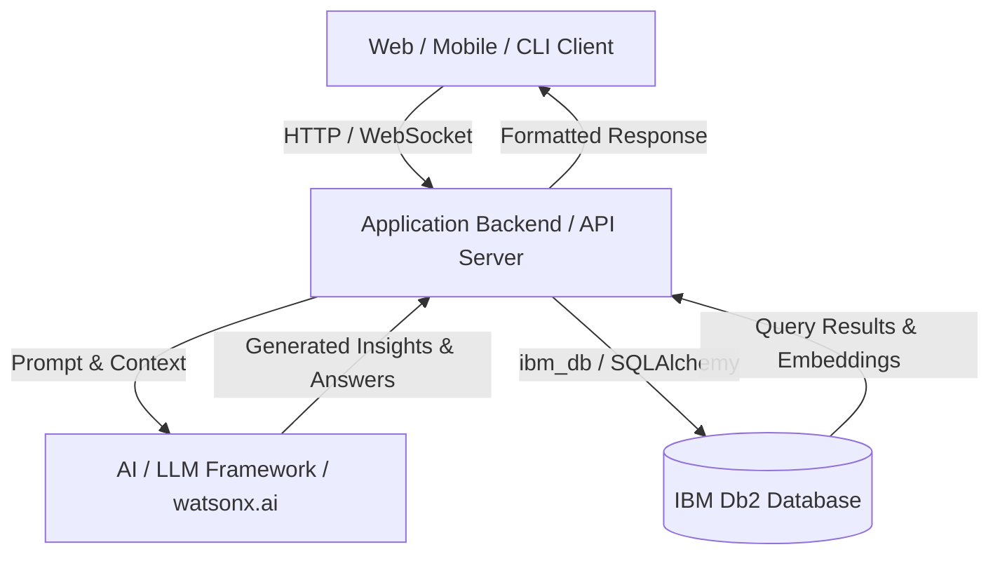

# System Architecture

## Overview
High-level architectural summary describing how frontend, backend services, AI agents/LLMs, and IBM Db2 interact.

---

## Architecture Diagram



---

## Component Breakdown

1. **User Interface / Client Layer**:
   - Description of UI components or CLI interactions.
2. **Application Backend Layer**:
   - Core API endpoints, routing, authentication, business logic.
3. **Database Layer (IBM Db2)**:
   - Data persistence, relational tables, indexing, transactions, or vector search structures.
4. **AI / Model Orchestration Layer** *(if applicable)*:
   - Agent loops, retrieval chains, prompt templates, and context assembly.

---

## Data Flow

1. **Input Ingestion**: User submits query or data via client interface.
2. **Context Retrieval**: Backend queries IBM Db2 for relevant transactional records, metrics, or embedded documents.
3. **Augmentation & Inference**: Context is formatted and injected into LLM prompt templates.
4. **State Persistence**: Generated outputs, audit logs, or new transactions are written back to IBM Db2.
5. **Response Delivery**: Result is streamed or returned to the user.

---

## IBM Db2 Schema & Storage Design

```sql
-- Example Schema DDL
CREATE TABLE projects (
    id INT GENERATED ALWAYS AS IDENTITY PRIMARY KEY,
    name VARCHAR(100) NOT NULL,
    description CLOB,
    created_at TIMESTAMP DEFAULT CURRENT_TIMESTAMP
);
```

---

## Security & Secrets Management
- All database credentials and external API tokens are read at runtime from environment variables.
- Sensitive production connection strings are never checked into version control.
