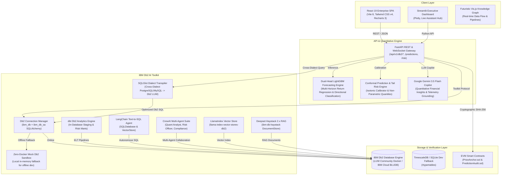

# Aegis Analytics AI — System Architecture

## Overview
**Aegis Analytics AI** is an institutional-grade quantitative finance platform designed for multi-asset return forecasting, directional probability calibration, distribution-free statistical risk bounds (conformal prediction), and tamper-proof on-chain audit verification using EVM smart contracts.

The platform natively integrates the **IBM Db2 AI & Analytics Toolkit**, transforming IBM Db2 into an enterprise operational data store, an in-database transformation engine (via dbt), and an AI knowledge layer supporting Text-to-SQL agents (LangChain, CrewAI), semantic vector indexing (LlamaIndex, Haystack), and visual workflow pipelines (Langflow).

---

## Architecture Diagram



---

## Component Breakdown

### 1. Presentation & Interface Layer
- **React 19 SPA (`frontend/`)**: Modern TypeScript, Vite 8, Tailwind CSS v4, Lucide React, and Recharts with 12 analytical modules (Overview, Forecasts, Risk Analytics, AI Analyst, Blockchain Audit, Crypto/DeFi, Db2 Analytics).
- **Streamlit Dashboard (`dashboard/`)**: High-density interactive trading terminal with live candlestick charting, conformal bands, multi-horizon comparison, and Assistant Hub.
- **Standalone Knowledge Graph (`graphify-out/graph.html`)**: Sci-Fi cybernetic React 18 + Vis Network visualizer showing directional data flows between storage, feature engineering, models, and Db2.

### 2. Backend & Quantitative Intelligence (`backend/`)
- **FastAPI Core**: Asynchronous REST API providing health probes, market data bars, dual-head predictions, risk quantiles, blockchain verification proofs, and AI endpoints.
- **Dual-Head LightGBM**: Trained models outputting simultaneously continuous return regressions ($\hat{y}$) and calibrated upward probability ($p_{\text{up}}$).
- **Conformal Risk Engine**: Non-parametric absolute residual quantile estimation guaranteeing 90% statistical coverage, plus downside tail risk probabilities ($P(\text{Return} < -1\%)$ and $P(\text{Return} < -2\%)$).
- **Google Gemini 3.5 Flash Analyst**: Context-grounded financial intelligence copilot that interprets model telemetry and provides institutional briefings.

### 3. IBM Db2 AI & Analytics Toolkit (`db2_toolkit/`)
- **Connection Manager (`connection.py`)**: Unified adapter wrapping native `ibm_db` and SQLAlchemy `ibm_db_sa` with automatic SSL/TLS, credential parsing, and zero-downtime mock fallback.
- **Mock Sandbox (`mock_db2_sandbox.py`)**: Zero-Docker, in-memory SQLite-backed simulation of IBM Db2, allowing offline judges and developers to run all tests without Docker.
- **SQLGlot Transpiler (`dialect_transpiler.py`)**: Automated translation of foreign SQL dialects (PostgreSQL, MySQL, T-SQL) into optimized IBM Db2 LUW syntax (`FETCH FIRST n ROWS ONLY`, `VARCHAR_FORMAT`, etc.).
- **dbt In-Database Transformations (`dbt/`)**: Production-ready data models creating staging views (`stg_market_bars`) and dimensional marts (`fct_risk_metrics`) directly inside Db2.
- **LangChain Agent (`langchain_agent.py`)**: Autonomous natural language Text-to-SQL agent and vector document search utilizing Db2 schema reflections.
- **CrewAI Suite (`crewai_agents.py`)**: Multi-agent team consisting of a **Quantitative Data Engineer**, **Risk Analyst**, and **Audit Officer** collaborating on market signals.
- **LlamaIndex & Haystack Integrations (`llamaindex_store.py`, `haystack_pipeline.py`)**: Production RAG and document stores mapped to Db2 tables.
- **Langflow Visual Component (`langflow_components.py`)**: Drag-and-drop workflow component exported as clean JSON for Langflow canvas integration.

---

## IBM Db2 Schema & Storage Design

```sql
-- Core Financial Time-Series Schema in IBM Db2 LUW

CREATE TABLE MARKET_BARS (
    SYMBOL VARCHAR(20) NOT NULL,
    TIMEFRAME VARCHAR(10) NOT NULL,
    TIMESTAMP TIMESTAMP NOT NULL,
    OPEN_PRICE DECIMAL(14, 4) NOT NULL,
    HIGH_PRICE DECIMAL(14, 4) NOT NULL,
    LOW_PRICE DECIMAL(14, 4) NOT NULL,
    CLOSE_PRICE DECIMAL(14, 4) NOT NULL,
    VOLUME BIGINT,
    CREATED_AT TIMESTAMP DEFAULT CURRENT TIMESTAMP,
    PRIMARY KEY (SYMBOL, TIMEFRAME, TIMESTAMP)
) ORGANIZE BY ROW;

CREATE INDEX IDX_BARS_SYM_TS ON MARKET_BARS (SYMBOL, TIMESTAMP DESC);

CREATE TABLE ML_PREDICTIONS (
    PREDICTION_ID BIGINT GENERATED ALWAYS AS IDENTITY PRIMARY KEY,
    SYMBOL VARCHAR(20) NOT NULL,
    HORIZON VARCHAR(10) NOT NULL,
    TIMEFRAME VARCHAR(10) NOT NULL,
    TIMESTAMP TIMESTAMP NOT NULL,
    LAST_CLOSE DECIMAL(14, 4) NOT NULL,
    EXPECTED_RETURN DECIMAL(10, 6) NOT NULL,
    EXPECTED_PRICE DECIMAL(14, 4) NOT NULL,
    P_UP DECIMAL(5, 4),
    INTERVAL_LOW DECIMAL(10, 6) NOT NULL,
    INTERVAL_HIGH DECIMAL(10, 6) NOT NULL,
    BLOCKCHAIN_TX_HASH VARCHAR(66),
    CREATED_AT TIMESTAMP DEFAULT CURRENT TIMESTAMP
);

CREATE TABLE DB2_VECTOR_DOCUMENTS (
    DOC_ID VARCHAR(64) PRIMARY KEY,
    CONTENT CLOB NOT NULL,
    METADATA_JSON CLOB,
    EMBEDDING_VECTOR BLOB,
    CREATED_AT TIMESTAMP DEFAULT CURRENT TIMESTAMP
);
```

---

## Security & Secrets Management
- All database passwords, RPC URLs, private keys, and API tokens are loaded at runtime from `.env` via `python-dotenv`.
- Zero credentials or active keys are hardcoded in the repository.
- Sensitive production connection strings are isolated and validated through schema models before query execution.
