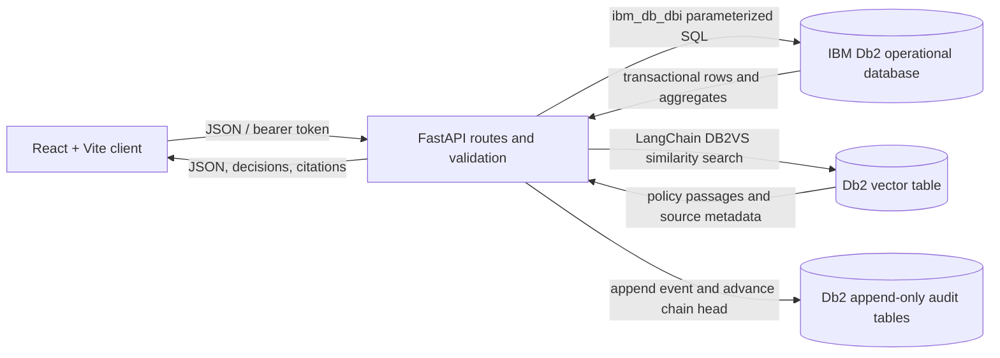

# AnnaSetu Architecture

## Overview
AnnaSetu is a React + Vite client backed by a FastAPI application. The API directly connects to IBM Db2 with the IBM `ibm_db` / `ibm_db_dbi` driver for all operational reads and writes. LangChain's `langchain-db2` package uses the same Db2 server for vector retrieval. There is no SQLite operational fallback.

## Architecture Diagram



## Component Breakdown

1. **Frontend:** `src/frontend` contains the React application, forms, role-aware dashboard, API client and responsive styles. It holds no database credentials and calls the configured FastAPI base URL.
2. **API:** `src/api/app/main.py` defines authentication, food/passport, NGO, rescue, policy, dashboard and audit endpoints. Pydantic validates request shapes; role and ownership checks are applied before state transitions.
3. **Db2 access and schema:** `db.py` opens direct IBM Db2 connections and executes parameterized SQL. `schema.py` creates missing tables, indexes and append-only triggers without dropping existing data. Db2 stores users, food evidence, human reviews, NGO capacity, rescues, audit records and policy source documents.
4. **Safety and feasibility:** safety decisions use declared evidence and deterministic rules. Logistics estimation compares remaining time with expiry, storage/category constraints, straight-line distance and a stated transit/handoff allowance. Policy retrieval does not override these decisions.
5. **LangChain Db2 vector retrieval:** `rag.py` creates a LangChain `DB2VS` store using the Db2 client connection and `ANNA_POLICY_VECTOR` table. A deterministic local feature-hash embedder supports offline retrieval without external model credentials. Search returns cited policy passages; no generative model is configured.
6. **Deployment:** `src/compose.yaml` defines the local Db2 Community Edition container and persistent volume. The Windows PowerShell launcher reuses Db2 and starts the API and Vite services locally.

## Food Safety and Rescue Workflow

```mermaid
sequenceDiagram
    actor Donor
    actor Reviewer as Verified NGO or admin
    participant UI as React
    participant API as FastAPI
    participant DB as IBM Db2
    Donor->>UI: Register batch and evidence
    UI->>API: POST /api/food
    API->>DB: Insert food, first observation, audit event (transaction)
    Reviewer->>API: Record human review
    API->>DB: Append immutable review; update current review state
    UI->>API: GET /api/food/{id}/evaluate
    API->>DB: Read evidence, expiry, NGO capacity
    API-->>UI: HOLD / FEASIBLE / INFEASIBLE with reasons and ETA estimate
    UI->>API: POST /api/food/{id}/allocate
    API->>DB: Reserve capacities, create rescues, append audit events (transaction)
```

Missing required evidence produces `HOLD`. Expired food, infeasible time/distance or logistics constraints produce `INFEASIBLE`. `FEASIBLE` is a screening result, not certification. Allocation requires the applicable human verification and eligible capacity. Capacity reservation uses conditional Db2 updates in the same transaction as rescue creation and rolls back on failure. Partial allocation across multiple eligible NGOs is supported; available capacity is not allowed to go below zero.

## Handoffs and Audit
Each rescue proceeds through ordered pickup, delivery/handoff and distribution. The donor, assigned volunteer and receiving NGO are authorized for their respective checkpoints; admin has an operational override. The API verifies ownership/assignment, stage order, OTP digest and distribution quantity. Checkpoint timestamps and actual distributed kilograms are persisted with the audit event. Audit writes serialize through `AUDIT_HEAD`, hash the previous event and append a new SHA-256 event. Db2 triggers reject `UPDATE` and `DELETE` on the audit-event, safety-observation and human-verification tables. Admin can verify chain integrity through the API.

## Database and Transaction Boundaries

- **Identity and access:** Db2 `USERS`, `NGOS` and `VOLUNTEERS`; salted password hashes and role-scoped API operations.
- **Passport:** `FOOD_BATCHES`, `SAFETY_OBSERVATIONS`, `HUMAN_VERIFICATIONS`.
- **Rescue:** `RESCUES` and NGO `AVAILABLE_KG` reservations.
- **Audit:** `AUDIT_HEAD`, append-only `AUDIT_EVENTS`.
- **Policy:** `POLICY_DOCUMENTS` and LangChain-managed `ANNA_POLICY_VECTOR` in Db2.
- **Transactions:** batch + initial evidence + audit; new evidence + review reset + audit; review + batch state + audit; capacity + rescue + audit; checkpoint/failure + status + audit.

Dashboard counts and kilogram totals use Db2 aggregate queries, including actual distribution quantities from distribution audit records. The recorded test report compares those values against direct SQL aggregates.

## Security and Privacy
Credentials are loaded from local environment variables; only placeholders are supplied in `.env.example`. Passwords and OTP plaintext are not returned in API profiles; OTPs are stored as hashes. SQL uses bound parameters. The frontend must not contain DB2 credentials, JWT signing keys or demo passwords. Demo accounts are for local demonstration and must be disabled or replaced before external deployment. Synthetic QA records belong in the isolated `ANNATEST` database.

## Setup and Interface
See [README.md](README.md), [Db2 setup](docs/DB2_SETUP.md) and [API reference](docs/API_REFERENCE.md) for commands, environment variables and endpoint permissions. `/api/health` performs a Db2 query; vector readiness is reported independently. The complete schema and constraints are in [DATABASE_SCHEMA.md](docs/DATABASE_SCHEMA.md).
