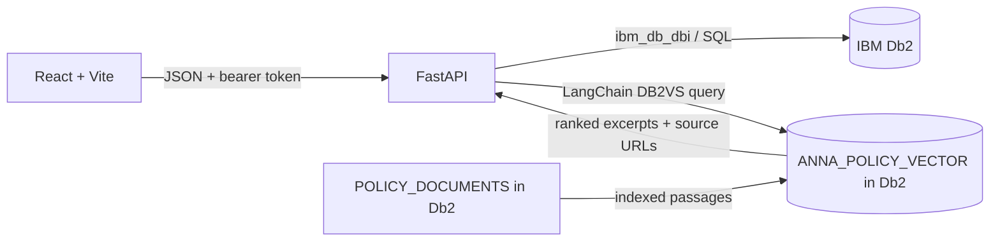

# AnnaSetu architecture

## Runtime and source of truth

The React/Vite client talks to a Python/FastAPI API. The API reads and writes only to IBM Db2. There is no SQLite, PostgreSQL, MySQL, file-backed, or in-memory operational fallback. If Db2 is unavailable, the API fails its startup rather than accepting food or rescue records that cannot be committed to the system of record.

The local profile pins the IBM Db2 Community Edition 12.1.5.0 image from IBM Container Registry. The image exposes port 50000 and keeps its database files in the named `annasetu-db2-data` volume. Community Edition is intended for non-production use.

`ANNA_POLICY_VECTOR` is a Db2 vector table, not a second operational store. The local feature-hash embedding implementation makes retrieval deterministic and offline; there is no remote generative model.

## Connected modules

1. **Food safety passport** — `FOOD_BATCHES`, `SAFETY_OBSERVATIONS`, and `HUMAN_VERIFICATIONS` carry the batch identity, donor, declared ingredients and allergens, storage observations, use-by time, and named human review.
2. **Rescue feasibility** — `services/safety.py` evaluates human verification, allergen declaration, storage mode and measurement, use-by time, and estimated transit. Missing or unreliable evidence returns `HOLD`. Past use-by or an estimated arrival after use-by returns `INFEASIBLE`. `FEASIBLE` means the recorded checks and estimated logistics fit; it is not a safety certification.
3. **NGO capacity** — `NGOS` stores verification, receiving categories and storage capabilities, hours, location, availability, and the remaining capacity reserved by open allocations. Allocation can split a batch across multiple eligible receivers.
4. **Rescue verification** — `RESCUES` stores volunteer assignment, allocated amount, one-time OTP hashes, state, and stage timestamps. Pickup, delivery, and distribution must be confirmed in order. The NGO supplies actual distributed kg at the final checkpoint; the value is stored in the immutable distribution audit event, so the current Db2 schema is unchanged. Reservation and rescue writes share one Db2 transaction.
5. **Intelligence dashboard** — totals, failures, receiver performance, and open supply/demand are queried from operational Db2 tables.
6. **Policy retrieval** — policy passages and source links are seeded to `POLICY_DOCUMENTS`. LangChain's `langchain-db2` `DB2VS` stores and searches vectors in Db2. A deterministic, local feature-hash embedding keeps the demonstration offline and avoids sending policy questions to a third party. Retrieved source passages are shown verbatim with their source URL. No LLM is configured, and retrieval never approves a batch.

## Data integrity and access

- Foreign keys link donors, verifiers, NGOs, volunteers, food, and rescue records.
- Database checks constrain roles, lifecycle values, positive quantities, capacity, temperature mode, and use-by ordering.
- Application queries use `?` parameter markers through `ibm_db_dbi`.
- JWT sessions carry one of `donor`, `ngo`, `volunteer`, or `admin`; write endpoints enforce role and ownership checks.
- Audit events are separate from mutable batch and rescue records. Each event stores a canonical payload, previous SHA-256 hash, and current hash. A single locked audit-head row serializes writers, and the administrator verification endpoint recomputes the chain.
- Db2 triggers reject `UPDATE` and `DELETE` statements on audit events, safety observations, and human verification records; new evidence is appended instead.
- OTP values are generated randomly and persisted only as SHA-256 digests. Allocation returns each code once to the caller for sharing with the receiving person.
- Checkpoint actors are enforced in both FastAPI and the React operations view: the donor confirms pickup, the assigned volunteer confirms delivery/handoff, and the receiving NGO confirms distribution. An administrator can override. Every non-admin actor must own or be assigned to the relevant batch/rescue.

## ETA and policy boundaries

For the MVP, route time is an estimate: straight-line geographic distance at 20 km/h plus a 15-minute handoff allowance. The UI labels this assumption and asks the volunteer to confirm actual conditions. No live route provider is used.

Evaluation returns the declared minutes remaining to use-by alongside candidate distance, estimated transit, capacity and decision reasons. Expired food is `INFEASIBLE`, including when there is no matching receiver. Missing safety evidence or absent eligible receiving capability yields `HOLD` with an explicit reason.

Cold `≤5°C`, hot `≥60°C`, and frozen `≤−18°C` are screening thresholds based on FSSAI public food-safety guidance. They are intentionally conservative app rules, not a substitute for a qualified food-safety person, current regulations, cold-chain records, hazard controls, or a certified FSSAI Food Safety Management System. Batches without complete evidence stay on `HOLD`.

## Main database tables

| Table | Purpose |
|---|---|
| `USERS` | Account identity, role, and password hash |
| `NGOS` | Verified receiving profile and capacity |
| `VOLUNTEERS` | Active volunteers and service area |
| `FOOD_BATCHES` | Operational batch record and current state |
| `SAFETY_OBSERVATIONS` | Append-only temperature and storage observations |
| `HUMAN_VERIFICATIONS` | Human review decisions |
| `RESCUES` | Capacity reservation and OTP-backed handoffs |
| `AUDIT_EVENTS`, `AUDIT_HEAD` | Tamper-evident append-only audit chain |
| `POLICY_DOCUMENTS`, `ANNA_POLICY_VECTOR` | Grounded policy source text and Db2 vector index |

## API map

- `POST /api/auth/login`, `GET /api/me`
- `GET /api/health`, `GET /api/dashboard`
- `GET|POST /api/food`, `GET /api/food/{id}/passport`, `PATCH /api/food/{id}/evidence`, `POST /api/food/{id}/verify`, `GET /api/food/{id}/evaluate`, `POST /api/food/{id}/allocate`
- `GET /api/rescues`, `POST /api/rescues/{id}/confirm`, `POST /api/rescues/{id}/fail`
- `GET|POST /api/ngos`, `PATCH /api/ngos/{id}/capacity`
- `GET /api/policy/status`, `POST /api/policy/ask`
- `GET /api/audit/verify` (administrator)

See [API reference](api.md), [Db2 schema](database-schema.md), [Db2 setup](db2-setup.md), [judge demo sequence](demo.md), and the [release testing report](testing.md) for operational detail.
