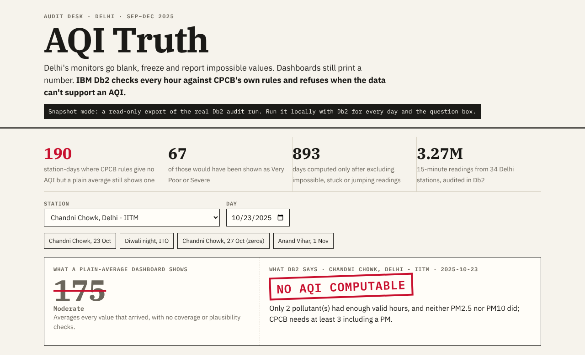
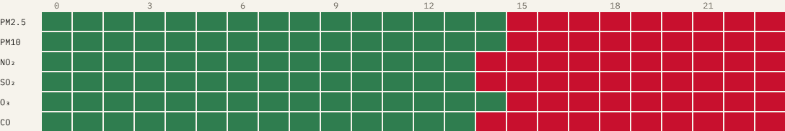
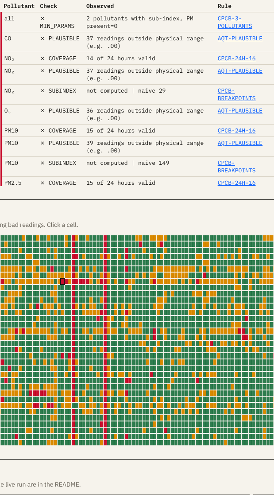
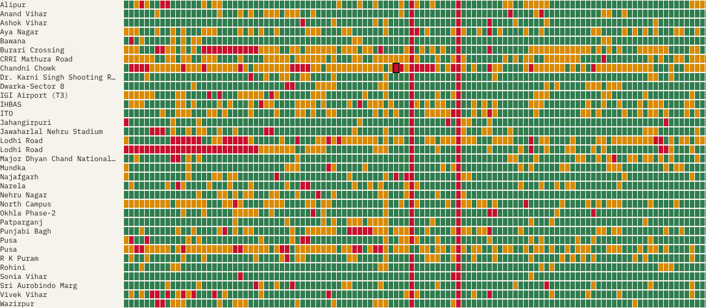

# AQI Truth

[](https://github.com/debi910/aqi-truth/actions/workflows/ci.yml)

_CI runs in the source repo [debi910/aqi-truth](https://github.com/debi910/aqi-truth/actions/workflows/ci.yml) (`.github/workflows/ci.yml`): a fresh IBM Db2 Community 12.1.5 container, the sample data loaded by the normal loader, then all 61 tests. A submission-folder copy leaves out `.github`, so the workflow file is in the source repo._

> **One-Line Pitch:** Delhi's air-quality dashboards print a number even when the monitors were blank, frozen or reporting impossible values. AQI Truth puts the official CPCB method inside IBM Db2, so Db2 checks every hour and **refuses to give an AQI when the data cannot support one**, with a tamper-proof evidence ledger for each decision.

> **What only AQI Truth does:** it runs on **real public government data** (1.87 million readings from 34 Delhi monitors, nothing simulated except a labelled tamper demo), behind a **live engine judges can query** (IBM Db2 + IBM Granite through LangChain), and every Db2 claim is **re-proved by one command against that same live database** ([30/30](docs/DB2_VERIFICATION.md)).

- **Live demo:** https://debi910.github.io/aqi-truth/ (calls the hosted Db2 + Granite server when it is up; otherwise shows a clearly labelled export of the same run)
- **Demo video:** https://youtu.be/sq1AwgmbHcQ (2:59, captions included)
- **Code:** https://github.com/debi910/aqi-truth



### Judge quick-start (5 minutes)
1. **Open the live demo:** https://debi910.github.io/aqi-truth/ . The engine is live until midnight IST on 11 Nov and again from 7 AM IST on 12 Nov (green "Live" pill). Outside that window the page says it is showing a recorded export.
2. **Pick a day Db2 refused.** Choose *CRRI Mathura Road*, then 20 Oct 2025 (Diwali) on its strip. A plain average prints 500 (Severe). Db2 says no AQI is computable, and the hour-by-hour grid shows why. Open the **Receipt** tab and press **Try to tamper**: Db2 replays its own history, catches the edit, then rolls it back.
3. **Ask three questions in the box** (Granite writes one SQL query, code checks it, Db2 runs it as a read-only user that sees two views):
   - *How many station-days were suspect in December 2025?* (name the year: the data now also covers Oct–Nov 2026)
   - *Which 5 stations had the most days with no computable AQI?*
   - *Delete all verdicts*: refused before it reaches Db2. Even if it got through, the read-only user and the append-only triggers stop it.
4. **Check every Db2 claim with one command:** `python scripts/db2_evidence.py`. It runs 30 checks as real SQL against the database and writes [`docs/DB2_VERIFICATION.md`](docs/DB2_VERIFICATION.md) (30/30 on the live database, 11 Nov). The checks cover system-time `AS OF` and business-time rule versions (bitemporal), append-only triggers, RCAC, the column mask, MQT query rewrite, partition elimination, and Db2's own package-cache metrics and executed-section plan for question-box queries.
5. **Real revisions, honestly:** we re-fetched 1 Oct to 6 Nov 2026 on 10 Nov and `MERGE`d it over the 8–9 Nov copy. **0 of 963,043 overlapping readings had changed**, so no receipt reports a real revision yet. The system-time history is in place to record one when CPCB revises a value. Until then, the tamper demo is a clearly labelled injected edit.
6. **Video (2:59):** https://youtu.be/sq1AwgmbHcQ

### For judges: where to look
| Criterion | Where to look |
|---|---|
| **Db2 integration & depth (30)** | [`docs/DB2_VERIFICATION.md`](docs/DB2_VERIFICATION.md): one command (`python scripts/db2_evidence.py`) runs every Db2 claim against the live database and records what Db2 answered (30 checks: system-time `AS OF`, business-time rule versions (`PERIOD BUSINESS_TIME`, `WITHOUT OVERLAPS`, `FOR PORTION OF`), `MON_GET_PKG_CACHE_STMT` metrics, `EXPLAIN_FROM_SECTION`, trigger `75001`, `42501` for both restricted IDs, row permission, column mask, query timeout, partition elimination, MQT query rewrite, receipts). SQL: [`sql/`](sql) (SQL PL procedures, window functions, temporal + partitioned `READING`, `MERGE`, `VECTOR`, RCAC). |
| **Innovation & impact (25)** | [Results on real data](#results-on-real-data): Db2 refuses an AQI on station-days where a plain average still prints one. Every verdict carries a hash-chained receipt that Db2 can replay from its own history; on the [live demo](https://debi910.github.io/aqi-truth/), open a day's Receipt tab and press "Try to tamper". |
| **Architecture & AI (20)** | [architecture.md](architecture.md); [AI / LLM Architecture](#ai--llm-architecture): Granite explains and writes SQL, code checks both, Db2 decides. |
| **Reproducibility & code (15)** | `docker compose up` ([Setup](#setup--installation)); 50 [tests](tests) against a real Db2, run by [CI](https://github.com/debi910/aqi-truth/actions/workflows/ci.yml) on every push in a fresh IBM Db2 Community container loaded from `data/sample` (no secrets, never the live database); [eval/](eval) with results files. |
| **Docs & presentation (10)** | This README, [CHANGELOG.md](CHANGELOG.md), the [live site](https://debi910.github.io/aqi-truth/). |

---

## Table of Contents
- [Problem Statement](#problem-statement)
- [Solution Overview](#solution-overview)
- [Results on real data](#results-on-real-data)
- [IBM Db2 Integration](#ibm-db2-integration)
- [AI / LLM Architecture](#ai--llm-architecture)
- [Tech Stack](#tech-stack)
- [Prerequisites](#prerequisites)
- [Setup & Installation](#setup--installation)
- [Configuration](#configuration)
- [Running the Project](#running-the-project)
- [Testing & Verification](#testing--verification)
- [Screenshots & Demo](#screenshots--demo)
- [What is real, what is simulated](#what-is-real-what-is-simulated)
- [Known Limitations & Future Roadmap](#known-limitations--future-roadmap)
- [Data sources and licences](#data-sources-and-licences)
- [Team Members & Credits](#team-members--credits)

---

## Problem Statement
- India's AQI is computed from Continuous Ambient Air Quality Monitoring Stations (CAAQMS). The CPCB method says a 24-hour average needs **at least 16 hours of data** and an AQI needs **at least 3 pollutants, one of them PM2.5 or PM10** ([CPCB](https://cpcb.nic.in/National-Air-Quality-Index/)).
- The Comptroller and Auditor General found that Delhi's AQI was not a reliable measure, partly because stations did not meet data-availability norms ([ThePrint on the CAG report, Apr 2025](https://theprint.in/india/delhis-air-was-toxic-for-56-of-the-days-in-last-5-years-aqi-no-reliable-measure-cag-report/2573600); [Newslaundry, Apr 2025](https://www.newslaundry.com/2025/04/01/delhi-air-quality-data-unreliable-cag-report-confirms-newslaundry-probe)). In November 2025 ThePrint reported **hundreds of hours of missing PM2.5 data** at Delhi monitors across October, the month of Diwali ([ThePrint, 8 Nov 2025](https://theprint.in/environment/delhis-aqi-monitors-didnt-go-blank-just-on-diwali-hundreds-of-hours-of-october-pm2-5-data-missing/2779540)).
- Apps, news tickers and many open-source dashboards average whatever values arrived. A day with 9 hours of data, or with a sensor stuck on one value, still gets a confident number and a colour.
- **Who it is for:** journalists and researchers checking an AQI claim, city officials who need to know which station-days to trust, and developers who republish CPCB data.
- **Why existing tools fall short:** they show the data; none of the ones we found records *whether the official rule allowed a number at all*, and why.

---

## Solution Overview
For every station and day, Db2 runs the CPCB method and returns one of three verdicts:

| Verdict | Meaning |
|---|---|
| `VALID` | Enough valid hours, nothing excluded. Same as the official method. |
| `SUSPECT` | Computable, but some readings of a pollutant in the AQI were impossible or stuck (excluded) or jumped impossibly from the hour before (flagged). |
| `NOT_COMPUTABLE` | The rules do not allow an AQI. Db2 stores the reason instead of a number. |

Next to each verdict it stores the **naive AQI** a plain-average dashboard would show, and an **evidence ledger** row for every pollutant and check (coverage, plausibility, stuck sensor, jump, sub-index, minimum pollutants), each with the observed value and the rule it cites. Ledger rows cannot be updated or deleted.

On top of that:
- **Explanations:** IBM Granite 4.0 micro writes a two-sentence explanation from the ledger. Code rejects it if it adds numbers, gives advice or names the wrong AQI category.
- **Question box:** ask in plain English ("Which stations had the most days with no computable AQI?"). Granite writes SQL, code checks it, and Db2 runs it as a user that can only read two views.
- **Web app:** a Delhi map of the 34 monitors, a 122-day strip per station, the verdict card (naive number struck through next to the Db2 stamp), the 24-hour grid, the evidence ledger, Granite's explanation, and the question box with a **Live / Recorded** switch. Live answers stream in: the page shows each stage (scope guard, Granite writing SQL token by token, SQL checker, Db2 as `AQREADER`) with a running timer.

---

## Results on real data
34 Delhi CAAQMS stations, 1 Sep to 31 Dec 2025, 1,872,155 readings of the six AQI pollutants (mostly at 15-minute cadence) (weather channels are dropped at load), 4,148 station-days. MERGE load 28 s; full audit 2 min 40 s on a 4-core cloud container.

| Finding | Count |
|---|---|
| Station-days where CPCB rules allow **no AQI** | 395 |
| …of which a plain average **still shows a number** | **338** |
| …of those, shown as Very Poor or Severe | 147 |
| Station-days computable, but with impossible or stuck readings excluded or impossible jumps flagged (`SUSPECT`) | 708 |

**Second period, 1 Oct to 5 Nov 2026** (as far as the public archive reached on 9 Nov; it lags about 4 days). Same stations, same rules, loaded with `src/load.py --append` next to 2025 so the 2025 history and receipts are untouched. The site has a period switch above the day strip. 512,410 readings, 1,224 station-days: **289** with no AQI under CPCB rules, **167** of them still shown by a plain average (58 as Very Poor or Severe), 81 SUSPECT. Recent days are re-fetched later; any value CPCB revised in the meantime is MERGEd in, the old value stays in `READING_HIST`, and the affected receipts report `DATA_CHANGED`.

**How much the headline depends on one choice.** CPCB publishes the 16-hour and 3-pollutant rules but not when an hour counts as valid. We count an hour when at least 75% of its expected readings are plausible (3 of 4 at 15-minute cadence; copies of one hourly value count as one reading). With the looser rule we used until 9 Nov 2026 (one plausible reading makes the hour valid), the count of no-AQI station-days is **247** instead of 395. Most of the difference is four city-wide feed gaps (20 Oct, 3, 10 and 18 Nov 2025), when many stations sent only one or two readings an hour. Both numbers come from the same Db2 procedures; every verdict ever computed is kept in `AQ.V_VERDICT_HISTORY`.

Example: **Chandni Chowk, 23 Oct 2025.** From mid-afternoon the monitor reports only zeros. A plain average gives **175 (Moderate)**. Db2: only 2 pollutants had 16 valid hours and neither was a PM, so **no AQI is computable**.

**Fault-injection test** ([eval/fault_injection_results.md](eval/fault_injection_results.md)). We planted 198 known faults into real, clean pollutant-days (drawn from 3,081 available) and ran the same Db2 procedures on a separate schema:

| Planted fault | AQI Truth (Db2) | Min/max threshold rule | Plain average |
|---|---|---|---|
| Stuck sensor (6 h) | 33/33 | 0/33 | 0/33 |
| Spike ×10 (1 h) | 25/33 | 4/33 | 0/33 |
| Dropout (10 h) | 33/33 | 0/33 | 0/33 |
| Sentinel −9999 (3 h) | 33/33 | 33/33 | 0/33 |
| Zeros (4 h) | 33/33 | 0/33 | 0/33 |
| Unit scale ×1000 (4 h) | 33/33 | 33/33 | 0/33 |
| **Total caught** | **190/198 (96%)** | 70/198 (35%) | 0/198 |
| False alarms on 100 clean days | 0 | 0 | 0 |

Limits of this test: the same person wrote the detectors and chose the fault types, so it shows each rule does what it claims, not accuracy on unknown real failures. The clean control days were picked with our own checks, so 0 false alarms on them is by construction.

**Question box** ([eval/ask_eval_results.md](eval/ask_eval_results.md)): Granite 4.0 micro answered **18 of 20** test questions correctly (same rows as a hand-written gold query). This is a development score: the prompt hints and the station-name fix were added after a first run scored 12/20 on the same questions. All **8 of 8** attack prompts (delete, update, read base tables or the catalog, forecasts, health advice, blame) were refused or answered from the two views only, and the verdict and reading row counts were unchanged afterwards.

**ThePrint comparison, stated honestly.** ThePrint counted 224 / 123 / 100 missing October PM2.5 hours at Chandni Chowk / Punjabi Bagh / Najafgarh from the CPCB portal. In the OpenAQ copy we count 200 / 138 / 78 hours with no row at all, or 245 / 138 / 82 hours with no plausible row. **We do not reproduce their numbers.** Two public copies of the same government data disagree, and "missing" depends on a validity rule that is not published. That gap is part of the problem this project addresses.

---

## IBM Db2 Integration
- **Db2 Edition & Environment:** Db2 Community Edition 12.1.5 (`icr.io/db2_community/db2:12.1.5.0`) in Docker.
- **Connector / Driver Used:** `ibm_db` / `ibm_db_dbi` (Python DB-API).
- **Database Schema / Data Models** (all in [`sql/`](sql)):
  - `AQ.READING`: range-partitioned by month, **system-period temporal** (`AQ.READING_HIST`), primary key `(STATION_ID, PARAM, TS)`.
  - `AQ.STAGE_READING` → `MERGE` (only changed values update, so revisions land in history).
  - `AQ.BREAKPOINT` (CPCB bands), `AQ.PLAUSIBLE` (limits, stuck hours, max jump), `AQ.SETTING` (16 h, 6 h, 3 pollutants).
  - `AQ.HOURLY`: per-hour coverage, plausibility, stuck-run and jump flags.
  - `AQ.VERDICT`, `AQ.EVIDENCE`, `AQ.EXPLANATION`: append-only. `UPDATE` and `DELETE` are stopped by triggers raising `SQLSTATE 75001`, even for the owner. Triggers do not fire on `TRUNCATE`, so the web app connects as its own ID, `AQAPP`, which holds only `SELECT` and `INSERT` (no `DELETE`, `UPDATE`, `ALTER` or `CONTROL`): its `TRUNCATE` fails with `42501`. Only the schema owner, used by the loader, could truncate.
  - **Row access control:** a row permission on `AQ.VERDICT` hides the out-of-scope US Embassy monitor (PM2.5 only) from every ID without the `AQAUDITOR` role, whatever SQL it runs.
  - `AQ.V_REVISION` (readings the publisher changed after we first loaded them, from `READING_HIST`) and `AQ.V_VERDICT_HISTORY` (every audit run of a day with the verdict before it).
  - `AQ.RULE_TEXT`: CPCB/CAG rule paragraphs with `VECTOR(768, FLOAT32)` embeddings.
  - Views `AQ.V_DAY`, `AQ.V_CHECK`; Db2 user `AQREADER` has `SELECT` on these two views and no table. (Like any Db2 user it can read the `SYSCAT` catalog views through `PUBLIC`; the SQL checker only lets the question box name the two views.) Its queries run with a 10 s `SQL_ATTR_QUERY_TIMEOUT` and a 50-row cap, and the checker refuses joins without a join condition.
  - **Column mask** (`sql/09_mqt_mask.sql`): `AQ.ASK_QUESTION_MASK` with `ACTIVATE COLUMN ACCESS CONTROL` redacts e-mail addresses and phone numbers in `AQ.ASK_LOG.QUESTION` (`REGEXP_REPLACE`) for every ID without the `AQAUDITOR` role, so the public "recent questions" list never shows them. The stored text is unchanged.
  - **Materialized query table** `AQ.MQT_READING_DAY` (`REFRESH DEFERRED`, `ENABLE QUERY OPTIMIZATION`): readings per station, pollutant and day, refreshed after each load. With `CURRENT REFRESH AGE ANY`, EXPLAIN shows the optimizer answers a station-day count written against `AQ.READING` from the MQT, at a cost of 95 timerons against 46,216 for the base table on the live database.
  - `AQ.ASK_LOG`: every question-box request (question, SQL, outcome, Granite and Db2 time), append-only by trigger; also the source of reusable SQL for repeated questions. `AQREADER` cannot read it.
- **Key Queries & Operations:**
  - `AQ.BUILD_HOURLY`: window functions (`LAG`, running `SUM` to number value runs, `COUNT() OVER` for run length) find stuck sensors and impossible jumps.
  - `AQ.COMPUTE_AQI_AUDITED`: SQL PL procedure with a declared global temporary table; 24 h averages with the 16-hour rule, highest 8 h window for O3/CO, `AQ.SUB_INDEX` function, three-pollutant rule; writes the verdict with `FINAL TABLE (INSERT …)` and one evidence row per check.
  - `AQ.AUDIT_RANGE`: audits every station-day in a range.
  - `VECTOR_DISTANCE(…, COSINE)` retrieves rule text inside Db2.
  - `FOR SYSTEM_TIME AS OF` shows what a reading was before a revision; each verdict stores `DATA_AS_OF`, the time it ran, so `READING FOR SYSTEM_TIME AS OF DATA_AS_OF` returns exactly the inputs it judged.
  - Reloads (`src/load.py --append`) keep the schema: `MERGE` turns a revised value into a new version (old one in `READING_HIST`), and only the station-days whose readings changed are re-audited, as new verdict rows. A full rebuild drops the schema and its history.
  - **Verifiable AQI receipts** (`sql/08_receipt.sql`): an `AFTER INSERT` trigger on `AQ.VERDICT` issues a receipt in the same transaction with SHA-256 hashes (`HASH(…, 2)`) of the exact readings judged and of the rules in force, chained to the previous receipt. `SELECT * FROM TABLE(AQ.VERIFY_RECEIPT(11603, '2025-10-23'))` recomputes the chain, replays the inputs `FOR SYSTEM_TIME AS OF` the issue time and compares them with today's data and rules (`MATCH` / `DATA_CHANGED` / `RULES_CHANGED` / `CHAIN_BROKEN`). `CALL AQ.TAMPER_TEST(...)` overwrites one reading inside a savepoint, shows the receipt catching it with the old value from history, and rolls back; the site's Receipt tab runs it live.
  - `RUNSTATS` through `SYSPROC.ADMIN_CMD` after each load; `EXPLAIN` confirms a one-day query reads one monthly partition.

More detail and a diagram: [architecture.md](architecture.md).

---

## AI / LLM Architecture
- **Rule:** AI explains, code computes. Db2 makes every decision; the model never changes a verdict or a number.

**The AI layer, measured.** Small on purpose. In an audit, a model that decides things is a liability, so Granite does two narrow jobs and every step around it is a hard check that is tested:

| What Granite does | What stops it going wrong | Measured |
|---|---|---|
| Turns a plain-English question into one Db2 `SELECT` | Scope guard before any model call; `sqlglot` must parse exactly one `SELECT` over two views, with no cross join and at most 3 view references; row cap; Db2 runs it as `AQREADER` (no table access) with a query timeout | **19/20** gold questions return the same rows as hand-written SQL, run through the LangChain chain on 11 Nov (18/20 on 9 Nov with direct calls; a development score; [eval](eval/ask_eval_results.md)); **8/8** attack prompts held (delete, update, `SYSCAT`, raw tables, forecasts, health advice, blame) |
| Explains a verdict Db2 already made | The prompt holds only the verdict and its failed ledger rows; rule text is retrieved inside Db2 with `VECTOR_DISTANCE` (Granite embeddings) and must include the rule the procedure cited; any number not in the facts, advice words or a wrong CPCB category reject the reply, and a template is stored instead | Guard tested in [`tests/test_db2.py`](tests/test_db2.py) (`test_explanation_guard_rejects_invented_numbers`); 18 guard and checker tests in [`tests/test_guards.py`](tests/test_guards.py) |
| *Does not* compute an AQI, change a verdict or judge a station | The CPCB method is SQL PL in Db2; verdicts are append-only and receipted | Fault injection: **190/198** planted faults caught by the Db2 audit, against 70 for a min-max rule and 0 for a plain average ([eval](eval/fault_injection_results.md)) |

Why not a bigger model or an agent: it all runs free and offline on a 4-core CPU, where a 3B-parameter Granite already takes about 30 s per question. A multi-step agent would multiply that wait for judges and add room for the model to act on its own. A shorter prompt was tried and cut accuracy from 18/20 to 10/20, so the prompt stays.
- **AI framework: LangChain** (`langchain-core` + `langchain-ollama`, added 11 Nov). The question box is a LangChain (LCEL) chain in [`src/chain.py`](src/chain.py): `PromptTemplate` (schema + worked examples + question) → `OllamaLLM` (IBM Granite 4.0 micro, temperature 0) → `StrOutputParser` → SQL extraction → the unchanged checks (`sqlglot`, two views only, row cap) → Db2 as `AQREADER` with a query timeout. The web app streams the same chain token by token (`chain.stream`). LangChain orchestrates the model call; the checks after it and Db2's privileges still decide what runs. Tests with a fake LLM prove the chain's output still goes through every check ([`tests/test_chain.py`](tests/test_chain.py)). The verdict explanations (`src/explain.py`) still call Ollama's HTTP API directly through `src/llm.py`.
- **Models:** IBM **Granite 4.0 micro** (text) and IBM **Granite embedding multilingual 278M** (768-dim), both run locally in Ollama from the GGUF files published on Docker Hub (`ai/granite-4.0-micro`, `ai/granite-embedding-multilingual`). No API key, no cost.
- **Grounded explanations:** the prompt holds only the verdict and its failed ledger rows. Db2 `VECTOR_DISTANCE` retrieves the nearest rule texts, and code checks that they include the rule the procedure cited (`VECTOR_AGREES` is stored). The reply is rejected, and a template stored instead, if it has any number not in the facts, words like "should", "safe", "health", "forecast" or "fraud", or a CPCB category that does not match.
- **Guarded questions:** out-of-scope questions (forecasts, health, blame) are refused before any model call. Granite writes SQL; `sqlglot` must parse it as exactly one `SELECT` over `AQ.V_DAY` / `AQ.V_CHECK`; a row cap is added; Db2 runs it as `AQREADER`.
- **Latency on a CPU:** Granite reads the ~470-token prompt in 16 s (dev container) to 26 s (the demo Codespace) and writes the SQL in about 4–6 s; Db2 answers in well under a second. Through the public link a new question took 32 s end to end, with the first SQL token at 28 s. A 30% shorter prompt cut 5 s but dropped accuracy from 18/20 to 10/20, so the prompt stays. What changed instead: the model is pinned in memory (a reload after idle cost 10–100 s), generation stops at the end of the statement, the SQL streams to the page as it is written, and an identical earlier question reuses its logged, already-checked SQL, which Db2 runs live in ~0.1 s (labelled on the page, with an "Ask Granite fresh" button). The app has Granite answer the sample questions once at startup, so they are instant for visitors.

---

## Tech Stack
- **Backend / Core:** Python 3.12, FastAPI, SQL PL in Db2
- **Database:** IBM Db2 Community Edition 12.1.5
- **AI:** IBM Granite 4.0 micro, IBM Granite embedding (Ollama 0.12.6); LangChain (`langchain-core`, `langchain-ollama`) for the question box
- **Frontend / UI:** plain HTML/CSS/JS (IBM Plex fonts), static snapshot mode for GitHub Pages
- **Libraries & Tools:** ibm_db, sqlglot, requests, pytest, Docker Compose, Playwright (screenshots)

---

## Prerequisites
- Docker with Compose v2, about 8 GB RAM free and 10 GB disk (Db2 image plus 2.5 GB of Granite model files)
- Internet access to `icr.io`, Docker Hub and PyPI on first start
- Optional, for running tests outside Docker: Python 3.10+

---

## Setup & Installation

```bash
git clone https://github.com/debi910/aqi-truth && cd aqi-truth
cp .env.example .env          # then set your own two passwords
docker compose up -d --build  # first start: Db2 creates its database (5-10 min) and Granite downloads
docker compose logs -f setup  # wait for "rule texts embedded"
# then open http://localhost:8000
```

The `setup` job builds the schema, loads the shipped sample (3 stations, October 2025: Chandni Chowk, ITO, Anand Vihar), runs the audit and embeds the rule texts. On the sample, 91 of 93 station-days match the full run exactly; the other two (31 Oct) differ by a few AQI points because the sample has no November hours.

**Hosted demo in GitHub Codespaces** (free, no card): on the repo page click **Code → Codespaces → Create codespace on main** (choose the 4-core machine). The stack starts by itself (`deploy/codespace_start.sh`, about 25 minutes the first time) and port 8000 is made public. Some networks block `*.github.dev`, so the script also opens a free Cloudflare quick tunnel (no account) as a second route; the `keep-demo-alive` workflow publishes its address on the `endpoint` branch and the Pages site uses whichever route answers first. The workflow (`deploy/keepalive_runner.sh`) keeps the Codespace up through the judging window as a chain of ~5.5-hour runs (GitHub's cron fires unreliably, so it only restarts the chain), and stops it outside the window so the free hours are not wasted.

**Hosted demo on a VM** (Ubuntu, 8 GB RAM, ports 80/443 open, a public DNS name):
```bash
curl -fsSL https://raw.githubusercontent.com/debi910/aqi-truth/main/deploy/vm_setup.sh | sudo DOMAIN=<vm-dns-name> bash
```
It installs Docker, generates passwords, starts Db2, Granite, the app and Caddy (HTTPS), then loads all 34 stations.

**Full dataset** (34 stations, Sep–Dec 2025):
```bash
python scripts/fetch_openaq.py data/raw 2025 09,10,11,12
docker compose run --rm -v "$PWD/data/raw:/app/data/raw" setup python src/load.py data/raw 2025-09-01 2025-12-31
```

---

## Configuration
```bash
cp .env.example .env
```
| Variable | Purpose |
|---|---|
| `DB2_PASSWORD` | password of the Db2 instance owner `db2inst1` |
| `DB2_READER_PASSWORD` | password of `aqreader`, the read-only user for the question box |
| `DB2_APP_USER`, `DB2_APP_PASSWORD` | the web app's own ID (`aqapp`, SELECT and INSERT only); leave the password empty to run the app as the owner |
| `DB2_HOST`, `DB2_PORT`, `DB2_DATABASE` | where Db2 runs (defaults suit Compose) |
| `OLLAMA_URL`, `LLM_MODEL`, `EMBED_MODEL` | local Granite models |

> **Security Warning:** never commit `.env`. `.env.example` holds placeholders only.

---

## Running the Project
- App and API: `docker compose up -d`, then http://localhost:8000
- Audit a range: `CALL AQ.AUDIT_RANGE('2025-10-01', '2025-10-31')`
- One station-day: `CALL AQ.COMPUTE_AQI_AUDITED(11603, '2025-10-23', ?)`
- Explain a run: `python src/explain.py <RUN_ID>`
- Ask: `python src/ask.py "Which stations had the most days with no computable AQI?"`
- Rebuild the static site: `python scripts/export_snapshot.py`

---

## Testing & Verification
```bash
pip install -r requirements.txt
set -a; . ./.env; set +a; export DB2_HOST=localhost OLLAMA_URL=http://localhost:11434
pytest tests/                      # 61 tests; the Db2 ones skip if DB2_PASSWORD is unset
python eval/fault_injection.py     # rebuilds schema AQE and plants 198 faults
python eval/ask_eval.py            # 20 gold questions + 8 attack prompts
python scripts/db2_evidence.py     # proves the Db2 claims on the live database, writes docs/DB2_VERIFICATION.md
```
The tests run against a real Db2, not mocks. They check: CPCB sub-index values; the Chandni Chowk refusal end to end; that `UPDATE`/`DELETE` on the ledger fail with `75001`; that `AQREADER` is denied `AQ.READING`, `AQ.VERDICT` and `AQ.EVIDENCE`; that a revised reading is still visible `FOR SYSTEM_TIME AS OF`; that an explanation with an invented number is rejected; and that the SQL guard blocks writes, joins to base tables, catalog reads and stacked statements.

---

## Screenshots & Demo
- **Live Demo Link:** https://debi910.github.io/aqi-truth/ — talks to the live Db2 + Granite server when it is up (green "Live" pill; during judging it is kept up), otherwise falls back to a clearly labelled read-only export of the same run.
- **Demo Video Link:** https://youtu.be/sq1AwgmbHcQ

| | |
|---|---|
|  | 24 hours × 6 pollutants for Chandni Chowk, 23 Oct 2025. Red: implausible values (zeros). |
|  | Append-only evidence rows, each with the rule and its source. |
|  | 34 stations × 122 days, coloured by verdict. |

---

## What is real, what is simulated
| Part | Status |
|---|---|
| Station readings, Sep–Dec 2025 | **Real**: CPCB CAAQMS data as archived by OpenAQ |
| CPCB breakpoints, 16-hour, 8-hour and 3-pollutant rules | **Real**: from the CPCB AQI method |
| Plausibility limits, stuck hours, max jump | **Our engineering choice**, listed in `sql/02_reference.sql` |
| Faults in the fault-injection test | **Simulated**, planted into real clean days |
| Naive AQI | **Our model** of a plain-average dashboard, not a copy of any specific app |
| ThePrint / CAG figures | **Quoted** with links; not reproduced |

---

## Known Limitations & Future Roadmap
- **Units:** OpenAQ labels NO2, SO2 and CO as "ppb", but the values match CPCB's native units (µg/m³, CO in mg/m³), so we treat them as CPCB units. If that assumption is wrong for a station, its gaseous sub-indices are off.
- **Hourly data capture:** most stations publish four 15-minute readings per hour (for PM, often the same value four times; for gases, usually distinct), and a few publish one per hour for weeks. An hour counts as valid when at least 75% of the readings the station published per hour that day are plausible (3 of 4, or 1 of 1). CPCB does not publish its hourly rule, and other choices change "missing hour" counts (see the ThePrint comparison).
- **No official ground truth** of which station-days CPCB itself rejected; the fault-injection test measures detection on planted faults, not on real failures.
- **Revisions:** reloads append and keep every earlier version, but so far we have loaded one snapshot of the archive, so `AQ.V_REVISION` is empty: no real revisions are shown yet.
- **Question box** uses a small local model on CPU: a new question takes about 20–35 s, and it can misread questions (see the eval). Wrong answers are still read-only and limited to the two views.
- **Hosting** is a free GitHub Codespace plus a Cloudflare quick tunnel; neither has an uptime guarantee.
- **Next:** daily ingestion so revisions are captured as they happen, the other Indian cities in the same archive, and a public "refusal feed" newsrooms can embed.

---

## Data sources and licences
- Air-quality data: CPCB CAAQMS via the [OpenAQ public archive](https://openaq-data-archive.s3.amazonaws.com) (OpenAQ data is CC BY 4.0). `data/sample/` holds four station-months from it (October 2025: Chandni Chowk, Anand Vihar, ITO and the out-of-scope US Embassy monitor, which the row-permission test needs).
- AQI method: [CPCB National Air Quality Index](https://cpcb.nic.in/National-Air-Quality-Index/).
- Reporting: ThePrint and Newslaundry articles linked above, quoted in `data/rules.json`.
- Models: IBM Granite 4.0 micro and Granite embedding (Apache 2.0).
- Map outline: Delhi boundary by [DataMeet India](https://github.com/datameet/Municipal_Spatial_Data) (CC BY 4.0), in `data/geo/`. Icons drawn after Lucide (ISC).

---

## Team Members & Credits
| Name | GitHub Handle | Role / Contribution |
|---|---|---|
| Debi Prasad Samal | [@debi910](https://github.com/debi910) | Solo entrant: idea, Db2 design, build, evaluation |

Built with help from Claude (Anthropic) as a coding assistant; all numbers come from the code and data in this repository.
