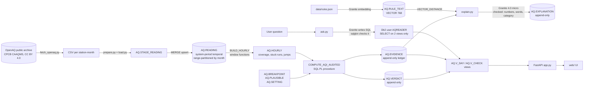

# Architecture

AQI Truth has one rule: **Db2 computes and decides, the AI only explains and asks.**
Every number a user sees comes from SQL in Db2. The Granite model never changes a verdict.

## Data flow

1. **Ingest.** `scripts/fetch_openaq.py` downloads station-month CSVs from the OpenAQ public S3 archive (no API key). `src/prepare.py` normalises them; `src/load.py` inserts into `AQ.STAGE_READING` and runs `sql/03_merge.sql`.
2. **Store.** `AQ.READING` has primary key `(STATION_ID, PARAM, TS)`, is **range-partitioned by month**, and is a **system-period temporal table** (`PERIOD SYSTEM_TIME`, history in `AQ.READING_HIST`). Re-loading a corrected file (`src/load.py --append`, which keeps the schema) only updates rows whose value changed (`MERGE ... WHEN MATCHED AND r.VALUE IS DISTINCT FROM s.VALUE`), the old value stays queryable with `FOR SYSTEM_TIME AS OF`, and only the station-days whose readings changed are re-audited. `AQ.V_REVISION` lists revised readings. A full rebuild (no `--append`) drops the schema and its history.
3. **Hourly layer.** `AQ.BUILD_HOURLY` buckets readings into hours (an hour is valid when 75% of its expected readings are plausible: 3 of 4 at 15-minute cadence, 1 when the source published hourly) and, in one pass with no self-join, uses window functions (`LAG`, running `SUM` to number runs, `COUNT ... OVER` for run length) to flag stuck sensors (same value for N hours, excluded) and impossible jumps between consecutive hours (flagged, kept in the average). Plausibility limits come from `AQ.PLAUSIBLE`.
4. **Audit.** `AQ.COMPUTE_AQI_AUDITED(station, day)` applies the CPCB method: 24-hour averages need at least 16 valid hours; O3 and CO use the highest 8-hour average with at least 6 valid hours; an AQI needs at least 3 pollutants, one of them PM2.5 or PM10. Sub-indices come from `AQ.SUB_INDEX` over `AQ.BREAKPOINT`. It also computes the **naive AQI** a plain-average dashboard would show. Output:
   - one row in `AQ.VERDICT` with `VALID`, `SUSPECT` (computable only after excluding bad hours) or `NOT_COMPUTABLE` (with the reason), and
   - one row per pollutant and check in `AQ.EVIDENCE` (coverage, plausibility, stuck, jump, sub-index, minimum pollutants), each with the observed value and the rule it cites.
   `AQ.AUDIT_RANGE(from, to)` runs it for every station and day.
5. **Ledger.** `BEFORE UPDATE` / `BEFORE DELETE` triggers on `AQ.EVIDENCE`, `AQ.VERDICT`, `AQ.EXPLANATION`, `AQ.RECEIPT` and `AQ.ASK_LOG` raise `SQLSTATE 75001`. Triggers do not fire on `TRUNCATE`, so the app connects as `AQAPP` (SELECT, plus INSERT on the two logs), which has no privilege to truncate (`42501`). A re-run adds a new run; `AQ.V_DAY` shows the latest run per station-day.
   - **Receipts** (`sql/08_receipt.sql`): an `AFTER INSERT` trigger on `AQ.VERDICT` writes a receipt in the same transaction: SHA-256 (`HASH(…, 2)`) of the exact readings judged, of the rules in force, and of the previous receipt (a hash chain). `AQ.VERIFY_RECEIPT(station, day)` recomputes the chain, replays the inputs `FOR SYSTEM_TIME AS OF` the issue time, and compares them with the data and rules now: `MATCH`, `DATA_CHANGED` (with the old value from history), `RULES_CHANGED` or `CHAIN_BROKEN`. `AQ.TAMPER_TEST` demonstrates it safely inside a savepoint.
   - **Row access control:** a row permission on `AQ.VERDICT` hides the out-of-scope US Embassy monitor from every ID without the `AQAUDITOR` role.
6. **Explain.** `src/explain.py` reads a verdict and its failed checks, runs a Db2 `VECTOR_DISTANCE` search over `AQ.RULE_TEXT`, and checks that the nearest rules include the rule the procedure cited. Granite 4.0 micro writes two sentences. Code rejects the text and stores a template instead if it contains a number not in the evidence, advice or prediction words, or a CPCB category that does not match the AQI.
7. **Ask.** `src/ask.py` refuses forecasts, health advice and blame questions before any model call. Otherwise Granite writes one SQL statement; `sqlglot` must parse it as a single `SELECT` over `AQ.V_DAY` / `AQ.V_CHECK` only, and a row cap is added. Db2 then runs it as `AQREADER`, a user whose only privileges are `CONNECT` and `SELECT` on those two views (plus the catalog views every Db2 user can read through `PUBLIC`), so even a query that slipped past the parser cannot read or change any table. Joins without a join condition are refused, rows are capped at 50, and Db2 cancels a query after 10 s (`SQL_ATTR_QUERY_TIMEOUT`).

## Why these Db2 features

| Feature | Where | Why it is needed here |
|---|---|---|
| Range partitioning by month | `AQ.READING` | 1.87M pollutant rows for four months; audits read one day at a time |
| System-period temporal table | `AQ.READING` | Government feeds get revised; an audit must be able to show what the data said when it was judged |
| MERGE | `sql/03_merge.sql` | Idempotent reloads; only changed values create history |
| SQL PL procedures and a function | `sql/04_audit.sql` | The CPCB method runs next to the data, the same way for the app, the tests and the evaluation |
| Window functions | `BUILD_HOURLY` | Stuck runs and jumps are sequence properties, not row properties |
| Declared global temporary table | `COMPUTE_AQI_AUDITED` | Per-call working set without touching shared tables |
| `FINAL TABLE (INSERT ...)` | `COMPUTE_AQI_AUDITED` | Gets the new run id in one statement |
| Triggers raising SQLSTATE | ledger tables | Evidence cannot be updated or deleted after the fact, even by the schema owner |
| SHA-256 `HASH` + trigger + temporal replay | `AQ.RECEIPT`, `AQ.VERIFY_RECEIPT` | Each published AQI is tamper-evident and replayable from Db2's own history |
| Row permission (RCAC) | `AQ.VERDICT` | The audit's scope is enforced by Db2 for every ID, not only by a view filter |
| Two least-privilege IDs | `AQAPP`, `AQREADER` | The app can append but never truncate or rewrite; the question box can only read two views |
| `RUNSTATS` via `ADMIN_CMD`, `EXPLAIN` | `src/load.py`, `scripts/db2_evidence.py` | Plans use real statistics; a one-day query reads one monthly partition |
| `VECTOR(768, FLOAT32)` + `VECTOR_DISTANCE` | `AQ.RULE_TEXT` | Rule retrieval happens in Db2 and is cross-checked against the procedure's citation |
| Least-privilege authorization ID | `AQREADER` | The natural-language box is safe by database permission, not only by prompt |
| CHECK constraints | `AQ.VERDICT`, `AQ.ASK_LOG` | Only the allowed states can exist |
| Append-only question log | `AQ.ASK_LOG` | Every natural-language request is on record; identical questions reuse checked SQL so a CPU-only model stays usable |
| Column mask + `ACTIVATE COLUMN ACCESS CONTROL` | `AQ.ASK_LOG.QUESTION` | E-mail addresses and phone numbers that visitors type are redacted for every ID except the auditor role; the stored text is unchanged |
| Materialized query table (`REFRESH DEFERRED`, `ENABLE QUERY OPTIMIZATION`) | `AQ.MQT_READING_DAY` | Station-pollutant-day counts; with `CURRENT REFRESH AGE ANY` the optimizer answers queries on `AQ.READING` from it (EXPLAIN cost 95 vs 46,216) |

## Runtime

`docker-compose.yml` starts Db2 Community Edition 12.1.5, Ollama 0.12.6 with the IBM Granite GGUF files from Docker Hub, a one-shot `setup` job (download models, build schema, load the 3-station sample, audit, embed rules) and the FastAPI app on port 8000. The public demo site is a static export of the full 34-station run (`scripts/export_snapshot.py`), so it works without a database.
