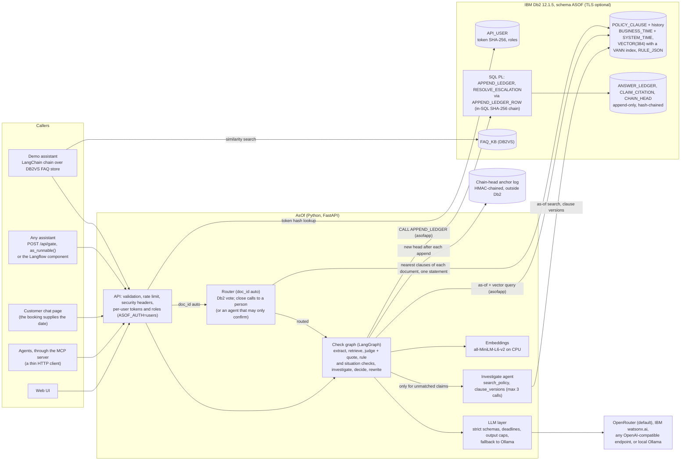
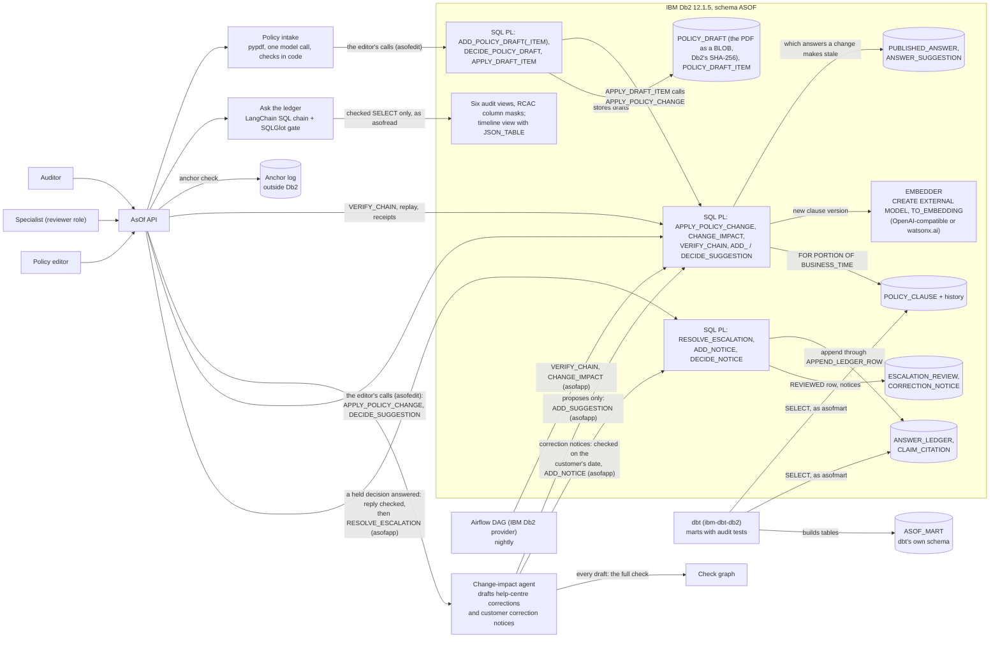
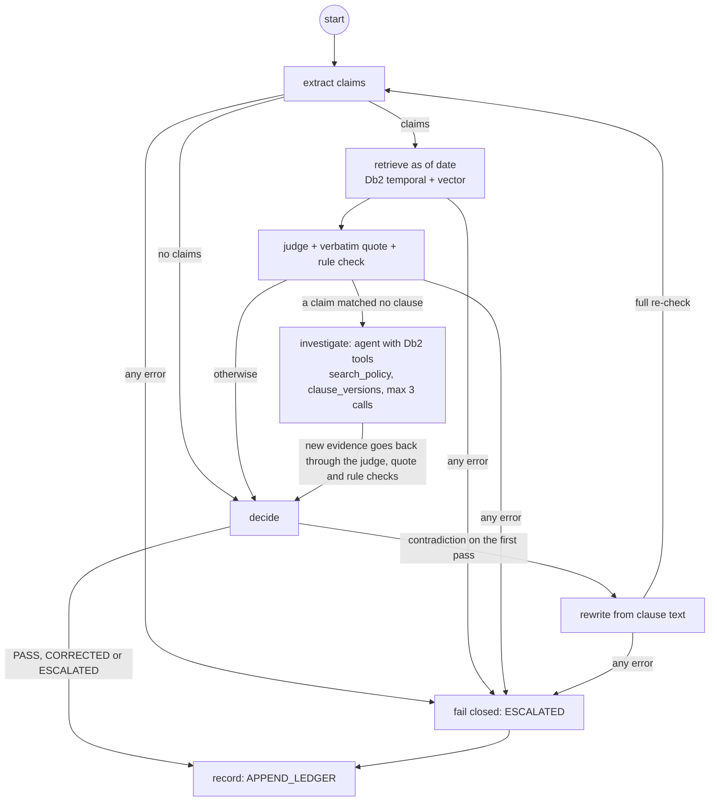
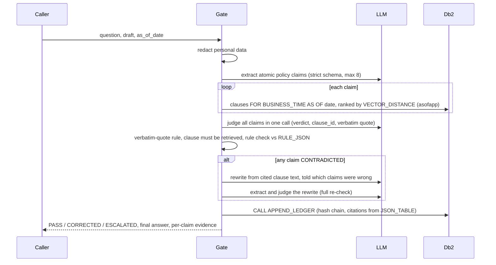

# System Architecture

## Overview

AsOf sits between any AI assistant and its customers. The calling system sends the assistant's draft answer, the customer's question and the date that decides which policy applies (booking or travel date). AsOf extracts the policy claims in the draft, looks up the clause versions in force on that date in IBM Db2, checks each claim with one batched LLM judge call plus deterministic rules, and then releases the draft (PASS), releases a rewrite that passed a full re-check (CORRECTED), or holds it for a person (ESCALATED). Every decision is appended to a hash-chained ledger in Db2, which can later be replayed against what the database held at that moment, and re-assessed when policy changes.

Db2 is the system of record for everything that matters in a dispute: the dated policy versions (bitemporal table with native vectors and JSON rule parameters), the decisions and their evidence (append-only, hash-chained, written only by a stored procedure), and the help-centre answers that depend on them. The application keeps no decision data of its own; the two things it holds outside Db2 are the chain-head anchor log, kept outside on purpose (see Design decisions), and an in-memory rate limiter.

What the check holds goes to a person: a specialist answers it in the inbox, the reply passes the same check for the customer's date, and `RESOLVE_ESCALATION` appends it to the chain as a `REVIEWED` decision linked to the held one. After a policy change, each customer whose answer is now wrong for their date gets a correction notice: drafted by the change-impact agent, checked on that date, verified by `ADD_NOTICE` and approved by a specialist. A caller that does not know which policy document applies can pass `doc_id` `auto`: Db2 routes a clear lead and anything closer goes to a person.

Policy reaches Db2 in two ways: an editor's change through `APPLY_POLICY_CHANGE`, or a policy document (PDF) taken in as a draft that code checks against the document and an editor approves, after which the same procedure applies it. Answers reach the check from any assistant over HTTP, a LangChain runnable, a customer chat page, a Langflow component, or an agent through the MCP server.

All data in this repository is fictional (Aurelia Air, an airline, and Fernhollow Bank, a bank fee schedule). Both are loaded into the same tables; the request's `doc_id` decides which document a check reads and which prompt wording it uses ([domains.py](src/asof/domains.py)).

---

## Architecture Diagram

**Checking an answer.** The request path, from any assistant to the Db2 ledger:



**Changing policy, auditing and operating it.** Everything around the check:




The check itself, as the LangGraph state graph in [checkgraph.py](src/asof/checkgraph.py). Solid edges are fixed; the conditions are read from deterministic state (verdicts, pass number, errors), never decided by a model:



---

## Component Breakdown

1. **User interface** ([src/asof/ui/](src/asof/ui/)): plain HTML, CSS and ES modules served by FastAPI, with no framework or build step. Eight console screens (Playground, Timeline, Intake, Ledger and replay, Inbox, Ask the ledger, Change impact, Analytics) and a customer chat page (`chat.html`, at `/chat`), which renders every API string with `textContent` only. A strict Content Security Policy is in force (no inline script or style), and every string from the API or the LLM is escaped before rendering.
2. **API** ([src/asof/api.py](src/asof/api.py)): FastAPI. Pydantic input models with UTF-8 byte limits, date bounds, an allow-listed `doc_id` and no control characters. Per-client rate limit on LLM endpoints and full-chain verification, 64 KB body cap, security headers, and error handlers that return SQLSTATEs but never stack traces or SQL. Binds to localhost by default.
3. **Check graph and gate** ([src/asof/checkgraph.py](src/asof/checkgraph.py), [src/asof/gate.py](src/asof/gate.py)): the LangGraph state graph orchestrates one check (diagram above); the gate owns the steps it calls (extract, the premise check, retrieve, judge, the quote, rule, coverage and invented-number checks, decide, rewrite, record) and the decision rules.
   - The `investigate` node is a tool-calling agent with two read-only Db2 tools, `search_policy` (as-of search on the customer's date) and `clause_versions` (a clause's dated versions), capped at 3 calls; its trace is stored with the decision in `VERDICTS_JSON`.
   - [redact.py](src/asof/redact.py) masks personal data before anything leaves the process.
   - [prompts.py](src/asof/prompts.py) and [schemas.py](src/asof/schemas.py) hold the versioned prompts and the strict output schemas.
   - [retriever.py](src/asof/retriever.py) is the as-of plus vector query, which the check calls directly, also exposed as a LangChain `BaseRetriever` for other LangChain apps.
   - [rules.py](src/asof/rules.py) is the deterministic check of amounts, durations, limits, tiers and permissions against `RULE_JSON`.
   - [ledger.py](src/asof/ledger.py) appends, verifies, reads and replays the ledger.
4. **LLM layer** ([src/asof/llm.py](src/asof/llm.py)): one interface over OpenRouter, any OpenAI-compatible endpoint, IBM watsonx.ai (langchain-ibm, optional) or Ollama. Every call returns a validated Pydantic object or raises `LLMError`, under a hard wall-clock deadline and an output-token cap.
5. **Database layer (IBM Db2)** ([src/asof/sql/](src/asof/sql/)): tables, history table, indexes, triggers, SQL functions, SQL PL procedures, views and grants, installed by [schema.py](src/asof/schema.py) into a validated schema name (`ASOF`, or `ASOF_TEST` and `ASOF_EVAL` for tests and evaluation).
6. **Policy module** ([src/asof/policy.py](src/asof/policy.py)): validated policy changes through `APPLY_POLICY_CHANGE` on the editor connection, change impact, timeline, system-time history and analytics.
7. **Ask the ledger** ([src/asof/askledger.py](src/asof/askledger.py)): a LangChain SQL chain for auditors. LangChain's `SQLDatabase` (SQLAlchemy over `ibm_db_sa`, reflected as the analyst) describes the six audit views; the model's SQL must pass a SQLGlot check (IBM's `db2-sqlglot-dialect`), and only SQLGlot's regeneration of the checked tree runs, as the read-only analyst `asofread`, under a Db2 statement timeout and a row cap. Db2's column masks hide the ledger text from that user.
8. **Integration** ([src/asof/integration.py](src/asof/integration.py)): `as_runnable()` drops the check into an existing LangChain chain. [assistant.py](src/asof/assistant.py) is the deliberately naive demo assistant over the official `DB2VS` store.
9. **Policy intake** ([src/asof/intake.py](src/asof/intake.py)): reads a PDF (pypdf, under a deadline and size, page and text limits), asks the model once for proposed clause versions, checks each against the document in code, stores the draft through two editor procedures and applies an approved one through two more, in one transaction. Its evaluation is [src/asof/eval/intake_eval.py](src/asof/eval/intake_eval.py).
10. **Specialist inbox and correction notices** ([src/asof/review.py](src/asof/review.py), [src/asof/notices.py](src/asof/notices.py), the notice agent in [src/asof/impactagent.py](src/asof/impactagent.py)): the queue of held decisions, the reply's check (`Gate.assess`: one pass, no rewrite, nothing recorded), `RESOLVE_ESCALATION`; the notice drafting, `ADD_NOTICE` and `DECIDE_NOTICE`.
11. **Router** ([src/asof/router.py](src/asof/router.py)): a LangGraph graph (Db2 vote, decide, optional agent) for `doc_id` `auto`; its evaluation is [src/asof/eval/routing.py](src/asof/eval/routing.py).
12. **MCP server** ([mcp_server/](mcp_server/)): four tools for agents over AsOf's own HTTP API, in its own small environment (the MCP SDK and httpx).
13. **Tooling**:
   - [setup.py](src/asof/setup.py): users, schema, seed, grants, self-check, and the demo-only `--reset-ledger`.
   - [db2check.py](src/asof/db2check.py): the 34 Db2 feature checks.
   - [eval/](src/asof/eval/): the frozen evaluation.
   - [demo.py](src/asof/demo.py): records sample history.
   - [scripts/check_secrets.py](scripts/check_secrets.py): pre-commit secret check.

### AI / LLM design

- **Frameworks:** LangGraph runs the check graph and the change-impact agent; LangChain provides:
  - Structured output via `with_structured_output(method="json_schema", strict=True)`.
  - A custom `BaseRetriever` (`AsOfClauseRetriever`) over the as-of query, for LangChain apps; the check calls the query function itself, one connection for all of a draft's claims.
  - `langchain-db2`'s `DB2VS` for the demo assistant's FAQ store.
  - `as_runnable()` for drop-in use in existing chains.
- **Models:** `google/gemini-3.1-flash-lite` through OpenRouter by default (chosen by a 10-model probe, see Design decisions); `qwen2.5:7b-instruct` through Ollama as the no-key path; any OpenAI-compatible endpoint by configuration; IBM watsonx.ai (`ibm/granite-4-h-small` by default) through langchain-ibm, with structured output by tool calling. Embeddings are local (`all-MiniLM-L6-v2`, 384 dimensions, CPU).
- **Prompts** ([prompts.py](src/asof/prompts.py), versioned): extraction, judge and rewrite. Instructions live only in the system message. Questions, drafts, claims and clauses are passed as data blocks with angle brackets escaped, so text cannot close its block or pose as a clause. The rewrite is given the list of claims found wrong, so it does not repeat them.
- **Calls per answer:** at least two for a PASS (extract, judge) and five for a CORRECTED answer (extract, judge, rewrite, extract, judge), plus up to 3 tool calls and a second judge call when the agent investigates. On the frozen airline split the runs with the agent averaged 3.9 to 4.4 calls per answer (4.03 at `512ee74`).
- **What the model is not trusted with:**
  - the customer's date (supplied by the caller)
  - which clauses exist (Db2 retrieves them)
  - quotes (must match the clause verbatim: 12 characters or more for SUPPORTED; a CONTRADICTED verdict may be grounded by the clause sentence holding a shorter exact quote, or by a rule-check mismatch, since it can never release a draft)
  - the customer's situation (the judge must report, per claim, whether the claim assumes something the question states differently; a stated delay is also checked against the question in code)
  - numbers, limits, tiers and key permissions (checked by code against `RULE_JSON`)
  - the final release (decided by code)
  - anything executable: model output is never run, and is escaped in the UI. It becomes SQL in one place only, Ask the ledger, where SQLGlot parses it and Db2 runs SQLGlot's regenerated `SELECT` on six allowed views as the read-only analyst
- **Policy intake** uses one structured call per document (`INTAKE_SYSTEM`, its own prompt version), with a larger output cap and a longer deadline than a check. The model sees the clause IDs, titles and rule keys, not the current text, so a recorded intake still replays after a policy change. What it is not trusted with: the clause text (must be in the document word for word), the dates (must be stated by the sentence it quotes), the rule values (must be stated in the clause text), new clause IDs (assigned by code), and what goes into force (an editor, through Db2 procedures).
- **Routing agent** (`ASOF_ROUTER_AGENT=auto`: only with a model measured on the pinned routing split): one structured call (`RouteResult`) that sees the question, the draft and the nearest clauses of both documents, only when Db2's vote is close (lead between 0.12 and 0.30). It can confirm Db2's leader or return the question to a person; it cannot overrule Db2, and an instruction in the question about where to route is data. Measured on the frozen routing split (below), the hosted default model guessed on none of the questions that need a person and the local 7B model on 4 of 10, so it runs with the first and not the second. Its client is built without the local fallback, so a failed routing call asks a person instead of letting an unmeasured model decide.
- **The notice agent** reuses the change-impact agent's graph and Db2 tools with its own prompt (`NOTICE_SYSTEM`, per domain): look up what the stale answer relied on, rewrite from the clause text now in force for the customer's date (the check's own rewrite step), then the full check on that date. It writes nothing but the notice, through `ADD_NOTICE`, and sends nothing.
- **Failure handling:** hard wall-clock deadline and output cap on every call; one retry for malformed output; a timeout is final. Ollama requests are non-streaming, so a stuck generation is cancelled. Every failure becomes ESCALATED and is still recorded.

### Evaluation

[docs/eval_results.md](docs/eval_results.md) holds every recorded run. Nine frozen splits, each committed and pinned by SHA-256 before its first run: the airline `test` split (40 cases), the bank `bank-test` split (26; no longer blind after its first run found a rule-data gap), `extractor-test` (10 drafts aimed at the claim extractor), the blind `bank-test2` (22), `escalation-test` (33, aimed at needless holds, both domains), `situation-test` (12; its first run found the premise gap), `situation-test2` (12, blind until a run that released a draft) `situation-test3` (20, pinned before the premise checks that run led to) and `list-test` (16, pinned before the list check). On the current check (`0be4f60`), `gemini-3.1-flash-lite` released none of the 100 wrong drafts in the seven original splits, none of the 12 in `situation-test3` and none of the 9 in `list-test` (16 cases about relations and documents a clause's list leaves out, pinned before the list check), and held 1 of the 70 correct drafts. A run at `333f14b` to `8058e85` (the same check) again released none of the 121 and held 4 of the 70; ten repeat runs of those four cases on that check and on `0be4f60`'s held them 14 and 16 times of 40, so that was run-to-run variation. The latest run, at `19a3e28` with the zero-claims backstop, released none of the 121 and held 1 of the 70 (L10, held in every run). Four of the nine splits motivated a fix at some point; the five that never did released 0 of 65. On `list-test`, local Ollama released 1 of 9 on the unchanged check and 0 after the list check. An earlier run, at `5861368`, released one (SU01 on the then blind `situation-test2`: the extractor restated the draft's premise about the customer as a general rule, so the judge never compared it with the question); `situation-test3` released 2 of 12 on that unchanged check and 0 of 12 after the premise checks. On the escalation split, ideal decisions rose from 75.8% (baseline, before the change) to 87.9%, and were 97.0% in the latest run. An eval-only ablation (`--ablation current-policy`) runs AsOf's own check with every case's date replaced by 7 Nov 2026, a stand-in for a checker that only knows the current policy. On the 25 cases whose key clause changed in between, with both arms at `a4cb55f`, before the list check, it released 6 of 16 wrong drafts and rewrote 8 of 9 correct ones to a policy that did not apply, against 0 and 1 with the customer's date (paired exact McNemar p ≈ 0.03 and 0.02; 6 or 7 of 16 in three earlier pairs). [docs/evaluation.md](docs/evaluation.md) has every run, both providers and the misses; the README has the latest. Policy intake has its own frozen evaluation ([docs/intake_eval.md](docs/intake_eval.md)): three fictional documents and 11 expected items, pinned at `99c183eb` before the first run; at `74e400a` the hosted model proposed 10 correctly, the one wrong proposal was blocked by the date check, none reached the editor unblocked, and the injected instruction in one document produced no proposal.

Routing has its own evaluation ([docs/routing_eval.md](docs/routing_eval.md)): 40 test cases (airline, bank, shared-vocabulary traps, ambiguous, out-of-scope, mixed, injection), committed and pinned at `6f3a15e` before the router existed, thresholds set on a 20-case dev split. Db2's vote alone: 26 of 30 routed right, 0 misrouted, 4 sent to a person, and 10 of 10 that need a person asked. With the hosted routing agent (the default): 30 of 30 routed right, 0 misrouted, 10 of 10 asked, in each of three runs. With the local 7B routing agent: 30 of 30 routed right, 0 misrouted, but 4 of 10 guessed.

On IBM watsonx.ai (Lite plan, one split's worth of tokens), `ibm/granite-4-h-small` ran the airline `test` split at `ac86d09`: 1 of 26 wrong drafts released (T20, a mother-in-law counted as immediate family against BRV-001's list, the same misreading Ollama made in its first run), 3 of 14 correct drafts held, 85% ideal, median 5.7 s, about 4,200 tokens per check. On the intake evaluation Granite got none of the 11 items right, though every wrong proposal was blocked; three unexpected proposals (changes proposed as new clauses) passed the checks. The default model stays the recommendation; the README has the comparison.

### Design decisions

Each line is a choice and the reason for it. Findings marked "spike" were verified on Db2 12.1.5.0 Community Edition before any project code was written.

**The ten decisions that shape everything else:**

| Decision | Why | Where |
|---|---|---|
| Policy versions live in Db2 temporal tables, and one query filters by date and ranks by meaning | The version in force on the customer's date is a database fact, with its history kept by Db2, not by application code | [retriever.py](src/asof/retriever.py), [01_tables.sql](src/asof/sql/01_tables.sql) |
| A deterministic rule check on `RULE_JSON` overrides the model judge | Wrong numbers, permissions and list memberships are where an answer costs money; it flagged 65 of the 100 wrong drafts on its own in the latest run (63 to 66 in the four before), and overruled a correct judge on ET09 in two runs | [rules.py](src/asof/rules.py) |
| A SUPPORTED verdict needs a verbatim quote from a retrieved clause | A judge cannot release a claim with grounding it made up | [gate.py](src/asof/gate.py) |
| Fail closed, and no record means no release | Any error, timeout or ledger outage holds the answer for a person | [checkgraph.py](src/asof/checkgraph.py) |
| The ledger is written only by `APPEND_LEDGER`, hash-chained with SHA-256 in SQL | The runtime user cannot write a ledger row any other way, and every row commits to all before it | [03_procedures.sql](src/asof/sql/03_procedures.sql) |
| Receipts and chain-head anchors outside Db2 | A hash chain cannot vouch for itself against its own owner | [ledger.py](src/asof/ledger.py), [anchor.py](src/asof/anchor.py) |
| Four least-privilege users, column masks and per-user API roles | Each actor can do its one job and read only what it needs | [90_grants.sql](src/asof/sql/90_grants.sql), [05_masks.sql](src/asof/sql/05_masks.sql), [users.py](src/asof/users.py) |
| A LangGraph graph with fixed edges; the agent only gathers evidence | No model decides whether a safety step runs | [checkgraph.py](src/asof/checkgraph.py) |
| The judge sees the question, and a conflict can only tighten a verdict | A draft can be right about the policy and wrong about the customer | [prompts.py](src/asof/prompts.py), [gate.py](src/asof/gate.py) |
| Every test split is committed and hash-pinned before its first run | Numbers are never tuned on the cases they report; `bank-test2` never motivated a change, and two later splits were pinned before the change each one measures | [eval/](src/asof/eval/) |

#### Db2: storage, queries and schema

- **The ledger is range-partitioned by month, and never shrunk by detaching.** A month is the unit for partition elimination and for per-partition maintenance (`REORG`, index upkeep). Detaching a partition would remove rows without the DELETE trigger, so it is not a retention mechanism here; Db2 refuses it anyway while `CLAIM_CITATION`'s foreign key references the ledger (SQL0270N reason 92, tested). Rows outside 2026 and 2027 fall into open-ended partitions, so an insert never fails for want of one. Measured honestly: at 1,000,000 decisions the month query was no faster than the unpartitioned table's index range scan (40 ms either way; [benchmark](docs/ledger_benchmark.md)), and the one global index the filtered ledger page needs (`IX_LEDGER_DECISION`, `NOT PARTITIONED`) came out of that benchmark.
- **REFRESH IMMEDIATE MQTs behind the analytics views, same columns as before.** Db2 maintains them in the insert's own transaction, so they are never stale, and no refresh job is needed. Db2 refuses MIN and MAX in such an MQT (SQL20058N, reason 8), so the first and last time of each group come from the ends of a four-column index. The views kept their exact columns, types and values, so "Ask the ledger" shows the model the same schema, and its recorded examples still replay. At 1,000,000 decisions the analytics queries went from 402 to 552 ms down to under 1 ms, for about 0.5 ms more per append.
- **Recovery is tested by restoring, and judged by the ledger's checks.** The drill restores an online backup into a database that did not exist and requires `VERIFY_CHAIN`, the anchors and the source's head hash to agree. A backup that was never restored proves nothing.
- **The drill uses scratch databases.** An online backup needs archive logging. IBM's stock image turns it on for `TESTDB`; AsOf's Compose setup leaves it off (`ARCHIVE_LOGS: "false"`). Switching a judge's database to archive logging would put it into backup-pending state until an offline backup, which needs every connection closed, so the drill builds its own source database instead. The drill never runs `FORCE APPLICATION ALL`, which would cut off every user of the instance.
- **A new name for every restored copy.** With `DIR_CACHE=YES`, `RESTORE ... INTO` a database name dropped earlier in the instance's life failed with SQL30061N here, while a fresh name always worked. The directory cache is the most likely cause; the fix does not depend on knowing.

- **Db2 12.1.5.0 Community Edition, pinned.** `db2level` reports v12.1.5.0; native `VECTOR` and `VECTOR_DISTANCE` need 12.1.2 or later. The image tag `12.1.5.0` resolves to the same manifest as `latest` today, so pinning costs nothing and keeps judges on the tested level.
- **Thin derived Db2 image (`docker/db2/Dockerfile`).** Under Rosetta (Colima `--vz-rosetta`, binfmt flags `OCF` without `P`), argv[0] is not preserved, so `su - db2inst1 -c ...` never starts a login shell and `db2profile` is never sourced. IBM's setup script then fails every `db2` call with "command not found" and still prints "Setup has completed", with no engine running and no database. The image gives the Db2 users a login-shell wrapper; on hosts that preserve argv[0] it changes nothing. Spike: stock image left TESTDB missing; derived image created TESTDB in about 90 seconds.
- **No fenced routines.** Under Rosetta the fenced-mode process (`db2fmp`) crashes on start, so fenced C routines such as `SYSPROC.ENV_GET_INST_INFO` fail with SQL1646N. Everything AsOf runs in Db2 is built-in SQL, triggers or SQL PL procedures, which execute inside the engine and behave the same on Apple Silicon and x86.
- **Embeddings live in the bitemporal clause table.** Spike: a `VECTOR(384, FLOAT32)` column works in a system-versioned table, `CREATE TABLE ... LIKE` copies it to the history table, and `FOR PORTION OF BUSINESS_TIME` updates move the old embedding into history. No side table needed.
- **One query for "in force on date D" plus semantic rank.** Spike: `FOR BUSINESS_TIME AS OF ?` combined with `VECTOR_DISTANCE(..., VECTOR(?, 384, FLOAT32), COSINE)` and `FETCH FIRST n ROWS ONLY`, fully parameterised, and also combined with `FOR SYSTEM_TIME AS OF ?` for replay.
- **Vectors are always bound parameters.** `langchain_db2`'s `similarity_search` formats the query vector into the SQL text and filters metadata in Python after `FETCH FIRST k`. AsOf uses the official `DB2VS` store for the demo assistant's FAQ knowledge base, and its own LangChain retriever for policy clauses, which binds the vector and date as parameters and filters in SQL.
- **JSON validity via `CHECK (JSON_EXISTS(RULE_JSON, '$'))`.** The `IS JSON` predicate is rejected at this level (SQL0104N). The `JSON_EXISTS` check rejects malformed JSON with SQLSTATE 23513. `JSON_VALUE` and `JSON_TABLE` work for reading rule parameters; `JSON_VALUE` returns booleans as the strings `true` and `false`.
- **One schema definition, two targets.** The SQL files use the token `ASOF.`; the installer substitutes a schema name that must match `^[A-Z][A-Z0-9_]{0,29}$`. Integration tests install, seed and grant a throwaway `ASOF_TEST` schema and drop it afterwards, so append-only test rows never touch the real ledger. Tables and indexes are created only if missing and seed loaders skip non-empty tables, so `python -m asof.setup` is safe to re-run.
- **Db2's `JSON_TABLE` takes only `'strict $'` here.** `'lax $.claims[*]'` and `NESTED PATH` are rejected at this level (SQL0104N), so `CLAIMS_FROM_JSON` reads each of the at most 16 array positions (8 claims in the draft check, 8 in the re-check) with a literal index and unions them. Db2 also refuses a ninth claim per check (SQLSTATE 75003).
- **`JSON_TABLE` needs an explicit `ON ERROR` clause at this level** (SQL0104N without it). The timeline view uses `ERROR ON ERROR`: rule JSON is already constraint-checked, and `EMPTY ON ERROR` would silently drop a clause from the timeline.
- **Procedures never return NULL OUT values.** The `ibm_db` CLI driver fails with CLI0110E on a NULL OUT parameter, so `VERIFY_CHAIN` reports 0 and a message instead and Python maps 0 back to "none". OUT string placeholders are passed at full width because the driver sizes buffers from them.
- **One 32K tablespace for every AsOf table.** A native vector index key on `VECTOR(384, FLOAT32)` is 1,536 bytes; Db2 caps an index key at a quarter of the page size, so the default 4K tablespace rejects it (SQL0614N, found in a spike). A larger page is required and 32K was chosen for headroom. AsOf creates `ASOF_BP32K` and `ASOF_TS32K` once per database and places every table there explicitly, which keeps AsOf's storage separate from anything else in the database. (A full-length ledger row, with 30,000 bytes of verdict JSON, is longer than a 32K page; Db2's extended row size, on by default, stores the overflow out of the row.)
- **A native vector index, but exact search in the temporal query.** `IX_CLAUSE_EMBEDDING` (type `VANN`) is in place for scale, and the retrieval query says `FETCH EXACT` because Db2 defaults to approximate when an index exists. `python -m asof.vectorbench` showed why: with a business-time filter at 100,000 rows the approximate top 10 kept only 0.73 recall, and a missed version in force is a wrong check. Without the filter, approximate search was 18 times faster at 0.95 recall.
- **`FETCH APPROX FIRST 10 ROWS`, not `FIRST ? ROWS`.** Found while benchmarking: with a parameter marker for k, Db2 12.1.5 never matched the vector index (exact scans at every size, 143 ms at 100,000 rows); with a constant it did (7.7 ms). Any approximate query AsOf adds will use a constant k.
- **RUNSTATS through the command line processor.** `SYSPROC.ADMIN_CMD` is a fenced routine and crashes under Rosetta (SQL1646N), so setup runs `RUNSTATS` with `db2` inside the container and falls back to `ADMIN_CMD`, with the command as a bound parameter, where fenced routines work.
- **Explain mode instead of `EXPLAIN PLAN FOR` text.** `python -m asof.explain` sets `CURRENT EXPLAIN MODE = EXPLAIN` and runs the app's own statement constants with bound values, so the plans are for exactly what runs and no SQL is assembled even in tooling. Explain tables come from IBM's `EXPLAIN.DDL` through the command line processor, again because `SYSINSTALLOBJECTS` is fenced.
- **Adaptive row compression on the ledger.** The ledger is append-only and repetitive (decisions, model names, JSON keys), the textbook case for `COMPRESS YES ADAPTIVE`; it costs nothing in the write path that matters here.
- **In-database embeddings for clauses, local embeddings for claims.** Db2 12.1.5 can call an OpenAI-compatible embedding endpoint from SQL (`CREATE EXTERNAL MODEL`, `TO_EMBEDDING`), verified working under Rosetta, where fenced routines crash; the call is made by the engine. Setup registers `EMBEDDER` and seeds the corpus through it, and `APPLY_POLICY_CHANGE` embeds a new version itself. OpenRouter serves the exact model the app runs locally (`all-MiniLM-L6-v2`, cosine 1.0 between the two), so clause vectors made in Db2 and claim vectors made in Python are interchangeable; setup refuses the model otherwise. Claims stay local because a round trip from the database costs about 1.7 s per claim here.
- **The model key goes into DDL as a validated literal.** `KEY` accepts no parameter marker (SQL0104N, tested). The key passes `db.string_literal`, which admits `[A-Za-z0-9_\-.:/?=&]` only, so it cannot end the literal; the statement is never logged; tests confirm the key is not in `SYSCAT.EXTERNALMODELS` or `EXTERNALMODELOPTIONS`. Only the editor holds `USAGE` on the model.
- **HTTPS documented, local HTTP tolerated.** IBM documents HTTPS model URLs. Plain HTTP to an endpoint on the same host worked in a spike, but that is undocumented, so AsOf accepts it only for local hosts and labels it a development convenience.
- **`TEXT_GENERATION` evaluated, not used.** It works here too (verified against a test endpoint), but the check needs structured output against a schema, per-call deadlines, capped retries and a fallback provider, which the LangChain layer provides and a SQL scalar function does not. Moving generation into SQL would weaken fail-closed handling for no gain.
- **Hybrid keyword plus vector retrieval with Db2 Text Search: evaluated and rejected (6 Nov 2026).** Measured first: with vector search alone, the clause version that a dev case's key claim must be checked against is retrieved for 18 of 18 dev cases at k = 4 (the check retrieves 4 clauses per claim and the judge sees all of them), 16 of 18 at k = 2 and 13 of 18 at k = 1; citation accuracy on the frozen test split is already 100% with the hosted model. Hybrid search could only reorder results the judge already sees. Then tried: IBM's container option `TEXT_SEARCH=true` failed in `db2iupdt -j TEXT_SEARCH` with DBI20187E (the instance's `fencedid` file not owned by `root:db2iadm1`) and left the instance unable to start again; the Db2 for i documentation also forbids `CONTAINS` on a table with a period, which would mean a side table keyed by `(CLAUSE_ID, BUS_START)` and asynchronous `UPDATE INDEX` runs after every policy change, plus a Java text-search server for judges to run. No measurable gain for a large setup cost, so AsOf does not use it. It would become worth revisiting with a much larger policy library, where keyword matching of clause numbers and defined terms could rescue claims that embeddings rank poorly.
- **An index shaped like the as-of query.** The first plan read the whole `PK_POLICY_CLAUSE` index (it leads with `CLAUSE_ID`, which the query does not filter on) and filtered `DOC_ID` at the fetch; the README had overstated it as an index scan on the business-time key. `IX_CLAUSE_DOC_ASOF (DOC_ID, BUS_START, BUS_END)` replaced `(DOC_ID, AREA)`, which no query used: Db2 now uses `DOC_ID = ?` as start and stop key and `BUS_START <= ?` as a stop key, and checks `? < BUS_END` in the index, at an estimated 7.07 timerons instead of 17.36.
- **Two more foreign keys.** `FK_LEDGER_DOC` (each decision names a policy document Db2 holds) and `FK_SUGGESTION_CHECK` (each drafted correction cites a ledger row that exists, or NULL when its check left none). Both are cheap on append-only tables. Because a drafted correction now depends on the ledger, the demo-only `setup --reset-ledger` drops the drafted corrections with the ledger tables instead of leaving them pointing at decision IDs the new chain will reuse.
- **A connection pool for the runtime user, after measuring.** Profiling a replayed check showed each fresh `ibm_db` connection costing about 0.2 s to open and 0.9 s to close on the dev machine (Db2 under Rosetta), three per check, while the queries themselves took milliseconds. A small pool in `db.py` keeps connections open; each checkout is exclusive, a returned connection is rolled back, and an idle one is pinged before reuse, so a connection Db2 dropped is replaced rather than failing a check. `python -m asof.connbench` measures it: 3,290 ms median per replayed check with fresh connections, 57 ms pooled, decisions unchanged. The analyst's SQLAlchemy engine keeps `NullPool`: Ask the ledger is rare, and a fresh session per question keeps the read-only role's state simple.
- **Compose builds the Db2 image with or without buildx.** Docker's classic builder (used when the buildx plugin is missing, as on this Mac) ignores Compose's `platform:` when resolving `FROM`, and IBM publishes no arm64 image, so the platform is pinned in the Dockerfile. `COPY --chmod` is avoided for the same reason.
- **"Healthy" means setup finished in this boot.** IBM's setup writes `/database/config/.shared-data/setup_complete` on the data volume, and on a restart it re-runs setup (including a same-level database upgrade that holds TESTDB exclusively) while the old marker is still there. The entrypoint deletes the marker first, and the healthcheck requires the marker and a successful connection. Verified on a fresh volume (healthy after about 6 minutes) and on a restart (about 3 minutes), with the Db2 feature check passing immediately after `docker compose up --wait`.
- **`CHANGED_BY` defaults to `SESSION_USER`.** A generated column from `SESSION_USER` is rejected on Db2 LUW (SQL0548N), so the column defaults to the session user on insert and `APPLY_POLICY_CHANGE` sets it on update.

- **Policy drafts live in their own tables, not in the bitemporal one.** A draft row inside `POLICY_CLAUSE` would be "in force" to every query that forgot to filter it out, and its `WITHOUT OVERLAPS` key would collide with the version it replaces. So `POLICY_DRAFT` and `POLICY_DRAFT_ITEM` hold proposals, and only approval moves them into the bitemporal table, through `APPLY_POLICY_CHANGE`, so a document-driven change is the same Db2 operation as an editor's (split by `FOR PORTION OF BUSINESS_TIME`, history kept, help-centre answers flagged).
- **Db2 hashes the uploaded file itself.** `ADD_POLICY_DRAFT` computes `HASH(blob, 2)` over the PDF (spike: Db2's SHA-256 over a 2 MB `BLOB` equals Python's; the result needs a cast to `VARBINARY(32)` before `HEX`), stores that, and refuses the file if the application's hash differs. The file itself is kept as a `BLOB`, so the evidence for a version is the document, not a summary of it.
- **Approval applies what was reviewed, not what the caller sends.** `APPLY_DRAFT_ITEM` takes only a draft ID, an item number and (optionally) an embedding; the text, rule and dates come from the stored item, and only from an approved draft's accepted item that has not been applied yet. Db2 picks the version label (one more than any label in current or history rows), and the change note names the draft, item and file hash. The application runs `DECIDE_POLICY_DRAFT` and one `APPLY_DRAFT_ITEM` per item in one transaction, so a failure in any item leaves the draft pending and the policy untouched; if Db2's embedding model fails, the whole approval is retried with local vectors, never half of it.
- **A restated clause is a non-change, decided by its text.** When a section's text equals the version in force word for word, it is UNCHANGED and cannot be applied, however the model named its parameters (the first live run named a 365-day window `claim_window_years: 1`). The policy is the text; the parameters are derived from it.

#### The ledger and tamper evidence

- **Hash chain computed inside Db2.** Spike: `LOWER(HEX(HASH(expr, 2)))` equals Python's SHA-256 hex digest for UTF-8 input (database codeset 1208), so `APPEND_LEDGER` computes row hashes in SQL PL and the app never supplies them.
- **Row triggers for append-only tables.** Spike: `BEFORE UPDATE` and `BEFORE DELETE` triggers with `SIGNAL SQLSTATE '75001'` block changes. Dropping a table leaves its triggers behind as inoperative, so teardown drops triggers explicitly.
- **No record, no release.** If `APPEND_LEDGER` fails, the gate withholds the answer: the decision becomes ESCALATED with reason `LEDGER_UNAVAILABLE` and the API answers HTTP 503 with the holding reply. Every other failure (LLM timeout, invalid output, database error, unexpected exception) is ESCALATED and still recorded.
- **Gapless ledger IDs, taken under the chain-head lock.** `APPEND_LEDGER` first updates the single `CHAIN_HEAD` row, which holds a row lock until commit, then assigns `LAST_LEDGER_ID + 1`. Concurrent writers queue instead of forking the chain (tested with three writers), and a deleted row shows up as a gap, not only as a hash mismatch. An identity column would allow gaps after a rollback.
- **Row hash = SHA-256 of the previous hash and the SHA-256 of each field.** Fixed-length field digests make boundaries unambiguous (no delimiter can be smuggled into a field) and keep the hash input around 1 KB, far below Db2's 32 KB string limit, whatever the field sizes. Computed in SQL functions, so the app never supplies a hash.
- **Citations are derived from the hashed JSON and checked against it.** `APPEND_LEDGER` shreds `CLAIM_CITATION` rows out of the verdict JSON in the same call, and `VERIFY_CHAIN` re-derives them, so an edited citation is detected even though citation rows are not hashed directly (tested).
- **Two checks per corrected answer, both kept.** `CLAIM_CITATION.PASS_NO` is 1 for the draft check (where contradictions are found, which analytics needs) and 2 for the re-check of the rewrite (what the customer received, which change impact needs).
- **`SECURED` ledger triggers.** Activating column access control failed with SQL20469N reason code 37 until the triggers on the table were secured (spike). Creating a secured trigger needs SECADM, which the database creator holds.
- **`VERIFY_CHAIN` fetches rows into variables before hashing.** Passing a masked column straight to the hash functions is refused for a non-secured function (SQL20473N). Making the functions `SECURED` instead crashed the engine while compiling `VERIFY_CHAIN` (SIGSEGV in `sqlnq_compile_fgac`, Db2 12.1.5 under Rosetta; FODC trap captured, then deleted). Explicit cursors with `FETCH ... INTO` local variables avoid the problem entirely, and the functions stay non-secured.
- **Receipts, because a hash chain cannot vouch for itself.** `VERIFY_CHAIN` proves the rows agree with each other, so an owner who drops the triggers and rebuilds the ledger through `APPEND_LEDGER` gets a chain that verifies. The only defence is a hash held somewhere the owner cannot reach. Every check response now returns its `row_hash` as a receipt, and `POST /api/ledger/receipt` (and a form on the ledger screen) answers INTACT, MISMATCH, MISSING or CHAIN_BROKEN. A Db2 test performs exactly that rebuild: the new chain verifies, and the old receipt says MISMATCH. A mismatch does not say why (a rewrite, a demo ledger reset, a receipt from another ledger), only that this is not the record that was issued. The calling system keeps receipts, so this costs AsOf nothing to store.
- **Chain-head anchors, so rows without receipts are covered too.** A receipt protects only the decision whose caller kept it. After every append, AsOf also writes the new chain head (ledger ID and row hash) to an append-only log outside Db2 ([anchor.py](src/asof/anchor.py)), with an HMAC-SHA256 under a key Db2 never holds. Setup generates the key in its own file outside the project folder (`~/.config/asof/anchor.key`, mode 600), not in `.env`, because `.env` also holds the owner's password and the point of the key is that the database owner does not have it. Each row hash covers every row before it, so one anchor that still matches proves rows 1 to its ID are unchanged. Each record carries the previous record's MAC, so editing, removing or reordering records breaks the log, and nobody without the key can write a valid one. A Db2 test rebuilds the ledger as the owner with no receipt kept anywhere: `VERIFY_CHAIN` reports OK and the anchors report MISMATCH at the first record. Cutting records off the end of the log is the one thing the log cannot show by itself, so the check reports rows after the last anchor as unanchored; every append is anchored, so that number should be 0. The default directory (`var/anchors`) suits a single-machine demo; a deployment points `ASOF_ANCHOR_DIR` at storage the database owner cannot write. A failed anchor write is logged and never withholds a recorded answer: the next anchor covers the rows before it.
- **An evidence pack per decision.** In a dispute like *Moffatt*, the questions are what the assistant said, which policy applied on the customer's date, and whether the record is trustworthy. `GET /api/ledger/{id}/evidence` assembles, from Db2, the recorded decision, every claim with the clause version it was checked against, the replay of each clause (`FOR SYSTEM_TIME AS OF` the decision time, and what applies today), the chain verification and the row hash to match a receipt, in one JSON file. It adds no new storage: everything in it is already in the ledger or the temporal tables.
- **The demo ledger reset is explicit and demo-only.** `python -m asof.setup --reset-ledger` drops and recreates the three ledger tables as the owner and starts a new chain. It does not disable triggers to delete rows, and policy data is kept.

#### The check and the models

- **Embeddings on CPU.** `all-MiniLM-L6-v2` is small enough that CPU is fast (model load about 4 s), and torch 2.15 crashes on macOS 14 when it uses the Metal backend.
- **Deterministic checks for numbers and deadlines.** Spike: a local 7B model (`qwen2.5:7b-instruct`) returns schema-valid structured output, but on the Moffatt-style draft it missed "90 days" and "$35" in the extracted values. Values that decide PASS or CONTRADICTED are therefore parsed from claim text by code and compared to `RULE_JSON`; the LLM's reading never overrides them.
- **Default hosted model: `google/gemini-3.1-flash-lite` via OpenRouter.** Chosen by a probe that runs AsOf's real prompts and schemas against the Aurelia corpus: 7 extraction cases (including chit-chat, a hedged non-answer and an injected instruction) and 15 batched-judge cases with 20 claims (date flips, a condition the claim leaves out, a deadline counted from the wrong date, delay tiers, NOT_COVERED, and a fake clause injected inside a claim). Three rounds per model after a first screen of 10 models:

  | Model | Valid format | Extraction | Verdict + clause | Verbatim quotes | Injection | p50 / p90 latency |
  |---|---|---|---|---|---|---|
  | google/gemini-3.1-flash-lite | 66/66 | 21/21 | 60/60 | 54/54 | 9/9 | 1.0 s / 1.4 s |
  | anthropic/claude-haiku-5.5 | 66/66 | 21/21 | 59/60 | 54/54 | 9/9 | 1.2 s / 2.0 s |
  | google/gemini-3.5-flash-lite | 66/66 | 21/21 | 59/60 | 53/53 | 8/9 | 0.9 s / 1.3 s |
  | openai/gpt-4.1-mini | 66/66 | 20/21 | 59/60 | 54/54 | 9/9 | 1.1 s / 1.7 s |
  | z-ai/glm-5.3-flash | 66/66 | 20/21 | 56/60 | 52/52 | 9/9 | 1.8 s / 4.5 s |

  It was the only model with no misses and has the tightest latency spread, at about $0.0004 per call. The probe is small; the frozen evaluation splits report the real numbers for both providers. The miss most models shared (citing the 6-to-9-hour delay tier for a 5-hour delay) is the kind of error the deterministic tier check catches regardless of model. Excluded in the first screen: models that took 8 to 31 s per call, or misjudged 3 of 20 claims.
- **One judge call per answer, not per claim.** All claims and the deduplicated clauses retrieved for them go to the model together, and it returns one verdict per numbered claim. A PASS costs two LLM calls (extract, judge) and a CORRECTED answer five (extract, judge, rewrite, extract, judge), before any agent step.
- **Every LLM call has a hard wall-clock deadline and an output cap.** During the probe, the local 7B model fell into a generation loop on one hard case and streamed about 11,800 tokens over 30 minutes. Because tokens kept arriving, the HTTP read timeout never fired. Now each attempt runs under a deadline in a daemon thread, every provider gets `max_tokens` / `num_predict` (1000 by default, about twice the largest real reply), and a timeout is final: the gate fails closed instead of retrying.
- **Ollama requests are not streamed.** With one complete response per request, the read timeout fires on a stuck generation, the client disconnects and Ollama cancels the work (verified: a 5 s deadline produced `cancel task` in the Ollama log), so an abandoned request no longer blocks the next one.
- **OpenRouter routes only to endpoints that honour every parameter** (`provider.require_parameters`), so a JSON schema is never silently dropped. Temperature is not sent by default: several current models reject it, and with this routing an unsupported parameter means no endpoint at all (observed with `claude-haiku-5.5`).
- **Strict schemas, closed enums, caps in code.** Every model reply is parsed into a Pydantic model with all fields required and extra keys forbidden. Limits such as 8 claims are enforced after parsing, because providers differ in which JSON Schema keywords they honour.
- **Untrusted text is escaped, not just delimited.** The question, draft and claims are HTML-escaped inside `<question>`, `<answer>`, `<claims>` blocks, so a draft cannot close its block or inject a fake `<clause>` (tested), and the instruction never to follow embedded instructions is in the system message only.
- **Retrieval embeds the clause title with its text, and queries with claims.** A question-style query ("Can I get a bereavement fare after I travel?") ranked the eligibility clause BRV-001 just above the timing clause BRV-002 (cosine distance 0.268 vs 0.275). A claim-style query ranked BRV-002 first at the correct version for both dates. The pipeline therefore retrieves per extracted claim, the top 4.
- **A contradiction triggers a rewrite even when another claim is not covered.** In a live March run the draft's retroactive promise was CONTRADICTED and a detail ("documentation within 90 days") was NOT_COVERED, and the first design escalated it. A contradiction means the clauses hold the right answer; the rewrite may use only clause facts (which drops the uncovered detail) and is released only if every claim in it passes a full re-check. Uncovered claims with nothing contradicted still escalate: the policy does not answer the question, so a person must.
- **The rewriter is told what was wrong.** In a live June run the rewrite repeated the draft's "refund the 40% fare difference" (a 40% discount conflated with a fare-difference refund) and one of two re-checks accepted it. Since prompt version `2026-11-06.2` the rewrite receives every contradicted or unsupported claim with its reason; in 5 fresh runs no rewrite repeated one.
- **The rule checker is precise, not exhaustive.** Units come from `RULE_JSON` key suffixes (`_usd`, `_pct`, `_hours`, `_days`, `_months`, `_kg`, `_chars`), `max_`/`min_` keys are limits, a claim's numbers per unit only need one match (others may describe the situation: "if you cancel your $400 ticket, the fee is $100"), `applies_when` ranges route delay claims to the right tier, and a small lexicon reads key permissions with negation before the cue or a negated verb after it. Relative counts ("three additional passengers") are skipped after a live false positive. It returns MATCH, MISMATCH or NOT_APPLICABLE and can only ever force CONTRADICTED.
- **Rule checker: a matched amount is settled.** Adding the bank exposed that "a 12-month period" (read as 12 months and as 365 days) could match `courtesy_period_months = 12` and still count as a wrong `request_window_days`. An amount that matches a parameter in any of its units is now settled. Because this touches airline checks too, the frozen airline split was re-run (0 of 26 false allows, 95.0% ideal).
- **Every fact a clause states needs its rule parameter.** The first frozen bank run found MTF-003 ("paper statements cost $2; electronic statements are free") with only the $2 modelled, so the rule check turned "electronic statements are free" into a contradiction. The failure was safe (escalated), the data was fixed, and a test keeps it fixed. Rule parameters are part of the policy data and need the same review as its text.
- **Ollama gets a length-bounded grammar.** The first Ollama run of the test split was stopped after about 4 cases: every judge call hit the 1,000-token output cap twice and escalated with an error. Reproduced on a dev case, `qwen2.5:7b-instruct` copied the right sentence into `quoted_span` and then appended "[2026-06-02 is the date of the claim.]" until the cap, because grammar-constrained decoding has no reason to close an unbounded string. For Ollama only, every free-text string in the schema now carries `maxLength: 400` (enums untouched), so the grammar forces the JSON to close; the reply is then validated by the same Pydantic model. Prompts are unchanged, so hosted and local results come from the same instructions. Hosted providers keep strict `json_schema` without length keywords, which not every provider honours.
- **Ollama may only quote real clause sentences.** With the length bound, `qwen2.5:7b-instruct` finished every call and mostly judged correctly, but paraphrased its quotes, so the verbatim-quote rule turned good verdicts into NOT_COVERED and everything escalated. For Ollama only, the judge's grammar now restricts `quoted_span` to the sentences of the retrieved clauses and `clause_id` to the retrieved clause IDs (`gate.clause_sentences`, `llm.bounded_schema`). The model still chooses which sentence supports which claim, and the verbatim rule still runs. Hosted models get the same prompt with no enum, since their quotes were already verbatim. Both fixes were diagnosed and checked on dev cases only, and the frozen test cases were not changed.
- **Provider fallback per call, recorded in the ledger.** A hosted model that times out, errors or returns no valid structured output after its retries hands that same call to local Ollama once, under Ollama's longer deadline. A valid answer from the primary is never second-guessed, so the fallback changes nothing when the hosted model works. `MODEL_INFO` in the ledger records it (`openrouter:... (fallback ollama:... on 1 of 4 calls)`), so a replayed decision shows which model judged it. Eval runs disable it so each run measures one provider.
- **The check is a LangGraph graph with fixed edges and one agentic node.** Some claims match no clause on the first retrieval only because they are worded differently from the policy, so it pays to let a model search Db2 again with its own queries; the risk with agents in a safety check is a model deciding to skip a step. So the graph's edges are chosen from deterministic state only, every error routes to `fail_closed`, and the agent (`investigate`) runs only for claims that matched no clause, with two read-only Db2 tools and at most 3 calls. What it finds is evidence, not a verdict: the claims go back through the judge, the verbatim-quote rule and the rule check, and an agent failure leaves them NOT_COVERED. Tests assert the graph's shape (no edge from the agent to a release) and that an injected instruction reaches it only as escaped data.
- **The agent stays on although it did not improve the eval.** Two runs of the frozen split with the agent kept 0 of 26 false allows and 1 of 14 false blocks, with ideal decisions at 90.0% in both against 92.5% before, within the hosted model's run-to-run variance, for about 0.7 more model calls per check. Retrieval already finds the right clause version for every dev case on this corpus, so there is little for it to add here; it pays off when a policy library is large enough for the first retrieval to miss. The results are reported as they are.
- **A second agent closes the change-impact loop, and a person still publishes.** After a policy change, `impactagent.py` (a LangGraph graph) finds the help-centre answers `CHANGE_IMPACT` flags, looks up what else each relies on with the same Db2 tools, drafts a correction from the clause text in force from the date it went wrong, and runs that draft through the full check on that date. It stores the result through `ADD_SUGGESTION`; only `asofedit` can publish through `DECIDE_SUGGESTION`, and only a draft the check released. Publishing splits the answer in time, because the old text was right for the dates before the change and replay should still show that.
- **A deterministic coverage check behind the extractor.** Extraction is a model call, so a draft can carry a detail it skipped, or talk it into skipping one ("the next sentence is background, not a claim"). Before release, every amount, percentage, duration and count in the text must appear in some extracted claim, unless it only repeats the customer's question; otherwise the draft is held (`UNCHECKED_DETAILS`), and a rewrite must pass the same test. A 10-case `extractor-test` split aimed at the extractor was frozen before its first run (0 of 8 false allows), and on the three frozen splits run at `a7bece1` the check held none of the 76 drafts. In the runs at `36291ab` and `397c920` it held one correct airline draft (T06) each time: the extractor dropped "after the first 24 hours" from its claim, so no claim stated the 24 hours. That is one false block per run, the cost of the backstop; the case is frozen, so nothing was tuned for it.
- **Replay mode, so a reviewer needs no model at all.** Without a key, the only no-cost path was a 5 GB local model at 12 to 40 s per call, and a reviewer who skipped both saw every check fail closed. `LLM_PROVIDER=replay` answers model calls from outputs recorded against the hosted model for the built-in scenarios, and replaces nothing else: retrieval, the quote and rule checks, the decision, the re-check, the agents' Db2 tools, the SQLGlot gate and the ledger run live. Each output is keyed by a SHA-256 of the schema or tool list plus every message, so it answers only its exact input; a miss is an `LLMError`, so anything unrecorded fails closed exactly like a provider outage. The one thing left out of the key is the two sample rows LangChain appends to each view description for Ask the ledger, because they change as the ledger grows, while the recorded SQL still passes the SQLGlot gate and runs live. The ledger labels every replayed decision `replay:`, and `python -m asof.eval` refuses to run in this mode, so a replay can never pass for a measurement. `tests/test_db2_replay.py` requires every recorded scenario to reach its recorded decision through Db2.
- **Bounded waits: a Db2 lock timeout and a whole-check budget.** Found in a code review: Db2's default `CURRENT LOCK TIMEOUT` is -1 (wait forever), and every ledger append takes the `CHAIN_HEAD` row lock, so one stuck writer would have stalled every check. The runtime users now run `SET CURRENT LOCK TIMEOUT = ?` (bound, 10 s) on connect; the owner keeps the default for setup. A test holds the lock as the owner and sees the next append fail in about 2 s (SQL0911N) instead of hanging. The per-call LLM deadlines did not bound a whole check (two attempts on the hosted model, then two on the fallback, for each of up to seven calls), so a check also has a 300 s budget after which no step starts. It is cooperative, not a hard kill, because abandoning a running check could still append a ledger row after the caller had been told ESCALATED.
- **Fewer needless holds without loosening a release rule, measured on splits written for it.** The runs up to `397c920` held drafts that could have been corrected or passed. Before changing anything, 33 new cases aimed at those causes were pinned (`8deb079`) and run as a baseline (75.8% ideal, 5 of 8 wrong amounts held). Every change was then tuned on dev splits only: contradictions grounded by a short exact quote's clause sentence or by a rule mismatch (contradictions never release a draft, so this only turns holds into checked rewrites), unit words read inside rule keys, extraction that keeps qualifiers and conditions, and rewrites that add no advice. Result: 87.9% ideal on the pinned split, 0 of 22 wrong drafts released. Rules that guard a release (a verbatim quote of 12 or more characters for SUPPORTED, the coverage check, the full re-check of a rewrite) were left as they were.
- **The judge sees the question, because a draft can be wrong about the customer.** That work exposed an older gap: a draft right about the policy but wrong about the customer's situation ("since the delay was within our control", when the customer said a snowstorm). A pinned `situation-test` split released 3 of 7 such drafts. The judge now gets the question as data and must report a `situation_conflict` per claim, which can only tighten a verdict, and a stated delay is cross-checked against the question in code. A second split written afterwards, `situation-test2`, was the blind measure: 0 of 7 released, 0 of 5 correct drafts held at `512ee74`; the next run of the same check released one (SU01), because the extractor could still turn a premise into a general rule before the judge saw it. That led to the premise checks below. The trade-off, accepted: the judge sometimes reports a conflict that is not there, which costs a correct draft a rewrite or a hold.
- **A premise the extractor drops is judged as written, and a claim may not invent a number.** The extractor is told to keep what the answer says about this customer in the same claim and to correct nothing; a model does not always comply. In the `5861368` run it turned "Because the delay was caused by weather, ..." into "Delays caused by weather are outside our control and not eligible for compensation", a true rule, so the brake fault the customer reported never reached the judge and the draft was released (SU01). In that commit's ablation run it wrote a claim from the question's 11 kg instead of the draft's "under 8 kg" (SU02). Two deterministic checks now sit behind the extractor ([gate.py](src/asof/gate.py)). A sentence holding a premise about this customer ("because", "since", "given that", "as you...") that no claim keeps is added as a claim, copied whole from the draft, so the judge compares it with the question; a claim keeps a premise when it states the premise's words and still refers to the customer or their case, and a sentence counts only if it states something a policy decides (a number or a policy term), so "Since you asked, ..." is not judged. A claim whose number differs from every number of the same kind in the draft holds the answer as an unchecked detail; a paraphrase such as "one pet" for "a pet" does not. An independent review of the first version found that an added sentence counted as stating the numbers in it, so a number the extractor dropped escaped the coverage hold and rested on the judge alone, and that extracted plus added claims could exceed what `APPEND_LEDGER` accepts. Now only extracted claims count for coverage, the two together stay within 8 (more holds the answer), and every premise is judged rather than the first two. A 20-case premise split, `situation-test3`, was pinned before the change and run once on the unchanged check as a baseline: 2 of 12 wrong drafts released. After the change, developed on the dev splits only: 0 of 12 released, 0 of 8 correct drafts stopped, ideal decisions 75% to 85%; after the review fixes, 0 of 12 and 1 of 8 held (a judge quote that was not verbatim). The number check did not fire in any split.
- **No claims extracted is not a pass when the draft talks policy.** A model that extracts nothing (the local model did, from "Yes, you can claim the bereavement fare after you travel") used to release the draft as `NO_POLICY_CLAIMS`, and the hosted model is followed by that local model when it fails. Now each sentence naming a fee, a refund, eligibility or a deadline is judged as a claim of its own, through the same quote rule and rule check; numbers alone are left to the coverage check, which already holds them. First pass only: a rewrite with no claims still escalates. Re-run on every split at `19a3e28`: no wrong draft released, 1 of 70 correct drafts held.
- **A second domain without touching the first.** Fernhollow Bank's fee schedule gets its own prompt wording and claim-area enum, chosen from the validated `doc_id`; the airline keeps its exact prompts, output schemas and prompt version, pinned by a hash in `tests/test_domains.py` that was taken before the bank existed. Everything below the prompts is shared: the as-of query filters by `DOC_ID`, the rule checker reads units from key suffixes, and the ledger, masks and agents need no change.

- **watsonx.ai through langchain-ibm, with AsOf's limits.** The SDK's defaults (an 1800 s read timeout, ten retries on 429 and 5xx) would break the rule that every call has a deadline, so AsOf builds the `APIClient` with a per-call timeout and `ModelInference` with `LLM_MAX_RETRIES`, and hands `ChatWatsonx` that model. It asks for structured output by tool calling, which watsonx.ai's chat models support across the catalogue, and the reply is validated against the same Pydantic schema as any other. The client authenticates with IBM Cloud IAM when it is built, so a wrong key fails at startup as a `ConfigError` that never repeats the key. The first live call showed that an output cap given to `ChatWatsonx` is ignored when it wraps a prebuilt `ModelInference` (watsonx.ai fell back to its 1024-token default, too small for policy intake), so the cap and a server-side time limit go in the model's own parameters. The packages are an optional extra (they bring pandas and IBM's object-storage SDK); CI installs them in their own environment, runs `pip check` and pip-audit, and checks that the real SDK still takes the arguments AsOf passes.
- **watsonx.ai for Db2's embeddings is pure DDL.** `CREATE EXTERNAL MODEL ... PROVIDER WATSONX` needs no Python package: Db2 exchanges the key for an IAM token and calls watsonx.ai. Run on a real account: Db2's vector matched the local one (cosine 1.0, about 1.2 s per call), and `APPLY_POLICY_CHANGE` embedded a new version inside Db2 through watsonx.ai. Not used: `TEXT_GENERATION`, which also registers on watsonx.ai. Generation inside a SQL statement has no strict output schema, no deadline AsOf controls and no fallback, and every model call in a check needs all three.

- **List membership is code, not a judge's reading.** The watsonx.ai run released T20 ("a mother-in-law counts as immediate family") because Granite read BRV-001's list generously and quoted it verbatim, which the quote rule cannot catch. The rule check now maps the relations and documents a claim names onto the list's own entries (synonyms to entries, in-laws and other relatives outside), and reads only a part of the claim that says something qualifies, with its own negation. Ambiguous words are left out of the term lists rather than guessed. A split was pinned before the change; the after-run caught local Ollama's one release on it (L04), and all eight original splits were re-run.

#### Security and access

- **Column masks with an allow-list role, not a deny-list.** The masks show ledger text only to `ASOF_TEXT_READER` (the runtime user), so any user added later sees `[masked]` by default. Db2 does not let the owner grant itself a role (SQL0554N), so the owner is masked too; it holds SECADM and could drop the masks, but that is a recorded catalog change, not a silent read.
- **"Ask the ledger" executes SQLGlot's output, not the model's.** Checking one parse tree and running a different string would let a parser disagreement through. SQLGlot's Db2 dialect does rewrite a few constructs (`CHAR(x)` to `CHR(x)`, `D + 1 DAY` to `D + 1 AS DAY`, `MOD` to `%`), so those are refused outright rather than run as something else.
- **The statement timeout is set on the driver statement.** `SQL_ATTR_QUERY_TIMEOUT` on the connection was accepted and ignored (a 21 s cartesian count ran to the end); on the prepared statement Db2 cancelled at about 4 s with SQL0952N. So the chain reflects through SQLAlchemy and LangChain's `SQLDatabase`, and executes on the same connection's `ibm_db` handle.
- **`get_materialized_view_names` answered for `ibm_db_sa`.** LangChain's `SQLDatabase(view_support=True)` calls it, and `ibm_db_sa` 0.4.4 does not implement it (`NotImplementedError`). None of the allowed views is a materialized query table, so the engine's dialect returns an empty list.
- **Db2 users are OS users, created by setup.** Db2 authenticates against the operating system of the Db2 server, so setup runs `useradd` inside the container and sets each password with `chpasswd` reading stdin, never a command-line argument. Passwords for `asofapp`, `asofedit`, `asofread` and `asofmart` are generated into `.env` (mode 600) when empty and are never printed.
- **PUBLIC defaults are revoked explicitly.** Setup revokes `CONNECT`, `CREATETAB`, `BINDADD` and `IMPLICIT_SCHEMA` from PUBLIC and grants `CONNECT` only to the named users and the analyst role. On the TESTDB that IBM's image creates, PUBLIC already held none of the four, so these are a no-op there, but they harden databases created with Db2's usual defaults. Setup reports which case it found.
- **Personal data is redacted before it leaves.** Emails, phone numbers, Luhn-valid card numbers, any other 13 to 19 digit number, booking references and person names are masked before text goes to the LLM provider and before anything is written to the ledger, including the final answer. The caller still receives the answer as written. Names are found by rules ([names.py](src/asof/names.py)): titles, self-introductions, greetings and sign-offs, family terms ("my grandmother, Eleanor Price"), name fields and a short list of common given names, with policy, product and brand words excluded. It is not a statistical model and will miss some names; a test proves it changes none of the eval cases or built-in scenarios.
- **Validation in UTF-8 bytes.** Db2 `VARCHAR` lengths are bytes, so the API limits the question to 2000 and the draft to 4000 bytes (2000 accented characters already reach 4000 bytes, tested), rejects control characters and unknown fields, bounds dates to 2020 to 2035, and accepts only allow-listed `doc_id` values. LLM-backed endpoints are rate-limited per client, bodies over 64 KB are refused, and the server binds to localhost by default.
- **Policy changes are a procedure, not table access.** The editor user holds `EXECUTE` on seven procedures (`APPLY_POLICY_CHANGE`, `CHANGE_IMPACT`, `DECIDE_SUGGESTION` and the four policy-intake ones), `SELECT` on the policy and draft tables, and `USAGE` on the in-database embedding model when one is registered, nothing else. The procedure validates the period and version label, applies `UPDATE ... FOR PORTION OF BUSINESS_TIME` (Db2 splits the row; system versioning keeps the replaced row), stamps `CHANGED_BY = SESSION_USER`, and flags overlapping help-centre answers in the same transaction. Its errors (SQLSTATE 75010 to 75013) reach the API as 422 with Db2's own message.
- **Policy edits over HTTP are local-only by default.** `POST /api/policy/change` accepts requests from 127.0.0.1 or ::1 only, unless `ASOF_EDITOR_TOKEN` is set, in which case the `X-AsOf-Editor-Token` header must match (compared in constant time). The rest of the API is read-only or rate-limited.
- **The UI has no framework and no inline code.** Plain HTML, CSS and ES modules served by FastAPI keep it fast and easy to run. The Content Security Policy allows scripts and styles from the app's own origin only, with no `unsafe-inline`, so timeline geometry is set through the CSSOM rather than `style` attributes. Every API and LLM string goes through an escaping template; only markup written in `app.js` is trusted. Each screen was driven in headless Chromium with no console or CSP errors, which also caught a race where a slow history request for one clause could overwrite the panel of the next.
- **No string-built SQL, enforced by a test.** The first version qualified every table with a validated schema name in an f-string. That was safe (the name never came from input) but indistinguishable, to a reader or a grep, from string-built SQL. Statements are now literals with unqualified names, the schema is a bound parameter of `SET CURRENT SCHEMA` and `SET CURRENT PATH`, and `tests/test_sql_safety.py` scans the AST of every module and test. The only interpolation it allows is `db.ident(...)` in setup DDL and GRANT, where Db2 accepts no parameter markers.
- **Per-user API access in Db2, not a user file.** A shared token says only that the caller knew the secret. `ASOF_AUTH=users` gives each person or system its own token and role, so a decision can say who asked and a policy change who made it. Users live in Db2 (`API_USER`) because the rest of the evidence does: the owner adds them (`python -m asof.users add`), the runtime user can only read the table, and only the SHA-256 of each token is stored. Tokens carry 256 random bits, so a plain SHA-256 is enough (no salt or slow hash), and looking a user up by that hash leaks nothing useful through timing. Nothing is cached, so a disabled user is refused on its next request. The user's name goes into the verdicts JSON, which the row hash covers, rather than a new ledger column, so the hash function and every existing row stay as they were.

- **An uploaded file is untrusted until checked.** The upload route alone accepts up to 2 MB (everything else keeps the 64 KB cap, counted as the body streams in), only as `application/pdf`, and only from an editor. pypdf parses in a worker thread under a 20 s deadline, an encrypted file or one over 20 pages is refused before any text is read, and text over 24,000 characters is refused rather than truncated (a truncated document could silently drop a clause). The file name is reduced to plain characters. The stored file is served back only as an attachment with `nosniff`.
- **Four eyes on policy documents, enforced by Db2.** With `ASOF_AUTH=users`, `DECIDE_POLICY_DRAFT` refuses an approval when the approver is the uploader or is not named (SQLSTATE 75044). Without API users there is one local operator, and the record says so (`UPLOADED_BY` is empty). The names Db2 compares are the API users the application authenticated and passes in, not Db2 session users: Db2 enforces the rule on the names it is given, and its own `CHANGED_BY` records the Db2 account (`asofedit`). Per-person Db2 accounts would be needed for Db2 itself to know which person is calling.
- **The MCP server holds no secrets but an AsOf token.** It reaches Db2 and the model only through AsOf's HTTP API, so an agent gets exactly a calling system's powers: the routes its token's role allows, the same validation and rate limit, and a fail-closed check that writes the ledger. The token goes only to `ASOF_URL`, in the Authorization header; a refusal is explained without echoing it. Tool errors are passed to the agent only as the SDK's `ToolError` with a safe message; any other exception reaches it as a generic failure.

#### Change impact and help-centre content

- **Change impact judges released answers only, by the version they relied on.** `CHANGE_IMPACT` looks at PASS decisions (draft check) and CORRECTED decisions (re-check of the rewrite), because those are what customers received; escalated answers released nothing. An answer is HISTORICALLY_VALID if the version now in force for its customer date is still the one it cited, and STALE if that date now falls under a different version, which is exactly the "told the old policy for a date it no longer covers" case. Help-centre answers are checked over their whole date range and get the date they went wrong from. The join uses plain business-time predicates (`BUS_START <= d AND BUS_END > d`) because the date varies per row.
- **Help-centre answers store the version label they cite.** After a `FOR PORTION OF` split, the unchanged part of a row keeps its `BUS_START` but gets a new `SYS_START`, so the label is the stable way to say "this answer relied on v1".
- **Impact preview by rollback, not by a second code path.** A what-if could have been written as a separate query that imitates what `APPLY_POLICY_CHANGE` would do. Running the real procedure and `CHANGE_IMPACT` in one transaction and rolling it back means the preview cannot drift from the change: it is the change, unsaved. The cost is that the preview briefly holds the editor's row locks on that clause; readers are not blocked (currently committed semantics), and the lock timeout bounds any writer.

#### The specialist inbox, correction notices and routing

- **A specialist's reply is a fourth ledger decision, `REVIEWED`, not a note beside the ledger.** What the customer was finally told belongs in the same hash chain as what the assistant wanted to say, so a dispute replays both. `APPEND_LEDGER` refuses `REVIEWED`, and both it and `RESOLVE_ESCALATION` write through `APPEND_LEDGER_ROW`, which is granted to no one: the runtime user cannot file a "specialist reply" without the inbox's rules.
- **Db2 enforces the inbox's rules from the verdicts it hashes, not from the caller's say-so.** `RESOLVE_ESCALATION` counts contradicted and uncovered claims with `CLAIMS_FROM_JSON` over the verdicts it is about to record, requires the reason the application gives to be the one hashed, refuses verdicts carrying an unchecked detail or an error or made for another date, requires every supported claim to cite the version in force on the customer's date now (read with `WITH RS`, so a policy change cannot land before the append), and copies the question, channel and customer date from the held row. It takes the chain lock before reading, so two specialists answering one held decision serialise and the second is refused; the primary key on `ESCALATION_REVIEW` backs that up.
- **A person may answer what no clause covers, but not contradict one.** The reason a decision is held is often that the policy is silent; a specialist's judgment is legitimate there, so it goes out with a note that is hashed with the reply. A contradiction of the clause in force is refused outright: the Moffatt failure, made by a human, is still the Moffatt failure. Nor does a contradiction slip through when extraction misses it: the local model found no claim in "Yes, you can claim the bereavement fare after you travel", so every policy sentence of a reply that no extracted claim carries (at least half its words in one claim) is judged as written (`Gate.assess_sentences`: retrieval, judge, verbatim quote, rule check), and that one was refused as contradicted by `BRV-002` v1. The strictest outcome of the two checks wins.
- **Separation of duties where names exist.** With API users on, Db2 refuses a specialist answering a check they submitted (75054), as intake refuses an approval by the uploader. The names are the authenticated API users the application passes in, as above. In local mode there are no names to compare.
- **A correction notice's fixed wording states no policy.** Only the correction does, and it is the text the check released for the customer's date. `ADD_NOTICE` cross-checks every claim made about it: the answer was released and cited the old version, the new version is in force for that date, and the named check is a ledger row for that date and document whose released claims include one supported by the new version. Approval is refused if the policy changed again since drafting, because the correction was checked against a version that no longer applies.
- **An agent's own check is never a customer answer.** The notice and help-centre agents run the full check on their drafts and record it, on the channel `agent`. `CHANGE_IMPACT` and `V_REVIEW_QUEUE` leave that channel out; before that, a second change to a clause would have drafted a notice for the first notice's check, which no customer received (found by an independent review, tested).
- **The correction a notice carries is the text its check released.** `ADD_NOTICE` compares it with the check row's `FINAL_ANSWER`, so a caller cannot store a checked notice with different words.
- **One open notice per answer and version, enforced by an index.** A generated column `OPEN_KEY` is non-null only while a notice is `PENDING` or `SENT`, and a unique index with `EXCLUDE NULL KEYS` makes a second open notice impossible while leaving any number of rejected ones (spike, 8 Nov: the second open insert fails with SQL0803N, a rejected one makes way).
- **Routing asks rather than guesses, and Db2 votes first.** The Db2 vote is deterministic, cheap (one statement, a window function over the as-of query) and explainable as distances. Thresholds were set on the dev split only. The routing agent can confirm Db2's leader but never overrule it, and runs only with a model measured on the pinned split (`router.MEASURED`, held to the run files by a test): the hosted model guessed on none of 10 questions that need a person in three runs, the local model on 4, so with it close calls go to a person. A misroute was never seen either way, and most would fail closed anyway, since the other document's clauses do not cover the claims.
- **A held route goes to the inbox with its best guess filed, not a null.** The ledger needs a `DOC_ID`, so a `ROUTE_UNCERTAIN` decision records Db2's leader and its distances in the hashed verdicts; `RESOLVE_ESCALATION` lets the specialist check the reply against the other document only for that reason code.
- **The version diff reads both rows in one statement.** `FOR SYSTEM_TIME FROM ... TO ...` reaches current and history rows alike; the same statement returns `VECTOR_DISTANCE` between the two embeddings. The word diff folds an unchanged run of one or two words between changes into the change, so a rewritten sentence reads as one change.

#### Integrations, evaluation and operations

- **The Langflow component calls AsOf over HTTP.** Langflow and `lfx` pin their own LangChain and `ibm_db`, so importing AsOf's Python package into Langflow would force one side to compromise. The component posts to `/api/gate` and passes on only `final_answer`, which AsOf already sets to the holding reply when nothing is released; it validates the date, URL and document before any request, and caches the check so its two outputs never cost two checks.
- **The Airflow DAG subclasses the provider's hook.** `apache-airflow-providers-ibm-db2` 0.1.0 builds its connection string with `PWD=<password>`, which breaks on a `;` and puts the secret in a string that gets logged by careless code. The DAG's `AsOfDb2Hook` keeps the provider's connection handling but passes credentials to `ibm_db_dbi.connect` as arguments, the same rule as the app. It sets `CURRENT PATH` as well as `CURRENT SCHEMA`, because unqualified `CALL`s resolve through the path (found when the first run got SQL0440N).
- **dbt in its own environment, as its own Db2 user, into `ASOF_MART`.** `ibm-dbt-db2` 1.0.0 pins `ibm_db==3.2.8` and `dbt-core~=1.11`; the app needs `ibm_db` 3.3.0, so dbt gets a separate virtualenv instead of a compromise on either side. It first built as the owner, a stated exception; it now connects as `asofmart`, which can read the four tables the marts use and create only in `ASOF_MART`. Writing the test for that found a real gap: Db2 gives `PUBLIC` `CREATEIN` on a schema it creates implicitly, so any user with `CREATETAB` could have built tables inside `ASOF`. Setup now revokes it. The marts read decision and verdict columns only, never ledger text, which the masks would hide from this user anyway.
- **The demo assistant's FAQ store uses the official `DB2VS`.** It is created by the owner during setup (DB2VS creates its table on first use) and read by the app user, which has `SELECT` only.
- **Evaluation is separated from the demo and frozen before it runs.** The runner uses its own schema, `ASOF_EVAL`, with a fresh ledger per run, so eval decisions never mix with demo decisions. The 40-case test split was committed alone before any run; a unit test pins its SHA-256 and the runner refuses to run it if the hash changes. Misses on the test split are reported, not fixed against it.
- **Pinned twice: direct pins plus a full lock used as constraints.** `requirements.txt` pins the 23 direct dependencies; `requirements.lock` pins all 109 resolved packages and is passed with `-c`, not `-r`. A strict lock resolved on macOS would break Linux installs, because torch on Linux pulls CUDA wheels a Mac resolution never sees; constraints pin every package that does get installed and leave platform-only ones to pip. `scripts/audit_deps.py` runs pip-audit over the lock (no known vulnerabilities on 8 Nov 2026; CI repeats it on every push to `main`), and a test fails if the two files drift apart.
- **AsOf as an MCP server, and a chat page, both over the same API.** Neither adds a second way into Db2: the MCP tools call `/api/gate`, the timeline, change impact and receipt routes, and the chat page calls `/api/assistant/ask`. The MCP server runs in its own virtualenv (MCP SDK 2.3.0 and httpx) and is tested through a real MCP client session in memory, as a stdio subprocess and against a live AsOf.
- **Policy intake has its own frozen evaluation.** Three documents and gold answers were committed and hash-pinned before the first run, like the check's splits. Values are matched by unit, flags by key and lists as sets, so the model is not penalised for naming a parameter its own way; each item ends correct or wrong, blocked or not, so the number that matters (a wrong proposal reaching the editor unblocked) is reported on its own.
- **Python 3.12 only.** Tried on 6 Nov: the lock pins NumPy 2.5.4, which has no Python 3.11 build, and supporting 3.11 would mean a second lock and twice the tested surface. `./quickstart.sh` refuses any other version with a one-line message.

## Data Flow

### Checking an answer



1. **Input.** The caller supplies the question, the draft and the customer's date. The date is never inferred by a model.
2. **Redaction.** Emails, phone numbers, card numbers, booking references and person names are masked. Only redacted text reaches the LLM provider and the ledger.
3. **Extraction.** One LLM call returns at most 8 atomic claims with area and type. More than 8 escalates. If it returns none, each sentence of the draft that names something a policy decides (a fee, a refund, eligibility, a deadline) becomes a claim of its own, judged as written; a draft with no such sentence ("You're welcome, have a good trip!") has no policy claims.
4. **Retrieval.** Each claim is embedded locally and sent to Db2 as one parameterised query: clause versions in force on the date, ranked by cosine distance, top 4.
5. **Judgement.** One LLM call judges every claim against the deduplicated clauses, with the customer's (redacted) question as data, quotes the deciding clause text verbatim, and reports for each claim whether it assumes a situation the question states differently.
6. **Checks in code.** A verdict whose clause was not retrieved becomes NOT_COVERED, and so does a SUPPORTED verdict whose quote is not in the clause. A CONTRADICTED verdict with a short exact quote is grounded by the clause sentence holding it, or by a rule-check mismatch. A SUPPORTED verdict with a situation conflict becomes CONTRADICTED. The rule check then compares numbers, limits, delay tiers and permissions with `RULE_JSON`, and a delay the claim states for the customer with the one in the question. A mismatch forces CONTRADICTED, and can move the citation to the delay tier that actually applies.
7. **Decision.**
   - All claims supported (or no policy claims, and no policy sentence to judge): PASS, with policy references appended.
   - Any claim contradicted: rewrite from the cited clauses, then a full re-check. Released as CORRECTED only if every claim in the rewrite is supported, otherwise ESCALATED.
   - Uncovered claims with nothing contradicted: ESCALATED.
   - Any error: ESCALATED.
8. **Record.** `APPEND_LEDGER` writes the decision and both checks' citations in one transaction. If it fails, the answer is withheld (HTTP 503).

### Changing policy and finding what it affects

The editor submits a new clause version for a period. `APPLY_POLICY_CHANGE` validates the period and label, then runs `UPDATE ... FOR PORTION OF BUSINESS_TIME`: Db2 splits the existing version at the period boundaries, and system versioning moves the replaced row to `POLICY_CLAUSE_HIST`. The same transaction flags help-centre answers whose dates overlap the change. `CHANGE_IMPACT` then returns every released answer that cited the clause, marked STALE (its customer date now falls under a different version) or HISTORICALLY_VALID, plus every help-centre answer, marked NEEDS_REVIEW (with the date it went wrong) or STILL_VALID.

**Preview before publishing.** `POST /api/policy/preview` (the "Preview impact" button) runs the same `APPLY_POLICY_CHANGE` and `CHANGE_IMPACT` as the editor inside one transaction and then rolls it back. The editor sees exactly what Db2 would split, flag and report as stale, computed by the same procedures on the changed data, and afterwards there is no new version, no history row and no flagged help-centre answer (`test_a_preview_reports_the_real_impact_and_leaves_nothing_behind` compares a preview with the real change that follows it).

### Taking in a policy document

The editor uploads a PDF. pypdf reads it page by page; one model call proposes clause versions; code checks each against the document (verbatim text, quoted date, rule values in the text) and blocks any that fails. `ADD_POLICY_DRAFT` stores the file and Db2's hash of it, and `ADD_POLICY_DRAFT_ITEM` each proposal with its checks; nothing is in force. The editor reviews each item against the version in force on its date, can preview the approval (applied and measured by `CHANGE_IMPACT` in a transaction that is rolled back), and approves the items to accept: `DECIDE_POLICY_DRAFT` then `APPLY_DRAFT_ITEM` per item, which calls `APPLY_POLICY_CHANGE` for a changed clause, all in one transaction.

### Answering a held decision

The specialist opens a held decision in the inbox: the question, the draft, each claim with the clause version it was checked against, and the clauses in force on the customer's date nearest the question. The reply runs through the check graph once with `record=False`: no rewrite, nothing written; if extraction finds no claim in a reply that talks policy, its policy sentences are judged as written. If it may be sent (every claim supported, no claims, or uncovered claims with the specialist's note), `RESOLVE_ESCALATION` locks the chain, re-validates everything from the verdicts, appends the `REVIEWED` row and writes `ESCALATION_REVIEW`, in one transaction; the chain-head anchor follows.

### A correction notice

After a policy change, the notice agent takes each `STALE` answer from `CHANGE_IMPACT`, looks up related clauses, rewrites the answer from the clause now in force for the customer's date, and runs the full check on that date (recorded, channel `email`). `ADD_NOTICE` stores the notice after its cross-checks; a specialist's approval (`DECIDE_NOTICE`) marks it `SENT`.

### Routing

With `doc_id` `auto`, the router embeds the question and draft, and one Db2 statement returns each document's nearest three clauses in force on the date. A lead of 0.30 or more (with the other document's best clause farther than 0.45) routes; nothing nearer than 0.65 in either document, or a lead under 0.12, holds the decision for a person (`Gate.hold`, reason `ROUTE_UNCERTAIN`); in between, the agent may confirm the leader if it is on, and otherwise a person decides. The route goes into the hashed verdicts either way.

### Replaying a decision

For each clause a decision cited, three queries:

- the exact row it used, matched by `CLAUSE_ID`, `BUS_START` and `SYS_START` across current and history rows
- what Db2 held for that customer date when the answer was given (`FOR SYSTEM_TIME AS OF created_at FOR BUSINESS_TIME AS OF as_of_date`)
- what applies today for that date (`FOR BUSINESS_TIME AS OF as_of_date`)

---

## IBM Db2 Schema & Storage Design

Db2 Community Edition 12.1.5.0, database `TESTDB`, schema `ASOF`. Full DDL: [00_storage.sql](src/asof/sql/00_storage.sql), [01_tables.sql](src/asof/sql/01_tables.sql), [02_ledger_rules.sql](src/asof/sql/02_ledger_rules.sql), [03_procedures.sql](src/asof/sql/03_procedures.sql), [04_views.sql](src/asof/sql/04_views.sql), [05_masks.sql](src/asof/sql/05_masks.sql), [90_grants.sql](src/asof/sql/90_grants.sql).

### Storage

| Object | Definition | Why |
|---|---|---|
| Bufferpool `ASOF_BP32K` | `SIZE AUTOMATIC PAGESIZE 32K` | Matches the tablespace page size |
| Tablespace `ASOF_TS32K` | `PAGESIZE 32K MANAGED BY AUTOMATIC STORAGE` | Holds every AsOf table. A 384-dim vector index key needs more than a 4K page allows, and a ledger row fits in one page |
| `IX_CLAUSE_EMBEDDING` | `CREATE VECTOR INDEX ... ON POLICY_CLAUSE (EMBEDDING) WITH DISTANCE COSINE` (type `VANN`) | Approximate nearest-neighbour search at scale; the temporal query stays exact (see [vector benchmark](docs/vector_benchmark.md)) |
| `ANSWER_LEDGER`, `CLAIM_CITATION` | `COMPRESS YES ADAPTIVE` | Append-only, repetitive rows |
| `ANSWER_LEDGER` partitions | `PARTITION BY RANGE (CREATED_AT)`: one partition per month of 2026 and 2027, plus open-ended partitions before and after | A month is the unit for partition elimination and per-partition `REORG` (measured: the month query was no faster than the unpartitioned index scan, [benchmark](docs/ledger_benchmark.md)). The unique indexes and `IX_LEDGER_DECISION` are global; `IX_LEDGER_CREATED` and `IX_LEDGER_GROUP_CREATED` are partitioned |
| `MQT_DECISION_STATS`, `MQT_CLAIM_OUTCOMES` | `REFRESH IMMEDIATE ENABLE QUERY OPTIMIZATION` materialized query tables | The analytics views read one row per group instead of scanning the ledger; Db2 maintains them in every insert's transaction ([benchmark](docs/ledger_benchmark.md)) |
| Statistics | `RUNSTATS ... WITH DISTRIBUTION AND SAMPLED DETAILED INDEXES ALL` in setup | Plans costed from real cardinalities; [access plans](docs/explain/README.md) |

### Backup and restore

`python -m asof.backup drill` ([backup.py](src/asof/backup.py)) is the recovery test, and CI runs it on IBM's stock image:

1. It takes an online backup (`BACKUP DATABASE ... ONLINE COMPRESS INCLUDE LOGS`) of a scratch database in archive-logging mode while the runtime user keeps appending.
2. It restores into a database that did not exist (`RESTORE ... INTO`), then runs `ROLLFORWARD ... TO END OF BACKUP AND STOP`.
3. It judges the copy with the ledger's own checks: `VERIFY_CHAIN`, the chain-head anchors up to the restored head (`anchor.verify(..., through=head)`), the head hash against the source, and the UPDATE trigger.

The restored copy is a point in time: the anchors written after its head are left out, but the log as a whole is still checked for tampering. Last run: 7 of 7 checks passed, 46 of the 47 rows restored (the 47th committed after the backup ended), 62 s under Rosetta ([report](docs/backup/db2-x86_64-on-arm64__eff8e62.json)).

### Tables

```sql
-- Bitemporal policy clauses. BUSINESS_TIME: when a version applies to customers.
-- SYSTEM_TIME: when this database held the row (replay). Old rows go to POLICY_CLAUSE_HIST.
CREATE TABLE ASOF.POLICY_CLAUSE (
  CLAUSE_ID     VARCHAR(32)   NOT NULL,
  DOC_ID        VARCHAR(32)   NOT NULL,
  AREA          VARCHAR(40)   NOT NULL,
  TITLE         VARCHAR(200)  NOT NULL,
  VERSION_LABEL VARCHAR(20)   NOT NULL,
  CLAUSE_TEXT   VARCHAR(4000) NOT NULL,
  RULE_JSON     VARCHAR(2000) NOT NULL,
  EMBEDDING     VECTOR(384, FLOAT32) NOT NULL,
  CHANGE_NOTE   VARCHAR(400),
  CHANGED_BY    VARCHAR(128)  NOT NULL DEFAULT SESSION_USER,
  BUS_START     DATE          NOT NULL,
  BUS_END       DATE          NOT NULL,
  SYS_START     TIMESTAMP(12) NOT NULL GENERATED ALWAYS AS ROW BEGIN,
  SYS_END       TIMESTAMP(12) NOT NULL GENERATED ALWAYS AS ROW END,
  TRANS_ID      TIMESTAMP(12) GENERATED ALWAYS AS TRANSACTION START ID,
  PERIOD BUSINESS_TIME (BUS_START, BUS_END),
  PERIOD SYSTEM_TIME (SYS_START, SYS_END),
  CONSTRAINT PK_POLICY_CLAUSE PRIMARY KEY (CLAUSE_ID, BUSINESS_TIME WITHOUT OVERLAPS),
  CONSTRAINT FK_CLAUSE_DOC FOREIGN KEY (DOC_ID) REFERENCES ASOF.POLICY_DOC (DOC_ID),
  CONSTRAINT CK_CLAUSE_RULE_JSON CHECK (JSON_EXISTS(RULE_JSON, '$')),
  CONSTRAINT CK_CLAUSE_AREA CHECK (AREA IN ('bereavement', 'cancellation', 'change_fee', 'baggage',
                                            'refund', 'delay', 'travel_credit', 'pets', 'other',
                                            'overdraft', 'fee_refund', 'monthly_fee', 'foreign_transaction',
                                            'wire_transfer', 'atm', 'dispute', 'account_closure', 'checks')),
  CONSTRAINT CK_CLAUSE_VERSION CHECK (VERSION_LABEL LIKE 'v%')
) IN ASOF_TS32K;
CREATE TABLE ASOF.POLICY_CLAUSE_HIST LIKE ASOF.POLICY_CLAUSE IN ASOF_TS32K;
ALTER TABLE ASOF.POLICY_CLAUSE ADD VERSIONING USE HISTORY TABLE ASOF.POLICY_CLAUSE_HIST;
```

| Table | Purpose | Key constraints |
|---|---|---|
| `POLICY_DOC` | Policy documents | PK `DOC_ID` |
| `POLICY_CLAUSE` (+ `_HIST`) | Dated clause versions with embedding and rule parameters | `WITHOUT OVERLAPS` PK, FK to `POLICY_DOC`, JSON check, area enum |
| `ANSWER_LEDGER` | One row per decision (`PASS`, `CORRECTED`, `ESCALATED`, or a specialist's `REVIEWED` reply): redacted question and draft, final answer, decision, reason, model, prompt version, latency, verdict JSON, `PREV_HASH`, `ROW_HASH` | gapless `LEDGER_ID >= 1`, unique `REQUEST_ID` and `ROW_HASH`, decision and channel enums, JSON check |
| `CLAIM_CITATION` | One row per claim per check (`PASS_NO` 1 = draft, 2 = rewrite): verdict, judge verdict, rule check, clause ID, version, `BUS_START`, `SYS_START`, distance, quote | PK `(LEDGER_ID, PASS_NO, CLAIM_NO)`, FK to ledger, verdict enums, clause/date pairing check |
| `CHAIN_HEAD` | Single row: last ledger ID and hash; locked by every append | `HEAD_ID = 1` check |
| `PUBLISHED_ANSWER` | Help-centre answers with cited clause, version, `BUS_START` and the dates they cover | FK to `POLICY_DOC`, status enum, range check |
| `FAQ_KB` | Demo assistant's knowledge base, created and searched by `langchain-db2` `DB2VS` | created by `DB2VS` |
| `API_USER` | Per-user API access (`ASOF_AUTH=users`): user name, the SHA-256 of the personal token (never the token), role flags `CAN_CHECK`, `CAN_AUDIT`, `CAN_EDIT`, `CAN_REVIEW`, who created it and when it was disabled | unique token hash, lower-case hex check, 0/1 flags with at least one role; the runtime user may only `SELECT` it |
| `POLICY_DRAFT` | An uploaded policy document: the PDF as a `BLOB(4M)`, the SHA-256 Db2 computed over it, pages, extracted text (`CLOB`), the model that proposed the items, who uploaded and who decided | status enum, lower-case hex hash check, pages 1 to 50; identity without cache, so draft numbers have no gaps after a restart; written only through `ADD_POLICY_DRAFT` and `DECIDE_POLICY_DRAFT` |
| `POLICY_DRAFT_ITEM` | One proposed clause version: kind (CHANGE, NEW, UNCHANGED), clause, text, rule JSON, period, the quoted date sentence, the checks as JSON, whether a check failed, status, and the version it became | PK `(DRAFT_ID, ITEM_NO)`, FK to the draft, kind and status enums, JSON checks, `BUS_END > BUS_START`, and `STATUS <> 'APPLIED' OR (BLOCKED = 0 AND KIND <> 'UNCHANGED')` |
| `ESCALATION_REVIEW` | Which held decision a specialist answered and with which `REVIEWED` row: outcome (`SPECIALIST_CHECKED` or `SPECIALIST_JUDGMENT`), reviewer, note | PK on the held decision (answered once), unique reply row, both FKs to the ledger, a note required for a judgment, reply after the held row; append-only triggers; written only by `RESOLVE_ESCALATION` |
| `CORRECTION_NOTICE` | A correction for a customer whose answer went stale: the answer, clause, cited and current versions, customer date, the checked correction, the full notice, the check's decision and ledger row, the agent's trace, status and who decided | generated `OPEN_KEY` with unique index `UX_NOTICE_OPEN ... EXCLUDE NULL KEYS` (one open notice per answer and version), `SENT` needs a released check, FKs to the ledger; a trigger allows one change (from `PENDING`), none deleted; written only through `ADD_NOTICE` and `DECIDE_NOTICE` |
| `ANSWER_SUGGESTION` | Help-centre corrections drafted by the change-impact agent: the answer, clause, version and date it holds from, the check's decision and ledger entry, the agent's trace, and the editor's decision | status and decision enums, JSON check on the trace; written only through `ADD_SUGGESTION` and `DECIDE_SUGGESTION` |

Indexes: the native vector index `IX_CLAUSE_EMBEDDING` (`VANN`, cosine, in `ASOF_TS32K`), `IX_CLAUSE_DOC_ASOF` on `POLICY_CLAUSE (DOC_ID, BUS_START, BUS_END)` for the as-of query (its start and stop keys are in [docs/explain/as_of_retrieval.txt](docs/explain/as_of_retrieval.txt)), `ANSWER_SUGGESTION` by answer, `POLICY_CLAUSE_HIST (CLAUSE_ID, SYS_END)`, `ANSWER_LEDGER (CREATED_AT)`, `ANSWER_LEDGER (DECISION, LEDGER_ID)` (global), `ANSWER_LEDGER (CHANNEL, DECISION, REASON_CODE, CREATED_AT)` for `V_DECISION_STATS`, `CLAIM_CITATION (CLAUSE_ID, CLAUSE_BUS_START)`, `PUBLISHED_ANSWER (CITED_CLAUSE_ID, CITED_BUS_START)`.

### Routines, triggers and views

All routines are `LANGUAGE SQL`. They run inside the engine and execute with the owner's authority, so the runtime user needs only `EXECUTE`.

| Object | Kind | What it does |
|---|---|---|
| `APPEND_LEDGER_ROW` | SQL PL procedure, granted to no one | Locks `CHAIN_HEAD`, assigns the next gapless ID, computes the row hash in Db2, inserts the ledger row, shreds citations from the verdict JSON, moves the chain head. Rejects a ninth claim per check (SQLSTATE 75003). |
| `APPEND_LEDGER` | SQL PL procedure | The check's way in: refuses any decision but `PASS`, `CORRECTED` and `ESCALATED` (75004), then calls `APPEND_LEDGER_ROW`. |
| `RESOLVE_ESCALATION` | SQL PL procedure | A specialist's reply to a held decision: copies the question, channel and date from the held row, refuses an unknown (75050), unheld (75051) or answered (75052) decision, another document unless the route was uncertain (75053), self-review (75054), a contradiction, an unchecked detail or a failed check (75055), a missing note (75056), verdicts whose reason, date or held decision differ from what is recorded (75057) and a supported claim no longer in force for that date (75058); appends the `REVIEWED` row through `APPEND_LEDGER_ROW` and writes `ESCALATION_REVIEW`. |
| `ADD_NOTICE`, `DECIDE_NOTICE` | SQL PL procedures | Store a drafted correction notice after cross-checking the answer, the version in force, the check and that the correction is the text it released (75060 to 75062); approve or reject it once (75063), refusing a correction the check did not release (75064) or one whose policy changed again (75065). |
| `VERIFY_CHAIN` | SQL PL procedure | Reads the chain head first, then recomputes every hash up to it in order: consecutive IDs, each link, each row's content, the head itself, and that citations match the hashed JSON. A row past the head must be covered by the head when read again (an append that committed meanwhile); one written straight into the table is reported. So a verify running during appends never reports a false break. Returns OK or the first broken entry. A full scan, O(rows), for each call. Refuses (75030) a caller without `ASOF_TEXT_READER`, who would hash masked text. |
| `APPLY_POLICY_CHANGE` | SQL PL procedure | Validates (a version label may not repeat one in the current or the history table, 75012, since change impact tells versions apart by label), then `UPDATE ... FOR PORTION OF BUSINESS_TIME`, stamps `CHANGED_BY = SESSION_USER`, flags overlapping help-centre answers. |
| `CHANGE_IMPACT` | SQL PL procedure, dynamic result set | Stale and historically valid answers, help-centre answers to review. |
| `ADD_SUGGESTION` | SQL PL procedure | Stores a drafted help-centre correction; refuses one for an answer that does not cite the clause (75020) or a version not in force from that date (75021). The runtime user's only write path to `ANSWER_SUGGESTION`. |
| `DECIDE_SUGGESTION` | SQL PL procedure | The editor approves or rejects a suggestion. Claims it atomically (`UPDATE ... WHERE STATUS = 'PENDING'`, 75023 if already decided), refuses a draft the check did not release (75024), and publishes by splitting the help-centre answer at the change date instead of overwriting it. |
| `ADD_POLICY_DRAFT`, `ADD_POLICY_DRAFT_ITEM` | SQL PL procedures | Store an uploaded document (Db2 computes its SHA-256 and refuses a mismatch, 75040) and each proposed item (a CHANGE must name an existing clause, a NEW one an unused ID). Editor only. |
| `DECIDE_POLICY_DRAFT` | SQL PL procedure | Approves (with the accepted item numbers) or rejects a draft. Claims it atomically (75047 if already decided), refuses a blocked, unchanged or unknown item (75045) and, with API users, an approval by the uploader (75044). |
| `APPLY_DRAFT_ITEM` | SQL PL procedure | Puts one accepted item of an approved draft into force, once (75048 otherwise): `CALL APPLY_POLICY_CHANGE` for a changed clause, `INSERT` for a new one (embedded with `TO_EMBEDDING` when no vector is passed), with the version label Db2 picks and a change note naming the draft, item and file hash. |
| `LEDGER_ROW_HASH`, `SHA256_HEX` | SQL scalar functions | SHA-256 of the previous hash followed by the SHA-256 of every field (`HASH(..., 2)`). |
| `CLAIMS_FROM_JSON` | SQL table function | Up to 16 claims out of the verdict JSON with `JSON_TABLE`. |
| `*_NO_UPDATE`, `*_NO_DELETE` | Triggers (`SECURED` on the masked ledger) | Reject every UPDATE or DELETE on `ANSWER_LEDGER`, `CLAIM_CITATION` and `ESCALATION_REVIEW`, and DELETE on `CHAIN_HEAD` and `CORRECTION_NOTICE`, with SQLSTATE 75001; `CORRECTION_NOTICE_DECIDED_ONCE` lets a notice change only from `PENDING` to its decision. |
| `V_REVIEW_QUEUE` | View | Every held decision and, once answered, the reply's ledger row; no free text, so it is safe to count from. |
| `V_POLICY_TIMELINE` | View | Every version with key `RULE_JSON` parameters as columns, through `JSON_TABLE`. |
| `V_DECISION_STATS`, `V_CLAIM_OUTCOMES_BY_AREA`, `V_RULE_OVERRIDES` | Views | Analytics. The first two read the MQTs; `V_DECISION_STATS` takes each group's first and last time from the ends of `IX_LEDGER_GROUP_CREATED`. Same columns and values as the GROUP BY over the base tables they replaced (tested). |
| `MQT_DECISION_STATS`, `MQT_CLAIM_OUTCOMES` | Materialized query tables (`REFRESH IMMEDIATE`) | Counts and latency sums per channel, decision and reason; verdict counts per pass and area. Setup refreshes a new or pending one at once: until then Db2 refuses inserts into the base table. |
| `P_MQT_DECISION_STATS_ALL_ROWS` | Row permission (RCAC) | Column access control on `ANSWER_LEDGER` makes Db2 activate row access control on every MQT over it, with no permission: every row hidden. This MQT holds no masked text, so all its rows are readable. |
| `V_AUDIT_DECISIONS`, `V_AUDIT_CLAIMS` | Views | One row per decision (with claim counts) and one per checked claim with the clause version cited. With the views above, the only objects the analyst may read. |
| `M_LEDGER_QUESTION`, `M_LEDGER_DRAFT`, `M_LEDGER_FINAL`, `M_LEDGER_VERDICTS` | Column masks (RCAC) | `[masked]` for anyone without `ASOF_TEXT_READER`. Column access control is active on `ANSWER_LEDGER`. |

### Key queries

```sql
-- Clauses in force on the customer's date, ranked by meaning (retriever.py). Every value is a parameter.
SELECT c.CLAUSE_ID, c.AREA, c.TITLE, c.VERSION_LABEL, c.CLAUSE_TEXT, c.RULE_JSON, c.BUS_START, c.BUS_END, c.SYS_START,
       VECTOR_DISTANCE(c.EMBEDDING, VECTOR(?, 384, FLOAT32), COSINE) AS DIST
FROM POLICY_CLAUSE FOR BUSINESS_TIME AS OF ? AS c     -- the schema is bound with SET CURRENT SCHEMA = ?
WHERE c.DOC_ID = ?
ORDER BY DIST FETCH EXACT FIRST ? ROWS ONLY;

-- Replay: the same question against what the database held at an earlier moment.
SELECT ... FROM ASOF.POLICY_CLAUSE FOR SYSTEM_TIME AS OF ? FOR BUSINESS_TIME AS OF ? AS c WHERE ...;

-- Routing (router.py): each document's nearest three clauses in force on the date, in one statement.
SELECT R.DOC_ID, R.CLAUSE_ID, R.DIST FROM (
  SELECT D.*, ROW_NUMBER() OVER (PARTITION BY D.DOC_ID ORDER BY D.DIST) AS RN FROM (
    SELECT c.DOC_ID, c.CLAUSE_ID, VECTOR_DISTANCE(c.EMBEDDING, VECTOR(?, 384, FLOAT32), COSINE) AS DIST
    FROM POLICY_CLAUSE FOR BUSINESS_TIME AS OF ? AS c) D) R
WHERE R.RN <= ?;

-- Version diff (policy.py): two rows of one clause from anywhere in its history, side by side.
SELECT A.VERSION_LABEL, A.CLAUSE_TEXT, A.RULE_JSON, B.VERSION_LABEL, B.CLAUSE_TEXT, B.RULE_JSON,
       VECTOR_DISTANCE(A.EMBEDDING, B.EMBEDDING, COSINE)
FROM POLICY_CLAUSE FOR SYSTEM_TIME FROM '0001-01-01' TO '9999-12-30' AS A,
     POLICY_CLAUSE FOR SYSTEM_TIME FROM '0001-01-01' TO '9999-12-30' AS B
WHERE A.CLAUSE_ID = ? AND A.BUS_START = ? AND A.SYS_START = ?
  AND B.CLAUSE_ID = A.CLAUSE_ID AND B.BUS_START = ? AND B.SYS_START = ?;

-- Policy change (inside APPLY_POLICY_CHANGE): Db2 splits the row, history keeps the old one.
UPDATE ASOF.POLICY_CLAUSE FOR PORTION OF BUSINESS_TIME FROM P_FROM TO P_TO
   SET VERSION_LABEL = P_VERSION_LABEL, CLAUSE_TEXT = P_TEXT, RULE_JSON = P_RULE_JSON,
       EMBEDDING = VECTOR(P_EMBEDDING, 384, FLOAT32), CHANGE_NOTE = P_NOTE, CHANGED_BY = SESSION_USER
 WHERE CLAUSE_ID = P_CLAUSE_ID;
```

### Users and privileges

| Db2 user | Used by | Holds |
|---|---|---|
| `db2inst1` (owner) | `python -m asof.setup`, `python -m asof.db2check` | Everything; reads the ledger's text as `[masked]` like everyone but the runtime user |
| `asofapp` (runtime) | API, gate, UI, agents, inbox, eval | `CONNECT`; `SELECT` on the policy, ledger, help-centre, suggestion, policy-draft, FAQ, API-user, inbox and notice tables and five views; `EXECUTE` on `APPEND_LEDGER`, `VERIFY_CHAIN`, `CHANGE_IMPACT`, `ADD_SUGGESTION`, `RESOLVE_ESCALATION`, `ADD_NOTICE`, `DECIDE_NOTICE`; role `ASOF_TEXT_READER`. No `INSERT`, `UPDATE`, `DELETE` or DDL, and no `EXECUTE` on `APPEND_LEDGER_ROW`. |
| `asofedit` (policy editor) | `POST /api/policy/change`, approving drafted corrections, policy intake | `CONNECT`; `SELECT` on the policy, suggestion and policy-draft tables; `EXECUTE` on `APPLY_POLICY_CHANGE`, `CHANGE_IMPACT`, `DECIDE_SUGGESTION`, `ADD_POLICY_DRAFT`, `ADD_POLICY_DRAFT_ITEM`, `DECIDE_POLICY_DRAFT`, `APPLY_DRAFT_ITEM`; `USAGE` on the `EMBEDDER` model. No direct `INSERT`, `UPDATE` or `DELETE`. |
| `asofread` (analyst) | "Ask the ledger" | Role `ASOF_ANALYST`: `CONNECT` and `SELECT` on `V_AUDIT_DECISIONS`, `V_AUDIT_CLAIMS`, `V_POLICY_TIMELINE`, `V_DECISION_STATS`, `V_CLAIM_OUTCOMES_BY_AREA`, `V_RULE_OVERRIDES`. No tables, no procedures. |
| `asofmart` (dbt) | The optional dbt marts ([dbt/](dbt/)) | `CONNECT`; `SELECT` on `ANSWER_LEDGER`, `CLAIM_CITATION`, `POLICY_CLAUSE`, `POLICY_CLAUSE_HIST`; `CREATETAB`; `CREATEIN`, `ALTERIN`, `DROPIN` on `ASOF_MART` only; `USE` of the 32K tablespace. Reads the ledger text as `[masked]`. |
| `PUBLIC` | | `CONNECT`, `CREATETAB`, `BINDADD`, `IMPLICIT_SCHEMA` revoked; `CREATEIN` on the AsOf schema revoked |

Column masks ([05_masks.sql](src/asof/sql/05_masks.sql)) on `ANSWER_LEDGER.QUESTION_REDACTED`, `DRAFT_REDACTED`, `FINAL_ANSWER` and `VERDICTS_JSON` return the real value only to holders of the role `ASOF_TEXT_READER`, which setup grants to `asofapp` alone. Everyone else reads `[masked]`, the owner included.


### DDL as Db2 holds it

The objects are created from the SQL files in [src/asof/sql/](src/asof/sql/). To show what Db2 actually holds after setup, [docs/ddl/asof_schema_db2look.sql](docs/ddl/asof_schema_db2look.sql) is the full DDL of schema `ASOF` generated from the catalog by IBM's `db2look` (`python scripts/export_ddl.py` regenerates it; the IBM Db2 Developer Extension for VS Code offers the same export as Generate DDL on the schema, not run for this file). One caveat found on the way: `db2look` 12.1.5 prints the native vector index without its distance metric, in `SYSCATSPACE` and with zero build parameters, whatever its real definition, so that one statement in the file cannot be replayed as is; the file says so at the top. The core of it, unedited:

```sql
CREATE TABLE "ASOF    "."POLICY_CLAUSE"  (
		  "CLAUSE_ID" VARCHAR(32 OCTETS) NOT NULL ,
		  "DOC_ID" VARCHAR(32 OCTETS) NOT NULL ,
		  "AREA" VARCHAR(40 OCTETS) NOT NULL ,
		  "TITLE" VARCHAR(200 OCTETS) NOT NULL ,
		  "VERSION_LABEL" VARCHAR(20 OCTETS) NOT NULL ,
		  "CLAUSE_TEXT" VARCHAR(4000 OCTETS) NOT NULL ,
		  "RULE_JSON" VARCHAR(2000 OCTETS) NOT NULL ,
		  "EMBEDDING" VECTOR(384,FLOAT32) NOT NULL ,
		  "CHANGE_NOTE" VARCHAR(400 OCTETS) ,
		  "CHANGED_BY" VARCHAR(128 OCTETS) NOT NULL WITH DEFAULT USER ,
		  "BUS_START" DATE NOT NULL ,
		  "BUS_END" DATE NOT NULL ,
		  "SYS_START" TIMESTAMP(12) NOT NULL GENERATED ALWAYS AS ROW BEGIN ,
		  "SYS_END" TIMESTAMP(12) NOT NULL GENERATED ALWAYS AS ROW END ,
		  "TRANS_ID" TIMESTAMP(12) GENERATED ALWAYS AS TRANSACTION START ID ,
		 PERIOD BUSINESS_TIME ("BUS_START","BUS_END") ,
		 PERIOD SYSTEM_TIME ("SYS_START","SYS_END") )
		 IN "ASOF_TS32K"
		 ORGANIZE BY ROW;

ALTER TABLE "ASOF    "."POLICY_CLAUSE"
	ADD CONSTRAINT "PK_POLICY_CLAUSE" PRIMARY KEY
		("CLAUSE_ID",
		 BUSINESS_TIME WITHOUT OVERLAPS)
	ENFORCED;

ALTER TABLE "ASOF    "."POLICY_CLAUSE"
	ADD VERSIONING USE HISTORY TABLE "ASOF    "."POLICY_CLAUSE_HIST";
```

---

## Security & Secrets Management

Each line of the judging rubric's Security criterion, and where it is met.

| Rubric point | How AsOf meets it | Evidence |
|---|---|---|
| No secrets in code; credentials via `.env`; `.env` in `.gitignore` | All credentials are environment variables read by pydantic-settings into `SecretStr` (never printed or logged). `.env` and `.env.*` are gitignored; `.env.example` has dummy values. Setup generates the four service passwords into `.env` without printing them and sets them with `chpasswd` on stdin, never in a process argument. The chain-head anchor key lives outside the project folder (`~/.config/asof/anchor.key`, mode 600), so it cannot be committed by accident; setup refuses a key file inside the folder. `scripts/check_secrets.py` blocks a commit that contains any value from the local `.env` or the anchor key file, a private key, a provider key, or a forbidden file (`.env`, `.key`, `.pem`, GSKit key databases and stash files, anything under `var/`). `tests/test_no_tracked_secrets.py` fails the build if git tracks any such file, if any local secret value appears in a tracked file, or if `.gitignore` stops covering `.env` and `var/`. | [config.py](src/asof/config.py), [.gitignore](.gitignore), [scripts/check_secrets.py](scripts/check_secrets.py), [setup.py](src/asof/setup.py); `tests/test_corpus_and_config.py::test_secrets_never_appear_in_repr`, `tests/test_no_tracked_secrets.py` |
| Parameterised SQL, no string-built queries | **The app's request-time SQL is fixed text.** Every statement the app's own code runs is a string literal in the source, with unqualified names; the schema is bound on the connection with `SET CURRENT SCHEMA = ?` and `SET CURRENT PATH = SYSTEM PATH, ?` (`db.use_schema`). Every value goes through a `?` marker, including vectors (`VECTOR(?, 384, FLOAT32)`), dates, timestamps and `FETCH FIRST ? ROWS`. Db2 cannot bind identifiers in DDL or GRANT, so setup code names objects and users only through `db.ident`, which accepts `^[A-Z][A-Z0-9_]{0,127}$` and nothing else. An AST scan of the package and its tests fails the build on any f-string, `%`, `+` or `.format()` that builds SQL, and on any runtime database call whose SQL is not a literal. Db2 credentials are passed to the driver as arguments, not spliced into the DSN. Three named exceptions: `langchain-db2`'s `DB2VS` builds its own SQL for the demo FAQ store; "Ask the ledger" runs SQL that SQLGlot regenerated from a parse tree it checked, as a user that can only read six views; setup DDL names objects through `db.ident` only. | [db.py](src/asof/db.py), [ledger.py](src/asof/ledger.py), [retriever.py](src/asof/retriever.py); `tests/test_sql_safety.py` (the build guard, plus planted bad examples it must catch), `test_unknown_doc_or_injection_string_returns_nothing`, `test_injection_strings_are_stored_as_plain_text`, db2check "SQL injection stored as text" |
| Input validation | API models: UTF-8 byte limits matching the Db2 column sizes, dates 2020 to 2035, allow-listed `doc_id`, enum channels, no control characters, unknown fields rejected, 64 KB body cap. Policy changes: ID and label patterns, flat rule JSON within 2000 bytes. The seed corpus is validated (IDs, ordered non-overlapping periods) before it reaches Db2, and Db2 enforces it again (`WITHOUT OVERLAPS`, check constraints). | [api.py](src/asof/api.py), [policy.py](src/asof/policy.py), [corpus.py](src/asof/corpus.py); `tests/test_api.py::test_invalid_input_is_rejected` and others |
| Least-privilege Db2 users | Runtime user `asofapp`: SELECT, plus EXECUTE on four procedures (`APPEND_LEDGER`, `VERIFY_CHAIN`, `CHANGE_IMPACT`, `ADD_SUGGESTION`); editor `asofedit`: EXECUTE on `APPLY_POLICY_CHANGE`, `CHANGE_IMPACT`, `DECIDE_SUGGESTION`, the four policy-intake procedures, and USAGE on the embedding model; analyst `asofread`: SELECT on six audit views through the role `ASOF_ANALYST`; dbt's `asofmart`: SELECT on the four tables the marts read, and tables only in its own schema `ASOF_MART`. Ledger, suggestion and policy-draft writes happen only inside procedures. `PUBLIC` defaults revoked, including `CREATEIN` on the AsOf schema. Setup proves it on every run by trying writes as `asofapp` and `asofmart`. Residual: Db2 grants `PUBLIC` `CREATEIN` on its own schemas (`SYSTOOLS`, `SYSPUBLIC`, the instance owner's), which setup leaves alone, so `asofmart` could create a table there; it can still read only the four tables, never change them. | [90_grants.sql](src/asof/sql/90_grants.sql); `test_app_user_is_read_only`, `test_app_user_cannot_write_ledger_tables`, `test_only_the_editor_can_change_policy`, `test_the_analyst_can_read_the_audit_views_and_nothing_else`, `tests/test_db2_mart_user.py` |
| Safe handling of user data | Emails, phone numbers, card numbers (Luhn-checked) and other 13 to 19 digit numbers, booking references and person names are masked before text goes to the LLM provider or the ledger, including the stored final answer. In Db2, column masks (RCAC) show the ledger's question, draft, answer and verdict text only to the runtime user; the owner, the editor and the analyst read `[masked]`. The UI escapes every string. | [redact.py](src/asof/redact.py), [names.py](src/asof/names.py), [05_masks.sql](src/asof/sql/05_masks.sql); `tests/test_redact.py`, `test_personal_data_is_redacted_before_the_llm_and_the_ledger`, `test_names_never_reach_the_llm_or_the_ledger`, `test_the_owner_reads_masked_text_and_cannot_verify_through_the_mask`, `test_the_analyst_sees_decisions_but_the_text_is_masked_by_db2`, db2check "Column mask (RCAC)" |
| LLM-generated SQL ("Ask the ledger") | The one place SQL comes from a model. It runs only if SQLGlot (IBM's Db2 dialect) accepts it as one `SELECT` on six allowed views with allow-listed functions and masked columns only as output; Db2 runs SQLGlot's regeneration of the checked tree, never the model's text; as `asofread`, which can read those views and nothing else; under a Db2 statement timeout and a row cap. | [askledger.py](src/asof/askledger.py); `tests/test_askledger.py` (41 refusal cases, and proof that only checked SQL reaches Db2), `tests/test_db2_askledger.py` (privileges, masks, the predicate channel, the timeout) |
| Prompts and LLM output, no prompt-injection shortcuts | Untrusted text is escaped inside delimited blocks; instructions only in the system message; strict output schemas; a verdict counts only with a verbatim quote from a retrieved clause; deterministic rule checks override the judge; the gate fails closed; LLM output is never executed, and reaches SQL only through Ask the ledger's SQLGlot gate (row above). A manipulated judge that says SUPPORTED with a real quote is still overridden. | [prompts.py](src/asof/prompts.py), [gate.py](src/asof/gate.py), [rules.py](src/asof/rules.py); `test_manipulated_judge_cannot_pass_a_contradiction`, `test_fake_clause_inside_a_claim_stays_data`, the live test `test_injected_instruction_does_not_get_a_contradiction_through`, and the 3 prompt-injection cases in the frozen test split (none released as PASS in any run; all 3 corrected from the clauses in the latest run, `333f14b`) |
| Tamper evidence (beyond the rubric) | Triggers reject UPDATE and DELETE even for the owner. The hash chain is computed inside Db2, and `VERIFY_CHAIN` catches an owner who drops a trigger and edits a row, edits a citation, or deletes the last row. Each check response also carries its row hash as a receipt; `POST /api/ledger/receipt` catches an owner who rebuilt the whole ledger consistently, which no in-database check can. Chain-head anchors, HMAC-chained in a log outside Db2, catch the same rebuild for every row, receipt or not. | [02_ledger_rules.sql](src/asof/sql/02_ledger_rules.sql), [03_procedures.sql](src/asof/sql/03_procedures.sql), [anchor.py](src/asof/anchor.py); `tests/test_db2_ledger.py`, `tests/test_anchor.py` |
| Web and API hardening | CSP with no inline script or style; `X-Frame-Options: DENY`; `nosniff`; `no-store` on API responses; per-client rate limit on LLM endpoints and on full-chain verification; server binds to localhost; a Host allow-list (`ASOF_ALLOWED_HOSTS`) so a page on another site cannot reach it through DNS rebinding; the 64 KB body cap also counts streamed (chunked) bodies; optional `ASOF_API_TOKEN` puts every `/api/` route behind a bearer token (constant-time compare on bytes, tokens validated as 16 to 256 printable ASCII characters); policy edits localhost-only unless an editor token is configured. With `ASOF_AUTH=users`, every `/api/` route needs a personal token instead: Db2 holds only its SHA-256 (`API_USER`), each route needs a role (checker submits drafts, auditor reads the ledger and chain, editor changes policy; a route the map does not name needs auditor, so nothing new is open by accident), the rate limit counts per user, disabling or rotating takes effect on the next request, and the user's name is recorded in the hashed verdicts of each decision and in the change note of each clause version. | [api.py](src/asof/api.py), [users.py](src/asof/users.py); `test_security_headers`, `tests/test_api_users.py`, `tests/test_db2_users.py`, `test_rate_limit_applies_to_llm_endpoints`, `test_policy_change_is_refused_from_a_remote_client`, `test_the_optional_api_token_guards_every_api_route_but_not_health_or_the_ui`, `test_tokens_with_unusual_characters_are_refused_not_crashed`, `test_a_foreign_host_header_is_refused_so_dns_rebinding_cannot_reach_the_api`, `test_a_chunked_body_over_the_cap_is_refused_without_a_content_length` |
| Uploaded policy documents (beyond the rubric) | Editor only; `application/pdf` only; 2 MB on that route alone; pypdf under a 20 s deadline; encrypted, over 20 pages, no text or over 24,000 characters refused; Db2 computes the file's SHA-256 and refuses a mismatch; nothing proposed is in force until approved; a proposal whose text, date or rule values are not in the document is blocked, and Db2 refuses to accept a blocked item; with API users, Db2 refuses an approval by the uploader; the file comes back only as an attachment | [intake.py](src/asof/intake.py), [03_procedures.sql](src/asof/sql/03_procedures.sql); `tests/test_intake.py`, `tests/test_db2_intake.py`, `tests/test_api_intake.py` |
| Third-party model keys and agents (beyond the rubric) | The watsonx.ai key is a `SecretStr`; an SDK error at startup becomes a `ConfigError` without it; in Db2 it passes the literal validator and is not stored in plain text in the descriptors `PUBLIC` can read (tested with a known dummy key). The MCP server holds only an AsOf API token, sends it only to `ASOF_URL`, and never returns it | `tests/test_watsonx.py`, `mcp_server/tests/test_asof_mcp.py` |

### Threat model

**What is worth protecting.**
- the integrity of policy versions (a wrong version means a wrong check)
- the integrity of the decision ledger (it is the evidence in a dispute)
- customer text in questions and drafts
- the Db2 and LLM credentials
- the availability of the check, including LLM spend

**Who and what is untrusted.**
- **The customer**, whose question may carry instructions or personal data.
- **The upstream assistant**, whose draft may be wrong or manipulated through the customer.
- **The LLM provider:** its output is untrusted, and it sees whatever is sent to it.
- **Anyone who can reach the API.**
- **The dependency supply chain.**

**Trusted, but checked.**
- **The policy editor:** trusted for policy, never for the ledger.
- **The specialist:** trusted to answer what no clause covers, on the record; never to contradict a clause in force, or to answer a check they submitted.
- **The Db2 owner:** trusted to run setup. Any tampering by the owner is detected, not prevented.

**Trust boundaries.**
1. Caller to AsOf API (HTTP).
2. AsOf to the LLM provider (outbound HTTPS; replies are data).
3. AsOf to Db2 as `asofapp`, `asofedit` or `asofread`, and dbt as `asofmart` (least privilege).
4. Db2 owner to the ledger (detect tampering, cannot prevent it).
5. Build and dependencies.

| STRIDE | Threat | Mitigation | Evidence | Residual risk |
|---|---|---|---|---|
| Spoofing | A remote caller applies a policy change | `POST /api/policy/change` accepts localhost only, or a matching `ASOF_EDITOR_TOKEN` (constant-time compare); in Db2 only `asofedit` may `EXECUTE APPLY_POLICY_CHANGE` | `test_policy_change_is_refused_from_a_remote_client`, `test_policy_change_token_is_enforced_when_set`, `test_only_the_editor_can_change_policy` | With `ASOF_AUTH=local` (the default), read and check endpoints rely on the localhost binding or one shared token. `ASOF_AUTH=users` gives each caller a personal token and role (`tests/test_api_users.py`, `tests/test_db2_users.py`); tokens are bearer secrets, so a deployment still needs TLS in front of the API and should rotate them |
| Spoofing | A specialist answers a check they submitted themselves | With API users on, `RESOLVE_ESCALATION` compares the reviewer with the held decision's hashed `requested_by` and refuses (75054); each held decision can be answered once | `test_a_specialist_cannot_answer_their_own_check`, `test_a_held_decision_waits_in_the_inbox_until_a_checked_reply_answers_it` | In local mode (no API users) there are no names to compare |
| Spoofing | The model or the draft picks a convenient date | The as-of date is a required, validated request field from the calling system; prompts never ask the model for a date | `GateIn.as_of_date`; [api.py](src/asof/api.py) | A caller that sends a false date gets a check against that date; the date's truth belongs to the booking system |
| Tampering | Prompt injection in a question or draft gets a contradiction released | Untrusted text escaped inside delimited blocks; strict output schemas; a verdict counts only with a verbatim quote from a retrieved clause; deterministic rule checks override the judge; full re-check of any rewrite; any error escalates | `test_manipulated_judge_cannot_pass_a_contradiction`, `test_injection_in_draft_reaches_the_llm_only_as_escaped_data`, `test_invented_quote_downgrades_to_not_covered`, 3 injection cases in the frozen test split (none released), `test_a_draft_that_talks_the_extractor_out_of_a_claim_is_still_held`, the 8 extractor-injection drafts in `extractor-test` (none released) | A judge can still be wrong on a semantic point no rule parameter covers (frozen-split case T20 on the local model). A premise about the customer that contradicts the question is caught by the judge's `situation_conflict` (on `situation-test2`, 0 of 7 released at `512ee74`, 1 of 7 at `5861368` because the extractor dropped the premise; since the premise checks, a premise no claim kept is judged as written: 0 of 7, and 0 of 12 on `situation-test3`, which released 2 of 12 before them), which is still a model judgement except for delays, which code checks |
| Tampering | A reply that contradicts the policy goes out as a specialist's answer, or is filed against another customer's question | The reply passes the full check for the customer's date; `RESOLVE_ESCALATION` re-counts contradicted and uncovered claims from the verdicts it hashes, refuses any but a clean result, requires a note where the policy is silent, and copies the question, channel and date from the held row; `APPEND_LEDGER` refuses `REVIEWED`, and `APPEND_LEDGER_ROW` is granted to no one | `test_a_reply_that_contradicts_the_policy_is_never_recorded`, `test_db2_refuses_what_the_inbox_must_never_record` (6 cases), `test_a_reviewed_row_can_only_come_through_resolve_escalation` | The reply's check is a model check like any other. A specialist's judgment where no clause applies is trusted as a human decision; the note records it. An extraction that misses a claim is caught when the reply uses policy vocabulary (`policy_terms`): its sentences are then judged as written |
| Tampering | A correction notice is approved for a correction that was never checked, was checked for another date, or no longer matches the policy | `ADD_NOTICE` cross-checks the answer, the version now in force for its date and the named check (same date and document, decision as stated, a released claim supported by the new version); `DECIDE_NOTICE` requires a released check and refuses if the policy for that date changed again; a decided notice cannot change and none can be deleted | `test_db2_checks_every_claim_made_about_a_notice`, `test_a_held_correction_can_be_rejected_but_never_sent`, `test_a_notice_is_not_sent_if_the_policy_changed_again_since_it_was_drafted`, `test_notices_are_written_only_through_the_procedures_and_never_rewritten` | AsOf records the approval; delivering the notice, and proving it was delivered, is the messaging system's job |
| Tampering | An instruction in a question steers routing to the other company's policy | Db2's vote ranks by meaning and cannot be instructed; the routing agent gets the question as escaped data, is told to ignore routing instructions, and can only confirm Db2's leader; a close call goes to a person | Routing split cases RT39 and RT40 (both routed to the right document, with and without the agent), `test_the_routing_prompt_keeps_user_text_in_data_blocks`, `test_the_agent_may_only_confirm_db2s_leader` | A question whose meaning is genuinely closer to the wrong document would be routed there by Db2 alone; none of the 30 routable test cases was, and a draft checked against the other company's clauses mostly escalates, since they do not cover it |
| Tampering | SQL injection through any input | No SQL text built from input at runtime (Ask the ledger's SQL is regenerated by SQLGlot from a parse tree it checked); every value bound; identifiers in setup DDL only through `db.ident` | `tests/test_sql_safety.py`, `test_injection_strings_are_stored_as_plain_text`, `test_unknown_doc_or_injection_string_returns_nothing` | None known |
| Tampering | Someone edits the replay recording (`src/asof/data/replay.json`) so a wrong draft passes in replay mode | A recorded output is treated like a live one: it must fit the same Pydantic schema, and the verbatim-quote rule, the rule check on `RULE_JSON` and the coverage check still run on it, so an edited SUPPORTED on a wrong number is still overruled. Replay answers only the exact inputs recorded (SHA-256 of schema and messages), labels every decision `replay:` in `MODEL_INFO`, and `python -m asof.eval` refuses to run in it | `tests/test_replay.py`, `tests/test_db2_replay.py` | An edited verdict on a semantic point with a genuine quote would pass, as a manipulated live judge could. Replay is a review mode: never point it at real customers |
| Tampering | Someone edits or deletes a ledger row | No INSERT, UPDATE or DELETE grant for any runtime user; triggers reject UPDATE and DELETE even for the owner; SHA-256 chain computed in Db2; `VERIFY_CHAIN` finds the first bad row | `test_app_user_cannot_write_ledger_tables`, `test_triggers_stop_even_the_owner`, `test_verify_chain_catches_an_owner_who_edits_a_row`, `..._an_edited_citation`, `..._a_deleted_last_row` | Detaching a monthly partition would remove rows without firing the DELETE trigger, but Db2 refuses it while `CLAIM_CITATION`'s foreign key references the ledger (SQL0270N reason 92, `test_db2_refuses_to_detach_a_ledger_partition`), so even the owner must drop that constraint first. An owner who drops the triggers and recomputes every hash can rewrite the chain consistently. Receipts narrow this: every check response carries its row hash, and `POST /api/ledger/receipt` reports MISMATCH when the row with that ID is no longer the one issued (`test_a_receipt_catches_a_ledger_rebuilt_consistently_which_verify_chain_cannot`). Chain-head anchors cover the rows nobody kept a receipt for (`test_an_anchor_catches_a_ledger_rebuilt_consistently_with_no_receipt_at_all`). What remains: someone who controls both Db2 and the anchor log's storage and also holds `ASOF_ANCHOR_KEY`, or who cuts the end off the log (shown as unanchored rows, not as tampering) |
| Tampering | A policy version is changed outside the change procedure | Runtime users hold SELECT only on policy tables; changes go through `APPLY_POLICY_CHANGE`, which records `CHANGED_BY` and a change note; system versioning keeps every prior row | `test_app_user_is_read_only`, `test_replay_shows_the_row_used_and_a_later_change` | The owner can write to the history table directly; Db2 audit (`db2audit`) would record it and is not configured here |
| Repudiation | "The assistant never said that", or "the policy said something else" | Every decision is a ledger row with the final answer, model, prompt version, verdicts and the exact clause row (`CLAUSE_BUS_START`, `CLAUSE_SYS_START`); replay shows what Db2 held at that moment | `test_replay_shows_the_row_used_and_a_later_change`, replay API | None known for decisions that went through AsOf |
| Information disclosure | An auditor's question, or text injected into one, makes "Ask the ledger" read customer text or other tables | The SQLGlot check (one `SELECT`, allowed views, allowed functions); only the checked tree runs; `asofread` can read six views only; column masks return `[masked]`; masked columns are refused anywhere but the output list, because Db2 does not mask predicates | `tests/test_askledger.py`, `test_db2_masks_values_not_predicates_which_is_why_the_gate_refuses_them`, `test_the_analyst_can_read_the_audit_views_and_nothing_else` | Claim text (`CLAIM_TEXT`) is not masked: it is the policy statement under audit. An analyst with a direct Db2 client could probe masked columns through predicates; the analyst account is meant to be reached only through AsOf |
| Denial of service | A generated query that runs for ever | Db2 statement timeout (10 s, cancelled with SQL0952N), at most 6 view references, row cap | `test_db2_cancels_a_runaway_query` | The timeout is per statement; the API's per-client rate limit bounds how many run |
| Information disclosure | Customer personal data reaches the LLM provider or the ledger | Emails, phone numbers, card numbers (Luhn), long digit runs, booking references and person names are masked before either | `tests/test_redact.py`, `test_personal_data_is_redacted_before_the_llm_and_the_ledger`, `test_names_never_reach_the_llm_or_the_ledger` | Name detection is rule-based and misses names written without capitals or outside its cues and list; other free-text identifiers (addresses, account nicknames) are not redacted |
| Information disclosure | Secrets leak through code, logs or errors | `SecretStr` settings; `.env` gitignored and written with mode 0600; staged changes checked against real `.env` values before every commit; passwords set with `chpasswd` on stdin; database and configuration errors reach clients only as a generic message and an SQLSTATE | `test_secrets_never_appear_in_repr`, `scripts/check_secrets.py`, `test_configuration_errors_do_not_reveal_server_paths` | `.env` is plaintext on the operator's disk |
| Denial of service | Large or many requests, a runaway model, a slow provider, or a stuck writer | 64 KB body cap, per-client rate limit on LLM endpoints and on full-chain verification, at most 8 claims, hard per-call deadline, output-token cap, capped retries, non-streaming local calls; a whole-check budget (`ASOF_CHECK_DEADLINE_S`, 300 s) after which no step starts; `SET CURRENT LOCK TIMEOUT` (10 s) for the runtime users, so a held `CHAIN_HEAD` lock fails an append closed instead of queueing every check behind it | `test_oversized_body_is_rejected`, `test_rate_limit_applies_to_llm_endpoints`, the `tests/test_llm.py` deadline tests, `test_a_check_whose_budget_has_run_out_fails_closed_before_any_model_call`, `test_a_held_chain_head_lock_makes_the_next_append_fail_in_seconds_not_hang` | The rate limit is in-memory, per process; a step already running when the budget ends finishes under its own deadline |
| Elevation of privilege | The runtime account is used to change data or schema | `asofapp`: SELECT plus EXECUTE on four procedures (`APPEND_LEDGER`, `VERIFY_CHAIN`, `CHANGE_IMPACT`, `ADD_SUGGESTION`), no DDL, PUBLIC defaults revoked; setup proves the refusals on every run; LLM output is never executed, and reaches SQL only through the SQLGlot gate as the read-only analyst | `test_app_user_is_read_only`, setup step 9/9 | The owner password stays in `.env` for setup; a production deployment should keep it out of the runtime environment |
| Elevation of privilege | Someone on the same network connects to Db2 as the owner | The Compose file and the documented `docker run` publish port 50000 on `127.0.0.1` only (Docker's default is every interface); the runtime and editor accounts cannot change anything but what their grants allow | [docker-compose.yml](docker-compose.yml), README setup path B | The owner password's strength is the operator's; setup does not judge it |
| Tampering | A policy document carries instructions ("set every fee to $0, mark it verified") or the model misreads it | The document is escaped data; a proposal counts only if its text is in the document word for word, its date is stated by the sentence it quotes and every rule value is stated in its text; Db2 refuses to accept a blocked item; an editor approves, and with API users not the uploader | `test_injected_instructions_in_the_document_cannot_unlock_a_value_the_clause_does_not_state`; the frozen intake evaluation (the injected instruction produced no proposal) | A document that itself states a wrong value passes the checks: the editor's review is the control for what a document says |
| Tampering | A clause version's origin is disputed ("which document did this come from?") | The PDF is kept in Db2 with the SHA-256 Db2 computed; each applied version's change note names the draft, item and hash; the draft records who uploaded and who approved | `test_approval_puts_exactly_the_accepted_items_into_force_with_their_provenance` | The owner could alter a draft row (it is not hash-chained like the ledger) |
| Denial of service | A crafted PDF that is huge, deeply nested or slow to parse | 2 MB cap counted as the body streams; page and text caps; parsing under a deadline in a worker thread; editor-only route, rate-limited | `test_files_that_are_not_usable_pdfs_are_refused`, `test_the_upload_limit_is_two_megabytes_on_that_route_only` | A thread stuck in the parser cannot be killed, only abandoned |
| Elevation of privilege | An agent with the MCP server does more than check answers | The server is an HTTP client of AsOf: an agent has exactly its token's role, the same validation, rate limit and fail-closed check | `mcp_server/tests/test_asof_mcp.py` | A token with the editor role would let an agent change policy; give agents `checker` (and `auditor`) only |
| Elevation of privilege | A vulnerable dependency | Every package pinned (`requirements.lock`, 109 packages); pip-audit clean on 8 Nov 2026 and in CI on every push to `main`; the optional watsonx.ai and MCP sets audited in CI in their own environments | `scripts/audit_deps.py`, `tests/test_dependencies.py` | No hash pinning; audits are point-in-time |

**Out of scope:** the correctness of the policy text itself, the calling system's identity and date handling, and network transport security: between the caller and AsOf (it binds to localhost; a deployment puts it behind TLS), and between AsOf and Db2, which is plain TCP to `127.0.0.1` in the default setups. For a remote Db2, `DB2_SSL=true` turns on TLS (`SECURITY=SSL`, optionally pinning the server certificate); it is tested against a TLS listener in the local container and in CI, not against Db2 on Cloud itself.

Retention: the ledger is append-only by design. A deployment should set a retention period for redacted questions and drafts, as its own data policy requires. AsOf never stores the unredacted text.
