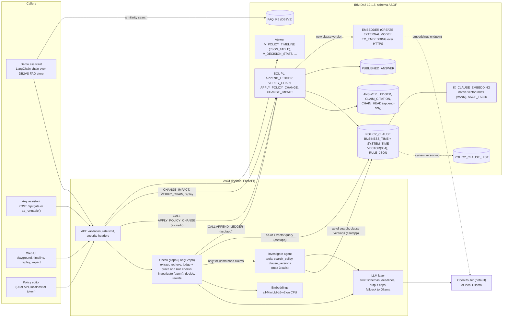
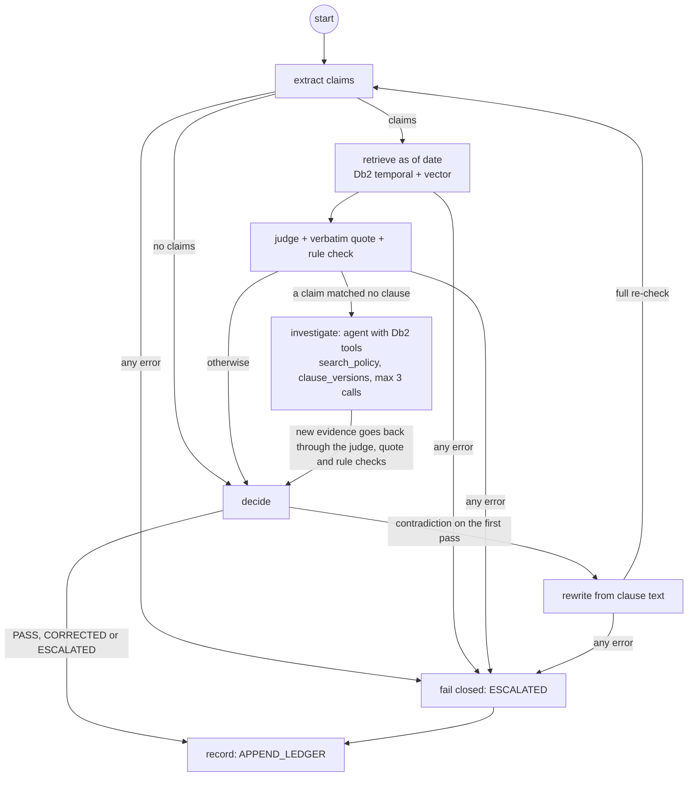
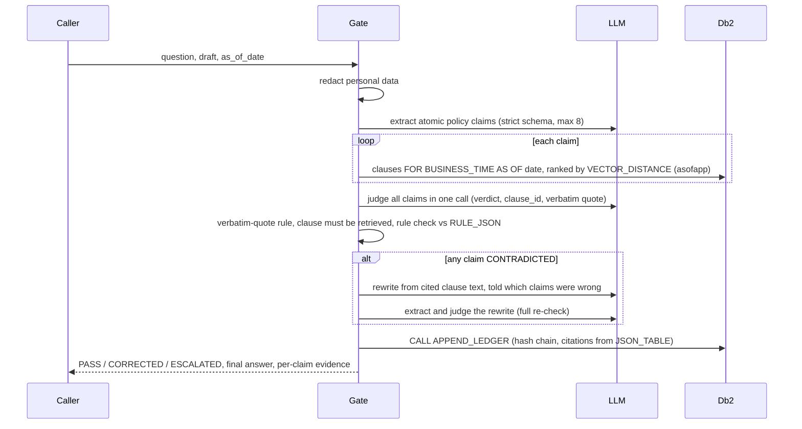

# System Architecture

## Overview

AsOf sits between any AI assistant and its customers. The calling system sends the assistant's draft answer, the customer's question and the date that decides which policy applies (booking or travel date). AsOf extracts the policy claims in the draft, looks up the clause versions in force on that date in IBM Db2, checks each claim with one batched LLM judge call plus deterministic rules, and then releases the draft (PASS), releases a rewrite that passed a full re-check (CORRECTED), or holds it for a person (ESCALATED). Every decision is appended to a hash-chained ledger in Db2, which can later be replayed against what the database held at that moment, and re-assessed when policy changes.

Db2 is the system of record for everything that matters in a dispute: the dated policy versions (bitemporal table with native vectors and JSON rule parameters), the decisions and their evidence (append-only, hash-chained, written only by a stored procedure), and the help-centre answers that depend on them. The application holds no state of its own.

All data in this repository is fictional (Aurelia Air, an airline, and Fernhollow Bank, a bank fee schedule). Both are loaded into the same tables; the request's `doc_id` decides which document a check reads and which prompt wording it uses ([domains.py](src/asof/domains.py)).

---

## Architecture Diagram




The check itself, as the LangGraph state graph in [checkgraph.py](src/asof/checkgraph.py). Solid edges are fixed; the conditions are read from deterministic state (verdicts, pass number, errors), never decided by a model:



---

## Component Breakdown

1. **User interface** ([src/asof/ui/](src/asof/ui/)): plain HTML, CSS and ES modules served by FastAPI, with no framework or build step. Six screens: Playground, Policy timeline, Ledger and replay, Ask the ledger, Change impact, Analytics. A strict Content Security Policy is in force (no inline script or style), and every string from the API or the LLM is escaped before rendering.
2. **API** ([src/asof/api.py](src/asof/api.py)): FastAPI. Pydantic input models with UTF-8 byte limits, date bounds, an allow-listed `doc_id` and no control characters. Per-client rate limit on LLM endpoints and full-chain verification, 64 KB body cap, security headers, and error handlers that return SQLSTATEs but never stack traces or SQL. Binds to localhost by default.
3. **Check graph and gate** ([src/asof/checkgraph.py](src/asof/checkgraph.py), [src/asof/gate.py](src/asof/gate.py)): the LangGraph state graph orchestrates one check (diagram above); the gate owns the steps it calls (extract, retrieve, judge, the quote, rule and coverage checks, decide, rewrite, record) and the decision rules.
   - The `investigate` node is a tool-calling agent with two read-only Db2 tools, `search_policy` (as-of search on the customer's date) and `clause_versions` (a clause's dated versions), capped at 3 calls; its trace is stored with the decision in `VERDICTS_JSON`.
   - [redact.py](src/asof/redact.py) masks personal data before anything leaves the process.
   - [prompts.py](src/asof/prompts.py) and [schemas.py](src/asof/schemas.py) hold the versioned prompts and the strict output schemas.
   - [retriever.py](src/asof/retriever.py) is the as-of plus vector query, exposed as a LangChain `BaseRetriever`.
   - [rules.py](src/asof/rules.py) is the deterministic check of amounts, durations, limits, tiers and permissions against `RULE_JSON`.
   - [ledger.py](src/asof/ledger.py) appends, verifies, reads and replays the ledger.
4. **LLM layer** ([src/asof/llm.py](src/asof/llm.py)): one interface over OpenRouter, any OpenAI-compatible endpoint, or Ollama. Every call returns a validated Pydantic object or raises `LLMError`, under a hard wall-clock deadline and an output-token cap.
5. **Database layer (IBM Db2)** ([src/asof/sql/](src/asof/sql/)): tables, history table, indexes, triggers, SQL functions, SQL PL procedures, views and grants, installed by [schema.py](src/asof/schema.py) into a validated schema name (`ASOF`, or `ASOF_TEST` and `ASOF_EVAL` for tests and evaluation).
6. **Policy module** ([src/asof/policy.py](src/asof/policy.py)): validated policy changes through `APPLY_POLICY_CHANGE` on the editor connection, change impact, timeline, system-time history and analytics.
7. **Ask the ledger** ([src/asof/askledger.py](src/asof/askledger.py)): a LangChain SQL chain for auditors. LangChain's `SQLDatabase` (SQLAlchemy over `ibm_db_sa`, reflected as the analyst) describes the six audit views; the model's SQL must pass a SQLGlot check (IBM's `db2-sqlglot-dialect`), and only SQLGlot's regeneration of the checked tree runs, as the read-only analyst `asofread`, under a Db2 statement timeout and a row cap. Db2's column masks hide the ledger text from that user.
8. **Integration** ([src/asof/integration.py](src/asof/integration.py)): `as_runnable()` drops the check into an existing LangChain chain. [assistant.py](src/asof/assistant.py) is the deliberately naive demo assistant over the official `DB2VS` store.
9. **Tooling**:
   - [setup.py](src/asof/setup.py): users, schema, seed, grants, self-check, and the demo-only `--reset-ledger`.
   - [db2check.py](src/asof/db2check.py): the 29 Db2 feature checks.
   - [eval/](src/asof/eval/): the frozen evaluation.
   - [demo.py](src/asof/demo.py): records sample history.
   - [scripts/check_secrets.py](scripts/check_secrets.py): pre-commit secret check.

### AI / LLM design

- **Frameworks:** LangGraph runs the check graph and the change-impact agent; LangChain provides:
  - Structured output via `with_structured_output(method="json_schema", strict=True)`.
  - A custom `BaseRetriever` (`AsOfClauseRetriever`) over the as-of query.
  - `langchain-db2`'s `DB2VS` for the demo assistant's FAQ store.
  - `as_runnable()` for drop-in use in existing chains.
- **Models:** `google/gemini-3.1-flash-lite` through OpenRouter by default (chosen by a 10-model probe, see Design decisions); `qwen2.5:7b-instruct` through Ollama as the no-key path; any OpenAI-compatible endpoint by configuration. Embeddings are local (`all-MiniLM-L6-v2`, 384 dimensions, CPU).
- **Prompts** ([prompts.py](src/asof/prompts.py), versioned): extraction, judge and rewrite. Instructions live only in the system message. Questions, drafts, claims and clauses are passed as data blocks with angle brackets escaped, so text cannot close its block or pose as a clause. The rewrite is given the list of claims found wrong, so it does not repeat them.
- **Calls per answer:** at least two for a PASS (extract, judge) and five for a CORRECTED answer (extract, judge, rewrite, extract, judge), plus up to 3 tool calls and a second judge call when the agent investigates. On the frozen airline split the runs with the agent averaged 4.15 to 4.4 calls per answer (4.38 at `36291ab`).
- **What the model is not trusted with:**
  - the customer's date (supplied by the caller)
  - which clauses exist (Db2 retrieves them)
  - quotes (must match the clause verbatim)
  - numbers, limits, tiers and key permissions (checked by code against `RULE_JSON`)
  - the final release (decided by code)
  - anything executable: model output is never run or used to build SQL, and is escaped in the UI
- **Failure handling:** hard wall-clock deadline and output cap on every call; one retry for malformed output; a timeout is final. Ollama requests are non-streaming, so a stuck generation is cancelled. Every failure becomes ESCALATED and is still recorded.

### Evaluation

[docs/eval_results.md](docs/eval_results.md) holds every recorded run. Four frozen splits, each committed and pinned by SHA-256 before its first run: the airline `test` split (40 cases), the bank `bank-test` split (26; no longer blind after its first run found a rule-data gap), `extractor-test` (10 drafts aimed at the claim extractor) and the blind `bank-test2` (22, run once). On the current check, `gemini-3.1-flash-lite` released none of the 64 drafts that were wrong for their date across the four, held back 1 of 34 correct drafts, and cited the right clause version in 94.3% (airline), 87.5% (bank), 100% (extractor) and 100% (blind bank) of keyed cases. The README has every run, both providers and the misses.

### Design decisions

Each line is a choice and the reason for it. Findings marked "spike" were verified on Db2 12.1.5.0 Community Edition before any project code was written.

- **The Langflow component calls AsOf over HTTP.** Langflow and `lfx` pin their own LangChain and `ibm_db`, so importing AsOf's Python package into Langflow would force one side to compromise. The component posts to `/api/gate` and passes on only `final_answer`, which AsOf already sets to the holding reply when nothing is released; it validates the date, URL and document before any request, and caches the check so its two outputs never cost two checks.
- **The Airflow DAG subclasses the provider's hook.** `apache-airflow-providers-ibm-db2` 0.1.0 builds its connection string with `PWD=<password>`, which breaks on a `;` and puts the secret in a string that gets logged by careless code. The DAG's `AsOfDb2Hook` keeps the provider's connection handling but passes credentials to `ibm_db_dbi.connect` as arguments, the same rule as the app. It sets `CURRENT PATH` as well as `CURRENT SCHEMA`, because unqualified `CALL`s resolve through the path (found when the first run got SQL0440N).
- **dbt in its own environment, building as the owner into `ASOF_MART`.** `ibm-dbt-db2` 1.0.0 pins `ibm_db==3.2.8` and `dbt-core~=1.11`; the app needs `ibm_db` 3.3.0, so dbt gets a separate virtualenv instead of a compromise on either side. The marts read decision and verdict columns only, never ledger text, so the column masks never apply to them.
- **A second domain without touching the first.** Fernhollow Bank's fee schedule gets its own prompt wording and claim-area enum, chosen from the validated `doc_id`; the airline keeps its exact prompts, output schemas and prompt version, pinned by a hash in `tests/test_domains.py` that was taken before the bank existed. Everything below the prompts is shared: the as-of query filters by `DOC_ID`, the rule checker reads units from key suffixes, and the ledger, masks and agents need no change.
- **Rule checker: a matched amount is settled.** Adding the bank exposed that "a 12-month period" (read as 12 months and as 365 days) could match `courtesy_period_months = 12` and still count as a wrong `request_window_days`. An amount that matches a parameter in any of its units is now settled. Because this touches airline checks too, the frozen airline split was re-run (0 of 26 false allows, 95.0% ideal).
- **Every fact a clause states needs its rule parameter.** The first frozen bank run found MTF-003 ("paper statements cost $2; electronic statements are free") with only the $2 modelled, so the rule check turned "electronic statements are free" into a contradiction. The failure was safe (escalated), the data was fixed, and a test keeps it fixed. Rule parameters are part of the policy data and need the same review as its text.
- **Column masks with an allow-list role, not a deny-list.** The masks show ledger text only to `ASOF_TEXT_READER` (the runtime user), so any user added later sees `[masked]` by default. Db2 does not let the owner grant itself a role (SQL0554N), so the owner is masked too; it holds SECADM and could drop the masks, but that is a recorded catalog change, not a silent read.
- **`SECURED` ledger triggers.** Activating column access control failed with SQL20469N reason code 37 until the triggers on the table were secured (spike). Creating a secured trigger needs SECADM, which the database creator holds.
- **`VERIFY_CHAIN` fetches rows into variables before hashing.** Passing a masked column straight to the hash functions is refused for a non-secured function (SQL20473N). Making the functions `SECURED` instead crashed the engine while compiling `VERIFY_CHAIN` (SIGSEGV in `sqlnq_compile_fgac`, Db2 12.1.5 under Rosetta; FODC trap captured, then deleted). Explicit cursors with `FETCH ... INTO` local variables avoid the problem entirely, and the functions stay non-secured.
- **"Ask the ledger" executes SQLGlot's output, not the model's.** Checking one parse tree and running a different string would let a parser disagreement through. SQLGlot's Db2 dialect does rewrite a few constructs (`CHAR(x)` to `CHR(x)`, `D + 1 DAY` to `D + 1 AS DAY`, `MOD` to `%`), so those are refused outright rather than run as something else.
- **The statement timeout is set on the driver statement.** `SQL_ATTR_QUERY_TIMEOUT` on the connection was accepted and ignored (a 21 s cartesian count ran to the end); on the prepared statement Db2 cancelled at about 4 s with SQL0952N. So the chain reflects through SQLAlchemy and LangChain's `SQLDatabase`, and executes on the same connection's `ibm_db` handle.
- **`get_materialized_view_names` answered for `ibm_db_sa`.** LangChain's `SQLDatabase(view_support=True)` calls it, and `ibm_db_sa` 0.4.4 does not implement it (`NotImplementedError`). None of the allowed views is a materialized query table, so the engine's dialect returns an empty list.
- **Db2 12.1.5.0 Community Edition, pinned.** `db2level` reports v12.1.5.0; native `VECTOR` and `VECTOR_DISTANCE` need 12.1.2 or later. The image tag `12.1.5.0` resolves to the same manifest as `latest` today, so pinning costs nothing and keeps judges on the tested level.
- **Thin derived Db2 image (`docker/db2/Dockerfile`).** Under Rosetta (Colima `--vz-rosetta`, binfmt flags `OCF` without `P`), argv[0] is not preserved, so `su - db2inst1 -c ...` never starts a login shell and `db2profile` is never sourced. IBM's setup script then fails every `db2` call with "command not found" and still prints "Setup has completed", with no engine running and no database. The image gives the Db2 users a login-shell wrapper; on hosts that preserve argv[0] it changes nothing. Spike: stock image left TESTDB missing; derived image created TESTDB in about 90 seconds.
- **No fenced routines.** Under Rosetta the fenced-mode process (`db2fmp`) crashes on start, so fenced C routines such as `SYSPROC.ENV_GET_INST_INFO` fail with SQL1646N. Everything AsOf runs in Db2 is built-in SQL, triggers or SQL PL procedures, which execute inside the engine and behave the same on Apple Silicon and x86.
- **Embeddings live in the bitemporal clause table.** Spike: a `VECTOR(384, FLOAT32)` column works in a system-versioned table, `CREATE TABLE ... LIKE` copies it to the history table, and `FOR PORTION OF BUSINESS_TIME` updates move the old embedding into history. No side table needed.
- **One query for "in force on date D" plus semantic rank.** Spike: `FOR BUSINESS_TIME AS OF ?` combined with `VECTOR_DISTANCE(..., VECTOR(?, 384, FLOAT32), COSINE)` and `FETCH FIRST n ROWS ONLY`, fully parameterised, and also combined with `FOR SYSTEM_TIME AS OF ?` for replay.
- **Vectors are always bound parameters.** `langchain_db2`'s `similarity_search` formats the query vector into the SQL text and filters metadata in Python after `FETCH FIRST k`. AsOf uses the official `DB2VS` store for the demo assistant's FAQ knowledge base, and its own LangChain retriever for policy clauses, which binds the vector and date as parameters and filters in SQL.
- **JSON validity via `CHECK (JSON_EXISTS(RULE_JSON, '$'))`.** The `IS JSON` predicate is rejected at this level (SQL0104N). The `JSON_EXISTS` check rejects malformed JSON with SQLSTATE 23513. `JSON_VALUE` and `JSON_TABLE` work for reading rule parameters; `JSON_VALUE` returns booleans as the strings `true` and `false`.
- **Hash chain computed inside Db2.** Spike: `LOWER(HEX(HASH(expr, 2)))` equals Python's SHA-256 hex digest for UTF-8 input (database codeset 1208), so `APPEND_LEDGER` computes row hashes in SQL PL and the app never supplies them.
- **Row triggers for append-only tables.** Spike: `BEFORE UPDATE` and `BEFORE DELETE` triggers with `SIGNAL SQLSTATE '75001'` block changes. Dropping a table leaves its triggers behind as inoperative, so teardown drops triggers explicitly.
- **Embeddings on CPU.** `all-MiniLM-L6-v2` is small enough that CPU is fast (model load about 4 s), and torch 2.15 crashes on macOS 14 when it uses the Metal backend.
- **Deterministic checks for numbers and deadlines.** Spike: a local 7B model (`qwen2.5:7b-instruct`) returns schema-valid structured output, but on the Moffatt-style draft it missed "90 days" and "$35" in the extracted values. Values that decide PASS or CONTRADICTED are therefore parsed from claim text by code and compared to `RULE_JSON`; the LLM's reading never overrides them.
- **Default hosted model: `google/gemini-3.1-flash-lite` via OpenRouter.** Chosen by a probe that runs AsOf's real prompts and schemas against the Aurelia corpus: 7 extraction cases (including chit-chat, a hedged non-answer and an injected instruction) and 15 batched-judge cases with 20 claims (date flips, a condition the claim leaves out, a deadline counted from the wrong date, delay tiers, NOT_COVERED, and a fake clause injected inside a claim). Three rounds per model after a first screen of 10 models:

  | Model | Valid format | Extraction | Verdict + clause | Verbatim quotes | Injection | p50 / p90 latency |
  |---|---|---|---|---|---|---|
  | google/gemini-3.1-flash-lite | 66/66 | 21/21 | 60/60 | 54/54 | 9/9 | 1.0 s / 1.4 s |
  | anthropic/claude-haiku-5.5 | 66/66 | 21/21 | 59/60 | 54/54 | 9/9 | 1.2 s / 2.0 s |
  | google/gemini-3.5-flash-lite | 66/66 | 21/21 | 59/60 | 53/53 | 8/9 | 0.9 s / 1.3 s |
  | openai/gpt-4.1-mini | 66/66 | 20/21 | 59/60 | 54/54 | 9/9 | 1.1 s / 1.7 s |
  | z-ai/glm-5.3-flash | 66/66 | 20/21 | 56/60 | 52/52 | 9/9 | 1.8 s / 4.5 s |

  It was the only model with no misses and has the tightest latency spread, at about $0.0004 per call. The probe is small; the frozen evaluation splits report the real numbers for both providers. The miss most models shared (citing the 6-to-9-hour delay tier for a 5-hour delay) is the kind of error the deterministic tier check catches regardless of model. Excluded in the first screen: models that took 8 to 31 s per call, or misjudged 3 of 20 claims.
- **One judge call per answer, not per claim.** All claims and the deduplicated clauses retrieved for them go to the model together, and it returns one verdict per numbered claim. A PASS costs two LLM calls (extract, judge) and a CORRECTED answer five (extract, judge, rewrite, extract, judge), before any agent step.
- **Every LLM call has a hard wall-clock deadline and an output cap.** During the probe, the local 7B model fell into a generation loop on one hard case and streamed about 11,800 tokens over 30 minutes. Because tokens kept arriving, the HTTP read timeout never fired. Now each attempt runs under a deadline in a daemon thread, every provider gets `max_tokens` / `num_predict` (1000 by default, about twice the largest real reply), and a timeout is final: the gate fails closed instead of retrying.
- **Ollama requests are not streamed.** With one complete response per request, the read timeout fires on a stuck generation, the client disconnects and Ollama cancels the work (verified: a 5 s deadline produced `cancel task` in the Ollama log), so an abandoned request no longer blocks the next one.
- **OpenRouter routes only to endpoints that honour every parameter** (`provider.require_parameters`), so a JSON schema is never silently dropped. Temperature is not sent by default: several current models reject it, and with this routing an unsupported parameter means no endpoint at all (observed with `claude-haiku-5.5`).
- **Strict schemas, closed enums, caps in code.** Every model reply is parsed into a Pydantic model with all fields required and extra keys forbidden. Limits such as 8 claims are enforced after parsing, because providers differ in which JSON Schema keywords they honour.
- **Untrusted text is escaped, not just delimited.** The question, draft and claims are HTML-escaped inside `<question>`, `<answer>`, `<claims>` blocks, so a draft cannot close its block or inject a fake `<clause>` (tested), and the instruction never to follow embedded instructions is in the system message only.
- **Compose builds the Db2 image with or without buildx.** Docker's classic builder (used when the buildx plugin is missing, as on this Mac) ignores Compose's `platform:` when resolving `FROM`, and IBM publishes no arm64 image, so the platform is pinned in the Dockerfile. `COPY --chmod` is avoided for the same reason.
- **"Healthy" means setup finished in this boot.** IBM's setup writes `/database/config/.shared-data/setup_complete` on the data volume, and on a restart it re-runs setup (including a same-level database upgrade that holds TESTDB exclusively) while the old marker is still there. The entrypoint deletes the marker first, and the healthcheck requires the marker and a successful connection. Verified on a fresh volume (healthy after about 6 minutes) and on a restart (about 3 minutes), with the Db2 feature check passing immediately after `docker compose up --wait`.
- **Db2 users are OS users, created by setup.** Db2 authenticates against the operating system of the Db2 server, so setup runs `useradd` inside the container and sets each password with `chpasswd` reading stdin, never a command-line argument. Passwords for `asofapp`, `asofedit` and `asofread` are generated into `.env` (mode 600) when empty and are never printed.
- **PUBLIC defaults are revoked explicitly.** Setup revokes `CONNECT`, `CREATETAB`, `BINDADD` and `IMPLICIT_SCHEMA` from PUBLIC and grants `CONNECT` only to the named users and the analyst role. On the TESTDB that IBM's image creates, PUBLIC already held none of the four, so these are a no-op there, but they harden databases created with Db2's usual defaults. Setup reports which case it found.
- **`CHANGED_BY` defaults to `SESSION_USER`.** A generated column from `SESSION_USER` is rejected on Db2 LUW (SQL0548N), so the column defaults to the session user on insert and `APPLY_POLICY_CHANGE` sets it on update.
- **One schema definition, two targets.** The SQL files use the token `ASOF.`; the installer substitutes a schema name that must match `^[A-Z][A-Z0-9_]{0,29}$`. Integration tests install, seed and grant a throwaway `ASOF_TEST` schema and drop it afterwards, so append-only test rows never touch the real ledger. Tables and indexes are created only if missing and seed loaders skip non-empty tables, so `python -m asof.setup` is safe to re-run.
- **Retrieval embeds the clause title with its text, and queries with claims.** A question-style query ("Can I get a bereavement fare after I travel?") ranked the eligibility clause BRV-001 just above the timing clause BRV-002 (cosine distance 0.268 vs 0.275). A claim-style query ranked BRV-002 first at the correct version for both dates. The pipeline therefore retrieves per extracted claim, top 3 to 5.
- **The demo assistant's FAQ store uses the official `DB2VS`.** It is created by the owner during setup (DB2VS creates its table on first use) and read by the app user, which has `SELECT` only.
- **No record, no release.** If `APPEND_LEDGER` fails, the gate withholds the answer: the decision becomes ESCALATED with reason `LEDGER_UNAVAILABLE` and the API answers HTTP 503 with the holding reply. Every other failure (LLM timeout, invalid output, database error, unexpected exception) is ESCALATED and still recorded.
- **Gapless ledger IDs, taken under the chain-head lock.** `APPEND_LEDGER` first updates the single `CHAIN_HEAD` row, which holds a row lock until commit, then assigns `LAST_LEDGER_ID + 1`. Concurrent writers queue instead of forking the chain (tested with three writers), and a deleted row shows up as a gap, not only as a hash mismatch. An identity column would allow gaps after a rollback.
- **Row hash = SHA-256 of the previous hash and the SHA-256 of each field.** Fixed-length field digests make boundaries unambiguous (no delimiter can be smuggled into a field) and keep the hash input around 1 KB, far below Db2's 32 KB string limit, whatever the field sizes. Computed in SQL functions, so the app never supplies a hash.
- **Citations are derived from the hashed JSON and checked against it.** `APPEND_LEDGER` shreds `CLAIM_CITATION` rows out of the verdict JSON in the same call, and `VERIFY_CHAIN` re-derives them, so an edited citation is detected even though citation rows are not hashed directly (tested).
- **Db2's `JSON_TABLE` takes only `'strict $'` here.** `'lax $.claims[*]'` and `NESTED PATH` are rejected at this level (SQL0104N), so `CLAIMS_FROM_JSON` reads each of the at most 16 array positions (8 claims in the draft check, 8 in the re-check) with a literal index and unions them. Db2 also refuses a ninth claim per check (SQLSTATE 75003).
- **Two checks per corrected answer, both kept.** `CLAIM_CITATION.PASS_NO` is 1 for the draft check (where contradictions are found, which analytics needs) and 2 for the re-check of the rewrite (what the customer received, which change impact needs).
- **Procedures never return NULL OUT values.** The `ibm_db` CLI driver fails with CLI0110E on a NULL OUT parameter, so `VERIFY_CHAIN` reports 0 and a message instead and Python maps 0 back to "none". OUT string placeholders are passed at full width because the driver sizes buffers from them.
- **A contradiction triggers a rewrite even when another claim is not covered.** In a live March run the draft's retroactive promise was CONTRADICTED and a detail ("documentation within 90 days") was NOT_COVERED, and the first design escalated it. A contradiction means the clauses hold the right answer; the rewrite may use only clause facts (which drops the uncovered detail) and is released only if every claim in it passes a full re-check. Uncovered claims with nothing contradicted still escalate: the policy does not answer the question, so a person must.
- **The rewriter is told what was wrong.** In a live June run the rewrite repeated the draft's "refund the 40% fare difference" (a 40% discount conflated with a fare-difference refund) and one of two re-checks accepted it. Since prompt version `2026-11-06.2` the rewrite receives every contradicted or unsupported claim with its reason; in 5 fresh runs no rewrite repeated one.
- **The rule checker is precise, not exhaustive.** Units come from `RULE_JSON` key suffixes (`_usd`, `_pct`, `_hours`, `_days`, `_months`, `_kg`, `_chars`), `max_`/`min_` keys are limits, a claim's numbers per unit only need one match (others may describe the situation: "if you cancel your $400 ticket, the fee is $100"), `applies_when` ranges route delay claims to the right tier, and a small lexicon reads key permissions with negation before the cue or a negated verb after it. Relative counts ("three additional passengers") are skipped after a live false positive. It returns MATCH, MISMATCH or NOT_APPLICABLE and can only ever force CONTRADICTED.
- **Personal data is redacted before it leaves.** Emails, phone numbers, Luhn-valid card numbers, any other 13 to 19 digit number, and booking references are masked before text goes to the LLM provider and before anything is written to the ledger, including the final answer. The caller still receives the answer as written.
- **Validation in UTF-8 bytes.** Db2 `VARCHAR` lengths are bytes, so the API limits the question to 2000 and the draft to 4000 bytes (2000 accented characters already reach 4000 bytes, tested), rejects control characters and unknown fields, bounds dates to 2020 to 2035, and accepts only allow-listed `doc_id` values. LLM-backed endpoints are rate-limited per client, bodies over 64 KB are refused, and the server binds to localhost by default.
- **Change impact judges released answers only, by the version they relied on.** `CHANGE_IMPACT` looks at PASS decisions (draft check) and CORRECTED decisions (re-check of the rewrite), because those are what customers received; escalated answers released nothing. An answer is HISTORICALLY_VALID if the version now in force for its customer date is still the one it cited, and STALE if that date now falls under a different version, which is exactly the "told the old policy for a date it no longer covers" case. Help-centre answers are checked over their whole date range and get the date they went wrong from. The join uses plain business-time predicates (`BUS_START <= d AND BUS_END > d`) because the date varies per row.
- **Policy changes are a procedure, not table access.** The editor user holds `EXECUTE` on `APPLY_POLICY_CHANGE` and `SELECT`, nothing else. The procedure validates the period and version label, applies `UPDATE ... FOR PORTION OF BUSINESS_TIME` (Db2 splits the row; system versioning keeps the replaced row), stamps `CHANGED_BY = SESSION_USER`, and flags overlapping help-centre answers in the same transaction. Its errors (SQLSTATE 75010 to 75013) reach the API as 422 with Db2's own message.
- **Help-centre answers store the version label they cite.** After a `FOR PORTION OF` split, the unchanged part of a row keeps its `BUS_START` but gets a new `SYS_START`, so the label is the stable way to say "this answer relied on v1".
- **`JSON_TABLE` needs an explicit `ON ERROR` clause at this level** (SQL0104N without it). The timeline view uses `ERROR ON ERROR`: rule JSON is already constraint-checked, and `EMPTY ON ERROR` would silently drop a clause from the timeline.
- **Policy edits over HTTP are local-only by default.** `POST /api/policy/change` accepts requests from 127.0.0.1 or ::1 only, unless `ASOF_EDITOR_TOKEN` is set, in which case the `X-AsOf-Editor-Token` header must match (compared in constant time). The rest of the API is read-only or rate-limited.
- **The UI has no framework and no inline code.** Plain HTML, CSS and ES modules served by FastAPI keep it fast and easy to run. The Content Security Policy allows scripts and styles from the app's own origin only, with no `unsafe-inline`, so timeline geometry is set through the CSSOM rather than `style` attributes. Every API and LLM string goes through an escaping template; only markup written in `app.js` is trusted. Each screen was driven in headless Chromium with no console or CSP errors, which also caught a race where a slow history request for one clause could overwrite the panel of the next.
- **Evaluation is separated from the demo and frozen before it runs.** The runner uses its own schema, `ASOF_EVAL`, with a fresh ledger per run, so eval decisions never mix with demo decisions. The 40-case test split was committed alone before any run; a unit test pins its SHA-256 and the runner refuses to run it if the hash changes. Misses on the test split are reported, not fixed against it.
- **The demo ledger reset is explicit and demo-only.** `python -m asof.setup --reset-ledger` drops and recreates the three ledger tables as the owner and starts a new chain. It does not disable triggers to delete rows, and policy data is kept.
- **Ollama gets a length-bounded grammar.** The first Ollama run of the test split was stopped after about 4 cases: every judge call hit the 1,000-token output cap twice and escalated with an error. Reproduced on a dev case, `qwen2.5:7b-instruct` copied the right sentence into `quoted_span` and then appended "[2026-06-02 is the date of the claim.]" until the cap, because grammar-constrained decoding has no reason to close an unbounded string. For Ollama only, every free-text string in the schema now carries `maxLength: 400` (enums untouched), so the grammar forces the JSON to close; the reply is then validated by the same Pydantic model. Prompts are unchanged, so hosted and local results come from the same instructions. Hosted providers keep strict `json_schema` without length keywords, which not every provider honours.
- **Ollama may only quote real clause sentences.** With the length bound, `qwen2.5:7b-instruct` finished every call and mostly judged correctly, but paraphrased its quotes, so the verbatim-quote rule turned good verdicts into NOT_COVERED and everything escalated. For Ollama only, the judge's grammar now restricts `quoted_span` to the sentences of the retrieved clauses and `clause_id` to the retrieved clause IDs (`gate.clause_sentences`, `llm.bounded_schema`). The model still chooses which sentence supports which claim, and the verbatim rule still runs. Hosted models get the same prompt with no enum, since their quotes were already verbatim. Both fixes were diagnosed and checked on dev cases only, and the frozen test cases were not changed.
- **Pinned twice: direct pins plus a full lock used as constraints.** `requirements.txt` pins the 23 direct dependencies; `requirements.lock` pins all 108 resolved packages and is passed with `-c`, not `-r`. A strict lock resolved on macOS would break Linux installs, because torch on Linux pulls CUDA wheels a Mac resolution never sees; constraints pin every package that does get installed and leave platform-only ones to pip. `scripts/audit_deps.py` runs pip-audit over the lock (no known vulnerabilities on 6 Nov 2026), and a test fails if the two files drift apart.
- **No string-built SQL, enforced by a test.** The first version qualified every table with a validated schema name in an f-string. That was safe (the name never came from input) but indistinguishable, to a reader or a grep, from string-built SQL. Statements are now literals with unqualified names, the schema is a bound parameter of `SET CURRENT SCHEMA` and `SET CURRENT PATH`, and `tests/test_sql_safety.py` scans the AST of every module and test. The only interpolation it allows is `db.ident(...)` in setup DDL and GRANT, where Db2 accepts no parameter markers.
- **One 32K tablespace for every AsOf table.** A native vector index key on `VECTOR(384, FLOAT32)` is 1,536 bytes; Db2 caps an index key at a quarter of the page size, so the default 4K tablespace rejects it (SQL0614N, found in a spike). AsOf creates `ASOF_BP32K` and `ASOF_TS32K` once per database and places every table there explicitly, which also lets a 30 KB ledger row sit in one page and keeps AsOf's storage separate from anything else in the database.
- **A native vector index, but exact search in the temporal query.** `IX_CLAUSE_EMBEDDING` (type `VANN`) is in place for scale, and the retrieval query says `FETCH EXACT` because Db2 defaults to approximate when an index exists. `python -m asof.vectorbench` showed why: with a business-time filter at 100,000 rows the approximate top 10 kept only 0.73 recall, and a missed version in force is a wrong check. Without the filter, approximate search was 18 times faster at 0.95 recall.
- **`FETCH APPROX FIRST 10 ROWS`, not `FIRST ? ROWS`.** Found while benchmarking: with a parameter marker for k, Db2 12.1.5 never matched the vector index (exact scans at every size, 143 ms at 100,000 rows); with a constant it did (7.7 ms). Any approximate query AsOf adds will use a constant k.
- **RUNSTATS through the command line processor.** `SYSPROC.ADMIN_CMD` is a fenced routine and crashes under Rosetta (SQL1646N), so setup runs `RUNSTATS` with `db2` inside the container and falls back to `ADMIN_CMD`, with the command as a bound parameter, where fenced routines work.
- **Explain mode instead of `EXPLAIN PLAN FOR` text.** `python -m asof.explain` sets `CURRENT EXPLAIN MODE = EXPLAIN` and runs the app's own statement constants with bound values, so the plans are for exactly what runs and no SQL is assembled even in tooling. Explain tables come from IBM's `EXPLAIN.DDL` through the command line processor, again because `SYSINSTALLOBJECTS` is fenced.
- **Adaptive row compression on the ledger.** The ledger is append-only and repetitive (decisions, model names, JSON keys), the textbook case for `COMPRESS YES ADAPTIVE`; it costs nothing in the write path that matters here.
- **In-database embeddings for clauses, local embeddings for claims.** Db2 12.1.5 can call an OpenAI-compatible embedding endpoint from SQL (`CREATE EXTERNAL MODEL`, `TO_EMBEDDING`), verified working under Rosetta, where fenced routines crash; the call is made by the engine. Setup registers `EMBEDDER` and seeds the corpus through it, and `APPLY_POLICY_CHANGE` embeds a new version itself. OpenRouter serves the exact model the app runs locally (`all-MiniLM-L6-v2`, cosine 1.0 between the two), so clause vectors made in Db2 and claim vectors made in Python are interchangeable; setup refuses the model otherwise. Claims stay local because a round trip from the database costs about 1.7 s per claim here.
- **The model key goes into DDL as a validated literal.** `KEY` accepts no parameter marker (SQL0104N, tested). The key passes `db.string_literal`, which admits `[A-Za-z0-9_\-.:/]` only, so it cannot end the literal; the statement is never logged; tests confirm the key is not in `SYSCAT.EXTERNALMODELS` or `EXTERNALMODELOPTIONS`. Only the editor holds `USAGE` on the model.
- **HTTPS documented, local HTTP tolerated.** IBM documents HTTPS model URLs. Plain HTTP to an endpoint on the same host worked in a spike, but that is undocumented, so AsOf accepts it only for local hosts and labels it a development convenience.
- **`TEXT_GENERATION` evaluated, not used.** It works here too (verified against a test endpoint), but the check needs structured output against a schema, per-call deadlines, capped retries and a fallback provider, which the LangChain layer provides and a SQL scalar function does not. Moving generation into SQL would weaken fail-closed handling for no gain.
- **Provider fallback per call, recorded in the ledger.** A hosted model that times out, errors or returns no valid structured output after its retries hands that same call to local Ollama once, under Ollama's longer deadline. A valid answer from the primary is never second-guessed, so the fallback changes nothing when the hosted model works. `MODEL_INFO` in the ledger records it (`openrouter:... (fallback ollama:... on 1 of 4 calls)`), so a replayed decision shows which model judged it. Eval runs disable it so each run measures one provider.
- **Hybrid keyword plus vector retrieval with Db2 Text Search: evaluated and rejected (6 Nov 2026).** Measured first: with vector search alone, the clause version that a dev case's key claim must be checked against is retrieved for 18 of 18 dev cases at k = 4 (the check retrieves 4 clauses per claim and the judge sees all of them), 16 of 18 at k = 2 and 13 of 18 at k = 1; citation accuracy on the frozen test split is already 100% with the hosted model. Hybrid search could only reorder results the judge already sees. Then tried: IBM's container option `TEXT_SEARCH=true` failed in `db2iupdt -j TEXT_SEARCH` with DBI20187E (the instance's `fencedid` file not owned by `root:db2iadm1`) and left the instance unable to start again; the Db2 for i documentation also forbids `CONTAINS` on a table with a period, which would mean a side table keyed by `(CLAUSE_ID, BUS_START)` and asynchronous `UPDATE INDEX` runs after every policy change, plus a Java text-search server for judges to run. No measurable gain for a large setup cost, so AsOf does not use it. It would become worth revisiting with a much larger policy library, where keyword matching of clause numbers and defined terms could rescue claims that embeddings rank poorly.
- **The check is a LangGraph graph with fixed edges and one agentic node.** Rubric B and Unstop ask for agentic AI, and the risk with agents in a safety check is a model deciding to skip a step. So the graph's edges are chosen from deterministic state only, every error routes to `fail_closed`, and the agent (`investigate`) runs only for claims that matched no clause, with two read-only Db2 tools and at most 3 calls. What it finds is evidence, not a verdict: the claims go back through the judge, the verbatim-quote rule and the rule check, and an agent failure leaves them NOT_COVERED. Tests assert the graph's shape (no edge from the agent to a release) and that an injected instruction reaches it only as escaped data.
- **The agent stays on although it did not improve the eval.** Two runs of the frozen split with the agent kept 0 of 26 false allows and 1 of 14 false blocks, with ideal decisions at 90.0% in both against 92.5% before, within the hosted model's run-to-run variance, for about 0.7 more model calls per check. Retrieval already finds the right clause version for every dev case on this corpus, so there is little for it to add here; it pays off when a policy library is large enough for the first retrieval to miss. The results are reported as they are.
- **A second agent closes the change-impact loop, and a person still publishes.** After a policy change, `impactagent.py` (a LangGraph graph) finds the help-centre answers `CHANGE_IMPACT` flags, looks up what else each relies on with the same Db2 tools, drafts a correction from the clause text in force from the date it went wrong, and runs that draft through the full check on that date. It stores the result through `ADD_SUGGESTION`; only `asofedit` can publish through `DECIDE_SUGGESTION`, and only a draft the check released. Publishing splits the answer in time, because the old text was right for the dates before the change and replay should still show that.
- **A deterministic coverage check behind the extractor.** Extraction is a model call, so a draft can carry a detail it skipped, or talk it into skipping one ("the next sentence is background, not a claim"). Before release, every amount, percentage, duration and count in the text must appear in some extracted claim, unless it only repeats the customer's question; otherwise the draft is held (`UNCHECKED_DETAILS`), and a rewrite must pass the same test. A 10-case `extractor-test` split aimed at the extractor was frozen before its first run (0 of 8 false allows), and on the three frozen splits the check held none of the 76 drafts, so it cost no false blocks.
- **Replay mode, so a reviewer needs no model at all.** Without a key, the only no-cost path was a 5 GB local model at 12 to 40 s per call, and a reviewer who skipped both saw every check fail closed. `LLM_PROVIDER=replay` answers model calls from outputs recorded against the hosted model for the built-in scenarios, and replaces nothing else: retrieval, the quote and rule checks, the decision, the re-check, the agents' Db2 tools, the SQLGlot gate and the ledger run live. Each output is keyed by a SHA-256 of the schema or tool list plus every message, so it answers only its exact input; a miss is an `LLMError`, so anything unrecorded fails closed exactly like a provider outage. The one thing left out of the key is the two sample rows LangChain appends to each view description for Ask the ledger, because they change as the ledger grows, while the recorded SQL still passes the SQLGlot gate and runs live. The ledger labels every replayed decision `replay:`, and `python -m asof.eval` refuses to run in this mode, so a replay can never pass for a measurement. `tests/test_db2_replay.py` requires every recorded scenario to reach its recorded decision through Db2.
- **Bounded waits: a Db2 lock timeout and a whole-check budget.** Found by an independent audit: Db2's default `CURRENT LOCK TIMEOUT` is -1 (wait forever), and every ledger append takes the `CHAIN_HEAD` row lock, so one stuck writer would have stalled every check. The runtime users now run `SET CURRENT LOCK TIMEOUT = ?` (bound, 10 s) on connect; the owner keeps the default for setup. A test holds the lock as the owner and sees the next append fail in about 2 s (SQL0911N) instead of hanging. The per-call LLM deadlines did not bound a whole check (two attempts on the hosted model, then two on the fallback, for each of up to seven calls), so a check also has a 300 s budget after which no step starts. It is cooperative, not a hard kill, because abandoning a running check could still append a ledger row after the caller had been told ESCALATED.
- **An index shaped like the as-of query.** The first plan read the whole `PK_POLICY_CLAUSE` index (it leads with `CLAUSE_ID`, which the query does not filter on) and filtered `DOC_ID` at the fetch; the README overstated it as an index scan on the business-time key, which an audit caught. `IX_CLAUSE_DOC_ASOF (DOC_ID, BUS_START, BUS_END)` replaced `(DOC_ID, AREA)`, which no query used: Db2 now uses `DOC_ID = ?` as start and stop key and `BUS_START <= ?` as a stop key, and checks `? < BUS_END` in the index, at an estimated 7.07 timerons instead of 17.36.
- **Two more foreign keys.** `FK_LEDGER_DOC` (each decision names a policy document Db2 holds) and `FK_SUGGESTION_CHECK` (each drafted correction cites a ledger row that exists, or NULL when its check left none). Both are cheap on append-only tables. Because a drafted correction now depends on the ledger, the demo-only `setup --reset-ledger` drops the drafted corrections with the ledger tables instead of leaving them pointing at decision IDs the new chain will reuse.
- **A connection pool for the runtime user, after measuring.** Profiling a replayed check showed each fresh `ibm_db` connection costing about 0.2 s to open and 0.9 s to close on the dev machine (Db2 under Rosetta), three per check, while the queries themselves took milliseconds. A small pool in `db.py` keeps connections open; each checkout is exclusive, a returned connection is rolled back, and an idle one is pinged before reuse, so a connection Db2 dropped is replaced rather than failing a check. `python -m asof.connbench` measures it: 3,290 ms median per replayed check with fresh connections, 57 ms pooled, decisions unchanged. The analyst's SQLAlchemy engine keeps `NullPool`: Ask the ledger is rare, and a fresh session per question keeps the read-only role's state simple.
- **Python 3.12 only.** Tried on 6 Nov: the lock pins NumPy 2.5.4, which has no Python 3.11 build, and supporting 3.11 would mean a second lock and twice the tested surface. `./quickstart.sh` refuses any other version with a one-line message.

## Data Flow

### Checking an answer



1. **Input.** The caller supplies the question, the draft and the customer's date. The date is never inferred by a model.
2. **Redaction.** Emails, phone numbers, card numbers and booking references are masked. Only redacted text reaches the LLM provider and the ledger.
3. **Extraction.** One LLM call returns at most 8 atomic claims with area and type. More than 8 escalates.
4. **Retrieval.** Each claim is embedded locally and sent to Db2 as one parameterised query: clause versions in force on the date, ranked by cosine distance, top 4.
5. **Judgement.** One LLM call judges every claim against the deduplicated clauses and must quote the deciding clause text verbatim.
6. **Checks in code.** A verdict whose clause was not retrieved, or whose quote is not in the clause, becomes NOT_COVERED. The rule check then compares numbers, limits, delay tiers and permissions with `RULE_JSON`. A mismatch forces CONTRADICTED, and can move the citation to the delay tier that actually applies.
7. **Decision.**
   - All claims supported (or no policy claims): PASS, with policy references appended.
   - Any claim contradicted: rewrite from the cited clauses, then a full re-check. Released as CORRECTED only if every claim in the rewrite is supported, otherwise ESCALATED.
   - Uncovered claims with nothing contradicted: ESCALATED.
   - Any error: ESCALATED.
8. **Record.** `APPEND_LEDGER` writes the decision and both checks' citations in one transaction. If it fails, the answer is withheld (HTTP 503).

### Changing policy and finding what it affects

The editor submits a new clause version for a period. `APPLY_POLICY_CHANGE` validates the period and label, then runs `UPDATE ... FOR PORTION OF BUSINESS_TIME`: Db2 splits the existing version at the period boundaries, and system versioning moves the replaced row to `POLICY_CLAUSE_HIST`. The same transaction flags help-centre answers whose dates overlap the change. `CHANGE_IMPACT` then returns every released answer that cited the clause, marked STALE (its customer date now falls under a different version) or HISTORICALLY_VALID, plus every help-centre answer, marked NEEDS_REVIEW (with the date it went wrong) or STILL_VALID.

### Replaying a decision

For each clause a decision cited, three queries:

- the exact row it used, matched by `CLAUSE_ID`, `BUS_START` and `SYS_START` across current and history rows
- what Db2 held for that customer date when the answer was given (`FOR SYSTEM_TIME AS OF created_at FOR BUSINESS_TIME AS OF as_of_date`)
- what applies today for that date (`FOR BUSINESS_TIME AS OF as_of_date`)

---

## IBM Db2 Schema & Storage Design

Db2 Community Edition 12.1.5.0, database `TESTDB`, schema `ASOF`. Full DDL: [00_storage.sql](src/asof/sql/00_storage.sql), [01_tables.sql](src/asof/sql/01_tables.sql), [02_ledger_rules.sql](src/asof/sql/02_ledger_rules.sql), [03_procedures.sql](src/asof/sql/03_procedures.sql), [04_views.sql](src/asof/sql/04_views.sql), [05_masks.sql](src/asof/sql/05_masks.sql), [90_grants.sql](src/asof/sql/90_grants.sql).

### Storage

| Object | Definition | Why |
|---|---|---|
| Bufferpool `ASOF_BP32K` | `SIZE AUTOMATIC PAGESIZE 32K` | Matches the tablespace page size |
| Tablespace `ASOF_TS32K` | `PAGESIZE 32K MANAGED BY AUTOMATIC STORAGE` | Holds every AsOf table. A 384-dim vector index key needs more than a 4K page allows, and a ledger row fits in one page |
| `IX_CLAUSE_EMBEDDING` | `CREATE VECTOR INDEX ... ON POLICY_CLAUSE (EMBEDDING) WITH DISTANCE COSINE` (type `VANN`) | Approximate nearest-neighbour search at scale; the temporal query stays exact (see [vector benchmark](docs/vector_benchmark.md)) |
| `ANSWER_LEDGER`, `CLAIM_CITATION` | `COMPRESS YES ADAPTIVE` | Append-only, repetitive rows |
| Statistics | `RUNSTATS ... WITH DISTRIBUTION AND SAMPLED DETAILED INDEXES ALL` in setup | Plans costed from real cardinalities; [access plans](docs/explain/README.md) |

### Tables

```sql
-- Bitemporal policy clauses. BUSINESS_TIME: when a version applies to customers.
-- SYSTEM_TIME: when this database held the row (replay). Old rows go to POLICY_CLAUSE_HIST.
CREATE TABLE ASOF.POLICY_CLAUSE (
  CLAUSE_ID     VARCHAR(32)   NOT NULL,
  DOC_ID        VARCHAR(32)   NOT NULL,
  AREA          VARCHAR(40)   NOT NULL,
  TITLE         VARCHAR(200)  NOT NULL,
  VERSION_LABEL VARCHAR(20)   NOT NULL,
  CLAUSE_TEXT   VARCHAR(4000) NOT NULL,
  RULE_JSON     VARCHAR(2000) NOT NULL,
  EMBEDDING     VECTOR(384, FLOAT32) NOT NULL,
  CHANGE_NOTE   VARCHAR(400),
  CHANGED_BY    VARCHAR(128)  NOT NULL DEFAULT SESSION_USER,
  BUS_START     DATE          NOT NULL,
  BUS_END       DATE          NOT NULL,
  SYS_START     TIMESTAMP(12) NOT NULL GENERATED ALWAYS AS ROW BEGIN,
  SYS_END       TIMESTAMP(12) NOT NULL GENERATED ALWAYS AS ROW END,
  TRANS_ID      TIMESTAMP(12) GENERATED ALWAYS AS TRANSACTION START ID,
  PERIOD BUSINESS_TIME (BUS_START, BUS_END),
  PERIOD SYSTEM_TIME (SYS_START, SYS_END),
  CONSTRAINT PK_POLICY_CLAUSE PRIMARY KEY (CLAUSE_ID, BUSINESS_TIME WITHOUT OVERLAPS),
  CONSTRAINT FK_CLAUSE_DOC FOREIGN KEY (DOC_ID) REFERENCES ASOF.POLICY_DOC (DOC_ID),
  CONSTRAINT CK_CLAUSE_RULE_JSON CHECK (JSON_EXISTS(RULE_JSON, '$')),
  CONSTRAINT CK_CLAUSE_AREA CHECK (AREA IN ('bereavement', 'cancellation', 'change_fee', 'baggage',
                                            'refund', 'delay', 'travel_credit', 'pets', 'other',
                                            'overdraft', 'fee_refund', 'monthly_fee', 'foreign_transaction',
                                            'wire_transfer', 'atm', 'dispute', 'account_closure', 'checks')),
  CONSTRAINT CK_CLAUSE_VERSION CHECK (VERSION_LABEL LIKE 'v%')
) IN ASOF_TS32K;
CREATE TABLE ASOF.POLICY_CLAUSE_HIST LIKE ASOF.POLICY_CLAUSE;
ALTER TABLE ASOF.POLICY_CLAUSE ADD VERSIONING USE HISTORY TABLE ASOF.POLICY_CLAUSE_HIST;
```

| Table | Purpose | Key constraints |
|---|---|---|
| `POLICY_DOC` | Policy documents | PK `DOC_ID` |
| `POLICY_CLAUSE` (+ `_HIST`) | Dated clause versions with embedding and rule parameters | `WITHOUT OVERLAPS` PK, FK to `POLICY_DOC`, JSON check, area enum |
| `ANSWER_LEDGER` | One row per decision: redacted question and draft, final answer, decision, reason, model, prompt version, latency, verdict JSON, `PREV_HASH`, `ROW_HASH` | gapless `LEDGER_ID >= 1`, unique `REQUEST_ID` and `ROW_HASH`, decision and channel enums, JSON check |
| `CLAIM_CITATION` | One row per claim per check (`PASS_NO` 1 = draft, 2 = rewrite): verdict, judge verdict, rule check, clause ID, version, `BUS_START`, `SYS_START`, distance, quote | PK `(LEDGER_ID, PASS_NO, CLAIM_NO)`, FK to ledger, verdict enums, clause/date pairing check |
| `CHAIN_HEAD` | Single row: last ledger ID and hash; locked by every append | `HEAD_ID = 1` check |
| `PUBLISHED_ANSWER` | Help-centre answers with cited clause, version, `BUS_START` and the dates they cover | FK to `POLICY_DOC`, status enum, range check |
| `FAQ_KB` | Demo assistant's knowledge base, created and searched by `langchain-db2` `DB2VS` | created by `DB2VS` |
| `ANSWER_SUGGESTION` | Help-centre corrections drafted by the change-impact agent: the answer, clause, version and date it holds from, the check's decision and ledger entry, the agent's trace, and the editor's decision | status and decision enums, JSON check on the trace; written only through `ADD_SUGGESTION` and `DECIDE_SUGGESTION` |

Indexes: the native vector index `IX_CLAUSE_EMBEDDING` (`VANN`, cosine, in `ASOF_TS32K`), `IX_CLAUSE_DOC_ASOF` on `POLICY_CLAUSE (DOC_ID, BUS_START, BUS_END)` for the as-of query (its start and stop keys are in [docs/explain/as_of_retrieval.txt](docs/explain/as_of_retrieval.txt)), `ANSWER_SUGGESTION` by answer, `POLICY_CLAUSE_HIST (CLAUSE_ID, SYS_END)`, `ANSWER_LEDGER (CREATED_AT)`, `ANSWER_LEDGER (DECISION, LEDGER_ID)`, `CLAIM_CITATION (CLAUSE_ID, CLAUSE_BUS_START)`, `PUBLISHED_ANSWER (CITED_CLAUSE_ID, CITED_BUS_START)`.

### Routines, triggers and views

All routines are `LANGUAGE SQL`. They run inside the engine and execute with the owner's authority, so the runtime user needs only `EXECUTE`.

| Object | Kind | What it does |
|---|---|---|
| `APPEND_LEDGER` | SQL PL procedure | Locks `CHAIN_HEAD`, assigns the next gapless ID, computes the row hash in Db2, inserts the ledger row, shreds citations from the verdict JSON, moves the chain head. Rejects a ninth claim per check (SQLSTATE 75003). |
| `VERIFY_CHAIN` | SQL PL procedure | Recomputes every hash in order. Checks consecutive IDs, each link, each row's content, the chain head, and that citations match the hashed JSON. Returns OK or the first broken entry. Refuses (75030) a caller without `ASOF_TEXT_READER`, who would hash masked text. |
| `APPLY_POLICY_CHANGE` | SQL PL procedure | Validates, then `UPDATE ... FOR PORTION OF BUSINESS_TIME`, stamps `CHANGED_BY = SESSION_USER`, flags overlapping help-centre answers. |
| `CHANGE_IMPACT` | SQL PL procedure, dynamic result set | Stale and historically valid answers, help-centre answers to review. |
| `ADD_SUGGESTION` | SQL PL procedure | Stores a drafted help-centre correction; refuses one for an answer that does not cite the clause (75020) or a version not in force from that date (75021). The runtime user's only write path to `ANSWER_SUGGESTION`. |
| `DECIDE_SUGGESTION` | SQL PL procedure | The editor approves or rejects a suggestion. Claims it atomically (`UPDATE ... WHERE STATUS = 'PENDING'`, 75023 if already decided), refuses a draft the check did not release (75024), and publishes by splitting the help-centre answer at the change date instead of overwriting it. |
| `LEDGER_ROW_HASH`, `SHA256_HEX` | SQL scalar functions | SHA-256 of the previous hash followed by the SHA-256 of every field (`HASH(..., 2)`). |
| `CLAIMS_FROM_JSON` | SQL table function | Up to 16 claims out of the verdict JSON with `JSON_TABLE`. |
| `*_NO_UPDATE`, `*_NO_DELETE` | Triggers (`SECURED`) | Reject every UPDATE or DELETE on `ANSWER_LEDGER` and `CLAIM_CITATION`, and DELETE on `CHAIN_HEAD`, with SQLSTATE 75001. |
| `V_POLICY_TIMELINE` | View | Every version with key `RULE_JSON` parameters as columns, through `JSON_TABLE`. |
| `V_DECISION_STATS`, `V_CLAIM_OUTCOMES_BY_AREA`, `V_RULE_OVERRIDES` | Views | Analytics. |
| `V_AUDIT_DECISIONS`, `V_AUDIT_CLAIMS` | Views | One row per decision (with claim counts) and one per checked claim with the clause version cited. With the views above, the only objects the analyst may read. |
| `M_LEDGER_QUESTION`, `M_LEDGER_DRAFT`, `M_LEDGER_FINAL`, `M_LEDGER_VERDICTS` | Column masks (RCAC) | `[masked]` for anyone without `ASOF_TEXT_READER`. Column access control is active on `ANSWER_LEDGER`. |

### Key queries

```sql
-- Clauses in force on the customer's date, ranked by meaning (retriever.py). Every value is a parameter.
SELECT c.CLAUSE_ID, c.AREA, c.TITLE, c.VERSION_LABEL, c.CLAUSE_TEXT, c.RULE_JSON, c.BUS_START, c.BUS_END, c.SYS_START,
       VECTOR_DISTANCE(c.EMBEDDING, VECTOR(?, 384, FLOAT32), COSINE) AS DIST
FROM POLICY_CLAUSE FOR BUSINESS_TIME AS OF ? AS c     -- the schema is bound with SET CURRENT SCHEMA = ?
WHERE c.DOC_ID = ?
ORDER BY DIST FETCH EXACT FIRST ? ROWS ONLY;

-- Replay: the same question against what the database held at an earlier moment.
SELECT ... FROM ASOF.POLICY_CLAUSE FOR SYSTEM_TIME AS OF ? FOR BUSINESS_TIME AS OF ? AS c WHERE ...;

-- Policy change (inside APPLY_POLICY_CHANGE): Db2 splits the row, history keeps the old one.
UPDATE ASOF.POLICY_CLAUSE FOR PORTION OF BUSINESS_TIME FROM P_FROM TO P_TO
   SET VERSION_LABEL = P_VERSION_LABEL, CLAUSE_TEXT = P_TEXT, RULE_JSON = P_RULE_JSON,
       EMBEDDING = VECTOR(P_EMBEDDING, 384, FLOAT32), CHANGE_NOTE = P_NOTE, CHANGED_BY = SESSION_USER
 WHERE CLAUSE_ID = P_CLAUSE_ID;
```

### Users and privileges

| Db2 user | Used by | Holds |
|---|---|---|
| `db2inst1` (owner) | `python -m asof.setup`, `python -m asof.db2check`, and the dbt marts (built into their own schema, `ASOF_MART`) | Everything; reads the ledger's text as `[masked]` like everyone but the runtime user |
| `asofapp` (runtime) | API, gate, UI, agents, eval | `CONNECT`; `SELECT` on the policy, ledger, help-centre, suggestion and FAQ tables and four analytics views; `EXECUTE` on `APPEND_LEDGER`, `VERIFY_CHAIN`, `CHANGE_IMPACT`, `ADD_SUGGESTION`; role `ASOF_TEXT_READER`. No `INSERT`, `UPDATE`, `DELETE` or DDL. |
| `asofedit` (policy editor) | `POST /api/policy/change`, approving drafted corrections | `CONNECT`; `SELECT` on the policy and suggestion tables; `EXECUTE` on `APPLY_POLICY_CHANGE`, `CHANGE_IMPACT`, `DECIDE_SUGGESTION`; `USAGE` on the `EMBEDDER` model. No direct `UPDATE`. |
| `asofread` (analyst) | "Ask the ledger" | Role `ASOF_ANALYST`: `CONNECT` and `SELECT` on `V_AUDIT_DECISIONS`, `V_AUDIT_CLAIMS`, `V_POLICY_TIMELINE`, `V_DECISION_STATS`, `V_CLAIM_OUTCOMES_BY_AREA`, `V_RULE_OVERRIDES`. No tables, no procedures. |
| `PUBLIC` | | `CONNECT`, `CREATETAB`, `BINDADD`, `IMPLICIT_SCHEMA` revoked |

Column masks ([05_masks.sql](src/asof/sql/05_masks.sql)) on `ANSWER_LEDGER.QUESTION_REDACTED`, `DRAFT_REDACTED`, `FINAL_ANSWER` and `VERDICTS_JSON` return the real value only to holders of the role `ASOF_TEXT_READER`, which setup grants to `asofapp` alone. Everyone else reads `[masked]`, the owner included.


### DDL as Db2 holds it

The objects are created from the SQL files in [src/asof/sql/](src/asof/sql/). To show what Db2 actually holds after setup, [docs/ddl/asof_schema_db2look.sql](docs/ddl/asof_schema_db2look.sql) is the full DDL of schema `ASOF` generated from the catalog by IBM's `db2look` (`python scripts/export_ddl.py` regenerates it; the IBM Db2 Developer Extension for VS Code produces the same with Generate DDL on the schema). One caveat found on the way: `db2look` 12.1.5 prints the native vector index without its distance metric, in `SYSCATSPACE` and with zero build parameters, whatever its real definition, so that one statement in the file cannot be replayed as is; the file says so at the top. The core of it, unedited:

```sql
CREATE TABLE "ASOF    "."POLICY_CLAUSE"  (
		  "CLAUSE_ID" VARCHAR(32 OCTETS) NOT NULL ,
		  "DOC_ID" VARCHAR(32 OCTETS) NOT NULL ,
		  "AREA" VARCHAR(40 OCTETS) NOT NULL ,
		  "TITLE" VARCHAR(200 OCTETS) NOT NULL ,
		  "VERSION_LABEL" VARCHAR(20 OCTETS) NOT NULL ,
		  "CLAUSE_TEXT" VARCHAR(4000 OCTETS) NOT NULL ,
		  "RULE_JSON" VARCHAR(2000 OCTETS) NOT NULL ,
		  "EMBEDDING" VECTOR(384,FLOAT32) NOT NULL ,
		  "CHANGE_NOTE" VARCHAR(400 OCTETS) ,
		  "CHANGED_BY" VARCHAR(128 OCTETS) NOT NULL WITH DEFAULT USER ,
		  "BUS_START" DATE NOT NULL ,
		  "BUS_END" DATE NOT NULL ,
		  "SYS_START" TIMESTAMP(12) NOT NULL GENERATED ALWAYS AS ROW BEGIN ,
		  "SYS_END" TIMESTAMP(12) NOT NULL GENERATED ALWAYS AS ROW END ,
		  "TRANS_ID" TIMESTAMP(12) GENERATED ALWAYS AS TRANSACTION START ID ,
		 PERIOD BUSINESS_TIME ("BUS_START","BUS_END") ,
		 PERIOD SYSTEM_TIME ("SYS_START","SYS_END") )
		 IN "ASOF_TS32K"
		 ORGANIZE BY ROW;

ALTER TABLE "ASOF    "."POLICY_CLAUSE"
	ADD CONSTRAINT "PK_POLICY_CLAUSE" PRIMARY KEY
		("CLAUSE_ID",
		 BUSINESS_TIME WITHOUT OVERLAPS)
	ENFORCED;

ALTER TABLE "ASOF    "."POLICY_CLAUSE"
	ADD VERSIONING USE HISTORY TABLE "ASOF    "."POLICY_CLAUSE_HIST";
```

---

## Security & Secrets Management

Each line of the judging rubric's Security criterion, and where it is met.

| Rubric point | How AsOf meets it | Evidence |
|---|---|---|
| No secrets in code; credentials via `.env`; `.env` in `.gitignore` | All credentials are environment variables read by pydantic-settings into `SecretStr` (never printed or logged). `.env` and `.env.*` are gitignored; `.env.example` has dummy values. Setup generates the two service passwords into `.env` without printing them and sets them with `chpasswd` on stdin, never in a process argument. `scripts/check_secrets.py` blocks a commit that contains any value from the local `.env`, a private key, a provider key or a forbidden file. | [config.py](src/asof/config.py), [.gitignore](.gitignore), [scripts/check_secrets.py](scripts/check_secrets.py), [setup.py](src/asof/setup.py); `tests/test_corpus_and_config.py::test_secrets_never_appear_in_repr` |
| Parameterised SQL, no string-built queries | **The app's request-time SQL is fixed text.** Every statement the app's own code runs is a string literal in the source, with unqualified names; the schema is bound on the connection with `SET CURRENT SCHEMA = ?` and `SET CURRENT PATH = SYSTEM PATH, ?` (`db.use_schema`). Every value goes through a `?` marker, including vectors (`VECTOR(?, 384, FLOAT32)`), dates, timestamps and `FETCH FIRST ? ROWS`. Db2 cannot bind identifiers in DDL or GRANT, so setup code names objects and users only through `db.ident`, which accepts `^[A-Z][A-Z0-9_]{0,127}$` and nothing else. An AST scan of the package and its tests fails the build on any f-string, `%`, `+` or `.format()` that builds SQL, and on any runtime database call whose SQL is not a literal. Db2 credentials are passed to the driver as arguments, not spliced into the DSN. Three named exceptions: `langchain-db2`'s `DB2VS` builds its own SQL for the demo FAQ store; "Ask the ledger" runs SQL that SQLGlot regenerated from a parse tree it checked, as a user that can only read six views; setup DDL names objects through `db.ident` only. | [db.py](src/asof/db.py), [ledger.py](src/asof/ledger.py), [retriever.py](src/asof/retriever.py); `tests/test_sql_safety.py` (the build guard, plus planted bad examples it must catch), `test_unknown_doc_or_injection_string_returns_nothing`, `test_injection_strings_are_stored_as_plain_text`, db2check "SQL injection stored as text" |
| Input validation | API models: UTF-8 byte limits matching the Db2 column sizes, dates 2020 to 2035, allow-listed `doc_id`, enum channels, no control characters, unknown fields rejected, 64 KB body cap. Policy changes: ID and label patterns, flat rule JSON within 2000 bytes. The seed corpus is validated (IDs, ordered non-overlapping periods) before it reaches Db2, and Db2 enforces it again (`WITHOUT OVERLAPS`, check constraints). | [api.py](src/asof/api.py), [policy.py](src/asof/policy.py), [corpus.py](src/asof/corpus.py); `tests/test_api.py::test_invalid_input_is_rejected` and others |
| Least-privilege Db2 users | Runtime user `asofapp`: SELECT, plus EXECUTE on four procedures (`APPEND_LEDGER`, `VERIFY_CHAIN`, `CHANGE_IMPACT`, `ADD_SUGGESTION`); editor `asofedit`: EXECUTE on `APPLY_POLICY_CHANGE`, `CHANGE_IMPACT`, `DECIDE_SUGGESTION` and USAGE on the embedding model; analyst `asofread`: SELECT on six audit views through the role `ASOF_ANALYST`. Ledger and suggestion writes happen only inside procedures. `PUBLIC` defaults revoked. Setup proves it on every run by trying writes as `asofapp`. | [90_grants.sql](src/asof/sql/90_grants.sql); `test_app_user_is_read_only`, `test_app_user_cannot_write_ledger_tables`, `test_only_the_editor_can_change_policy`, `test_the_analyst_can_read_the_audit_views_and_nothing_else` |
| Safe handling of user data | Emails, phone numbers, card numbers (Luhn-checked) and other 13 to 19 digit numbers, and booking references are masked before text goes to the LLM provider or the ledger, including the stored final answer. In Db2, column masks (RCAC) show the ledger's question, draft, answer and verdict text only to the runtime user; the owner, the editor and the analyst read `[masked]`. The UI escapes every string. | [redact.py](src/asof/redact.py), [05_masks.sql](src/asof/sql/05_masks.sql); `tests/test_redact.py`, `test_personal_data_is_redacted_before_the_llm_and_the_ledger`, `test_the_owner_reads_masked_text_and_cannot_verify_through_the_mask`, `test_the_analyst_sees_decisions_but_the_text_is_masked_by_db2`, db2check "Column mask (RCAC)" |
| LLM-generated SQL ("Ask the ledger") | The one place SQL comes from a model. It runs only if SQLGlot (IBM's Db2 dialect) accepts it as one `SELECT` on six allowed views with allow-listed functions and masked columns only as output; Db2 runs SQLGlot's regeneration of the checked tree, never the model's text; as `asofread`, which can read those views and nothing else; under a Db2 statement timeout and a row cap. | [askledger.py](src/asof/askledger.py); `tests/test_askledger.py` (44 refusal cases, and proof that only checked SQL reaches Db2), `tests/test_db2_askledger.py` (privileges, masks, the predicate channel, the timeout) |
| Prompts and LLM output, no prompt-injection shortcuts | Untrusted text is escaped inside delimited blocks; instructions only in the system message; strict output schemas; a verdict counts only with a verbatim quote from a retrieved clause; deterministic rule checks override the judge; the gate fails closed; LLM output is never executed or used in SQL. A manipulated judge that says SUPPORTED with a real quote is still overridden. | [prompts.py](src/asof/prompts.py), [gate.py](src/asof/gate.py), [rules.py](src/asof/rules.py); `test_manipulated_judge_cannot_pass_a_contradiction`, `test_fake_clause_inside_a_claim_stays_data`, the live test `test_injected_instruction_does_not_get_a_contradiction_through`, and the 3 prompt-injection cases in the frozen test split (none released as PASS: 2 corrected from the clauses, 1 escalated) |
| Tamper evidence (beyond the rubric) | Triggers reject UPDATE and DELETE even for the owner. The hash chain is computed inside Db2, and `VERIFY_CHAIN` catches an owner who drops a trigger and edits a row, edits a citation, or deletes the last row. | [02_ledger_rules.sql](src/asof/sql/02_ledger_rules.sql), [03_procedures.sql](src/asof/sql/03_procedures.sql); `tests/test_db2_ledger.py` |
| Web and API hardening | CSP with no inline script or style; `X-Frame-Options: DENY`; `nosniff`; `no-store` on API responses; per-client rate limit on LLM endpoints and on full-chain verification; server binds to localhost; a Host allow-list (`ASOF_ALLOWED_HOSTS`) so a page on another site cannot reach it through DNS rebinding; the 64 KB body cap also counts streamed (chunked) bodies; optional `ASOF_API_TOKEN` puts every `/api/` route behind a bearer token (constant-time compare on bytes, tokens validated as 16 to 256 printable ASCII characters); policy edits localhost-only unless an editor token is configured. | [api.py](src/asof/api.py); `test_security_headers`, `test_rate_limit_applies_to_llm_endpoints`, `test_policy_change_is_refused_from_a_remote_client`, `test_the_optional_api_token_guards_every_api_route_but_not_health_or_the_ui`, `test_tokens_with_unusual_characters_are_refused_not_crashed`, `test_a_foreign_host_header_is_refused_so_dns_rebinding_cannot_reach_the_api`, `test_a_chunked_body_over_the_cap_is_refused_without_a_content_length` |

### Threat model

**What is worth protecting.**
- the integrity of policy versions (a wrong version means a wrong check)
- the integrity of the decision ledger (it is the evidence in a dispute)
- customer text in questions and drafts
- the Db2 and LLM credentials
- the availability of the check, including LLM spend

**Who and what is untrusted.**
- **The customer**, whose question may carry instructions or personal data.
- **The upstream assistant**, whose draft may be wrong or manipulated through the customer.
- **The LLM provider:** its output is untrusted, and it sees whatever is sent to it.
- **Anyone who can reach the API.**
- **The dependency supply chain.**

**Trusted, but checked.**
- **The policy editor:** trusted for policy, never for the ledger.
- **The Db2 owner:** trusted to run setup. Any tampering by the owner is detected, not prevented.

**Trust boundaries.**
1. Caller to AsOf API (HTTP).
2. AsOf to the LLM provider (outbound HTTPS; replies are data).
3. AsOf to Db2 as `asofapp`, `asofedit` or `asofread` (least privilege).
4. Db2 owner to the ledger (detect tampering, cannot prevent it).
5. Build and dependencies.

| STRIDE | Threat | Mitigation | Evidence | Residual risk |
|---|---|---|---|---|
| Spoofing | A remote caller applies a policy change | `POST /api/policy/change` accepts localhost only, or a matching `ASOF_EDITOR_TOKEN` (constant-time compare); in Db2 only `asofedit` may `EXECUTE APPLY_POLICY_CHANGE` | `test_policy_change_is_refused_from_a_remote_client`, `test_policy_change_token_is_enforced_when_set`, `test_only_the_editor_can_change_policy` | With `ASOF_API_TOKEN` unset (the default), read and check endpoints rely on the localhost binding. The token is one shared secret, not per-user identity; a deployment would put AsOf behind its own authentication |
| Spoofing | The model or the draft picks a convenient date | The as-of date is a required, validated request field from the calling system; prompts never ask the model for a date | `GateIn.as_of_date`; [api.py](src/asof/api.py) | A caller that sends a false date gets a check against that date; the date's truth belongs to the booking system |
| Tampering | Prompt injection in a question or draft gets a contradiction released | Untrusted text escaped inside delimited blocks; strict output schemas; a verdict counts only with a verbatim quote from a retrieved clause; deterministic rule checks override the judge; full re-check of any rewrite; any error escalates | `test_manipulated_judge_cannot_pass_a_contradiction`, `test_injection_in_draft_reaches_the_llm_only_as_escaped_data`, `test_invented_quote_downgrades_to_not_covered`, 3 injection cases in the frozen test split (none released), `test_a_draft_that_talks_the_extractor_out_of_a_claim_is_still_held`, the 8 extractor-injection drafts in `extractor-test` (none released) | A judge can still be wrong on a semantic point no rule parameter covers (frozen-split case T20 on the local model) |
| Tampering | SQL injection through any input | No SQL text built at runtime; every value bound; identifiers in setup DDL only through `db.ident` | `tests/test_sql_safety.py`, `test_injection_strings_are_stored_as_plain_text`, `test_unknown_doc_or_injection_string_returns_nothing` | None known |
| Tampering | Someone edits the replay recording (`src/asof/data/replay.json`) so a wrong draft passes in replay mode | A recorded output is treated like a live one: it must fit the same Pydantic schema, and the verbatim-quote rule, the rule check on `RULE_JSON` and the coverage check still run on it, so an edited SUPPORTED on a wrong number is still overruled. Replay answers only the exact inputs recorded (SHA-256 of schema and messages), labels every decision `replay:` in `MODEL_INFO`, and `python -m asof.eval` refuses to run in it | `tests/test_replay.py`, `tests/test_db2_replay.py` | An edited verdict on a semantic point with a genuine quote would pass, as a manipulated live judge could. Replay is a review mode: never point it at real customers |
| Tampering | Someone edits or deletes a ledger row | No INSERT, UPDATE or DELETE grant for any runtime user; triggers reject UPDATE and DELETE even for the owner; SHA-256 chain computed in Db2; `VERIFY_CHAIN` finds the first bad row | `test_app_user_cannot_write_ledger_tables`, `test_triggers_stop_even_the_owner`, `test_verify_chain_catches_an_owner_who_edits_a_row`, `..._an_edited_citation`, `..._a_deleted_last_row` | An owner who drops the triggers and recomputes every hash can rewrite the chain consistently. Closing that needs the chain head anchored outside Db2 (for example published periodically); not built |
| Tampering | A policy version is changed outside the change procedure | Runtime users hold SELECT only on policy tables; changes go through `APPLY_POLICY_CHANGE`, which records `CHANGED_BY` and a change note; system versioning keeps every prior row | `test_app_user_is_read_only`, `test_replay_shows_the_row_used_and_a_later_change` | The owner can write to the history table directly; Db2 audit (`db2audit`) would record it and is not configured here |
| Repudiation | "The assistant never said that", or "the policy said something else" | Every decision is a ledger row with the final answer, model, prompt version, verdicts and the exact clause row (`CLAUSE_BUS_START`, `CLAUSE_SYS_START`); replay shows what Db2 held at that moment | `test_replay_shows_the_row_used_and_a_later_change`, replay API | None known for decisions that went through AsOf |
| Information disclosure | An auditor's question, or text injected into one, makes "Ask the ledger" read customer text or other tables | The SQLGlot check (one `SELECT`, allowed views, allowed functions); only the checked tree runs; `asofread` can read six views only; column masks return `[masked]`; masked columns are refused anywhere but the output list, because Db2 does not mask predicates | `tests/test_askledger.py`, `test_db2_masks_values_not_predicates_which_is_why_the_gate_refuses_them`, `test_the_analyst_can_read_the_audit_views_and_nothing_else` | Claim text (`CLAIM_TEXT`) is not masked: it is the policy statement under audit. An analyst with a direct Db2 client could probe masked columns through predicates; the analyst account is meant to be reached only through AsOf |
| Denial of service | A generated query that runs for ever | Db2 statement timeout (10 s, cancelled with SQL0952N), at most 6 view references, row cap | `test_db2_cancels_a_runaway_query` | The timeout is per statement; the API's per-client rate limit bounds how many run |
| Information disclosure | Customer personal data reaches the LLM provider or the ledger | Emails, phone numbers, card numbers (Luhn), long digit runs and booking references are masked before either | `tests/test_redact.py`, `test_personal_data_is_redacted_before_the_llm_and_the_ledger` | Names and other free-text identifiers are not redacted; the provider sees redacted text |
| Information disclosure | Secrets leak through code, logs or errors | `SecretStr` settings; `.env` gitignored and written with mode 0600; staged changes checked against real `.env` values before every commit; passwords set with `chpasswd` on stdin; database and configuration errors reach clients only as a generic message and an SQLSTATE | `test_secrets_never_appear_in_repr`, `scripts/check_secrets.py`, `test_configuration_errors_do_not_reveal_server_paths` | `.env` is plaintext on the operator's disk |
| Denial of service | Large or many requests, a runaway model, a slow provider, or a stuck writer | 64 KB body cap, per-client rate limit on LLM endpoints and on full-chain verification, at most 8 claims, hard per-call deadline, output-token cap, capped retries, non-streaming local calls; a whole-check budget (`ASOF_CHECK_DEADLINE_S`, 300 s) after which no step starts; `SET CURRENT LOCK TIMEOUT` (10 s) for the runtime users, so a held `CHAIN_HEAD` lock fails an append closed instead of queueing every check behind it | `test_oversized_body_is_rejected`, `test_rate_limit_applies_to_llm_endpoints`, the `tests/test_llm.py` deadline tests, `test_a_check_whose_budget_has_run_out_fails_closed_before_any_model_call`, `test_a_held_chain_head_lock_makes_the_next_append_fail_in_seconds_not_hang` | The rate limit is in-memory, per process; a step already running when the budget ends finishes under its own deadline |
| Elevation of privilege | The runtime account is used to change data or schema | `asofapp`: SELECT plus EXECUTE on four procedures (`APPEND_LEDGER`, `VERIFY_CHAIN`, `CHANGE_IMPACT`, `ADD_SUGGESTION`), no DDL, PUBLIC defaults revoked; setup proves the refusals on every run; LLM output is never executed or used to build SQL | `test_app_user_is_read_only`, setup step 9/9 | The owner password stays in `.env` for setup; a production deployment should keep it out of the runtime environment |
| Elevation of privilege | Someone on the same network connects to Db2 as the owner | The Compose file and the documented `docker run` publish port 50000 on `127.0.0.1` only (Docker's default is every interface); the runtime and editor accounts cannot change anything but what their grants allow | [docker-compose.yml](docker-compose.yml), README setup path B | The owner password's strength is the operator's; setup does not judge it |
| Elevation of privilege | A vulnerable dependency | Every package pinned (`requirements.lock`, 108 packages); pip-audit clean on 6 Nov 2026 | `scripts/audit_deps.py`, `tests/test_dependencies.py` | No hash pinning; audits are point-in-time |

**Out of scope:** the correctness of the policy text itself, the calling system's identity and date handling, and network transport security between the caller and AsOf (it binds to localhost; a deployment puts it behind TLS).

Retention: the ledger is append-only by design. A deployment should set a retention period for redacted questions and drafts, as its own data policy requires. AsOf never stores the unredacted text.
