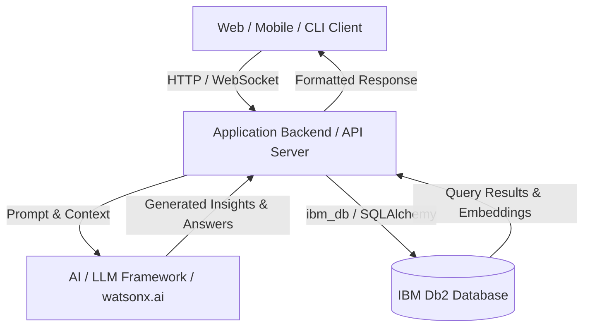

# System Architecture

## Overview
High-level architectural summary describing how frontend, backend services, AI agents/LLMs, and IBM Db2 interact.

---

## Architecture Diagram



---

## Component Breakdown

1. **User Interface / Client Layer**:
   - Description of UI components or CLI interactions.
2. **Application Backend Layer**:
   - Core API endpoints, routing, authentication, business logic.
3. **Database Layer (IBM Db2)**:
   - Data persistence, relational tables, indexing, transactions, or vector search structures.
4. **AI / Model Orchestration Layer** *(if applicable)*:
   - Agent loops, retrieval chains, prompt templates, and context assembly.

---

## Data Flow

1. **Input Ingestion**: User submits query or data via client interface.
2. **Context Retrieval**: Backend queries IBM Db2 for relevant transactional records, metrics, or embedded documents.
3. **Augmentation & Inference**: Context is formatted and injected into LLM prompt templates.
4. **State Persistence**: Generated outputs, audit logs, or new transactions are written back to IBM Db2.
5. **Response Delivery**: Result is streamed or returned to the user.

---

## IBM Db2 Schema & Storage Design

```sql
-- Example Schema DDL
CREATE TABLE projects (
    id INT GENERATED ALWAYS AS IDENTITY PRIMARY KEY,
    name VARCHAR(100) NOT NULL,
    description CLOB,
    created_at TIMESTAMP DEFAULT CURRENT_TIMESTAMP
);
```

---

## Security & Secrets Management
- All database credentials and external API tokens are read at runtime from environment variables.
- Sensitive production connection strings are never checked into version control.

---

## Design decisions

Each line is a choice and the reason for it. Findings marked "spike" were verified on Db2 12.1.5.0 Community Edition before any project code was written.

- **Db2 12.1.5.0 Community Edition, pinned.** `db2level` reports v12.1.5.0; native `VECTOR` and `VECTOR_DISTANCE` need 12.1.2 or later. The image tag `12.1.5.0` resolves to the same manifest as `latest` today, so pinning costs nothing and keeps judges on the tested level.
- **Thin derived Db2 image (`docker/db2/Dockerfile`).** Under Rosetta (Colima `--vz-rosetta`, binfmt flags `OCF` without `P`), argv[0] is not preserved, so `su - db2inst1 -c ...` never starts a login shell and `db2profile` is never sourced. IBM's setup script then fails every `db2` call with "command not found" and still prints "Setup has completed", with no engine running and no database. The image gives the Db2 users a login-shell wrapper; on hosts that preserve argv[0] it changes nothing. Spike: stock image left TESTDB missing; derived image created TESTDB in about 90 seconds.
- **No fenced routines.** Under Rosetta the fenced-mode process (`db2fmp`) crashes on start, so fenced C routines such as `SYSPROC.ENV_GET_INST_INFO` fail with SQL1646N. Everything AsOf runs in Db2 is built-in SQL, triggers or SQL PL procedures, which execute inside the engine and behave the same on Apple Silicon and x86.
- **Embeddings live in the bitemporal clause table.** Spike: a `VECTOR(384, FLOAT32)` column works in a system-versioned table, `CREATE TABLE ... LIKE` copies it to the history table, and `FOR PORTION OF BUSINESS_TIME` updates move the old embedding into history. No side table needed.
- **One query for "in force on date D" plus semantic rank.** Spike: `FOR BUSINESS_TIME AS OF ?` combined with `VECTOR_DISTANCE(..., VECTOR(?, 384, FLOAT32), COSINE)` and `FETCH FIRST n ROWS ONLY`, fully parameterised, and also combined with `FOR SYSTEM_TIME AS OF ?` for replay.
- **Vectors are always bound parameters.** `langchain_db2`'s `similarity_search` formats the query vector into the SQL text and filters metadata in Python after `FETCH FIRST k`. AsOf uses the official `DB2VS` store for the demo assistant's FAQ knowledge base, and its own LangChain retriever for policy clauses, which binds the vector and date as parameters and filters in SQL.
- **JSON validity via `CHECK (JSON_EXISTS(RULE_JSON, '$'))`.** The `IS JSON` predicate is rejected at this level (SQL0104N). The `JSON_EXISTS` check rejects malformed JSON with SQLSTATE 23513. `JSON_VALUE` and `JSON_TABLE` work for reading rule parameters; `JSON_VALUE` returns booleans as the strings `true` and `false`.
- **Hash chain computed inside Db2.** Spike: `LOWER(HEX(HASH(expr, 2)))` equals Python's SHA-256 hex digest for UTF-8 input (database codeset 1208), so `APPEND_LEDGER` computes row hashes in SQL PL and the app never supplies them.
- **Row triggers for append-only tables.** Spike: `BEFORE UPDATE` and `BEFORE DELETE` triggers with `SIGNAL SQLSTATE '75001'` block changes. Dropping a table leaves its triggers behind as inoperative, so teardown drops triggers explicitly.
- **Embeddings on CPU.** `all-MiniLM-L6-v2` is small enough that CPU is fast (model load about 4 s), and torch 2.15 crashes on macOS 14 when it uses the Metal backend.
- **Deterministic checks for numbers and deadlines.** Spike: a local 7B model (`qwen2.5:7b-instruct`) returns schema-valid structured output, but on the Moffatt-style draft it missed "90 days" and "$35" in the extracted values. Values that decide PASS or CONTRADICTED are therefore parsed from claim text by code and compared to `RULE_JSON`; the LLM's reading never overrides them.
