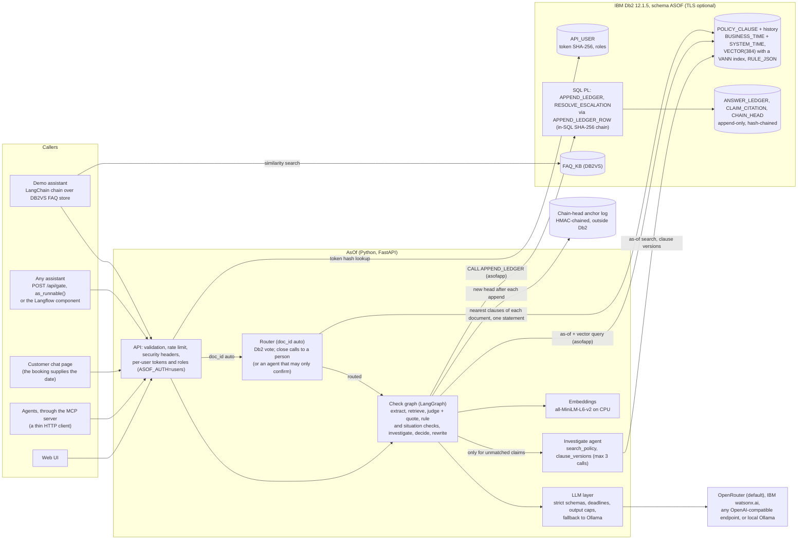
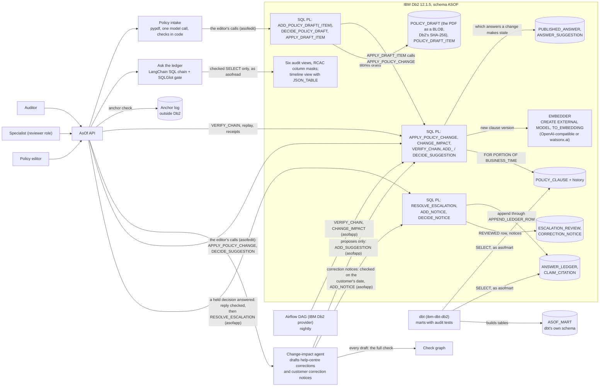
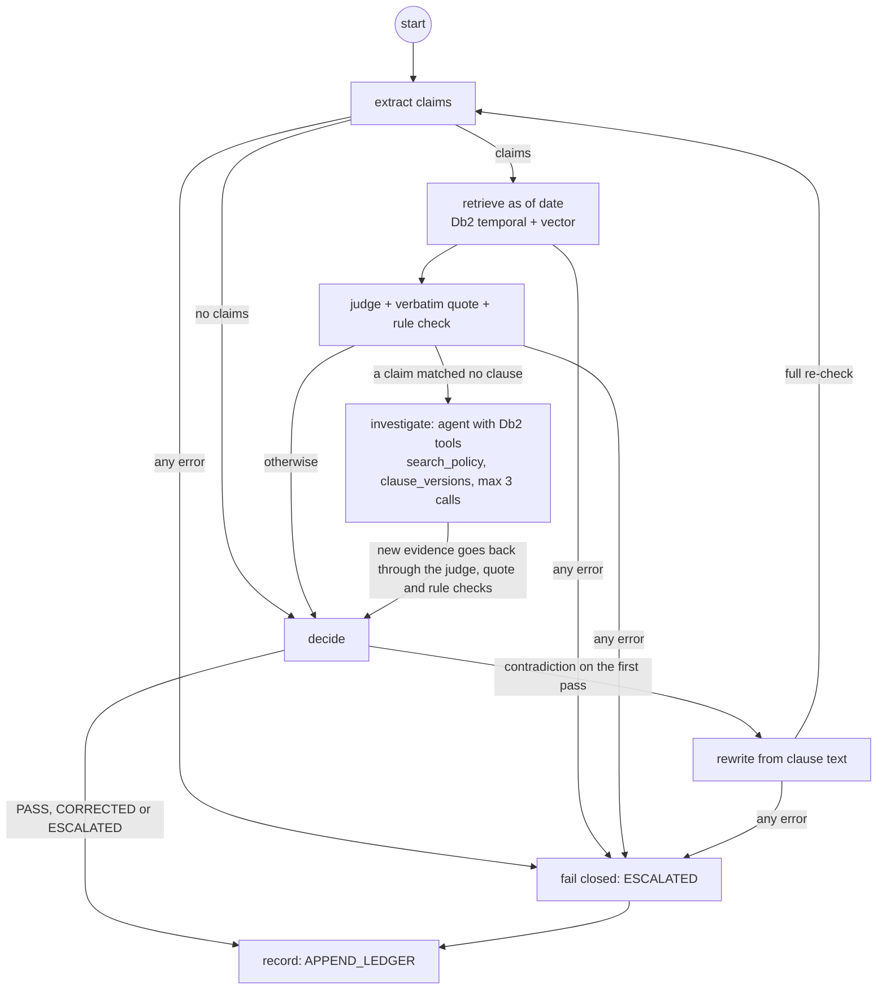
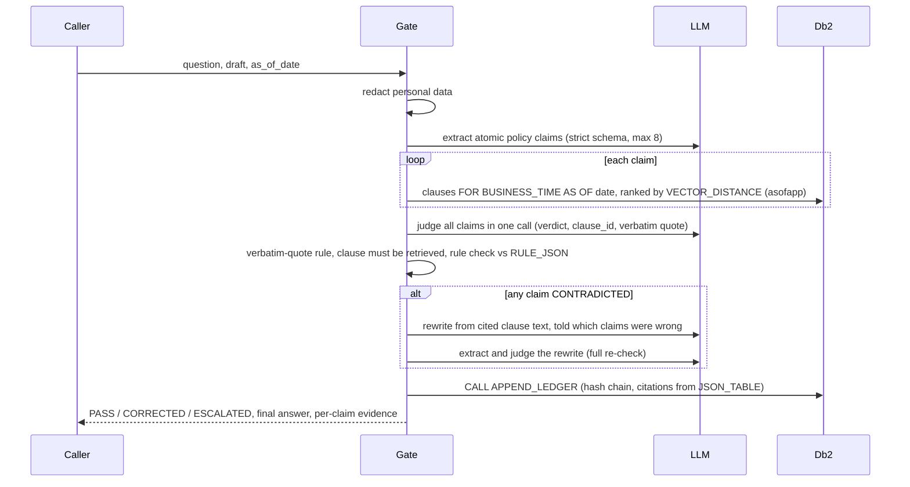

# System Architecture

## Overview

AsOf sits between any AI assistant and its customers. The calling system sends the assistant's draft answer, the customer's question and the date that decides which policy applies (booking or travel date). AsOf extracts the policy claims in the draft, looks up the clause versions in force on that date in IBM Db2, checks each claim with one batched LLM judge call plus deterministic rules, and then releases the draft (PASS), releases a rewrite that passed a full re-check (CORRECTED), or holds it for a person (ESCALATED). Every decision is appended to a hash-chained ledger in Db2, which can later be replayed against what the database held at that moment, and re-assessed when policy changes.

Db2 is the system of record for everything that matters in a dispute: the dated policy versions (a bitemporal table with native vectors and JSON rule parameters), the decisions and their evidence (append-only, hash-chained, written only by a stored procedure), and the help-centre answers that depend on them. The application keeps no decision data of its own; outside Db2 it holds only the chain-head anchor log, kept there on purpose, and an in-memory rate limiter.

Around the check: a specialist answers what it holds in an inbox, and the reply passes the same check before `RESOLVE_ESCALATION` appends it as a `REVIEWED` decision. After a policy change, each customer whose answer is now wrong for their date gets a checked correction notice. A caller that does not know which policy document applies passes `doc_id` `auto`: Db2 routes a clear lead and a person takes the rest. Policy reaches Db2 from an editor's change through `APPLY_POLICY_CHANGE`, or from a PDF taken in as a draft that code checks against the document and an editor approves. Answers reach the check over HTTP, as a LangChain runnable, from a customer chat page, a Langflow component, or an agent through the MCP server.

All data in this repository is fictional (Aurelia Air, an airline, and Fernhollow Bank, a bank fee schedule). Both are loaded into the same tables; the request's `doc_id` decides which document a check reads and which prompt wording it uses ([domains.py](src/asof/domains.py)).

This page is the summary. The detail lives in [docs/](docs/): every design decision ([design-decisions.md](docs/design-decisions.md)), each flow step by step ([data-flow.md](docs/data-flow.md)), the full schema ([schema.md](docs/schema.md)), the threat model ([threat-model.md](docs/threat-model.md)), the AI layer ([ai.md](docs/ai.md)), the Db2 features in depth ([db2.md](docs/db2.md)) and the evaluation ([evaluation.md](docs/evaluation.md)).

---

## Architecture Diagram

**Checking an answer.** The request path, from any assistant to the Db2 ledger:



**Changing policy, auditing and operating it.** Everything around the check:




The check itself, as the LangGraph state graph in [checkgraph.py](src/asof/checkgraph.py). Solid edges are fixed; the conditions are read from deterministic state (verdicts, pass number, errors), never decided by a model:



---

## Component Breakdown

1. **User interface** ([src/asof/ui/](src/asof/ui/)): plain HTML, CSS and ES modules served by FastAPI, with no framework or build step. Eight console screens and a customer chat page (`/chat`), under a strict Content Security Policy; every string from the API or the LLM is escaped before rendering.
2. **API** ([api.py](src/asof/api.py)): FastAPI with Pydantic input models (UTF-8 byte limits, date bounds, an allow-listed `doc_id`, no control characters), a per-client rate limit, a 64 KB body cap and security headers. Errors return SQLSTATEs, never stack traces or SQL. Binds to localhost by default.
3. **Check graph and gate** ([checkgraph.py](src/asof/checkgraph.py), [gate.py](src/asof/gate.py)): the LangGraph state graph orchestrates one check (diagram above); the gate owns the steps and the decision rules. The `investigate` node is a tool-calling agent with two read-only Db2 tools, capped at 3 calls. Around it: [redact.py](src/asof/redact.py) masks personal data before anything leaves the process; [prompts.py](src/asof/prompts.py) and [schemas.py](src/asof/schemas.py) hold the versioned prompts and strict output schemas; [retriever.py](src/asof/retriever.py) is the as-of plus vector query (also a LangChain `BaseRetriever`); [rules.py](src/asof/rules.py) checks amounts, durations, limits, tiers, permissions and lists against `RULE_JSON`; [ledger.py](src/asof/ledger.py) appends, verifies, reads and replays the ledger.
4. **LLM layer** ([llm.py](src/asof/llm.py)): one interface over OpenRouter, any OpenAI-compatible endpoint, IBM watsonx.ai or Ollama. Every call returns a validated Pydantic object or raises `LLMError`, under a hard deadline and an output-token cap.
5. **Database layer** ([src/asof/sql/](src/asof/sql/)): tables, history table, indexes, triggers, SQL functions, SQL PL procedures, views, masks and grants, installed by [schema.py](src/asof/schema.py) into a validated schema name.
6. **Policy module** ([policy.py](src/asof/policy.py)): policy changes through `APPLY_POLICY_CHANGE` on the editor connection, change impact, timeline, system-time history and analytics.
7. **Ask the ledger** ([askledger.py](src/asof/askledger.py)): a LangChain SQL chain for auditors. Only SQLGlot's regeneration of a checked `SELECT` runs, as the read-only analyst `asofread`, under a Db2 statement timeout and a row cap; Db2's column masks hide the ledger text from that user.
8. **Integration** ([integration.py](src/asof/integration.py)): `as_runnable()` drops the check into an existing LangChain chain; [assistant.py](src/asof/assistant.py) is the deliberately naive demo assistant over the official `DB2VS` store.
9. **Policy intake** ([intake.py](src/asof/intake.py)): reads a PDF under strict limits, asks the model once for proposed clause versions, checks each against the document in code, and stores and applies them through editor procedures.
10. **Specialist inbox and correction notices** ([review.py](src/asof/review.py), [notices.py](src/asof/notices.py), [impactagent.py](src/asof/impactagent.py)): the queue of held decisions, the reply's check, `RESOLVE_ESCALATION`; notice drafting, `ADD_NOTICE` and `DECIDE_NOTICE`.
11. **Router** ([router.py](src/asof/router.py)): a LangGraph graph (Db2 vote, decide, optional agent) for `doc_id` `auto`.
12. **MCP server** ([mcp_server/](mcp_server/)): four tools for agents over AsOf's own HTTP API, in its own small environment.
13. **Tooling**: [setup.py](src/asof/setup.py) (users, schema, seed, grants, self-check), [db2check.py](src/asof/db2check.py) (34 Db2 feature checks), [eval/](src/asof/eval/) (the frozen evaluation), [demo.py](src/asof/demo.py) and [scripts/check_secrets.py](scripts/check_secrets.py).

### AI / LLM design

LangGraph runs the check graph and the change-impact agent. LangChain provides structured output into strict schemas (`with_structured_output(method="json_schema", strict=True)`), a custom `BaseRetriever` over the as-of query, `langchain-db2`'s `DB2VS` for the demo assistant's FAQ store, and `as_runnable()` for existing chains. The default model is `google/gemini-3.1-flash-lite` through OpenRouter, chosen by a 10-model probe on AsOf's own prompts; `qwen2.5:7b-instruct` through Ollama is the no-key path, and IBM watsonx.ai (`ibm/granite-4-h-small`) or any OpenAI-compatible endpoint can be configured. Embeddings are local (`all-MiniLM-L6-v2`, 384 dimensions, CPU).

Prompts are versioned and short; instructions live only in the system message, and questions, drafts, claims and clauses go in as data blocks with angle brackets escaped. A PASS costs two model calls (extract, judge) and a CORRECTED answer five, plus up to 3 tool calls when the agent investigates. The model is never trusted with the customer's date, which clauses exist, quotes (they must match a retrieved clause verbatim), the customer's situation, numbers, limits and permissions (checked in code against `RULE_JSON`), the final release, or anything executable. Every call has a deadline and an output cap, and every failure becomes ESCALATED and is still recorded. The intake, routing and notice agents work under the same rules. In full: [docs/ai.md](docs/ai.md#llm-design-in-summary).

### Evaluation

Nine frozen splits, each committed and pinned by SHA-256 before its first run. The latest run (`19a3e28`, `gemini-3.1-flash-lite`) released none of the 121 wrong drafts and held 1 of the 70 correct ones. An eval-only ablation that replaces every customer's date with 7 Nov 2026 released 6 of 16 wrong drafts whose key clause had changed in between, against 0 with the customer's date. Routing (40 cases) and policy intake (11 items) have frozen evaluations of their own, and the airline split also ran on watsonx.ai Granite (1 of 26 wrong drafts released, which led to the list check). Every run and every miss: [docs/evaluation.md](docs/evaluation.md), [docs/routing_eval.md](docs/routing_eval.md), [docs/intake_eval.md](docs/intake_eval.md) and the raw results in [docs/eval_results.md](docs/eval_results.md).

### Design decisions

Each line is a choice and the reason for it. Findings marked "spike" were verified on Db2 12.1.5.0 Community Edition before any project code was written.

**The ten decisions that shape everything else:**

| Decision | Why | Where |
|---|---|---|
| Policy versions live in Db2 temporal tables, and one query filters by date and ranks by meaning | The version in force on the customer's date is a database fact, with its history kept by Db2, not by application code | [retriever.py](src/asof/retriever.py), [01_tables.sql](src/asof/sql/01_tables.sql) |
| A deterministic rule check on `RULE_JSON` overrides the model judge | Wrong numbers, permissions and list memberships are where an answer costs money; it flagged 66 of the 100 wrong drafts on its own in the latest run (63 to 66 in the four before), and overruled a correct judge on ET09 in two runs | [rules.py](src/asof/rules.py) |
| A SUPPORTED verdict needs a verbatim quote from a retrieved clause | A judge cannot release a claim with grounding it made up | [gate.py](src/asof/gate.py) |
| Fail closed, and no record means no release | Any error, timeout or ledger outage holds the answer for a person | [checkgraph.py](src/asof/checkgraph.py) |
| The ledger is written only by `APPEND_LEDGER`, hash-chained with SHA-256 in SQL | The runtime user cannot write a ledger row any other way, and every row commits to all before it | [03_procedures.sql](src/asof/sql/03_procedures.sql) |
| Receipts and chain-head anchors outside Db2 | A hash chain cannot vouch for itself against its own owner | [ledger.py](src/asof/ledger.py), [anchor.py](src/asof/anchor.py) |
| Five least-privilege users, column masks and per-user API roles | Each actor can do its one job and read only what it needs | [90_grants.sql](src/asof/sql/90_grants.sql), [05_masks.sql](src/asof/sql/05_masks.sql), [users.py](src/asof/users.py) |
| A LangGraph graph with fixed edges; the agent only gathers evidence | No model decides whether a safety step runs | [checkgraph.py](src/asof/checkgraph.py) |
| The judge sees the question, and a conflict can only tighten a verdict | A draft can be right about the policy and wrong about the customer | [prompts.py](src/asof/prompts.py), [gate.py](src/asof/gate.py) |
| Every test split is committed and hash-pinned before its first run | Numbers are never tuned on the cases they report; five splits never motivated a change (`bank-test2`, `escalation-test`, `extractor-test`, `situation-test3`, `list-test`), and none of their 65 wrong drafts was released | [eval/](src/asof/eval/) |

Every other decision, with its reason, is in [docs/design-decisions.md](docs/design-decisions.md), by area:

- [Db2: storage, queries and schema](docs/design-decisions.md#db2-storage-queries-and-schema): what spikes on 12.1.5 settled (`VECTOR` in a system-versioned table, `JSON_EXISTS` instead of `IS JSON`, no fenced routines under Rosetta), the 32K tablespace, exact search beside a vector index, and partitions and MQTs measured at 1,000,000 decisions.
- [The ledger and tamper evidence](docs/design-decisions.md#the-ledger-and-tamper-evidence): SHA-256 chain in SQL PL, gapless IDs under the chain-head lock, citations re-derived from the hashed JSON, and receipts and HMAC anchors outside Db2, because a chain cannot vouch for itself.
- [The check and the models](docs/design-decisions.md#the-check-and-the-models): the model probe, one judge call per answer, deadlines and output caps, Ollama's bounded grammar, provider fallback, the agent, the coverage and premise checks, and replay mode.
- [Security and access](docs/design-decisions.md#security-and-access): allow-list column masks, executing SQLGlot's output and not the model's, Db2 users as OS users, PUBLIC revoked, redaction, no string-built SQL, per-user tokens in Db2, and four eyes on policy documents.
- [Change impact and help-centre content](docs/design-decisions.md#change-impact-and-help-centre-content): released answers judged by the version they relied on, and a preview that is the real change rolled back.
- [The specialist inbox, correction notices and routing](docs/design-decisions.md#the-specialist-inbox-correction-notices-and-routing): `REVIEWED` decisions in the same chain, Db2 enforcing the inbox's rules from the verdicts it hashes, a reviewer account for a person's decisions, and routing that asks rather than guesses.
- [Integrations, evaluation and operations](docs/design-decisions.md#integrations-evaluation-and-operations): Langflow over HTTP, an Airflow hook without a password in its DSN, dbt in its own environment and Db2 user, a full lock used as constraints, and Python 3.12 only.

## Data Flow

### Checking an answer



1. **Input.** The caller supplies the question, the draft and the customer's date. The date is never inferred by a model.
2. **Redaction.** Personal data is masked; only redacted text reaches the LLM provider and the ledger.
3. **Extraction.** One LLM call returns at most 8 atomic claims (more escalates). If it returns none, each sentence that names something a policy decides is judged as a claim of its own.
4. **Retrieval.** Each claim is embedded locally and sent to Db2 as one parameterised query: the clause versions in force on the date, ranked by cosine distance, top 4.
5. **Judgement.** One LLM call judges every claim against the deduplicated clauses, with the question as data, quotes the deciding clause text verbatim, and flags any claim that assumes a situation the question states differently.
6. **Checks in code.** A verdict whose clause was not retrieved, or a SUPPORTED verdict whose quote is not in the clause, becomes NOT_COVERED; a situation conflict turns SUPPORTED into CONTRADICTED; the rule check compares numbers, limits, delay tiers, permissions and lists with `RULE_JSON`, and a mismatch forces CONTRADICTED.
7. **Decision.** All claims supported: PASS, with policy references. Any contradiction: rewrite from the cited clauses and a full re-check, released as CORRECTED only if every claim in the rewrite is supported. Uncovered claims with nothing contradicted, or any error: ESCALATED.
8. **Record.** `APPEND_LEDGER` writes the decision and both checks' citations in one transaction. If it fails, the answer is withheld (HTTP 503).

### The other flows

- **Changing policy.** `APPLY_POLICY_CHANGE` runs `UPDATE ... FOR PORTION OF BUSINESS_TIME`: Db2 splits the version at the period boundaries and system versioning keeps the replaced row. `CHANGE_IMPACT` marks each released answer that cited the clause STALE or HISTORICALLY_VALID, and each help-centre answer NEEDS_REVIEW or STILL_VALID. A preview runs both in one transaction and rolls it back.
- **Taking in a policy document.** pypdf reads the PDF, one model call proposes clause versions, code checks each against the document, and Db2 stores the file with its own SHA-256. Nothing is in force until an editor approves; then `DECIDE_POLICY_DRAFT` and one `APPLY_DRAFT_ITEM` per accepted item (which calls `APPLY_POLICY_CHANGE` for a changed clause) run in one transaction.
- **Answering a held decision.** The specialist's reply runs through the check once, recording nothing. If it may be sent, `RESOLVE_ESCALATION` re-validates everything from the verdicts and appends the `REVIEWED` row.
- **A correction notice.** The notice agent rewrites each STALE answer from the clause now in force for the customer's date and runs the full check on that date; `ADD_NOTICE` cross-checks it and a specialist's `DECIDE_NOTICE` marks it sent.
- **Routing.** One Db2 statement returns each document's nearest clauses in force on the date. A clear lead routes; a close call goes to a person, or to the agent, which may only confirm Db2's leader.
- **Replaying a decision.** For each cited clause: the exact row used, what Db2 held for that customer date when the answer was given (`FOR SYSTEM_TIME AS OF ... FOR BUSINESS_TIME AS OF ...`), and what applies today.

Every flow step by step, with thresholds and the tests behind them: [docs/data-flow.md](docs/data-flow.md).

---

## IBM Db2 Schema & Storage Design

Db2 Community Edition 12.1.5.0, database `TESTDB`, schema `ASOF`. Full DDL: [00_storage.sql](src/asof/sql/00_storage.sql), [01_tables.sql](src/asof/sql/01_tables.sql), [02_ledger_rules.sql](src/asof/sql/02_ledger_rules.sql), [03_procedures.sql](src/asof/sql/03_procedures.sql), [04_views.sql](src/asof/sql/04_views.sql), [05_masks.sql](src/asof/sql/05_masks.sql), [90_grants.sql](src/asof/sql/90_grants.sql). Every table, index, routine, trigger, view and grant, the storage design and the backup drill are described in full in [docs/schema.md](docs/schema.md).

**Storage.** Every AsOf table lives in one 32K tablespace (`ASOF_TS32K`), because a native vector index key on `VECTOR(384, FLOAT32)` does not fit a 4K page. The clause embeddings carry a native `VANN` vector index; the ledger is append-only with adaptive row compression, range-partitioned by month, and `REFRESH IMMEDIATE` materialized query tables sit behind the analytics views. Recovery is tested by restoring an online backup into a database that did not exist and judging the copy with `VERIFY_CHAIN` and the anchors.

| Table | Holds |
|---|---|
| `POLICY_DOC` | Policy documents |
| `POLICY_CLAUSE` (+ `_HIST`) | Dated clause versions: `BUSINESS_TIME` and `SYSTEM_TIME` periods, `VECTOR(384)` embedding, `RULE_JSON`; `WITHOUT OVERLAPS` key |
| `ANSWER_LEDGER` | One row per decision, hash-chained, with gapless IDs and the verdict JSON |
| `CLAIM_CITATION` | One row per claim per check, naming the exact clause version cited |
| `CHAIN_HEAD` | The last ledger ID and hash, locked by every append |
| `PUBLISHED_ANSWER` | Help-centre answers and the clause version each cites |
| `FAQ_KB` | The demo assistant's knowledge base (`DB2VS`) |
| `API_USER` | Per-user API access: the SHA-256 of each token, never the token, and its roles |
| `POLICY_DRAFT`, `POLICY_DRAFT_ITEM` | Uploaded policy PDFs (as `BLOB`, with Db2's SHA-256) and the clause versions proposed from them |
| `ESCALATION_REVIEW` | Which held decision a specialist answered, and with which `REVIEWED` row |
| `CORRECTION_NOTICE` | Checked corrections for customers whose answer went stale |
| `ANSWER_SUGGESTION` | Help-centre corrections drafted by the change-impact agent |

**Routines, triggers and views.** All `LANGUAGE SQL`, running inside the engine with the owner's authority, so runtime users need only `EXECUTE`: `APPEND_LEDGER` (through `APPEND_LEDGER_ROW`, which is granted to no one), `VERIFY_CHAIN`, `APPLY_POLICY_CHANGE`, `CHANGE_IMPACT`, `RESOLVE_ESCALATION`, `ADD_NOTICE` and `DECIDE_NOTICE`, `ADD_SUGGESTION` and `DECIDE_SUGGESTION`, the four policy-intake procedures, SHA-256 hash functions, `CLAIMS_FROM_JSON` (`JSON_TABLE` over the verdict JSON), append-only triggers, `V_POLICY_TIMELINE` (`JSON_TABLE` over `RULE_JSON`), the analytics and audit views, and four RCAC column masks.

The query everything rests on, plus replay:

```sql
-- Clauses in force on the customer's date, ranked by meaning (retriever.py). Every value is a parameter.
SELECT c.CLAUSE_ID, c.AREA, c.TITLE, c.VERSION_LABEL, c.CLAUSE_TEXT, c.RULE_JSON, c.BUS_START, c.BUS_END, c.SYS_START,
       VECTOR_DISTANCE(c.EMBEDDING, VECTOR(?, 384, FLOAT32), COSINE) AS DIST
FROM POLICY_CLAUSE FOR BUSINESS_TIME AS OF ? AS c     -- the schema is bound with SET CURRENT SCHEMA = ?
WHERE c.DOC_ID = ?
ORDER BY DIST FETCH EXACT FIRST ? ROWS ONLY;

-- Replay: the same question against what the database held at an earlier moment.
SELECT ... FROM ASOF.POLICY_CLAUSE FOR SYSTEM_TIME AS OF ? FOR BUSINESS_TIME AS OF ? AS c WHERE ...;
```

**Users and privileges.**

| Db2 user | Holds |
|---|---|
| `db2inst1` (owner) | Everything; used by setup only, and reads the ledger's text as `[masked]` |
| `asofapp` (runtime) | `SELECT` on its tables and five views, plus `EXECUTE` on `APPEND_LEDGER`, `VERIFY_CHAIN`, `CHANGE_IMPACT`, `ADD_SUGGESTION` and `ADD_NOTICE`; no `INSERT`, `UPDATE`, `DELETE` or DDL |
| `asofrev` (reviewer) | `EXECUTE` on `RESOLVE_ESCALATION` and `DECIDE_NOTICE`; no table privileges |
| `asofedit` (policy editor) | `EXECUTE` on `APPLY_POLICY_CHANGE`, `CHANGE_IMPACT`, `DECIDE_SUGGESTION` and the four intake procedures; `SELECT` on the policy, suggestion and draft tables; `USAGE` on the embedding model |
| `asofread` (analyst) | `SELECT` on six audit views, through the role `ASOF_ANALYST` |
| `asofmart` (dbt) | `SELECT` on four tables; creates tables only in `ASOF_MART` |
| `PUBLIC` | `CONNECT`, `CREATETAB`, `BINDADD`, `IMPLICIT_SCHEMA` and `CREATEIN` on the AsOf schema revoked |

Column masks show the ledger's question, draft, answer and verdict text only to the role `ASOF_TEXT_READER` (`asofapp` and `asofrev`); everyone else, the owner included, reads `[masked]`.

### DDL as Db2 holds it

The objects are created from the SQL files in [src/asof/sql/](src/asof/sql/). To show what Db2 actually holds after setup, [docs/ddl/asof_schema_db2look.sql](docs/ddl/asof_schema_db2look.sql) is the full DDL of schema `ASOF` generated from the catalog by IBM's `db2look` (`python scripts/export_ddl.py` regenerates it; the IBM Db2 Developer Extension for VS Code offers the same export as Generate DDL on the schema, not run for this file). One caveat found on the way: `db2look` 12.1.5 prints the native vector index without its distance metric, in `SYSCATSPACE` and with zero build parameters, whatever its real definition, so that one statement in the file cannot be replayed as is; the file says so at the top. The core of it, unedited:

```sql
CREATE TABLE "ASOF    "."POLICY_CLAUSE"  (
		  "CLAUSE_ID" VARCHAR(32 OCTETS) NOT NULL ,
		  "DOC_ID" VARCHAR(32 OCTETS) NOT NULL ,
		  "AREA" VARCHAR(40 OCTETS) NOT NULL ,
		  "TITLE" VARCHAR(200 OCTETS) NOT NULL ,
		  "VERSION_LABEL" VARCHAR(20 OCTETS) NOT NULL ,
		  "CLAUSE_TEXT" VARCHAR(4000 OCTETS) NOT NULL ,
		  "RULE_JSON" VARCHAR(2000 OCTETS) NOT NULL ,
		  "EMBEDDING" VECTOR(384,FLOAT32) NOT NULL ,
		  "CHANGE_NOTE" VARCHAR(400 OCTETS) ,
		  "CHANGED_BY" VARCHAR(128 OCTETS) NOT NULL WITH DEFAULT USER ,
		  "BUS_START" DATE NOT NULL ,
		  "BUS_END" DATE NOT NULL ,
		  "SYS_START" TIMESTAMP(12) NOT NULL GENERATED ALWAYS AS ROW BEGIN ,
		  "SYS_END" TIMESTAMP(12) NOT NULL GENERATED ALWAYS AS ROW END ,
		  "TRANS_ID" TIMESTAMP(12) GENERATED ALWAYS AS TRANSACTION START ID ,
		 PERIOD BUSINESS_TIME ("BUS_START","BUS_END") ,
		 PERIOD SYSTEM_TIME ("SYS_START","SYS_END") )
		 IN "ASOF_TS32K"
		 ORGANIZE BY ROW;

ALTER TABLE "ASOF    "."POLICY_CLAUSE"
	ADD CONSTRAINT "PK_POLICY_CLAUSE" PRIMARY KEY
		("CLAUSE_ID",
		 BUSINESS_TIME WITHOUT OVERLAPS)
	ENFORCED;

ALTER TABLE "ASOF    "."POLICY_CLAUSE"
	ADD VERSIONING USE HISTORY TABLE "ASOF    "."POLICY_CLAUSE_HIST";
```

---

## Security & Secrets Management

Each line of the judging rubric's Security criterion, and where it is met.

| Rubric point | How AsOf meets it | Evidence |
|---|---|---|
| No secrets in code; credentials via `.env`; `.env` in `.gitignore` | All credentials are environment variables read by pydantic-settings into `SecretStr` (never printed or logged). `.env` and `.env.*` are gitignored; `.env.example` has dummy values. Setup generates the five service passwords into `.env` without printing them and sets them with `chpasswd` on stdin, never in a process argument. The chain-head anchor key lives outside the project folder (`~/.config/asof/anchor.key`, mode 600), so it cannot be committed by accident; setup refuses a key file inside the folder. `scripts/check_secrets.py` blocks a commit that contains any value from the local `.env` or the anchor key file, a private key, a provider key, or a forbidden file (`.env`, `.key`, `.pem`, GSKit key databases and stash files, anything under `var/`). `tests/test_no_tracked_secrets.py` fails the build if git tracks any such file, if any local secret value appears in a tracked file, or if `.gitignore` stops covering `.env` and `var/`. | [config.py](src/asof/config.py), [.gitignore](.gitignore), [scripts/check_secrets.py](scripts/check_secrets.py), [setup.py](src/asof/setup.py); `tests/test_corpus_and_config.py::test_secrets_never_appear_in_repr`, `tests/test_no_tracked_secrets.py` |
| Parameterised SQL, no string-built queries | **The app's request-time SQL is fixed text.** Every statement the app's own code runs is a string literal in the source, with unqualified names; the schema is bound on the connection with `SET CURRENT SCHEMA = ?` and `SET CURRENT PATH = SYSTEM PATH, ?` (`db.use_schema`). Every value goes through a `?` marker, including vectors (`VECTOR(?, 384, FLOAT32)`), dates, timestamps and `FETCH FIRST ? ROWS`. Db2 cannot bind identifiers in DDL or GRANT, so setup code names objects and users only through `db.ident`, which accepts `^[A-Z][A-Z0-9_]{0,127}$` and nothing else. An AST scan of the package and its tests fails the build on any f-string, `%`, `+` or `.format()` that builds SQL, and on any runtime database call whose SQL is not a literal. Db2 credentials are passed to the driver as arguments, not spliced into the DSN. Three named exceptions: `langchain-db2`'s `DB2VS` builds its own SQL for the demo FAQ store; "Ask the ledger" runs SQL that SQLGlot regenerated from a parse tree it checked, as a user that can only read six views; setup DDL names objects through `db.ident` only. | [db.py](src/asof/db.py), [ledger.py](src/asof/ledger.py), [retriever.py](src/asof/retriever.py); `tests/test_sql_safety.py` (the build guard, plus planted bad examples it must catch), `test_unknown_doc_or_injection_string_returns_nothing`, `test_injection_strings_are_stored_as_plain_text`, db2check "SQL injection stored as text" |
| Input validation | API models: UTF-8 byte limits matching the Db2 column sizes, dates 2020 to 2035, allow-listed `doc_id`, enum channels, no control characters, unknown fields rejected, 64 KB body cap. Policy changes: ID and label patterns, flat rule JSON within 2000 bytes. The seed corpus is validated (IDs, ordered non-overlapping periods) before it reaches Db2, and Db2 enforces it again (`WITHOUT OVERLAPS`, check constraints). | [api.py](src/asof/api.py), [policy.py](src/asof/policy.py), [corpus.py](src/asof/corpus.py); `tests/test_api.py::test_invalid_input_is_rejected` and others |
| Least-privilege Db2 users | Runtime user `asofapp`: SELECT, plus EXECUTE on five procedures (`APPEND_LEDGER`, `VERIFY_CHAIN`, `CHANGE_IMPACT`, `ADD_SUGGESTION`, `ADD_NOTICE`); reviewer `asofrev`: EXECUTE on `RESOLVE_ESCALATION` and `DECIDE_NOTICE` only, so a person's decisions never run as the model-facing account; editor `asofedit`: EXECUTE on `APPLY_POLICY_CHANGE`, `CHANGE_IMPACT`, `DECIDE_SUGGESTION`, the four policy-intake procedures, and USAGE on the embedding model; analyst `asofread`: SELECT on six audit views through the role `ASOF_ANALYST`; dbt's `asofmart`: SELECT on the four tables the marts read, and tables only in its own schema `ASOF_MART`. Ledger, suggestion and policy-draft writes happen only inside procedures. `PUBLIC` defaults revoked, including `CREATEIN` on the AsOf schema. Setup proves it on every run by trying writes as `asofapp` and `asofmart`. Residual: Db2 grants `PUBLIC` `CREATEIN` on its own schemas (`SYSTOOLS`, `SYSPUBLIC`, the instance owner's), which setup leaves alone, so `asofmart` could create a table there; it can still read only the four tables, never change them. | [90_grants.sql](src/asof/sql/90_grants.sql); `test_app_user_is_read_only`, `test_app_user_cannot_write_ledger_tables`, `test_only_the_editor_can_change_policy`, `test_the_analyst_can_read_the_audit_views_and_nothing_else`, `tests/test_db2_mart_user.py` |
| Safe handling of user data | Emails, phone numbers, card numbers (Luhn-checked) and other 13 to 19 digit numbers, booking references and person names are masked before text goes to the LLM provider or the ledger, including the stored final answer. In Db2, column masks (RCAC) show the ledger's question, draft, answer and verdict text only to the runtime user and the reviewer; the owner, the editor and the analyst read `[masked]`. The UI escapes every string. | [redact.py](src/asof/redact.py), [names.py](src/asof/names.py), [05_masks.sql](src/asof/sql/05_masks.sql); `tests/test_redact.py`, `test_personal_data_is_redacted_before_the_llm_and_the_ledger`, `test_names_never_reach_the_llm_or_the_ledger`, `test_the_owner_reads_masked_text_and_cannot_verify_through_the_mask`, `test_the_analyst_sees_decisions_but_the_text_is_masked_by_db2`, db2check "Column mask (RCAC)" |
| LLM-generated SQL ("Ask the ledger") | The one place SQL comes from a model. It runs only if SQLGlot (IBM's Db2 dialect) accepts it as one `SELECT` on six allowed views with allow-listed functions and masked columns only as output; Db2 runs SQLGlot's regeneration of the checked tree, never the model's text; as `asofread`, which can read those views and nothing else; under a Db2 statement timeout and a row cap. | [askledger.py](src/asof/askledger.py); `tests/test_askledger.py` (41 refusal cases, and proof that only checked SQL reaches Db2), `tests/test_db2_askledger.py` (privileges, masks, the predicate channel, the timeout) |
| Prompts and LLM output, no prompt-injection shortcuts | Untrusted text is escaped inside delimited blocks; instructions only in the system message; strict output schemas; a verdict counts only with a verbatim quote from a retrieved clause; deterministic rule checks override the judge; the gate fails closed; LLM output is never executed, and reaches SQL only through Ask the ledger's SQLGlot gate (row above). A manipulated judge that says SUPPORTED with a real quote is still overridden. | [prompts.py](src/asof/prompts.py), [gate.py](src/asof/gate.py), [rules.py](src/asof/rules.py); `test_manipulated_judge_cannot_pass_a_contradiction`, `test_fake_clause_inside_a_claim_stays_data`, the live test `test_injected_instruction_does_not_get_a_contradiction_through`, and the 3 prompt-injection cases in the frozen test split (none released as PASS in any run; all 3 corrected from the clauses in the latest run, `19a3e28`) |
| Tamper evidence (beyond the rubric) | Triggers reject UPDATE and DELETE even for the owner. The hash chain is computed inside Db2, and `VERIFY_CHAIN` catches an owner who drops a trigger and edits a row, edits a citation, or deletes the last row. Each check response also carries its row hash as a receipt; `POST /api/ledger/receipt` catches an owner who rebuilt the whole ledger consistently, which no in-database check can. Chain-head anchors, HMAC-chained in a log outside Db2, catch the same rebuild for every row, receipt or not. | [02_ledger_rules.sql](src/asof/sql/02_ledger_rules.sql), [03_procedures.sql](src/asof/sql/03_procedures.sql), [anchor.py](src/asof/anchor.py); `tests/test_db2_ledger.py`, `tests/test_anchor.py` |

Three more controls beyond the rubric (web and API hardening, uploaded policy documents, third-party model keys and agents) are mapped the same way in [docs/threat-model.md](docs/threat-model.md#controls-beyond-the-rubric).

### Threat model

What is worth protecting: the integrity of policy versions and of the decision ledger, customer text, the Db2 and LLM credentials, and the availability of the check. Untrusted: the customer, the upstream assistant, the LLM provider, anyone who can reach the API, and the dependency supply chain. Trusted but checked: the policy editor (never for the ledger), the specialist (never to contradict a clause in force) and the Db2 owner, whose tampering is detected, not prevented. The full STRIDE table, 24 threats with mitigation, evidence and residual risk for each, is in [docs/threat-model.md](docs/threat-model.md#threat-model), with what is out of scope (the policy text's correctness, the caller's identity and dates, transport security in front of AsOf) and the retention note.
