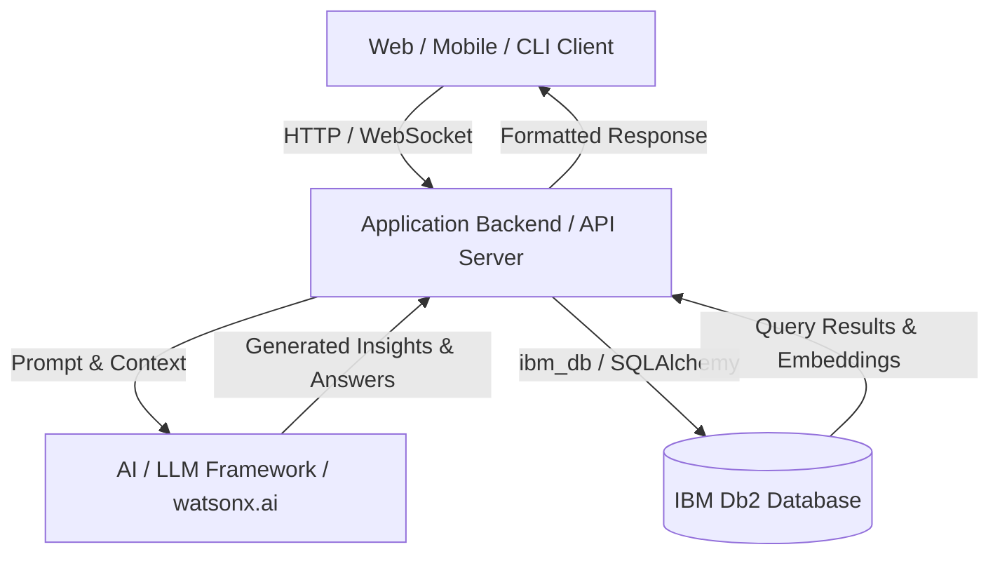

# System Architecture

## Overview
High-level architectural summary describing how frontend, backend services, AI agents/LLMs, and IBM Db2 interact.

---

## Architecture Diagram



---

## Component Breakdown

1. **User Interface / Client Layer**:
   - Description of UI components or CLI interactions.
2. **Application Backend Layer**:
   - Core API endpoints, routing, authentication, business logic.
3. **Database Layer (IBM Db2)**:
   - Data persistence, relational tables, indexing, transactions, or vector search structures.
4. **AI / Model Orchestration Layer** *(if applicable)*:
   - Agent loops, retrieval chains, prompt templates, and context assembly.

---

## Data Flow

1. **Input Ingestion**: User submits query or data via client interface.
2. **Context Retrieval**: Backend queries IBM Db2 for relevant transactional records, metrics, or embedded documents.
3. **Augmentation & Inference**: Context is formatted and injected into LLM prompt templates.
4. **State Persistence**: Generated outputs, audit logs, or new transactions are written back to IBM Db2.
5. **Response Delivery**: Result is streamed or returned to the user.

---

## IBM Db2 Schema & Storage Design

```sql
-- Example Schema DDL
CREATE TABLE projects (
    id INT GENERATED ALWAYS AS IDENTITY PRIMARY KEY,
    name VARCHAR(100) NOT NULL,
    description CLOB,
    created_at TIMESTAMP DEFAULT CURRENT_TIMESTAMP
);
```

---

## Security & Secrets Management
- All database credentials and external API tokens are read at runtime from environment variables.
- Sensitive production connection strings are never checked into version control.

---

## Design decisions

Each line is a choice and the reason for it. Findings marked "spike" were verified on Db2 12.1.5.0 Community Edition before any project code was written.

- **Db2 12.1.5.0 Community Edition, pinned.** `db2level` reports v12.1.5.0; native `VECTOR` and `VECTOR_DISTANCE` need 12.1.2 or later. The image tag `12.1.5.0` resolves to the same manifest as `latest` today, so pinning costs nothing and keeps judges on the tested level.
- **Thin derived Db2 image (`docker/db2/Dockerfile`).** Under Rosetta (Colima `--vz-rosetta`, binfmt flags `OCF` without `P`), argv[0] is not preserved, so `su - db2inst1 -c ...` never starts a login shell and `db2profile` is never sourced. IBM's setup script then fails every `db2` call with "command not found" and still prints "Setup has completed", with no engine running and no database. The image gives the Db2 users a login-shell wrapper; on hosts that preserve argv[0] it changes nothing. Spike: stock image left TESTDB missing; derived image created TESTDB in about 90 seconds.
- **No fenced routines.** Under Rosetta the fenced-mode process (`db2fmp`) crashes on start, so fenced C routines such as `SYSPROC.ENV_GET_INST_INFO` fail with SQL1646N. Everything AsOf runs in Db2 is built-in SQL, triggers or SQL PL procedures, which execute inside the engine and behave the same on Apple Silicon and x86.
- **Embeddings live in the bitemporal clause table.** Spike: a `VECTOR(384, FLOAT32)` column works in a system-versioned table, `CREATE TABLE ... LIKE` copies it to the history table, and `FOR PORTION OF BUSINESS_TIME` updates move the old embedding into history. No side table needed.
- **One query for "in force on date D" plus semantic rank.** Spike: `FOR BUSINESS_TIME AS OF ?` combined with `VECTOR_DISTANCE(..., VECTOR(?, 384, FLOAT32), COSINE)` and `FETCH FIRST n ROWS ONLY`, fully parameterised, and also combined with `FOR SYSTEM_TIME AS OF ?` for replay.
- **Vectors are always bound parameters.** `langchain_db2`'s `similarity_search` formats the query vector into the SQL text and filters metadata in Python after `FETCH FIRST k`. AsOf uses the official `DB2VS` store for the demo assistant's FAQ knowledge base, and its own LangChain retriever for policy clauses, which binds the vector and date as parameters and filters in SQL.
- **JSON validity via `CHECK (JSON_EXISTS(RULE_JSON, '$'))`.** The `IS JSON` predicate is rejected at this level (SQL0104N). The `JSON_EXISTS` check rejects malformed JSON with SQLSTATE 23513. `JSON_VALUE` and `JSON_TABLE` work for reading rule parameters; `JSON_VALUE` returns booleans as the strings `true` and `false`.
- **Hash chain computed inside Db2.** Spike: `LOWER(HEX(HASH(expr, 2)))` equals Python's SHA-256 hex digest for UTF-8 input (database codeset 1208), so `APPEND_LEDGER` computes row hashes in SQL PL and the app never supplies them.
- **Row triggers for append-only tables.** Spike: `BEFORE UPDATE` and `BEFORE DELETE` triggers with `SIGNAL SQLSTATE '75001'` block changes. Dropping a table leaves its triggers behind as inoperative, so teardown drops triggers explicitly.
- **Embeddings on CPU.** `all-MiniLM-L6-v2` is small enough that CPU is fast (model load about 4 s), and torch 2.15 crashes on macOS 14 when it uses the Metal backend.
- **Deterministic checks for numbers and deadlines.** Spike: a local 7B model (`qwen2.5:7b-instruct`) returns schema-valid structured output, but on the Moffatt-style draft it missed "90 days" and "$35" in the extracted values. Values that decide PASS or CONTRADICTED are therefore parsed from claim text by code and compared to `RULE_JSON`; the LLM's reading never overrides them.
- **Default hosted model: `google/gemini-3.1-flash-lite` via OpenRouter.** Chosen by a probe that runs AsOf's real prompts and schemas against the Aurelia corpus: 7 extraction cases (including chit-chat, a hedged non-answer and an injected instruction) and 15 batched-judge cases with 20 claims (date flips, a condition the claim leaves out, a deadline counted from the wrong date, delay tiers, NOT_COVERED, and a fake clause injected inside a claim). Three rounds per model after a first screen of 10 models:

  | Model | Valid format | Extraction | Verdict + clause | Verbatim quotes | Injection | p50 / p90 latency |
  |---|---|---|---|---|---|---|
  | google/gemini-3.1-flash-lite | 66/66 | 21/21 | 60/60 | 54/54 | 9/9 | 1.0 s / 1.4 s |
  | anthropic/claude-haiku-5.5 | 66/66 | 21/21 | 59/60 | 54/54 | 9/9 | 1.2 s / 2.0 s |
  | google/gemini-3.5-flash-lite | 66/66 | 21/21 | 59/60 | 53/53 | 8/9 | 0.9 s / 1.3 s |
  | openai/gpt-4.1-mini | 66/66 | 20/21 | 59/60 | 54/54 | 9/9 | 1.1 s / 1.7 s |
  | z-ai/glm-5.3-flash | 66/66 | 20/21 | 56/60 | 52/52 | 9/9 | 1.8 s / 4.5 s |

  It was the only model with no misses and has the tightest latency spread, at about $0.0004 per call. The probe is small; the 60-case evaluation reports the real numbers for both providers. The miss most models shared (citing the 6-to-9-hour delay tier for a 5-hour delay) is the kind of error the deterministic tier check catches regardless of model. Excluded in the first screen: models that took 8 to 31 s per call, or misjudged 3 of 20 claims.
- **One judge call per answer, not per claim.** All claims and the deduplicated clauses retrieved for them go to the model together, and it returns one verdict per numbered claim. A PASS costs two LLM calls (extract, judge); a CORRECTED answer costs five (extract, judge, rewrite, extract, judge).
- **Every LLM call has a hard wall-clock deadline and an output cap.** During the probe, the local 7B model fell into a generation loop on one hard case and streamed about 11,800 tokens over 30 minutes. Because tokens kept arriving, the HTTP read timeout never fired. Now each attempt runs under a deadline in a daemon thread, every provider gets `max_tokens` / `num_predict` (1000 by default, about twice the largest real reply), and a timeout is final: the gate fails closed instead of retrying.
- **Ollama requests are not streamed.** With one complete response per request, the read timeout fires on a stuck generation, the client disconnects and Ollama cancels the work (verified: a 5 s deadline produced `cancel task` in the Ollama log), so an abandoned request no longer blocks the next one.
- **OpenRouter routes only to endpoints that honour every parameter** (`provider.require_parameters`), so a JSON schema is never silently dropped. Temperature is not sent by default: several current models reject it, and with this routing an unsupported parameter means no endpoint at all (observed with `claude-haiku-5.5`).
- **Strict schemas, closed enums, caps in code.** Every model reply is parsed into a Pydantic model with all fields required and extra keys forbidden. Limits such as 8 claims are enforced after parsing, because providers differ in which JSON Schema keywords they honour.
- **Untrusted text is escaped, not just delimited.** The question, draft and claims are HTML-escaped inside `<question>`, `<answer>`, `<claims>` blocks, so a draft cannot close its block or inject a fake `<clause>` (tested), and the instruction never to follow embedded instructions is in the system message only.
- **Compose builds the Db2 image with or without buildx.** Docker's classic builder (used when the buildx plugin is missing, as on this Mac) ignores Compose's `platform:` when resolving `FROM`, and IBM publishes no arm64 image, so the platform is pinned in the Dockerfile. `COPY --chmod` is avoided for the same reason.
- **"Healthy" means setup finished in this boot.** IBM's setup writes `/database/config/.shared-data/setup_complete` on the data volume, and on a restart it re-runs setup (including a same-level database upgrade that holds TESTDB exclusively) while the old marker is still there. The entrypoint deletes the marker first, and the healthcheck requires the marker and a successful connection. Verified on a fresh volume (healthy after about 6 minutes) and on a restart (about 3 minutes), with the 26-check script passing immediately after `docker compose up --wait`.
- **Db2 users are OS users, created by setup.** Db2 authenticates against the operating system of the Db2 server, so setup runs `useradd` inside the container and sets each password with `chpasswd` reading stdin, never a command-line argument. Passwords for `asofapp` and `asofedit` are generated into `.env` (mode 600) when empty and are never printed.
- **PUBLIC defaults are revoked explicitly.** Setup revokes `CONNECT`, `CREATETAB`, `BINDADD` and `IMPLICIT_SCHEMA` from PUBLIC and grants `CONNECT` only to the two named users. On the TESTDB that IBM's image creates, PUBLIC already held none of the four, so these are a no-op there, but they harden databases created with Db2's usual defaults. Setup reports which case it found.
- **`CHANGED_BY` defaults to `SESSION_USER`.** A generated column from `SESSION_USER` is rejected on Db2 LUW (SQL0548N), so the column defaults to the session user on insert and `APPLY_POLICY_CHANGE` sets it on update.
- **One schema definition, two targets.** The SQL files use the token `ASOF.`; the installer substitutes a schema name that must match `^[A-Z][A-Z0-9_]{0,29}$`. Integration tests install, seed and grant a throwaway `ASOF_TEST` schema and drop it afterwards, so append-only test rows never touch the real ledger. Tables and indexes are created only if missing and seed loaders skip non-empty tables, so `python -m asof.setup` is safe to re-run.
- **Retrieval embeds the clause title with its text, and queries with claims.** A question-style query ("Can I get a bereavement fare after I travel?") ranked the eligibility clause BRV-001 just above the timing clause BRV-002 (cosine distance 0.268 vs 0.275). A claim-style query ranked BRV-002 first at the correct version for both dates. The pipeline therefore retrieves per extracted claim, top 3 to 5.
- **The demo assistant's FAQ store uses the official `DB2VS`.** It is created by the owner during setup (DB2VS creates its table on first use) and read by the app user, which has `SELECT` only.
