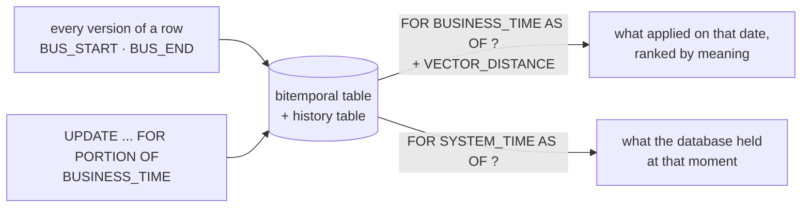

# Temporal search

[← Db2 AI Cookbook](../README.md)

> Search what was true **on a given date**. Db2 temporal tables keep every version of a row with the
> period it applied, and `FOR BUSINESS_TIME AS OF` composes with `VECTOR_DISTANCE` in one statement:
> "which version, in force on this date, best matches this question?" is a single query.

Policies, prices and product terms change, and a question is often about a date that has passed: a
refund requested under last quarter's terms, a fee charged before an increase, a promise made by a
chatbot in March. A vector store that holds only the current text answers those questions with
today's rules. Db2's bitemporal tables keep two clocks on every row: **business time**, when a version
applies, and **system time**, when the database held it. The first picks the right version for a
date; the second replays what the system knew at any moment, which is what an audit or a dispute asks.

This is a **branch** rather than a next step: it assumes only what
[01-tabular-search](../01-tabular-search/) shows, `VECTOR_DISTANCE` next to ordinary predicates, and
adds time to it.

## Recipes

| Recipe | Stack | What it shows | Last checked |
|---|---|---|---|
| [python-local-embeddings](python-local-embeddings/) | Python · `ibm_db` · `sentence-transformers` on CPU, no API key | `FOR BUSINESS_TIME AS OF` and `VECTOR_DISTANCE` in one query, `FOR PORTION OF BUSINESS_TIME` splitting a row at a date, `FOR SYSTEM_TIME AS OF` replay, on three fictional policy clauses | ✅ 2026-11-07 |

## Prerequisites

Db2 **12.1.2** or later, for the native `VECTOR` type (temporal tables are much older). A user that may
create tables, since the recipe makes its own schema and drops it at the end; it uses none of the
`SAMPLE` tables, so any database will do. Python 3.12.

## Where to go next

- [01-tabular-search](../01-tabular-search/): `VECTOR_DISTANCE` with ordinary filters, the half of this module without time
- [08-language-model-integration](../08-language-model-integration/): compute the vectors inside Db2 with `TO_EMBEDDING` instead of in Python
- [04-rag](../04-rag/): retrieval feeding a language model, where retrieving the version in force matters as much as retrieving the right document
