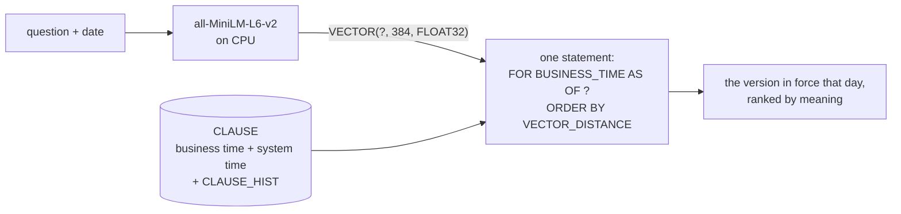

# Temporal search with local embeddings

> **Last checked 2026-11-07**: verified: notebook executed end to end with `nbconvert`, all 7 code cells. The
> same question returned the clause version from 2026-01-01 for 10 March and the one from 2026-05-01 for
> 2 June, from one statement; `FOR PORTION OF BUSINESS_TIME` split the row; `FOR SYSTEM_TIME AS OF`
> replayed the text held before the change.  
> Checked on: Db2 12.1.5.0 Community Edition (IBM's container image) · macOS 14 arm64 · Python 3.12.8.

[← Temporal search](../README.md) · [← Db2 AI Cookbook](../../README.md)

> Store dated policy clauses in a bitemporal Db2 table with a native `VECTOR` column, and ask "which
> clause, in force on this date, best matches this question?" in one SQL statement.


A customer who booked in March and one who booked in June ask the same question, and the right answer
differs because the policy changed on 1 May. The notebook loads three fictional clauses, changes one of
them from 1 May, and shows the as-of query, the row split Db2 does by itself, and a replay of what the
database held before the change was recorded. No API key, and no model download beyond the 90 MB
embedding model.



## Quick start

```bash
python3.12 -m venv .venv
source .venv/bin/activate
pip install -r requirements.txt

cp .env.example .env          # then set DB_PASSWORD (and DB_NAME if not SAMPLE)
jupyter nbconvert --to notebook --execute --inplace temporal-search.ipynb   # or open it in VS Code / Jupyter
```

The notebook creates its own schema, `TEMPORAL_RECIPE`, and drops it in the last cell. It needs a user
that may create tables, such as the instance owner (`db2inst1`).

## Expected output

| Step | You should see |
|---|---|
| Connect | `DB2/LINUXX8664 12.01.0500` (any 12.1.2 or later) |
| The change on 1 May | Two `BRV-002` rows: `2026-01-01` to `2026-05-01` (the old text), and `2026-05-01` to `9999-12-31` (the new text) |
| One query, two dates | `2026-03-10: BRV-002 from 2026-01-01` (requests before travel only) and `2026-06-02: BRV-002 from 2026-05-01` (retroactive within 90 days) |
| Replay | For 2 June, the old text as the database held it before the change, the new text now, and one row in `CLAUSE_HIST` |

## Concepts

### Two clocks

`BUSINESS_TIME` (`BUS_START`, `BUS_END`) is when a clause applies to customers: you set it. `SYSTEM_TIME`
(`SYS_START`, `SYS_END`) is when the database held a row: Db2 sets it, and moves every replaced row to
the history table by itself. `PRIMARY KEY (CLAUSE_ID, BUSINESS_TIME WITHOUT OVERLAPS)` makes two
versions of one clause in force on the same day impossible.

### One statement, not two systems

```sql
SELECT c.CLAUSE_ID, c.BUS_START, c.CLAUSE_TEXT,
       VECTOR_DISTANCE(c.EMBEDDING, VECTOR(?, 384, FLOAT32), COSINE) AS DIST
FROM CLAUSE FOR BUSINESS_TIME AS OF ? AS c
ORDER BY DIST
FETCH FIRST 2 ROWS ONLY
```

The date filter and the similarity ranking are one query, with both values as bound parameters. A
separate vector store would need its own copy of every version and its own idea of which one is in
force on a date; here there is nothing to keep in step.

### `FOR PORTION OF` and replay

`UPDATE CLAUSE FOR PORTION OF BUSINESS_TIME FROM '2026-05-01' TO '9999-12-31' SET ...` changes the
clause from 1 May only, and Db2 splits the row at the boundary. Putting `FOR SYSTEM_TIME AS OF <moment>`
before `FOR BUSINESS_TIME AS OF` reads the table as it stood at that moment, which answers the question
that matters in a dispute: what did the system know when it answered?

## Appendix: hosts

- **Apple Silicon.** IBM's Db2 image is x86 only; it runs under Colima with Rosetta (`colima start
  --vz-rosetta`). Fenced routines such as `SYSPROC.ENV_GET_INST_INFO` crash there, so the notebook reads
  the server level from the driver (`ibm_db.server_info`) instead.
- **Without the `SAMPLE` database.** The recipe uses none of the `SAMPLE` tables: point `DB_NAME` at any
  database where your user can create a table.
