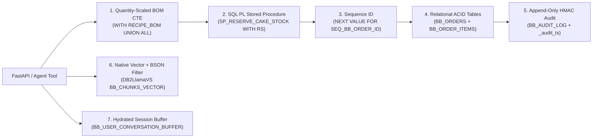
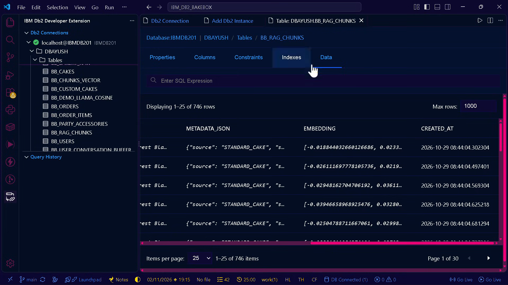
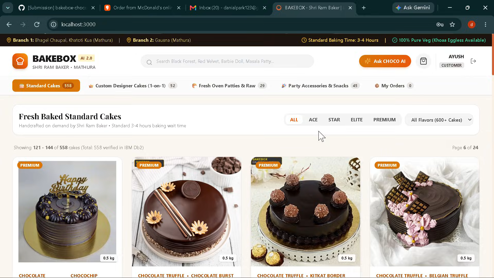
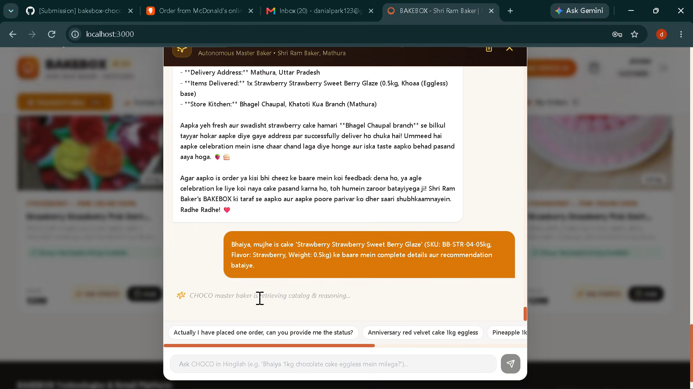
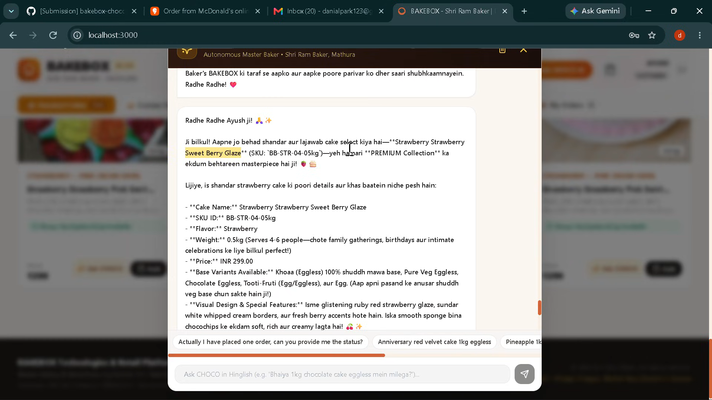
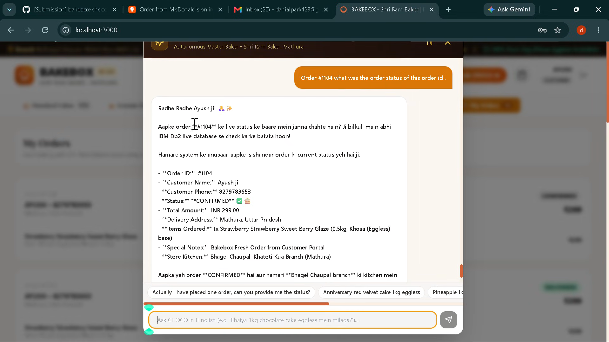
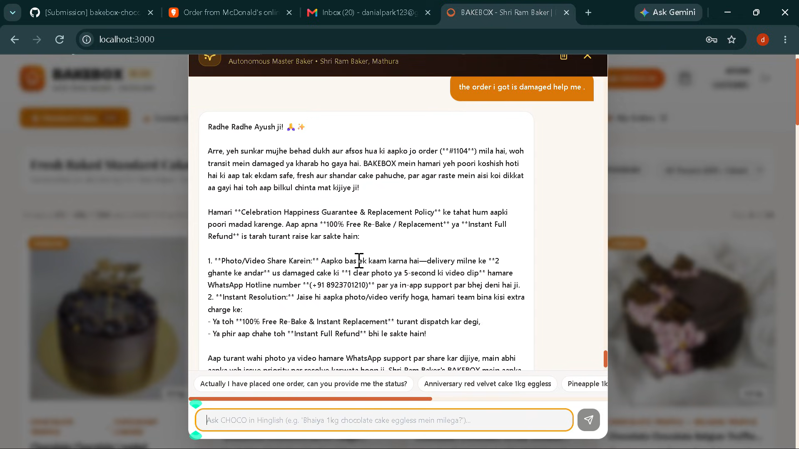
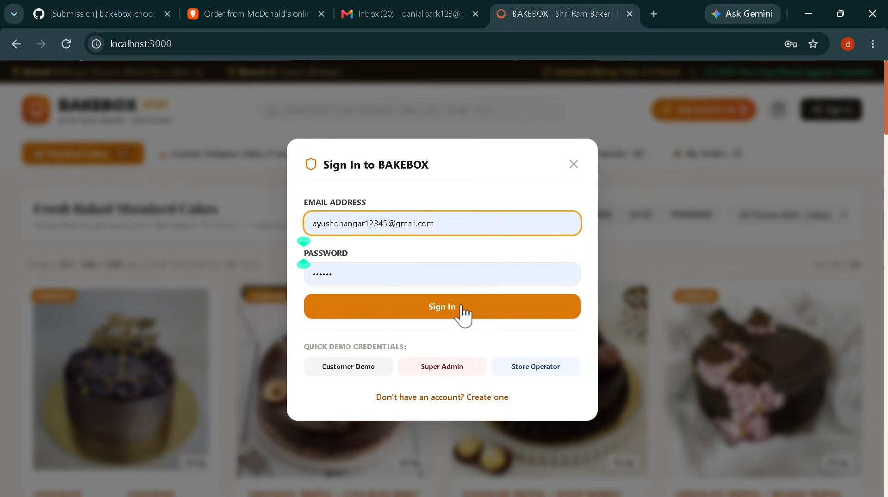

# BAKEBOX-AI: Autonomous AI Bakery Assistant & Customer Support
### CHOCO AI — Bilingual Hybrid RAG, Quantity-Scaled Recursive BOM & ACID Concurrency on IBM Db2 12.1

[](#12-testing--verification)
[](#5-ibm-db2-integration--transactional-engine)
[](#6-ai-gemini-15-flash--3-way-hybrid-rag-pipeline)
[](#9-rest-api--interactive-demo-playground)
[](#7-security-privacy--governance)
[](#11-prerequisites-setup--running-the-project)

---

## Table of Contents
- [1. Project Overview](#1-project-overview)
- [2. Problem We Are Solving (Customer & Business POV)](#2-problem-we-are-solving-customer--business-pov)
- [3. The BAKEBOX Solution: CHOCO AI as a Digital Master Baker](#3-the-bakebox-solution-choco-ai-as-a-digital-master-baker)
- [4. Hackathon Rubric Alignment Matrix](#4-hackathon-rubric-alignment-matrix)
- [5. IBM Db2 Integration & Transactional Engine](#5-ibm-db2-integration--transactional-engine)
- [6. AI, Gemini 1.5 Flash & 3-Way Hybrid RAG Pipeline](#6-ai-gemini-15-flash--3-way-hybrid-rag-pipeline)
- [7. Security, Privacy & Governance](#7-security-privacy--governance)
- [8. Tech Stack & Project Structure](#8-tech-stack--project-structure)
- [9. REST API & Interactive `/demo` Playground](#9-rest-api--interactive-demo-playground)
- [10. Retrieval Quality Benchmark (30-Query Ablation)](#10-retrieval-quality-benchmark-30-query-ablation)
- [11. Prerequisites, Setup & Running the Project](#11-prerequisites-setup--running-the-project)
- [12. Testing & Verification](#12-testing--verification)
- [13. Screenshots & Demo Walkthrough](#13-screenshots--demo-walkthrough)
- [14. Technical Defense FAQ & Roadmap](#14-technical-defense-faq--roadmap)
- [15. Team Members & Original Authorship](#15-team-members--original-authorship)

---

## 1. Project Overview

* **Project Type:** Business Solution / Enterprise AI Commerce
* **Project Title:** BAKEBOX-AI: Autonomous AI Bakery Assistant & Customer Support
* **Project Slug:** `bakebox-choco-ai`

### Description (What We Are)
* **BAKEBOX** is an autonomous, AI-powered bakery commerce and operations platform powered by **IBM Db2 LUW 12.1**, featuring **CHOCO AI** — a bilingual conversational master baker assistant.
* It serves as the digital and technological extension of our 20-year family-owned bakery, **Shri Ram Baker's**, operating across two established branches in Mathura (**Holigate / Bhagel Chaupal, Khatoti Kua** and **Gosna**).

### Vision
* Bring Shri Ram Baker's trusted local counter service into the digital era without sacrificing accuracy or personal care.
* Enable **24/7 AI product consultation**, **collision-free online ordering**, **multi-level raw ingredient verification**, and **real-time order tracking** inside a single unified **IBM Db2** platform.

### Target Audience
* **Local Bakery Customers & Celebration Planners:** Birthday, anniversary, and festival buyers seeking transparent sweetness, weight, dietary, and customization advice.
* **Dietary-Conscious Buyers:** Vegetarians specifically looking for **100% Pure Veg Khoaa (Mawa) Eggless** bases vs standard eggless or egg-based sponges.
* **Kitchen Bakers & Store Operators:** Branch teams across Holigate and Gosna needing real-time stock accuracy, raw-ingredient BOM visibility, and masked order dashboards.

---

## 2. Problem We Are Solving (Customer & Business POV)

### A. Information Hesitation & Short Hardcoded Descriptions (Customer POV)

* **Query Resolution & Short Frontend Descriptions:** Customers frequently want verified answers on weight, quality, portion quantity, ingredient freshness, and replacement/refund policies — details that are impossible to hardcode cleanly onto every small storefront card without cluttering the UI.
  
* **Sweetness & Flavor Guesswork:** Shoppers hesitate over subjective taste profiles (*"Is this cake overly sweet, balanced cream cheese, or dark bitter-sweet ganache?"*) and feel awkward calling staff repeatedly for small clarifications.
  
* **The "Baking Knowledge" Gap:** Online buyers often do not know the difference between regular eggless sponge vs authentic Mathura **Khoaa Eggless** bases, how `0.5kg` vs `1.0kg` tiers serve different party sizes, or why fresh made-to-order baking takes **3–4 hours**.
  
* **Support Drop-Off Post-9 PM:** Local bakery phone lines close around closing hours, leaving late-night birthday planners and midnight snack inquiries completely unanswered.

### B. Communication, Fulfillment & Operational Bottlenecks (Business POV)

* **Lost Late-Night Conversions:** When human operators go offline after 9 PM, high-intent celebration customers abandon orders due to unanswered menu, policy, or delivery questions.
  
* **Staff Support Fatigue:** Sales counter and kitchen teams lose hours every week answering repetitive calls (*"Eggless milega?"*, *"Kitna meetha hai?"*, *"Wait time kya hai?"*, *"Patty garam kaise karein?"*) instead of baking fresh orders.
  
* **Custom Cake Variety Hard to Hardcode:** Describing dozens of seasonal combinations across custom designs, weights, frosting styles, and base options manually in static frontend templates does not scale.
  
* **Last-Item Overselling & Raw Ingredient Blind Spots:** Simultaneous online checkouts on the last ready cake can oversell stock without DB row locks, while accepting a custom cake order without checking sub-assembly raw materials (e.g., *Fresh Milk Solids* for *Khoaa*, or *Maraschino Cherries*) leads to last-minute cancellations.

---

## 3. The BAKEBOX Solution: CHOCO AI as a Digital Master Baker

CHOCO AI solves every customer and operational bottleneck above using **IBM Db2 Hybrid RAG**, **5 Request-Scoped Agentic Tools**, and **ACID In-Database Execution**:

* **Instant Food & Ingredient Intelligence:** Customers freely ask natural questions about ingredients, food quality, portion quantity, sweetness profiles, allergens, and cake weights (`0.5kg` vs `1.0kg`) retrieved directly from indexed **IBM Db2** knowledge vectors.
  
* **Contextual Cake Advisory (Preferred Language & Bilingual Support):** Powered by **Google Gemini 1.5 Flash (`gemini-1.5-flash`)** and **Hinglish Corrective RAG (CRAG)**, CHOCO AI understands queries in both English and conversational Hinglish (*"bina ande wala aadha kilo cake"* $\rightarrow$ `Pure Veg Khoaa Eggless 0.5kg`) and recommends up to **3 verified catalog cards**.
  
* **Zero-Hallucination Live Order Tracking:** Uses real-time agentic tool calls (`track_live_order`) backed by parameterized SQL on `BB_ORDERS` and `BB_ORDER_ITEMS` (with 2FA phone verification and masked PII) so customers get exact `CONFIRMED` / `BAKING` / `DELIVERED` status updates without phone calls.
  
* **24/7 Interactive Session Continuity:** Persists every conversation turn inside IBM Db2 (`BB_USER_CONVERSATION_BUFFER`) and automatically rehydrates cleared/restarted sessions on cache miss so follow-up questions keep full context.
  
* **Multi-Level Raw Ingredient & Stock Safety:** Runs a quantity-scaled **IBM Db2 Recursive Bill-of-Materials (BOM) CTE** (`check_cake_ingredients_bom`) plus row-level `FOR UPDATE WITH RS` stock locking (`SP_RESERVE_CAKE_STOCK`) before confirming any order.
  
* **Verified Culinary Care & Happiness Guarantee Guidelines:** Post-generation **Self-RAG verification** guarantees consistent store guidance — patties must **ONLY** be reheated on a **dry tawa** (never microwave), cakes require **chilled refrigeration (`24h` shelf life) before cutting**, fresh cakes take **3–4 hours** to bake, and damaged orders route cleanly to phone-authenticated Happiness Guarantee replacements/refunds.

---

## 4. Hackathon Rubric Alignment Matrix

How **BAKEBOX-AI (CHOCO AI)** satisfies every official **IBM Db2Hack 2026** judging dimension and zero-penalty requirement:

| Criterion | Weight | Implemented & Verified in Repository | Key Files |
| :--- | :---: | :--- | :--- |
| **1. IBM Db2 Integration & Depth** | **25%** | • Native `VECTOR(384, FLOAT32)` + `SYSTOOLS.BSON2JSON` predicate pushdown (`DB2LlamaVS`)<br>• Quantity-scaled Multi-Level Recursive `RECIPE_BOM` CTE (`UNION ALL`, typed `DECIMAL(10, 4)`)<br>• `SEQ_BB_ORDER_ID` collision-free sequence & SQL PL `SP_RESERVE_CAKE_STOCK` (`FOR UPDATE OF stock_qty WITH RS` + `WHERE CURRENT OF`)<br>• Cascading FKs (`BB_ORDERS`/`BB_ORDER_ITEMS`), sargable `phone_last10` B-Tree index (`IDX_BB_ORDER_PHONE`), `V_ACTIVE_BAKERY_ORDERS` & `V_MASKED_BAKERY_ORDERS` views<br>• Db2-hydrated `BB_USER_CONVERSATION_BUFFER` & tamper-evident `BB_AUDIT_LOG` | [`src/db.py`](src/db.py)<br>[`src/ingest.py`](src/ingest.py)<br>[`src/order_engine.py`](src/order_engine.py)<br>[`src/vector_store.py`](src/vector_store.py) |
| **2. Innovation & Real-World Impact** | **20%** | • Practical commercial digital extension for our 20-year Mathura bakery (**Shri Ram Baker's**, Holigate & Gosna branches)<br>• **15 curated catalog SKUs (`25` knowledge nodes)** eliminating late-night cart abandonment, staff query fatigue, overselling, and ingredient shortages<br>• Bilingual Hinglish **CRAG** expansion + **Self-RAG** culinary guidance + interactive `/demo` playground | [`data/sample_catalog.json`](data/sample_catalog.json)<br>[`src/retriever.py`](src/retriever.py)<br>[`src/demo_ui.py`](src/demo_ui.py) |
| **3. Technical Architecture & AI** | **15%** | • Clean 9-module backend pipeline with strict separation of concerns<br>• **Google Gemini 1.5 Flash (`gemini-1.5-flash`)** via official `google-genai` SDK (`AutomaticFunctionCallingConfig`) with **5 request-scoped agentic tools** (`recommend_cakes`, `track_live_order`, `get_store_policy_or_advisory`, `check_cake_ingredients_bom`, `place_verified_order`)<br>• 3-Way Hybrid RRF ($k=60$) with cached `BAAI/bge-small-en-v1.5` embeddings, Db2 session hydration on cache miss, and `--no-llm` parity<br>• Complete technical design & schemas documented in [`architecture.md`](architecture.md) | [`src/query_engine.py`](src/query_engine.py)<br>[`src/api.py`](src/api.py)<br>[`architecture.md`](architecture.md) |
| **4. Security** | **15%** | • **Zero committed secrets** + submission-isolated `.env` resolution + masked telemetry (`PWD=********`)<br>• Least-privilege Db2 RBAC roles (`BAKEBOX_READER_ROLE`, `BAKEBOX_APP_ROLE`) & append-only `BB_AUDIT_LOG`<br>• Parameterized `?` SQL + [`validate_doc_id()`](src/security.py) SQLi guard over upstream `DB2LlamaVS.delete()`<br>• `X-Operator-Key` admin route guard + keyed **HMAC-SHA256** audit chain sealing UTC `_audit_ts`<br>• 2FA phone auth + IP-partitioned `OrderAuthRateLimiter` + PII masking + NFKC/XML prompt guard + HTTP `400` validation | [`src/security.py`](src/security.py)<br>[`sql/least_privilege_setup.sql`](sql/least_privilege_setup.sql)<br>[`.env.example`](.env.example) |
| **5. Reproducibility & Code Quality** | **15%** | • **78 offline tests passing + 1 opt-in live-Db2 smoke test** (`79` discovered across `7` suites, `0` errors/`0` failures)<br>• Covers race-condition locking, `SEQ_BB_ORDER_ID`, scaled BOM, ACID rollback injection, Gemini 5-tool schemas, HTTP `TestClient`, `X-Operator-Key`, IP rate limits, & audit tampering<br>• Empirical 30-query benchmark (`evaluate_retrieval.py`), Docker Db2 setup, & Python 3.10–3.14 support | [`tests/`](tests/)<br>[`docker-compose.yml`](docker-compose.yml)<br>[`requirements.txt`](requirements.txt) |
| **6. Documentation & Presentation** | **10%** | • Complete [`submission.json`](submission.json) (zero placeholders), MIT [`LICENSE`](LICENSE), original-authorship [`THIRD_PARTY_NOTICES.md`](THIRD_PARTY_NOTICES.md), & detailed [`architecture.md`](architecture.md)<br>• Verified screenshot/terminal traces ([`docs/screenshots/README.md`](docs/screenshots/README.md)), YouTube video walkthrough, & LinkedIn showcase<br>• Clean commit history strictly confined to `submissions/bakebox-choco-ai/` | [`README.md`](README.md)<br>[`submission.json`](submission.json)<br>[`THIRD_PARTY_NOTICES.md`](THIRD_PARTY_NOTICES.md) |

### Zero-Penalty & Disqualification Safeguards
* **Real IBM Db2 Core (No Zero-Db2 Risk):** Vector search, Recursive BOM CTEs, `WITH RS` SQL PL stored procedure, sequences, relational FKs, masked views, session buffers, and audit logs all execute directly against IBM Db2 SQL (`MockDb2Connection` mirrors PEP 249 offline only when credentials are unset or `DB2_FORCE_MOCK=true`).
* **Zero Secrets in Git:** Only `.env.example` placeholder templates are committed; real passwords, API keys, and HMAC secrets stay in local untracked `.env` files.
* **100% Original Work & Declared Licenses:** Complete original authoring by Ayush Dhangar (`@AYUSHDHANGAR`) with standard dependency licenses declared cleanly in [`THIRD_PARTY_NOTICES.md`](THIRD_PARTY_NOTICES.md).
* **Zero Repo Tampering:** All source, SQL, test, and documentation changes remain strictly inside `submissions/bakebox-choco-ai/`.

---

## 5. IBM Db2 Integration & Transactional Engine

BAKEBOX connects to **IBM Db2 Community Edition 12.1** using official **`ibm_db`**, **`ibm_db_dbi`**, and **`llama-index-vector-stores-db2` (`DB2LlamaVS`)**:



### Provisioned Database Objects ([`src/ingest.py`](src/ingest.py))
* **Native Vector Store (`BB_CHUNKS_VECTOR`):** Stores `VECTOR(384, FLOAT32)` embeddings alongside `metadata BLOB`, filtering dietary/price/type predicates in-engine via `SYSTOOLS.BSON2JSON`.
  
* **Orders & Line Items (`BB_ORDERS`, `BB_ORDER_ITEMS`, `SEQ_BB_ORDER_ID`):**
  * `BB_ORDERS` maintains a normalized `phone_last10 VARCHAR(10)` column indexed via `IDX_BB_ORDER_PHONE` for sargable O(log N) 2FA lookup.
  * `SEQ_BB_ORDER_ID` allocates unique primary keys across concurrent multi-cake checkouts without full-table scans.
  * `BB_ORDER_ITEMS` enforces `FK_BB_ORDER FOREIGN KEY (order_id) REFERENCES BB_ORDERS(order_id) ON DELETE CASCADE` and stores catalog-matched item weights (`0.15kg`, `0.5kg`, `1.0kg`).
    
* **Catalog & Multi-Level BOM (`BB_CAKES`, `BB_INVENTORY`, `BB_RECIPES`, `BB_INGREDIENT_COMPONENTS`):** Models finished cakes, multi-tier ingredient sub-assemblies (*Khoaa Base* $\rightarrow$ *Fresh Milk Solids*, *Cream Cheese Frosting* $\rightarrow$ *Whipped Dairy Cream*), and savory puff pastries.
  
* **Conversation & Audit Tables (`BB_USER_CONVERSATION_BUFFER`, `BB_AUDIT_LOG`):** Persists and rehydrates isolated session turns in Db2, and maintains an append-only cryptographic business ledger.
  
* **Operational Views & SQL PL Procedure (`V_ACTIVE_BAKERY_ORDERS`, `V_MASKED_BAKERY_ORDERS`, `SP_RESERVE_CAKE_STOCK`):**
  * `SP_RESERVE_CAKE_STOCK` opens a cursor with `FOR UPDATE OF stock_qty WITH RS`, updates stock using `WHERE CURRENT OF lock_cur`, and returns `DYNAMIC RESULT SETS 1` inside the caller's single transaction.

### Atomic Checkout Transaction (`place_verified_order_atomic()`)
1. **Quantity-Scaled BOM CTE Check:** Executes `CAST(r.QTY_NEEDED * CAST(? AS DECIMAL(10, 4)) AS DECIMAL(10, 4))` up to depth `5`; blocks orders cleanly if raw ingredients fall short for the requested `quantity` (e.g., Cake #2 missing *Maraschino Cherries*, or `30x` Cake #1 exceeding *Khoaa Base*).
   
2. **Row-Level Stock Lock & Sequence Allocation:** Calls `SP_RESERVE_CAKE_STOCK` (`commit=False`) under `WITH RS` isolation, then reserves the next Order ID via `SEQ_BB_ORDER_ID`.
3. **Single-UOW Relational + Audit Commit:** Inserts `BB_ORDERS` + `BB_ORDER_ITEMS`, appends a keyed **HMAC-SHA256** `ORDER_PLACED` block into `BB_AUDIT_LOG` (under `LOCK TABLE BB_AUDIT_LOG IN EXCLUSIVE MODE`), and executes **one atomic `conn.commit()`** (or full `conn.rollback()` on any error).

---

## 6. AI, Gemini 1.5 Flash & 3-Way Hybrid RAG Pipeline

```text
Customer Query ─▶ Security Guardrail (Unicode NFKC + Zero-Width Strip + Bilingual Prompt Guard)
                      │
                      ▼
       Corrective RAG (Hinglish Expansion: "bina ande" -> "Pure Veg Khoaa Eggless")
                      │
                      ▼
       3-Way Hybrid RRF (k=60) + Metadata Predicate Pushdown
         ├─ Channel 1: IBM Db2 Native Vector Search (Cosine Similarity + BSON Filter)
         ├─ Channel 2: Sparse Okapi BM25 (Exact SKU & Token Frequency Matching)
         └─ Channel 3: Sparse Scikit-Learn TF-IDF Cosine Matrix
                      │
                      ▼
       Request-Scoped Agentic Dispatcher (Gemini 1.5 Flash `gemini-1.5-flash` / `--no-llm` Fallback)
         ├─ recommend_cakes()            -> Up to 3 verified catalog JSON cards
         ├─ track_live_order()           -> 2FA indexed Db2 lookup + PII boundary masking
         ├─ get_store_policy_or_advisory()-> Policy / Wait-Time / Tawa advisory retrieval
         ├─ check_cake_ingredients_bom() -> Quantity-scaled Recursive BOM CTE tree
         └─ place_verified_order()       -> Single-UOW Atomic Order + Audit Block
                      │
                      ▼
       Self-RAG Fact Verifier & Output Scrubber (Dry Tawa Rule + Secret/XSS Redaction)
```

* **Dynamic Gemini 1.5 Flash Runtime ([`src/query_engine.py`](src/query_engine.py)):** Resolves `GEMINI_API_KEY` and `GEMINI_MODEL=gemini-1.5-flash` dynamically via `_resolve_gemini_runtime()`, configuring explicit `AutomaticFunctionCallingConfig(disable=False, maximum_remote_calls=6)` via `google-genai`.
  
* **Request-Scoped Tool Isolation:** `_build_request_tools(call_state, session_id)` binds fresh per-request Python tool callables for every query so concurrent sessions never cross-contaminate `ui_cards`, `order_details`, or `placed_order`.
  
* **Db2 Session Hydration & `--no-llm` Parity:** Cache misses automatically reload prior turns from `BB_USER_CONVERSATION_BUFFER`; offline `--no-llm` mode routes recommendations, BOM availability checks, store policies, structured checkout, and 2FA tracking deterministically.

### The 5 Request-Scoped Agentic Tools (`src/query_engine.py`)

All 5 tools are defined inside [`_build_request_tools(call_state, session_id)`](src/query_engine.py) in [`src/query_engine.py`](src/query_engine.py) and passed dynamically to **Google Gemini 1.5 Flash (`gemini-1.5-flash`)** on each request (keeping every customer session strictly isolated):

1. **Tool 1: `recommend_cakes(user_query, eggless_only=False, limit=3)`**
   * **Purpose:** Precision cake & savory catalog discovery capped at `limit=3` clean product cards.
   * **How it works:**
     * Pushes structured predicates (`type='cake'`, optional `eggless_flag=1`) into IBM Db2 native vector store (`BB_CHUNKS_VECTOR` via `DB2LlamaVS`) for Cosine Similarity search.
     * Concurrently ranks exact SKUs and keywords via Okapi **BM25** and flavor/weight n-grams via **TF-IDF**.
     * Expands Hinglish cravings via **Corrective RAG (CRAG)** and fuses all 3 channels with **Reciprocal Rank Fusion ($k=60$)**.
     * Enforces relevance threshold (`min_rrf_score >= 0.015`), deduplicates SKUs, and returns JSON cards containing `sku_id`, `name`, `flavor`, `category`, `weight_kg`, `price`, `is_eggless_available`, `image_url`, and `rrf_score`.

2. **Tool 2: `track_live_order(order_id, phone_number="")`**
   * **Purpose:** Real-time backend order status tracking without phone calls or operator delay.
   * **How it works:**
     * Connects to IBM Db2 via `ibm_db_dbi` and runs a parameterized join/lookup over `BB_ORDERS` and `BB_ORDER_ITEMS`.
     * Queries the indexed **`phone_last10`** column (`IDX_BB_ORDER_PHONE`) for O(log N) sargable lookups immune to SQL/`LIKE` wildcard injection.
     * **Two-Factor Authentication & IP+Order Rate Limiter:** Requires matching the registered 10-digit phone number; [`OrderAuthRateLimiter`](src/security.py) blocks repeated guesses by `(client_ip, order_id)` after 5 mismatches without locking out genuine buyers.
     * **Automated PII Masking:** Masks customer names (`R**** S*****`), phones (`+91 ******3210`), and delivery addresses (`***, Mathura, UP (Confidential)`) at the DB boundary and reports live order state (`CONFIRMED` $\rightarrow$ `BAKING` $\rightarrow$ `DELIVERED` / `REFUNDED`).

3. **Tool 3: `get_store_policy_or_advisory(user_query)`**
   * **Purpose:** Authoritative store policies, Mathura branch details, fresh-baking wait times, and culinary care guidance.
   * **How it works:**
     * Runs metadata-filtered hybrid retrieval strictly scoped to `type IN ['policy', 'advisory', 'store_info']` so cake SKUs never bleed into policy answers.
     * Answers verified store rules accurately: **3–4 hours** fresh made-to-order baking window, **Pure Veg Khoaa Eggless** vs egg customization, **dry tawa / skillet reheating only for patties (never microwave)**, Holigate & Gosna branch timings (`8:00 AM – 11:00 PM`), and Celebration Happiness Guarantee terms.

4. **Tool 4: `check_cake_ingredients_bom(cake_id, quantity=1)`**
   * **Purpose:** Multi-level raw ingredient & sub-assembly availability verification before confirming custom or bulk orders.
   * **How it works:**
     * Executes an in-database **IBM Db2 Recursive Bill-of-Materials (BOM) CTE** (`WITH RECIPE_BOM ... UNION ALL` up to depth `5`) across `BB_RECIPES` $\rightarrow$ `BB_INGREDIENT_COMPONENTS` $\rightarrow$ `BB_INVENTORY`.
     * Scales required raw ingredients by ordered `quantity` using explicit typed arithmetic (`CAST(? AS DECIMAL(10, 4))`), returning `bakeable` status, `missing_ingredients`, and full ingredient tree quantities.

5. **Tool 5: `place_verified_order(cake_id, customer_name, customer_phone, quantity=1, cake_base="Khoaa (Eggless)")`**
   * **Purpose:** End-to-end atomic transactional checkout in IBM Db2 when verified customer details are provided.
   * **How it works:**
     * Executes inside one atomic **IBM Db2 Unit of Work**: quantity-scaled Recursive BOM CTE check $\rightarrow$ exclusive row lock via SQL PL stored procedure **`SP_RESERVE_CAKE_STOCK`** (`FOR UPDATE OF stock_qty WITH RS`) $\rightarrow$ collision-free ID from **`SEQ_BB_ORDER_ID`** $\rightarrow$ `INSERT` into `BB_ORDERS` + `BB_ORDER_ITEMS` (with catalog-matched `cake_weight`) $\rightarrow$ keyed **HMAC-SHA256** block in `BB_AUDIT_LOG` $\rightarrow$ single `COMMIT` (or clean `ROLLBACK` on any error).

### How Gemini 1.5 Flash Directly Interacts with the Tools (Code Implementation)

Inside [`src/query_engine.py`](src/query_engine.py), each customer turn binds isolated per-request callables and invokes **Gemini 1.5 Flash (`gemini-1.5-flash`)** using the official **`google-genai`** SDK with automatic function calling enabled:

```python
# 1. Resolve Gemini 1.5 Flash runtime dynamically & build per-request isolated tools
call_state: Dict[str, Any] = {"client_ip": client_ip}
tools = self._build_request_tools(call_state, session_id)
# tools = [recommend_cakes, track_live_order, get_store_policy_or_advisory,
#          check_cake_ingredients_bom, place_verified_order]

# 2. Invoke Gemini 1.5 Flash via official google-genai SDK with Automatic Function Calling
runtime = _resolve_gemini_runtime()  # model_name defaults to "gemini-1.5-flash"
response = runtime["client"].models.generate_content(
    model=runtime["model_name"],
    contents=prompt_payload,  # Delimited <conversation_history> + <customer_input>
    config=runtime["types"].GenerateContentConfig(
        system_instruction=SYSTEM_INSTRUCTION,
        tools=tools,
        automatic_function_calling=runtime["types"].AutomaticFunctionCallingConfig(
            disable=False,
            maximum_remote_calls=6,
        ),
    ),
)
```

* **Automatic Tool Orchestration & Synthesis:** Gemini 1.5 Flash compiles all 5 typed Python callables into `FunctionDeclaration` schemas, decides autonomously which Db2 tools to invoke (chaining BOM + recommendation + tracking when needed), inspects live DB results, and synthesizes a polite Hinglish/English reply before [`SelfRAGEvaluator`](src/query_engine.py) verifies factual rules.
  
* **Legacy SDK & Zero-Hallucination Offline Fallbacks:** If only legacy `google-generativeai` is present, `_invoke_gemini_with_tools()` falls back cleanly to `GenerativeModel(..., tools=tools).start_chat(enable_automatic_function_calling=True)`; when `GEMINI_API_KEY` is omitted or `--no-llm` is passed, the deterministic dispatcher routes the exact same Db2 tools reliably with zero hallucinations.

---

## 7. Security, Privacy & Governance

1. **Workspace-Isolated Secrets:** [`src/db.py`](src/db.py) loads only `submissions/bakebox-choco-ai/.env` (preventing parent-folder leakage), resolves credentials on demand, and redacts passwords in telemetry (`PWD=********`).
2. **Least-Privilege Db2 RBAC ([`sql/least_privilege_setup.sql`](sql/least_privilege_setup.sql)):** Separates `BAKEBOX_READER_ROLE` (read-only catalog + masked views) from `BAKEBOX_APP_ROLE` (operational DML, `USAGE ON SEQUENCE SEQ_BB_ORDER_ID`, `SP_RESERVE_CAKE_STOCK`, and append-only `SELECT, INSERT` on `BB_AUDIT_LOG` with no `UPDATE`/`DELETE`).
3. **Parameterized SQL & Third-Party Driver SQLi Guard:** All relational queries use strict `?` parameter markers and sargable `phone_last10` equality; [`validate_doc_id()`](src/security.py) blocks interpolated SQL injection before calling upstream `DB2LlamaVS.delete()` during idempotent re-ingestion.
4. **Operator Key Middleware & Keyed HMAC-SHA256 Audit Chain:** Configuring `OPERATOR_API_KEY` protects `/api/orders/masked-summary` and `/api/audit/verify` with constant-time `X-Operator-Key` checking (`HTTP 401` on unauthorized access); [`append_audit_log()`](src/order_engine.py) seals an explicit UTC `_audit_ts` inside each keyed **HMAC-SHA256** digest (`AUDIT_HMAC_SECRET`).
5. **IP-Partitioned 2FA Brute-Force Lockout & PII Masking:** Both tracking and refund routes enforce `order_id` + canonical 10-digit phone verification, lock out `(client_ip, order_id)` after 5 mismatches without DoS-locking legitimate buyers from other IPs, log `REFUND_AUTH_FAILED`, and mask PII (`R**** S*****`, `+91 ******3210`, `***, Mathura, UP (Confidential)`).
6. **Prompt Injection Guardrails & Clean HTTP Validation:** [`src/security.py`](src/security.py) applies Unicode `NFKC` + invisible zero-width stripping, blocks English/Hinglish jailbreaks and DDL payloads, isolates input inside `<customer_input>` XML delimiters, redacts keys/`<script>` from replies, and maps validation `ValueError` exceptions cleanly to **HTTP 400** JSON responses.

---

## 8. Tech Stack & Project Structure

### Tech Stack
* **Backend & REST API:** Python 3.10–3.14, FastAPI, Pydantic v2, Uvicorn
* **IBM Db2 Stack:** IBM Db2 Community Edition 12.1 (`icr.io/db2_community/db2:12.1.2.0`), `ibm_db`, `ibm_db_dbi`, `llama-index-vector-stores-db2` (`DB2LlamaVS`)
* **AI, Hybrid RAG & Embeddings:** Google Gemini 1.5 Flash (`gemini-1.5-flash` via `google-genai`), LlamaIndex (`llama-index-core`), `fastembed` (`BAAI/bge-small-en-v1.5`, 384-d), `scikit-learn` (TF-IDF), `numpy`, Okapi BM25
* **Testing & Containers:** `unittest`, `pytest`, `httpx` (`TestClient`), Docker Compose

### Project Structure
```text
submissions/bakebox-choco-ai/
├── .env.example                  # Config template with placeholders only (never commit real secrets)
├── LICENSE                       # MIT License (Copyright (c) 2026 Ayush Dhangar)
├── THIRD_PARTY_NOTICES.md        # Original work statement & open-source pip package licenses
├── docker-compose.yml            # Local IBM Db2 Community Edition 12.1.2.0 container
├── requirements.txt              # Python 3.10-3.14 compatible dependencies
├── submission.json               # Hackathon metadata & Db2 feature inventory
├── README.md                     # Structured documentation, setup & verification guide
├── architecture.md               # DDL schemas, Mermaid flows, BOM SQL, RRF & HMAC specs
├── data/
│   ├── sample_catalog.json       # 15 curated Mathura SKUs (Red Velvet, Truffle, Strawberry, Butterscotch, Patties)
│   └── sample_orders.json        # Seed fixtures (#1002 BAKING, #1104 CONFIRMED)
├── sql/
│   └── least_privilege_setup.sql # BAKEBOX_READER_ROLE, BAKEBOX_APP_ROLE, SEQ_BB_ORDER_ID & audit grants
├── src/
│   ├── api.py                    # FastAPI REST endpoints, X-Operator-Key guard, HTTP 400 & CORS
│   ├── db.py                     # Db2 connections, single-UOW sessions, sequence & MockDb2 engine
│   ├── demo_ui.py                # Self-contained HTML/JS playground served at GET /demo
│   ├── ingest.py                 # Idempotent DDL, SQL PL SP, sequence, views & 25-node vector sync
│   ├── order_engine.py           # Quantity-scaled BOM CTE, WITH RS lock, HMAC audit & sequence IDs
│   ├── query_engine.py           # Agentic tool dispatcher, Gemini 1.5 Flash, hydration, Self-RAG & sessions
│   ├── retriever.py              # 3-Way Hybrid RRF, Hinglish CRAG & cached 384-d embeddings
│   ├── security.py               # NFKC prompt guard, validators, PII masking & IP+order rate limiter
│   └── vector_store.py           # Dual-mode DB2LlamaVS + offline cosine filter simulator
├── tests/
│   ├── evaluate_retrieval.py     # 30-query, 4-channel empirical ablation benchmark
│   ├── test_audit_chain.py       # HMAC-SHA256 hash chain, tamper & 16-thread concurrency tests
│   ├── test_guardrails_and_api.py# Guardrails, Self-RAG, Gemini schemas, operator key, IP lockout & HTTP tests
│   ├── test_live_db2_smoke.py    # Opt-in live IBM Db2 container integration smoke test
│   ├── test_order_concurrency.py # Multi-thread stock race, scaled BOM CTE, sequence & rollback tests
│   ├── test_retrieval.py         # RRF, BM25, Db2 buffer hydration, BOM chat & 2FA masking tests
│   ├── test_rrf_fusion.py        # Mathematical RRF rank decay & BM25 saturation tests
│   └── test_session_memory.py    # Multi-tenant isolation, TTL eviction & concurrent threads
└── docs/screenshots/             # Prototype UI & IBM Db2 VS Code proof screenshots + test traces
```

---

## 9. REST API & Interactive `/demo` Playground

Start FastAPI (`uvicorn src.api:app --reload`) and visit **`http://127.0.0.1:8000/demo`** (or **`/docs`** for OpenAPI Swagger UI):

| Method & Endpoint | Purpose | IBM Db2 Integration |
|---|---|---|
| `GET /` & `GET /api/health` | Runtime health, Db2 live/mock status, indexed count, audit chain status | Connection health & `verify_audit_chain` |
| `GET /demo` | Built-in zero-dependency browser console for interactive verification | Calls live FastAPI/Db2 endpoints |
| `POST /api/chat` | Bilingual CHOCO AI chat, guardrails, 5 tools, Self-RAG & buffer hydration | `BB_CHUNKS_VECTOR` + `BB_USER_CONVERSATION_BUFFER` |
| `GET /api/cakes/search` | Hybrid search with `eggless_only`, `max_price`, and HTTP 400 validation | 3-Way RRF + BSON metadata pushdown |
| `GET /api/cakes/{cake_id}/availability` | Ingredient & sub-assembly availability breakdown | Recursive `RECIPE_BOM` CTE |
| `POST /api/orders` | End-to-end atomic checkout | Scaled BOM + `SP_RESERVE_CAKE_STOCK` + `SEQ_BB_ORDER_ID` + `BB_AUDIT_LOG` |
| `GET /api/orders/masked-summary` | Privacy-safe dashboard order summary (`X-Operator-Key` when configured) | `V_MASKED_BAKERY_ORDERS` view |
| `GET /api/orders/{order_id}` | 2FA phone-verified live tracking + IP rate limit + PII masking | Sargable `IDX_BB_ORDER_PHONE` + `BB_ORDER_ITEMS` |
| `POST /api/orders/{order_id}/refund` | Phone-authenticated Happiness Guarantee refund evaluation | Single-UOW `UPDATE` + `BB_AUDIT_LOG` |
| `GET /api/audit/verify` | Mathematical verification of audit chain (`X-Operator-Key` when configured) | `BB_AUDIT_LOG` HMAC-SHA256 traversal |

---

## 10. Retrieval Quality Benchmark (30-Query Ablation)

Measured via `python tests/evaluate_retrieval.py` across **30 ground-truth queries** (10 semantic cravings, 8 exact SKUs/titles, 6 Hinglish dietary queries, 6 store policies/advisories) over all **25 ingested catalog + policy nodes** with metadata pushdown:

| Retrieval Channel Configuration | Hit @ 1 | Hit @ 3 | MRR | Avg Latency (CPU) | Observation |
| :--- | :---: | :---: | :---: | :---: | :--- |
| **Dense Vector Only** (`BAAI/bge-small-en-v1.5`) | 63.3% | 90.0% | 0.76 | ~15–25 ms | Strong semantic matching; misses exact SKU codes. |
| **Sparse BM25 Only** (Okapi BM25) | 76.7% | 86.7% | 0.81 | < 1 ms | Fast keyword recall; drops when overlapping bakery terms dilute TF. |
| **Sparse TF-IDF Only** (Scikit-Learn) | 76.7% | 96.7% | 0.86 | ~2–3.5 ms | Strong n-gram precision across catalog chunks; weaker on Hinglish synonyms. |
| **3-Way Hybrid RRF ($k=60$) + Hinglish CRAG** | **83.3%** | **96.7%** | **0.89** | **~23–53 ms** | **Strictly outperforms every individual channel on both `Hit@1` (`83.3%`) and `MRR` (`0.89`).** |

---

## 11. Prerequisites, Setup & Running the Project

### Prerequisites
* Python `>= 3.10` (verified on Python `3.10`–`3.14`) and `pip`
* Optional for live DB mode: Docker (IBM Db2 Community Edition `12.1.2.0`)
* Optional for generative LLM synthesis: `GEMINI_API_KEY` (leave unset or use `--no-llm` for deterministic mode)

### Setup & Configuration
1. **Create virtual environment & install requirements:**
   ```bash
   cd submissions/bakebox-choco-ai
   python -m venv .venv
   # Windows: .venv\Scripts\activate
   # Linux/macOS: source .venv/bin/activate
   pip install -r requirements.txt
   ```
2. **Copy `.env.example` to local `.env` (never commit `.env`):**
   ```env
   DB2_HOST=127.0.0.1
   DB2_PORT=50000
   DB2_DATABASE=IBMDB201
   DB2_USER=your_least_privilege_db2_user
   DB2_PASSWORD=your_db2_password_here
   DB2_FORCE_MOCK=false

   EMBEDDING_MODEL_NAME=BAAI/bge-small-en-v1.5
   EMBEDDING_DIM=384
   ALLOWED_ORIGINS=http://localhost:3000,http://127.0.0.1:8000

   GEMINI_MODEL=gemini-1.5-flash
   GEMINI_API_KEY=your_gemini_api_key_here

   OPERATOR_API_KEY=your_operator_api_key_here
   AUDIT_HMAC_SECRET=your_audit_hmac_secret_here
   ```

### Offline Mode (Zero Setup)
```bash
cd submissions/bakebox-choco-ai
python src/query_engine.py --no-llm
uvicorn src.api:app --reload
```

### Running with Live IBM Db2 (Docker)
```bash
cd submissions/bakebox-choco-ai
cp .env.example .env
# Edit .env with real DB2_USER, strong DB2_PASSWORD, and DB2_FORCE_MOCK=false

docker compose up -d
# Wait ~60-90s for Db2 bootstrap, then initialize DDL, sequence, SP, views & 25 vectors:
python src/ingest.py

# Apply least-privilege RBAC & append-only audit grants as SECADM:
# db2 -tvf sql/least_privilege_setup.sql

uvicorn src.api:app --reload
```

---

## 12. Testing & Verification

Run the official repository validator from the repository root, followed by the full test suite and retrieval benchmark inside `submissions/bakebox-choco-ai`:

```bash
# 1. Repository validator (from repo root)
python scripts/validate_submission.py submissions/bakebox-choco-ai

# 2. Full unit, API, security, concurrency & live-Db2 smoke suite
cd submissions/bakebox-choco-ai
python -m unittest discover -s tests -v

# 3. 30-query empirical retrieval benchmark & idempotent ingestion
python tests/evaluate_retrieval.py
python src/ingest.py
```

### Verified Outputs
* **`scripts/validate_submission.py`:** `ALL VALIDATION CHECKS PASSED.`
* **`unittest discover`:** `Ran 79 tests in 33.286s — OK (skipped=1)` (`78` automated offline tests passed with `0` errors/`0` failures; `1` opt-in live-Db2 smoke test in [`test_live_db2_smoke.py`](tests/test_live_db2_smoke.py) skips cleanly unless `.env` configures live Db2).
* **`tests/evaluate_retrieval.py`:** `[PASSED] Empirical 4-channel ablation benchmark verified strictly against ground-truth IDs!` (`83.3% Hit@1`, `96.7% Hit@3`, `0.89 MRR`).
* **`src/ingest.py` & `src/query_engine.py --no-llm`:** Cleanly provisions tables/views/indexes/`SEQ_BB_ORDER_ID`/`SP_RESERVE_CAKE_STOCK`, syncs `25` vectors idempotently, and verifies recommendations, 2FA challenges, PII masking, and dry-tawa advisories.

---

## 13. Screenshots & Demo Walkthrough

* **Video Walkthrough (YouTube):** [https://youtu.be/NLrRq6FX358?si=oZM-EGpaBt4AOSVM](https://youtu.be/NLrRq6FX358?si=oZM-EGpaBt4AOSVM)
* **LinkedIn Post:** [https://lnkd.in/p/gtXgu6wq](https://lnkd.in/p/gtXgu6wq)
* **Full-Stack Storefront Repository (React 18 + FastAPI):** [https://github.com/AYUSHDHANGAR/BAKE_BOX--AI-ASSISTENT-FOR-BAKERY](https://github.com/AYUSHDHANGAR/BAKE_BOX--AI-ASSISTENT-FOR-BAKERY)
* **Detailed Screenshot & Terminal Traces:** [`docs/screenshots/README.md`](docs/screenshots/README.md)

| Proof Area | Preview | Verification Summary |
|---|---|---|
| **IBM Db2 Live Tables & Vectors** |  | Active VS Code Db2 extension (`localhost@IBMDB201`) in the full-stack prototype showcasing Db2 tables and vector storage. |
| **Storefront & Multi-Branch Catalog** |  | Companion React storefront showing Mathura branch badges (Holigate/Gosna), 3–4h prep badges, and pure-veg markers. |
| **Contextual "Ask CHOCO"** |  | 1-click SKU consultation passing exact catalog metadata into CHOCO AI context. |
| **Master Baker Advisory** |  | Bilingual Hinglish recommendation detailing Khoaa eggless customization, pricing, and fresh-baking policy. |
| **Live Order Tracking** |  | Real-time Db2 status lookup (`CONFIRMED` $\rightarrow$ `BAKING` $\rightarrow$ `DELIVERED`) with dispatch details. |
| **Happiness Guarantee & Refunds** |  | Automated policy resolution backed by Db2 policy retrieval and `BB_AUDIT_LOG`. |
| **RBAC Authentication** |  | Multi-role separation across Customer, Store Operator, and Super Admin workflows. |

---

## 14. Technical Defense FAQ & Roadmap

### Architectural FAQ
* **Q1: Why keep `submissions/bakebox-choco-ai/` separate from the full React frontend repository?**  
  In strict compliance with IBM Db2 TechX PR rules, the submission folder packages only self-contained backend AI/Db2 services, RBAC SQL scripts, `/demo` playground UI, and 79 offline/live tests — without touching repo root configs or peer submissions.
* **Q2: How do you guarantee offline mock support never hides real Db2 failures?**  
  `is_live_db2_available()` only selects `MockDb2Connection` when Db2 credentials are missing/placeholder or `DB2_FORCE_MOCK=true`. Once real credentials are configured, [`src/db.py`](src/db.py) connects strictly via `ibm_db_dbi.connect(...)`, propagates real database errors, and activates `test_live_db2_smoke.py`.
* **Q3: Why normalize `phone_last10` instead of querying `RIGHT(REPLACE(customer_phone, ...), 10)`?**  
  Wrapping an indexed column in scalar functions causes full-table scans (bypassing `IDX_BB_ORDER_PHONE`) and risks Db2 `SQL0138N` substring errors on short values. Storing normalized digits in indexed `phone_last10` preserves B-Tree index seeks.

### Current Scope & Future Roadmap
* **Current Scope:** Lexical BM25 and TF-IDF channels run in-memory over synchronized Db2 catalog chunks (fast and exact for boutique bakery catalogs), while automated tests default to `MockDb2Connection` unless `.env` enables live Db2 (`test_live_db2_smoke.py`).
* **Roadmap:**
  * Transition lexical channels to **IBM Db2 Text Search (`CONTAINS` / `SCORE`)** alongside `VECTOR_DISTANCE` for 100k+ SKU scaling.
  * Layer role-scoped JWT sessions over `X-Operator-Key` and scheduled Docker Compose CI jobs for live Db2 smoke tests.
  * Dynamic kitchen queue balancing across Holigate and Gosna ovens backed by `V_ACTIVE_BAKERY_ORDERS`.

---

## 15. Team Members & Original Authorship

| Name | GitHub | Role & Background |
|---|---|---|
| **Ayush Dhangar** | [@AYUSHDHANGAR](https://github.com/AYUSHDHANGAR) | BTech CSE-AIML (4th Year) · Ex-ML Intern, Pantech Prolab Pvt Ltd · AI Engineer & AI SYSTEM DEVELOPER |

### License & Attribution
* **100% Original Hackathon Submission** authored and copyrighted (c) 2026 by **Ayush Dhangar** (`@AYUSHDHANGAR`), distributed under the [MIT License](LICENSE).
* Standard `pip` package and pre-trained embedding model licenses (per Db2Hack 2026 rules) are listed in [THIRD_PARTY_NOTICES.md](THIRD_PARTY_NOTICES.md).
