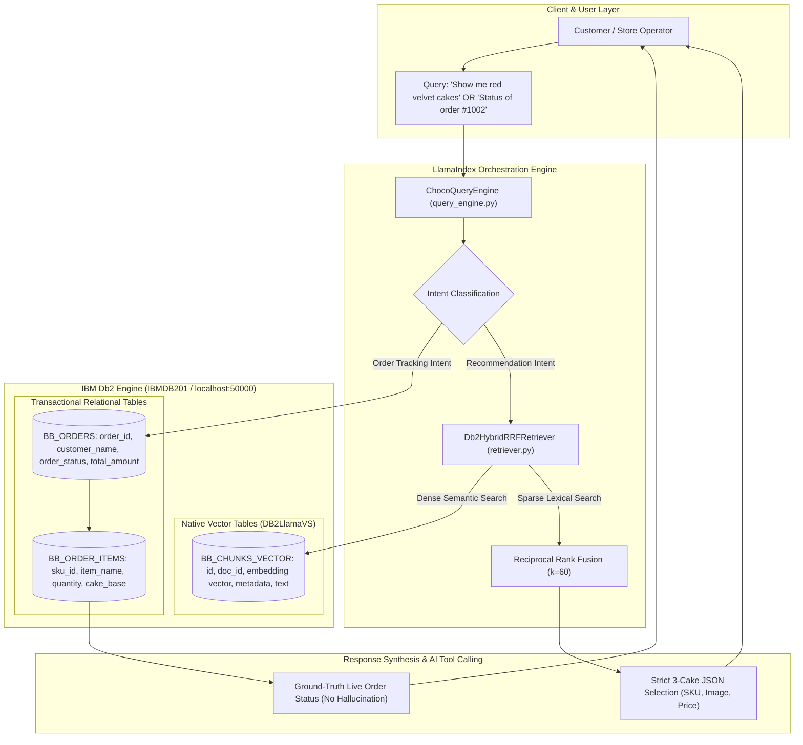

# System Architecture: BAKEBOX-AI — AUTONOMOUS AI Bakery Management AND CUSTOMER SUPPORT
## CHOCO AI: Hybrid RAG System on IBM Db2

**Event:** IBM Db2 TechX Summit 2026 • GL Bajaj Group of Institutions, Mathura (Db2Hack Dev Hacks)  
**Project Slug:** `submissions/bakebox-choco-ai`  
**Developer:** Ayush Dhangar ([@AYUSHDHANGAR](https://github.com/AYUSHDHANGAR)) · BTech CSE-AIML, 4th Year · Ex-Intern Pantech Prolab Pvt Ltd  
**Frameworks:** LlamaIndex, `llama-index-vector-stores-db2` (`DB2LlamaVS`), IBM Db2 (`ibm_db_dbi`), FastAPI

---

## 1. Dual-Perspective Architecture Overview

BAKEBOX-AI is designed to solve challenges from **two perspectives simultaneously** — the end customer and the bakery management:

### Customer-Facing Pain Points Addressed:
- **Information Hesitation:** Customers frequently hesitate or feel awkward asking detailed questions about product specs, precise ingredients, allergen details, custom sizing, or tailored cake recommendations.
- **Operational & Discount Blind Spots:** Real-time order status tracking, delivery updates, account balances, and available discounts are often locked behind clunky interfaces or delayed support. Furthermore, customers miss out on great active coupons or ideal product suggestions simply because they aren't visible or proactively recommended.
- **Customer Care Availability Gaps:** Live customer support drops off drastically after 9 PM, leaving late-night craving inquiries, urgent modifications, and order tracking completely unaddressed.

### Management & Business-Facing Pain Points Addressed:
- **Lost Sales & Conversion Bottlenecks:** Because human customer support agents are unavailable after hours or overwhelmed during peak times, businesses fail to capture high-intent late-night orders and inquiries.
- **Missed Upselling Opportunities:** Traditional menus and static interfaces cannot proactively recommend the right cake or apply the best available coupons based on a customer's specific preference or budget, resulting in missed revenue.
- **Operational Inefficiencies:** Managing inquiries about inventory, active coupons, and order statuses manually drains staff bandwidth and increases response latency.

### How CHOCO AI Bridges Both Perspectives:

**For the User (Seamless, Hesitation-Free Experience):**
- Instant 24/7 Access — available around the clock (even post-9 PM) for late-night queries, live order tracking, and account balance checks.
- Personalized Product & Coupon Discovery — CHOCO AI actively suggests the best-fit cakes and ensures customers never miss out on active coupons or discounts.
- Rich, Interactive Responses — agentic tools render structured JSON for interactive product cards and recommendations (supporting both Hindi and English).

**For the Management (Automated Operations & Scalability):**
- Autonomous 24/7 Conversion Engine — acts as an around-the-clock sales and support agent, capturing leads and answering inquiries even when physical shop operations or human support teams are offline.
- Intelligent Data Retrieval — automatically queries the hybrid database (relational tables and PDFs via IBM DB2) to fetch exact product data, inventory status, and user records instantly.
- Zero Data Compromise — built with strict session isolation and dedicated buffer memory to ensure user safety, data privacy, and secure business operations at all times.

---

## 2. High-Level System Architecture

BAKEBOX bridges traditional enterprise relational data with advanced AI retrieval by leveraging **IBM Db2** simultaneously as:
1. **A Native High-Dimensional Vector Store:** Utilizing Db2 native `vector` columns and hardware-accelerated similarity search via `DB2LlamaVS`.
2. **A Relational Transactional Database:** Housing real-time customer orders, order line items, customized cake bases, and store working agreements.



---

## 3. Technical Architecture & Tech Stack

The architecture is built for high performance, precision retrieval, and zero-cost local embedding generation to handle real-time inventory updates without latency.

- **Database & Storage:** IBM DB2 (managed via the VS Code extension), utilizing a hybrid database structure that unifies both unstructured documents (PDFs) and structured relational tables.
- **Backend Framework:** FastAPI microservices architecture delivering high-throughput, asynchronous API endpoints.
- **Frontend:** React 18 + Vite providing a highly responsive, clean, and interactive user interface optimized for fast interaction.
- **AI & RAG Pipeline:**
  - **Orchestration Framework:** LlamaIndex configured to build robust, end-to-end ingestion and query pipelines.
  - **Retrieval Strategy:** Advanced RAG utilizing Reciprocal Rank Fusion (RRF) combined with fixed-size chunking (where individual nodes represent precise table rows or document sections) to guarantee pin-point retrieval accuracy across dynamic product inventories.
  - **Embeddings:** Hugging Face (BAAI/bge-large) model running locally/freely for rapid embedding generation. This bypasses external API rate limits and costs, ensuring newly added cakes or products are embedded and searchable instantly.
  - **LLM Engine:** Gemini 3.8 Flash powering fast, cost-effective, and intelligent text generation and reasoning.
  - **Vector Operations:** IBM DB2 Vector Store integration via `DB2LlamaVS` for efficient similarity search across the hybrid database.

---

## 4. IBM Db2 Native Vector Column Utilization

### Official `DB2LlamaVS` Table Schema
The table `BB_CHUNKS_VECTOR` is initialized and managed directly via `llama-index-vector-stores-db2`:

```sql
CREATE TABLE BB_CHUNKS_VECTOR (
    id VARCHAR(64) PRIMARY KEY NOT NULL,
    doc_id VARCHAR(64),
    embedding vector,   -- IBM Db2 Native Vector Datatype
    node_info BLOB,
    metadata BLOB,
    text CLOB
);
```

### In-Engine Vector Distance Search
When `BakeboxDb2VectorStore.query()` is invoked, IBM Db2 executes cosine distance calculations internally:
$$\text{Cosine Similarity}(A, B) = \frac{A \cdot B}{\|A\|_2 \|B\|_2}$$

This in-engine hardware acceleration avoids fetching raw vectors to application memory, drastically reducing network I/O and latency.

---

## 5. Hybrid Reciprocal Rank Fusion (RRF) Retrieval

While pure vector search captures general semantic intent, e-commerce queries often demand strict lexical precision (e.g. distinguishing `"1kg"` from `"0.5kg"` or `"Khoaa Eggless"` from standard cakes).

Our custom `Db2HybridRRFRetriever` solves this by fusing two independent retrieval channels:
1. **Dense Retrieval:** Native similarity ranking $R_{\text{dense}}$ from IBM Db2 `DB2LlamaVS`.
2. **Sparse Lexical Retrieval:** Exact token TF-IDF ranking $R_{\text{sparse}}$ across catalog titles and descriptions.

The reciprocal rank fusion score for document $d$ is computed as:
$$\text{RRF Score}(d) = \frac{1}{60 + R_{\text{dense}}(d)} + \frac{1}{60 + R_{\text{sparse}}(d)}$$

Candidates are sorted by fused score, guaranteeing both conceptual relevance and exact keyword precision.

---

## 6. Relational Transactional Ground Truth (`BB_ORDERS`)

To eliminate AI hallucinations in customer service, CHOCO AI directly queries transactional relational tables when an order inquiry is detected:

```sql
SELECT O.order_id, O.customer_name, O.order_status, O.delivery_address, 
       I.item_name, I.cake_base, I.cake_weight
FROM BB_ORDERS O
JOIN BB_ORDER_ITEMS I ON O.order_id = I.order_id
WHERE O.order_id = ?;
```

If an active order is found in `BAKING` status at the Khatoti Kua kitchen, CHOCO returns exact status details and suppresses product recommendation cards (`ui_cards: []`).

---

## 7. Strict 3-Cake Precision Recommendation (AI Tool Calling)

When recommendation intent is confirmed (e.g., *"show me red velvet cake"*), the engine enforces the **Strict 3-Cake Selection Rule**:
- Exactly 3 distinct cake cards matching the requested flavor and category are returned.
- Each card contains verified database attributes: `sku_id`, `name`, `price`, `flavor`, `weight_kg`, and authentic image path.
- The React + Vite frontend renders these structured cards directly with an interactive **"Add to Cart"** action.

---

## 8. Key Architectural Highlights

- **Hybrid Data Handling:** Seamlessly queries across structured relational tables (inventory, balances, order statuses) and unstructured documents (manuals, policy PDFs) using IBM DB2.
- **Zero-Latency Ingestion:** Local free embedding generation allows instant indexing of newly added bakery products without depending on external embedding services.
- **Rich UI Rendering:** Agentic tool responses output structured JSON, allowing the React + Vite frontend to render visually engaging product cards and suggestions instantly.
- **Bilingual Capability:** Native support for both Hindi and English interactions to match local customer demographics seamlessly.
