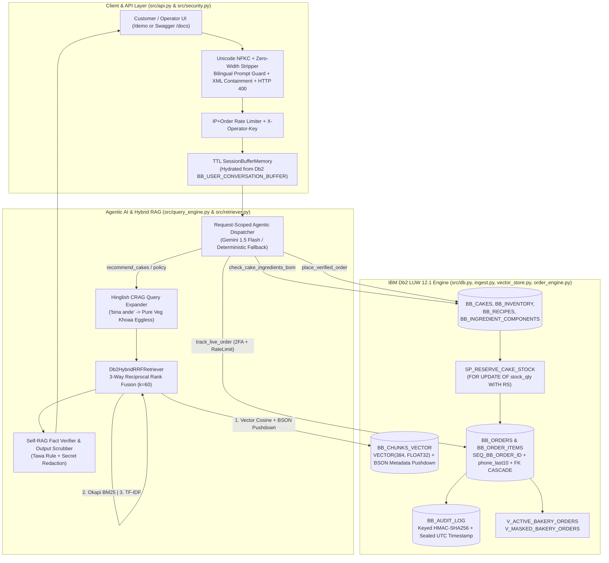
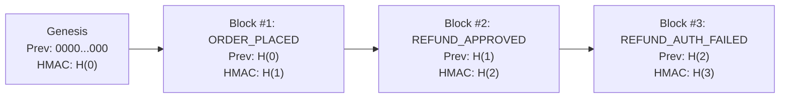

# System Architecture: BAKEBOX-AI — Autonomous AI Bakery Management & Customer Support
## CHOCO AI: Enterprise Hybrid RAG & Transactional Platform on IBM Db2 LUW

**Event:** IBM Db2 TechX Summit 2026 · GL Bajaj Group of Institutions, Mathura (Db2Hack Dev Hacks)  
**Project Slug:** `submissions/bakebox-choco-ai`  
**Developer:** Ayush Dhangar ([@AYUSHDHANGAR](https://github.com/AYUSHDHANGAR)) · BTech CSE-AIML, 4th Year · AI Systems & Db2 Solutions Architect  
**Core Stack:** IBM Db2 LUW 12.1 (`ibm_db`, `ibm_db_dbi`), LlamaIndex (`llama-index-vector-stores-db2` / `DB2LlamaVS`), Scikit-Learn, FastEmbed (`BAAI/bge-small-en-v1.5`), Google Gemini 1.5 Flash (`gemini-1.5-flash` via `google-genai`), FastAPI

---

## 1. Dual-Perspective Problem & Architecture Overview

BAKEBOX-AI solves operational and communication bottlenecks for **Shri Ram Baker's** (a 20-year family bakery in Mathura operating across **Holigate / Khatoti Kua** and **Gosna**) from two synchronized perspectives:

1. **Customer Experience Perspective:**
   * Eliminates hesitation around sweetness profiles, allergens, portion sizing (`0.5kg` vs `1.0kg`), and **Khoaa Eggless** bases.
   * Delivers 24/7 bilingual (**English & Hinglish**) assistance past 9 PM closing hours.
   * Prevents misinformation via **Self-RAG fact verification** (3–4h fresh-baking timelines, dry tawa patty reheating) and real-time order verification.
2. **Bakery Operations & Engineering Perspective:**
   * Eliminates late-night order abandonment and staff repetitive-query fatigue.
   * Guarantees zero overselling on last-item stock via Db2 **Read Stability (`FOR UPDATE WITH RS`)** row locks.
   * Prevents promising out-of-stock cakes by traversing multi-level sub-assemblies through an in-database **Recursive BOM CTE** before accepting orders.
   * Enforces immutable governance with a **SHA-256 hash-chained `BB_AUDIT_LOG`** and least-privilege Db2 roles.

---

## 2. End-to-End System Topology



---

## 3. IBM Db2 Native Vector & Relational Database Schemas (DDL)

All schemas, indexes, views, and stored procedures are provisioned idempotently by [`src/ingest.py`](src/ingest.py) and hardened by [`sql/least_privilege_setup.sql`](sql/least_privilege_setup.sql).

### 3.1 Native Vector Table (`DB2LlamaVS` with BSON Metadata Pushdown)
```sql
CREATE TABLE BB_CHUNKS_VECTOR (
    id VARCHAR(64) PRIMARY KEY NOT NULL,
    doc_id VARCHAR(64),
    embedding vector(384, FLOAT32),   -- IBM Db2 v12.1.2+ Native Vector Column
    node_info BLOB,
    metadata BLOB,                    -- Queried in-engine via SYSTOOLS.BSON2JSON
    text CLOB
);
```

### 3.2 Transactional Orders & Cascading Line Items (Sargable 2FA Index)
```sql
CREATE TABLE BB_ORDERS (
    order_id INT NOT NULL PRIMARY KEY,
    user_id INT,
    customer_name VARCHAR(128) NOT NULL,
    customer_phone VARCHAR(32) NOT NULL,
    phone_last10 VARCHAR(10),         -- Normalized 10 digits for O(log N) sargable lookup
    order_type VARCHAR(32) DEFAULT 'DELIVERY',
    order_status VARCHAR(32) DEFAULT 'BAKING',
    total_amount DECIMAL(10, 2) NOT NULL,
    delivery_address VARCHAR(512),
    special_notes VARCHAR(512),
    created_at TIMESTAMP DEFAULT CURRENT TIMESTAMP
);

CREATE SEQUENCE SEQ_BB_ORDER_ID AS INT START WITH 1105 INCREMENT BY 1 NO CACHE;

CREATE INDEX IDX_BB_ORDER_PHONE ON BB_ORDERS(phone_last10);

CREATE TABLE BB_ORDER_ITEMS (
    item_id INT NOT NULL GENERATED ALWAYS AS IDENTITY (START WITH 1 INCREMENT BY 1) PRIMARY KEY,
    order_id INT NOT NULL,
    sku_id VARCHAR(64) NOT NULL,
    item_name VARCHAR(256) NOT NULL,
    quantity INT NOT NULL,
    unit_price DECIMAL(10, 2) NOT NULL,
    cake_base VARCHAR(64) DEFAULT 'Khoaa (Eggless)',
    cake_weight VARCHAR(32) DEFAULT '1kg',
    custom_message VARCHAR(256),
    CONSTRAINT FK_BB_ORDER FOREIGN KEY (order_id) REFERENCES BB_ORDERS(order_id) ON DELETE CASCADE
);

CREATE INDEX IDX_BB_ITEM_ORDER ON BB_ORDER_ITEMS(order_id);
```

### 3.3 Catalog, Multi-Level Recipe BOM, Persistent AI Buffer & Audit Tables
```sql
CREATE TABLE BB_CAKES (
    cake_id INT NOT NULL PRIMARY KEY,
    name VARCHAR(256) NOT NULL,
    sku_id VARCHAR(64) NOT NULL,
    price DECIMAL(10, 2) NOT NULL,
    stock_qty INT NOT NULL DEFAULT 5,
    is_eggless_available SMALLINT DEFAULT 1
);

CREATE TABLE BB_INVENTORY (
    ingredient_id INT NOT NULL PRIMARY KEY,
    ingredient_name VARCHAR(128) NOT NULL,
    stock_qty DECIMAL(10, 2) NOT NULL DEFAULT 0.0,
    unit VARCHAR(32) DEFAULT 'kg'
);

CREATE TABLE BB_RECIPES (
    recipe_id INT NOT NULL GENERATED ALWAYS AS IDENTITY PRIMARY KEY,
    cake_id INT NOT NULL,
    ingredient_id INT NOT NULL,
    ingredient_name VARCHAR(128) NOT NULL,
    qty_needed DECIMAL(10, 2) NOT NULL,
    CONSTRAINT FK_RECIPE_CAKE FOREIGN KEY (cake_id) REFERENCES BB_CAKES(cake_id) ON DELETE CASCADE,
    CONSTRAINT FK_RECIPE_ING FOREIGN KEY (ingredient_id) REFERENCES BB_INVENTORY(ingredient_id) ON DELETE CASCADE
);

CREATE TABLE BB_INGREDIENT_COMPONENTS (
    parent_ingredient_id INT NOT NULL,
    component_id INT NOT NULL,
    component_name VARCHAR(128) NOT NULL,
    qty_ratio DECIMAL(10, 4) NOT NULL,
    PRIMARY KEY (parent_ingredient_id, component_id),
    CONSTRAINT FK_COMP_PARENT FOREIGN KEY (parent_ingredient_id) REFERENCES BB_INVENTORY(ingredient_id) ON DELETE CASCADE,
    CONSTRAINT FK_COMP_CHILD FOREIGN KEY (component_id) REFERENCES BB_INVENTORY(ingredient_id) ON DELETE CASCADE
);

CREATE TABLE BB_AUDIT_LOG (
    log_id INT NOT NULL GENERATED ALWAYS AS IDENTITY PRIMARY KEY,
    session_id VARCHAR(128) NOT NULL,
    action_type VARCHAR(64) NOT NULL,
    payload CLOB NOT NULL,
    prev_hash VARCHAR(64) NOT NULL,
    current_hash VARCHAR(64) NOT NULL,
    created_at TIMESTAMP DEFAULT CURRENT TIMESTAMP
);

CREATE TABLE BB_USER_CONVERSATION_BUFFER (
    buffer_id INT NOT NULL GENERATED ALWAYS AS IDENTITY (START WITH 1 INCREMENT BY 1) PRIMARY KEY,
    session_id VARCHAR(64) NOT NULL,
    user_id INT DEFAULT 0,
    role VARCHAR(20) NOT NULL,
    content CLOB(32000) NOT NULL,
    ui_cards_json CLOB(32000),
    crag_status VARCHAR(50) DEFAULT 'VERIFIED',
    created_at TIMESTAMP DEFAULT CURRENT TIMESTAMP
);
```

### 3.4 Operational & Privacy-Masked SQL Views
```sql
CREATE OR REPLACE VIEW V_ACTIVE_BAKERY_ORDERS AS
SELECT O.order_id, O.customer_name, O.order_status, O.total_amount, O.created_at,
       COUNT(I.item_id) AS total_items
FROM BB_ORDERS O
LEFT JOIN BB_ORDER_ITEMS I ON O.order_id = I.order_id
GROUP BY O.order_id, O.customer_name, O.order_status, O.total_amount, O.created_at;

CREATE OR REPLACE VIEW V_MASKED_BAKERY_ORDERS AS
SELECT
    order_id,
    SUBSTR(customer_name, 1, 1) || '****' AS masked_customer_name,
    CASE
        WHEN LENGTH(COALESCE(phone_last10, '')) >= 4
        THEN '+91 ******' || RIGHT(phone_last10, 4)
        ELSE '******'
    END AS masked_phone,
    order_type,
    order_status,
    total_amount,
    created_at
FROM BB_ORDERS;
```

---

## 4. Hybrid RAG, Metadata Pushdown, CRAG & Self-RAG

0. **Gemini 1.5 Flash (`gemini-1.5-flash`) & 5 Request-Scoped Agentic Tools (`src/query_engine.py`):**
   * `_resolve_gemini_runtime()` dynamically resolves `GEMINI_API_KEY` and `GEMINI_MODEL=gemini-1.5-flash` via the official `google-genai` SDK (`AutomaticFunctionCallingConfig`), falling back seamlessly to offline deterministic routing when `--no-llm` or placeholder keys are active.
   * `_build_request_tools(call_state, session_id)` binds 5 fresh per-request tool callables so concurrent sessions remain strictly isolated: `recommend_cakes`, `track_live_order`, `get_store_policy_or_advisory`, `check_cake_ingredients_bom`, and `place_verified_order`.
1. **Metadata Predicate Pushdown (`src/query_engine.py`, `src/vector_store.py`):**
   * Cake discovery passes `MetadataFilters(type='cake', eggless_flag=1, price <= max_price)` down into `DB2LlamaVS` (`SYSTOOLS.BSON2JSON` predicate before `VECTOR_DISTANCE` sorting) and restricts lexical channels equivalently.
   * Policy lookups pass `MetadataFilters(type IN ['policy', 'advisory', 'store_info'])`, guaranteeing zero catalog SKU bleed into policy queries.
2. **3-Way Reciprocal Rank Fusion ($k=60$):**
   $$\text{RRF Score}(d) = \sum_{c \in \{\text{Dense}, \text{BM25}, \text{TF-IDF}\}} \frac{1}{60 + \text{rank}_c(d) + 1}$$
3. **Corrective RAG (CRAG) Hinglish Expansion (`src/retriever.py`):**
   * Translates Hinglish terms (*"bina ande"* $\rightarrow$ `Pure Veg Khoaa Eggless`, *"aadha kilo"* $\rightarrow$ `0.5kg`, *"saal girah"* $\rightarrow$ `anniversary heart red velvet`, *"petis"* $\rightarrow$ `patty puff pastry`) when primary confidence is ambiguous.
4. **Self-RAG Fact Verification (`src/query_engine.py`):**
   * Inspects generated replies prior to delivery, injecting mandatory dry-tawa warnings on snack/patty responses and grounding verified Order IDs.

---

## 5. Quantity-Scaled In-Database Recursive Bill-of-Materials (BOM) CTE

[`check_recipe_bom_availability()`](src/order_engine.py) executes Db2 LUW recursive SQL (`UNION ALL` without invalid `RECURSIVE` keyword, typing the quantity multiplier explicitly via `CAST(? AS DECIMAL(10, 4))` to satisfy Db2 `SQL0418N` parameter typing) before order reservation:

```sql
WITH RECIPE_BOM (DEPTH, INGREDIENT_ID, INGREDIENT_NAME, REQUIRED_QTY, CURRENT_STOCK) AS (
    SELECT 1, r.INGREDIENT_ID, r.INGREDIENT_NAME,
           CAST(r.QTY_NEEDED * CAST(? AS DECIMAL(10, 4)) AS DECIMAL(10, 4)), i.STOCK_QTY
    FROM BB_RECIPES r
    JOIN BB_INVENTORY i ON r.INGREDIENT_ID = i.INGREDIENT_ID
    WHERE r.CAKE_ID = ?
    UNION ALL
    SELECT b.DEPTH + 1, sub.COMPONENT_ID, sub.COMPONENT_NAME,
           CAST(b.REQUIRED_QTY * sub.QTY_RATIO AS DECIMAL(10, 4)), inv.STOCK_QTY
    FROM RECIPE_BOM b
    JOIN BB_INGREDIENT_COMPONENTS sub ON b.INGREDIENT_ID = sub.PARENT_INGREDIENT_ID
    JOIN BB_INVENTORY inv ON sub.COMPONENT_ID = inv.INGREDIENT_ID
    WHERE b.DEPTH < 5
)
SELECT INGREDIENT_NAME, REQUIRED_QTY, CURRENT_STOCK,
       CASE WHEN CURRENT_STOCK >= REQUIRED_QTY THEN 'IN_STOCK' ELSE 'OUT_OF_STOCK' END AS AVAILABILITY
FROM RECIPE_BOM;
```

---

## 6. Single-UOW ACID Locking, Stored Procedure & Audit Trail

### 6.1 Native SQL PL Stored Procedure (`SP_RESERVE_CAKE_STOCK`)
Holds an exclusive row lock under Read Stability (`FOR UPDATE OF stock_qty WITH RS`) while executing `UPDATE ... WHERE CURRENT OF lock_cur`, returning `DYNAMIC RESULT SETS 1` without prematurely committing an outer multi-statement transaction:

```sql
CREATE OR REPLACE PROCEDURE SP_RESERVE_CAKE_STOCK (
    IN p_cake_id INT,
    IN p_qty INT
)
DYNAMIC RESULT SETS 1
LANGUAGE SQL
BEGIN
    DECLARE v_current_stock INT DEFAULT -1;
    DECLARE v_success INT DEFAULT 0;
    DECLARE lock_cur CURSOR FOR
        SELECT stock_qty FROM BB_CAKES WHERE cake_id = p_cake_id FOR UPDATE OF stock_qty WITH RS;
    DECLARE res_cur CURSOR WITH RETURN TO CALLER FOR
        SELECT v_success AS SUCCESS FROM SYSIBM.SYSDUMMY1;

    IF p_qty > 0 THEN
        OPEN lock_cur;
        FETCH lock_cur INTO v_current_stock;
        IF v_current_stock >= p_qty THEN
            UPDATE BB_CAKES
            SET stock_qty = stock_qty - p_qty
            WHERE CURRENT OF lock_cur;
            SET v_success = 1;
        END IF;
        CLOSE lock_cur;
    END IF;

    OPEN res_cur;
END
```

### 6.2 Atomic Multi-Step Order Flow (`place_verified_order_atomic`)
All steps share one Unit of Work (`commit=False` on sub-operations, single `conn.commit()` on completion, `conn.rollback()` on any error):
`Quantity-Scaled BOM CTE Check` $\rightarrow$ `SP_RESERVE_CAKE_STOCK` $\rightarrow$ `NEXT VALUE FOR SEQ_BB_ORDER_ID` $\rightarrow$ `INSERT BB_ORDERS` $\rightarrow$ `INSERT BB_ORDER_ITEMS` (catalog-matched `cake_weight`) $\rightarrow$ `INSERT BB_AUDIT_LOG` $\rightarrow$ `COMMIT`.

### 6.3 Keyed HMAC-SHA256 Hash-Chained Audit Trail (`BB_AUDIT_LOG`)
Every block seals a canonical UTC `_audit_ts` inside its payload JSON and links cryptographically to its immediate predecessor via a keyed HMAC (`AUDIT_HMAC_SECRET`):
$$\text{Current Hash} = \text{HMAC-SHA256}_{K}\big(\text{Prev Hash} \,\|\, \text{session\_id} \,\|\, \text{action\_type} \,\|\, \text{canonical\_payload\_json\_with\_ts}\big)$$



[`verify_audit_chain(conn)`](src/order_engine.py) (`GET /api/audit/verify`) traverses `BB_AUDIT_LOG` in primary-key order and pinpoints the exact `log_id` if any payload, timestamp, or pointer was tampered with.

---

## 7. Security, Isolation & Least-Privilege Governance

* **Zero Secret Leakage:** Local `.env` only loaded from `submissions/bakebox-choco-ai/.env`; connection credentials and `AUDIT_HMAC_SECRET` / `OPERATOR_API_KEY` resolved on-demand and masked in telemetry (`PWD=********`).
* **Operator Endpoint Protection & HTTP 400 Validation:** When `OPERATOR_API_KEY` is configured, `GET /api/orders/masked-summary` and `GET /api/audit/verify` require constant-time verified `X-Operator-Key` headers; malformed/blocked `ValueError` inputs map cleanly to `HTTP 400` JSON responses via FastAPI `@app.exception_handler(ValueError)`.
* **Request-Scoped Agentic Tool Closures & Db2 Hydration:** `_build_request_tools(call_state, session_id)` binds fresh per-request tool wrappers so concurrent sessions never contaminate each other's state, while `get_or_create_session()` restores historical turns from `BB_USER_CONVERSATION_BUFFER` on cache miss or restart.
* **SQL Injection & Third-Party Driver Guard:** All relational SQL queries use parameterized `?` markers and sargable `phone_last10` equality; `validate_doc_id()` enforces strict identifier regex prior to `DB2LlamaVS.delete()`, including idempotent delete-before-insert sync in `src/ingest.py`.
* **IP-Partitioned 2FA Order Rate Limiter & PII Masking:** Tracking and refund evaluation verify order ID + canonical 10-digit phone, partition `OrderAuthRateLimiter` lockouts by `(client_ip, order_id)` after 5 mismatches (preventing unauthenticated victim lockout), and mask PII via `mask_order_pii()`.
* **Least-Privilege Db2 Roles (`sql/least_privilege_setup.sql`):** Separates `BAKEBOX_READER_ROLE` (catalog + masked views) from `BAKEBOX_APP_ROLE` (operational DML, `USAGE ON SEQUENCE SEQ_BB_ORDER_ID`, `EXECUTE ON PROCEDURE SP_RESERVE_CAKE_STOCK`, and append-only `SELECT, INSERT` on `BB_AUDIT_LOG`).
