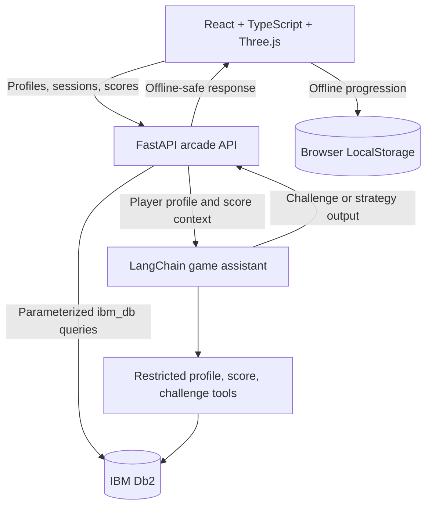

# Bootcamp Runner: AI CEO Edition Architecture

## Overview

The browser runs the complete arcade loop locally: Three.js renders the runner, obstacles, collectibles, and worlds; React owns menus, controls, progression, and LocalStorage persistence. The optional FastAPI service is the only component allowed to access IBM Db2 or watsonx credentials.

## Runtime flow

1. A delta-time animation loop moves the track, animates the character rig, and recycles obstacles and collectibles.
2. Lane, jump, slide, collision, score, combo, and collectible events update the current run.
3. End-of-run statistics are merged into LocalStorage with duplicate-safe achievements and unlock checks.
4. When configured, FastAPI stores player profiles, sessions, scores, character unlocks, achievements, missions, and assistant challenges in Db2.
5. The assistant uses restricted tools and optional watsonx.ai; it cannot execute arbitrary SQL or block offline gameplay.

## Db2 schema

`backend/migrations/schema.sql` creates `player_profiles`, `game_sessions`, `game_scores`, `character_unlocks`, `achievements`, `player_missions`, and `assistant_challenges`, with foreign keys, checks, primary keys, and indexes.

## Security and service boundaries

- Db2 and watsonx credentials stay in backend environment variables.
- Pydantic validates and bounds API inputs.
- Repository queries are parameterized.
- CORS is controlled by an explicit allow-list.
- Db2 failures return an explicit offline response; the frontend retains local play.
- Character names are fictionalized game concepts and do not imply endorsement.
