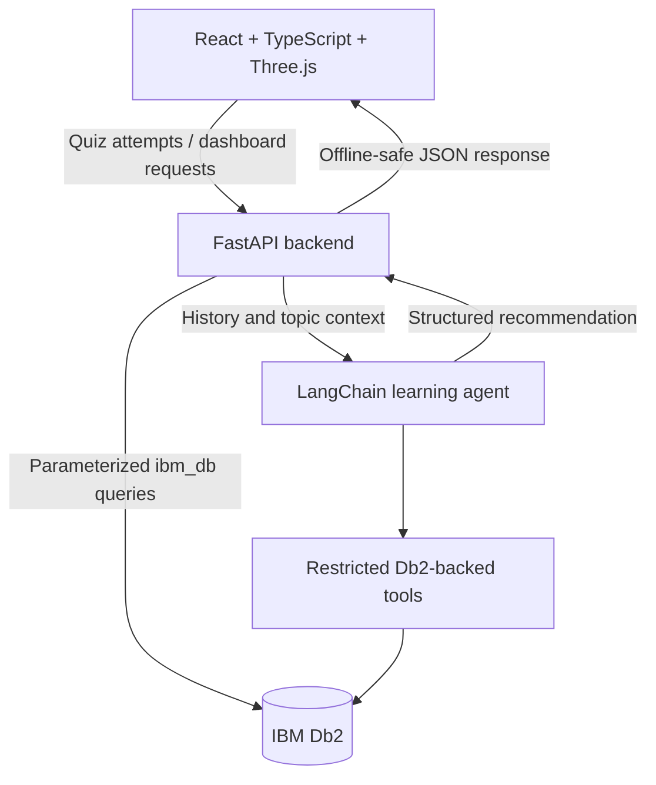

# Bootcamp Runner AI Architecture

## Overview

The browser preserves the original lightweight runner and communicates with a FastAPI service for learner history and adaptive recommendations. The service is the only component allowed to access IBM Db2 or model credentials.

## Components and data flow

1. The runner presents a local question pack and records the selected answer, topic, difficulty, and correctness.
2. The browser sends an attempt to FastAPI. A failed request does not stop local scoring or gameplay.
3. FastAPI validates the payload with Pydantic and stores attempts through parameterized repository methods.
4. The agent retrieves history through restricted tools, calculates topic accuracy, selects a difficulty, creates targeted practice guidance, and stores the recommendation.
5. The dashboard renders totals, topic progress, weak areas, and the latest recommendation. Flow mode can use the recommended difficulty for the next run.

## Db2 schema

`backend/migrations/schema.sql` creates `learners`, `quiz_attempts`, `learning_profiles`, and `ai_recommendations`, with primary keys, foreign keys, checks, indexes, and timestamps. The repository never accepts arbitrary SQL from the client.

## Security boundaries

- Db2 and watsonx credentials are server-side environment variables.
- API request bodies are validated and bounded by Pydantic models.
- CORS is configured from an explicit environment allow-list.
- Agent tools expose fixed operations only; user input cannot become SQL.
- Database outages return an explicit offline status instead of fabricated history or connection success.
