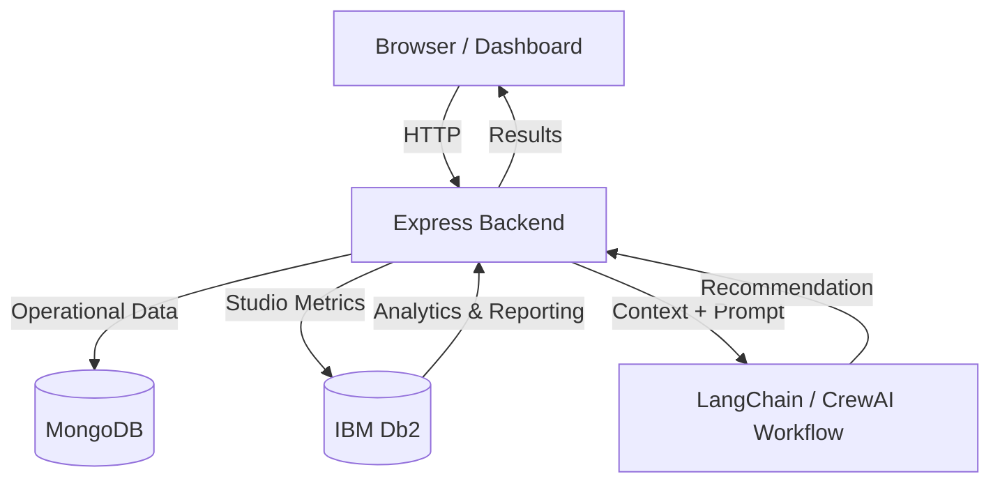

# System Architecture

## Overview
Box Office Inc is designed as a hybrid full-stack simulation system where the gameplay engine runs in a standard web stack, while IBM Db2 is used as the analytical layer for reporting and strategic intelligence.

---

## Architecture Diagram



---

## Component Breakdown

### 1. User Interface / Client Layer
The frontend provides the studio dashboard, talent management panels, production tracking, and release monitoring.

### 2. Application Backend Layer
The backend handles:
- player authentication
- studio lifecycle management
- simulation tick processing
- movie and talent workflow actions
- AI strategy orchestration

### 3. Operational Database Layer (MongoDB)
MongoDB stores the live game state, including:
- users and studios
- production records
- talent contracts
- financial history
- active market state

### 4. IBM Db2 Analytics Layer
IBM Db2 is used for strategic and analytical storage, including:
- studio performance snapshots
- benchmark and leaderboards
- recommendation history
- market trend records
- future analytics and forecasting tables

### 5. AI / Model Orchestration Layer
The AI layer processes studio metrics and produces recommendations such as:
- increase marketing spend
- focus on high-conversion audience segments
- scale winning franchises
- reduce cost pressure during soft market periods

---

## Data Flow

1. User performs an action in the studio dashboard.
2. The backend validates the request and updates the operational MongoDB state.
3. Studio performance data is bundled into a structured summary.
4. The application checks whether IBM Db2 is configured.
5. If configured, the system stores the summary and recommendation in Db2.
6. AI analysis generates a next-step recommendation.
7. The frontend renders adjusted insight panels and dashboard recommendations.

---

## IBM Db2 Schema & Storage Design

```sql
CREATE TABLE BOX_OFFICE_STUDIO_INSIGHTS (
    ID INTEGER GENERATED ALWAYS AS IDENTITY PRIMARY KEY,
    STUDIO_NAME VARCHAR(255),
    REVENUE DECIMAL(18,2),
    EXPENSES DECIMAL(18,2),
    REPUTATION DECIMAL(10,2),
    FANBASE INTEGER,
    ACTIVE_MOVIES INTEGER,
    MARKETING_BUDGET DECIMAL(18,2),
    MARKET_TREND VARCHAR(64),
    RECOMMENDATION VARCHAR(2000),
    REASON VARCHAR(2000),
    SOURCE VARCHAR(64),
    CREATED_AT TIMESTAMP DEFAULT CURRENT_TIMESTAMP
);
```

This structure allows the application to persist strategy insights for later reporting and analysis.

---

## Security & Secrets Management
- All external service credentials are stored in environment variables
- Sensitive keys are never committed to source control
- Db2 connection strings are read at runtime from `.env`
- AI model credentials remain isolated from the public repository
