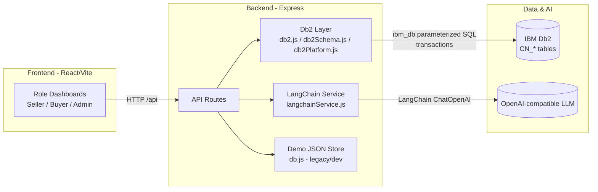
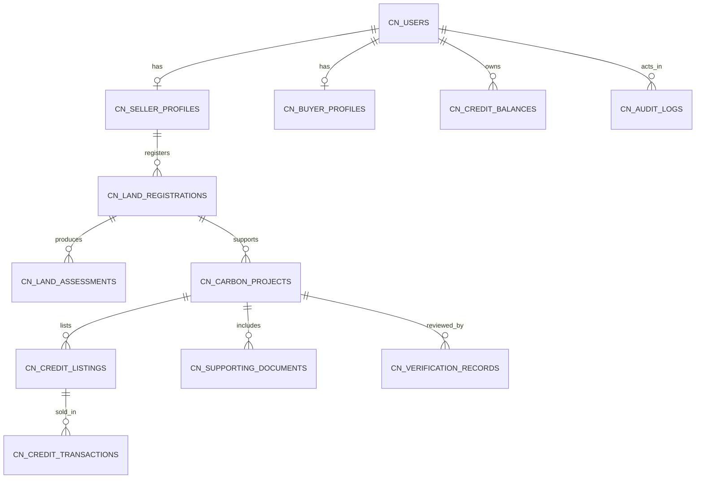
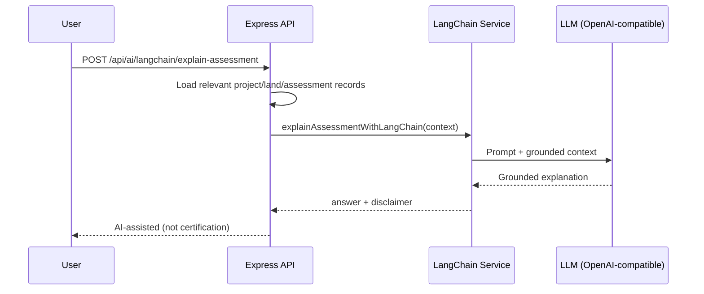

# CarbonNova Architecture

## 1. High-Level Architecture
CarbonNova is an integrated web application (React + Vite frontend, Express/Node backend) submitted under `submissions/carbonnova/src/app/`. The platform supports **Seller / Buyer / Admin** demonstration workflows for agricultural land registration, carbon project/credit lifecycle management, marketplace assessment, and simulated credit transactions.

**Core compliance components:**
- **IBM Db2** (via `ibm_db`) as the target primary relational database for persistent business records, schema initialization, real health checks, and **transactional** credit allocation.
- **LangChain** (JS) for functional AI-assisted workflows (grounded assessment explanation, document consistency review) connected to application records and OpenAI-compatible model configuration.



## 2. Frontend Architecture
- **Entry/routing:** `src/main.jsx`, `src/App.jsx` (React Router). Preserves existing CarbonNova pages and adds demo role flows (`/role-select`, `/demo/seller/*`, `/demo/buyer/*`, `/demo/admin/*`).
- **Layouts:** `CarbonNovaLayout` (existing app) and `RoleLayout` (role-specific sidebars/navigation).
- **Data access:** `src/lib/api.js` + TanStack Query hooks/pages for shared backend data (marketplace, land/projects, transactions, admin, AI).
- **Key UX:** land registration & estimated assessment, project/listing management, global marketplace with filters/map/inspection, AI-assisted document review, admin verification and audit views. All estimates/simulations are labeled; no fabricated certification.

## 3. Backend Architecture
- **Server:** `server/index.js` (Express 5), ESM modules.
- **Routes:** existing CarbonNova routes (projects/readings/carbon/ai/reports/parcels/assessments) plus `platform` and `db2` routes.
- **Db2 modules:**
  - `lib/db2.js` — config from `DB2_*`, connection handling, parameterized query helpers, `withTransaction`, **real** `healthCheck()` using `SELECT CURRENT SERVER FROM SYSIBM.SYSDUMMY1`.
  - `lib/db2Schema.js` — idempotent DDL for required CarbonNova tables/indexes.
  - `lib/db2Platform.js` — Db2-backed workflow operations, including **transactional purchase** (validate, allocate, persist transaction/audit, commit/rollback).
  - `routes/db2.js` — `GET /api/health/db2`, `POST /api/db2/init`, `GET /api/db2/status`.
- **Framework module:** `lib/langchainService.js` — LangChain chains for assessment explanation and document review.

## 4. IBM Db2 Architecture & Schema
**Primary intended business entities (Db2):** users/profiles, land registrations & assessments, carbon projects, credit listings, verification records, supporting document metadata, credit balances, credit transactions, admin audit logs.



**Table design notes:** primary keys on IDs/owner IDs, foreign-key-like relationships by ID columns (enforced by application and schema design), status/role fields, timestamps, JSON/CLOB metadata for flexible demo payloads, indexes for seller/status/transaction/audit lookups. **Estimated assessments are stored as estimates** (`IS_ESTIMATE=1`) and must not be treated as certified credits.

## 5. API Communication
Frontend calls backend REST endpoints under `/api/*` using `fetch` (`src/lib/api.js`). Mutations use POST/PATCH; reads use GET with query params. Errors are normalized to user-visible messages; Db2/AI failures return truthful errors (no fake success).

## 6. AI Integration (LangChain)


## 7. Seller / Buyer / Admin Workflows
- **Seller:** register land → persist registration/assessment (Db2-capable helpers + app records) → submit project → admin review → create listing after approval.
- **Buyer:** query eligible listings → inspect quality/documents → optional LangChain document review → purchase (simulated payment). Purchase path uses **Db2 transaction** when configured.
- **Admin:** review project/listing/user status → updates governance state and audit records; monitors transactions/audit logs.

## 8. Carbon-Credit Transaction Lifecycle (Db2 when configured)
```mermaid
flowchart TD
  A[Buyer requests purchase] --> B{Db2 configured?}
  B -- yes --> C[BEGIN TRANSACTION]
  C --> D[SELECT listing FOR UPDATE / validate approved+available]
  D --> E{Valid?}
  E -- no --> R[ROLLBACK + error]
  E -- yes --> F[UPDATE CN_CREDIT_LISTINGS qty/status]
  F --> G[MERGE CN_CREDIT_BALANCES seller/buyer]
  G --> H[INSERT CN_CREDIT_TRANSACTIONS]
  H --> I[INSERT CN_AUDIT_LOGS]
  I --> J[COMMIT]
  B -- no --> K[Demo JSON path with validation\n(non-Db2 fallback for local UI dev)]
```

## 9. Document Verification Workflow
Buyer/admin selects project → backend retrieves document metadata → heuristic checks (missing categories, unsupported verification claims) → **LangChain** review endpoint produces a cautious summary with disclaimer. Output is **AI-assisted, not official certification**.

## 10. Data Flow Summary (Db2 operations)
| Area | Reads/Writes to IBM Db2 (implemented) |
|---|---|
| Connectivity | `GET /api/health/db2` runs `SELECT CURRENT SERVER FROM SYSIBM.SYSDUMMY1` |
| Schema | `POST /api/db2/init` executes DDL for `CN_*` tables/indexes |
| Land/assessment | `db2InsertLandRegistration` inserts `CN_LAND_REGISTRATIONS` + `CN_LAND_ASSESSMENTS` |
| Purchase/ledger | `db2PurchaseCredits` reads/updates listings, merges balances, inserts transaction + audit in a Db2 transaction |
| Governance | Verification/audit tables designed and written in transactional/Db2 helper paths; full endpoint migration can be extended |

All SQL data operations use parameterized markers; credentials come from environment variables only.
