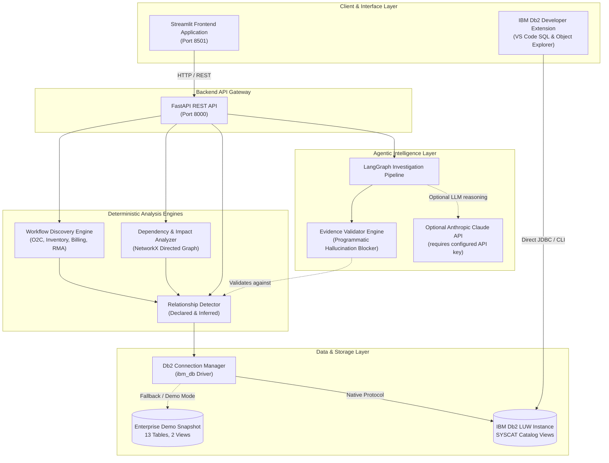
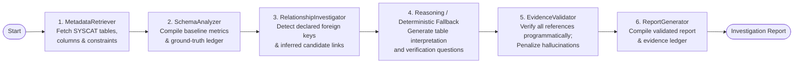
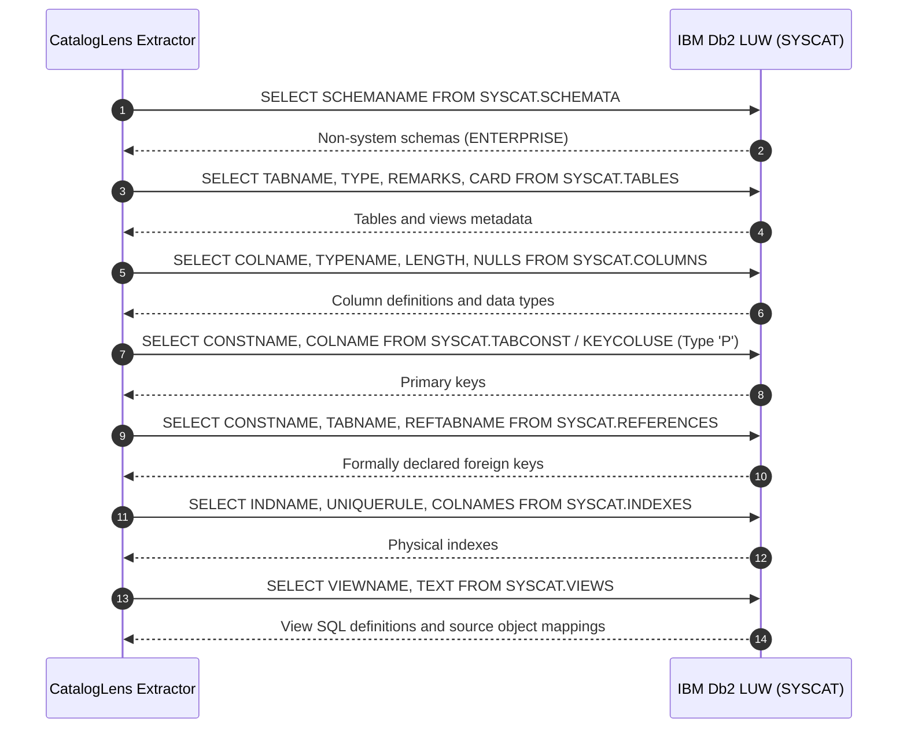

# CatalogLens — System Architecture & Technical Specifications

> **Tagline:** Making the unknown structure of enterprise databases understandable.
> **Target Ecosystem:** IBM Db2 LUW & Db2 Developer Extension for VS Code.

---

## 1. High-Level System Architecture

CatalogLens is structured into distinct, decoupled layers separating deterministic catalog analysis from agentic reasoning:



---

## 2. LangGraph Stateful Investigation Pipeline

CatalogLens uses a purposeful, 6-node state machine orchestrating database understanding:



### Typed State Structure (`InvestigationState`)

```python
class InvestigationState(TypedDict):
    schema_name: str
    selected_table: str
    investigation_question: Optional[str]
    use_demo: bool
    metadata: Optional[DbSchemaMetadata]
    declared_relationships: List[RelationshipEdge]
    inferred_relationships: List[RelationshipEdge]
    table_evidence_ledger: List[EvidenceClaim]
    ai_understanding: Optional[TableUnderstanding]
    validated_evidence: List[EvidenceClaim]
    discrepancies: List[str]
    final_report: Optional[Dict[str, Any]]
    errors: List[str]
```

---

## 3. IBM Db2 LUW Catalog Metadata Extraction Flow

All structural evidence originates from standard Db2 LUW `SYSCAT` system views:



---

## 4. Evidence Validation & Hallucination Defense Flow

```mermaid
flowchart TD
    ClaudeOut["Reasoning Output\n(LLM response or deterministic fallback)"] --> Parser["Structured JSON Parser\n(Pydantic TableUnderstanding)"]
    Parser --> ExtractRefs["Extract Referenced Tables & Columns"]
    ExtractRefs --> EngineCheck{"Cross-reference with\nLoaded DbSchemaMetadata"}

    EngineCheck -->|Objects Exist in SYSCAT| CheckFK{"Matches Declared\nForeign Key?"}
    EngineCheck -->|Object Missing in SYSCAT| FlagHallucination["Flag Discrepancy:\n'Table does not exist'\nStatus: UNVERIFIED_ASSUMPTION\nConfidence halved (< 0.50)"]

    CheckFK -->|Yes| SetFact["Status: VERIFIED_FACT\nConfidence: 1.00"]
    CheckFK -->|No (Naming/Type Match)| SetSupported["Status: METADATA_SUPPORTED\nHeuristic candidate; manual verification required"]

    SetFact --> Ledger["Evidence Ledger Cards\n(Presented in UI)"]
    SetSupported --> Ledger
    FlagHallucination --> Ledger
```

---

## 5. Db2 Developer Extension for VS Code Synergy

CatalogLens and the IBM Db2 Developer Extension for VS Code serve distinct, mutually reinforcing roles:

| Capability | IBM Db2 Developer Extension (VS Code) | CatalogLens |
|---|---|---|
| **Primary User Goal** | Execute SQL, manage connection profiles, view raw DDL | Understand business context, discover hidden links, assess change risk |
| **Interface** | VS Code sidebar tree view & SQL editor tabs | Interactive Streamlit graph dashboard & FastAPI service |
| **Object Inspection** | Raw tree view of schemas, tables, columns, routines | Normalized structural view + cardinality + catalog remarks |
| **Relationship Mapping** | Explicit foreign keys only | Declared foreign keys + Inferred candidate relationships + Graph |
| **Semantic Understanding**| None | LangGraph investigation pipeline with optional Claude integration |
| **Dependency & Impact Analysis**| Manual query inspection | Automated multi-hop cascade dependency tracer & severity ratings |
| **Evidence Ledger** | None | Metadata-backed evidence and validation ledger |
| **Developer Synergy** | The developer inspects and modifies SQL in VS Code | The developer uses CatalogLens to discover *what* to write and assess *risk* |
