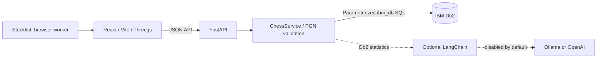

# System Architecture

## Overview

The existing game is extended with a separate FastAPI service and real ibm_db adapter. Live Db2 verification remains pending.

## Architecture Diagram

## Component Breakdown

1. **Client:** Existing cinematic game, PGN tools, Stockfish evaluation and My Games/Analytics/Coach UI with loading, empty and error states.
2. **Backend:** FastAPI health, game save/list/detail, analytics and coaching routes under `/api/v1`; Pydantic and python-chess validation.
3. **Db2:** Prepared SQL, per-operation connections, atomic transaction and UUID retry handling.
4. **AI:** Browser Stockfish plus optional statistics-grounded LangChain calls; heuristic gameplay opponent is preserved.

## Data Flow

1. Client sends PGN, result metadata, UUID and optional completed analysis.
2. Service validates PGN and derives moves/outcome.
3. Repository saves game, moves, analysis and opening totals atomically; errors roll back. Identical UUID retries return existing data; conflicts return HTTP 409.
4. History loads saved PGN for review/reanalysis. Analytics uses database aggregates.
5. Optional coaching retrieves Db2 statistics and game facts before invoking the configured provider.

## IBM Db2 Schema & Storage Design

Complete DDL: [src/backend/schema.sql](src/backend/schema.sql).

| Table | Purpose |
|---|---|
| CHESS_GAMES | UUID key, PGN CLOB, result, player outcome, metadata and timestamps |
| CHESS_MOVES | Game/ply composite key, SAN/UCI/FEN, cascading game foreign key |
| CHESS_GAME_ANALYSIS | Game/ply key, score, probability, engine/depth and explicit status |
| CHESS_OPENING_STATISTICS | Opening key and consistent total/win/loss/draw/unknown counts |

Initializer reuses existing schemas/tables. Hosted users must select their assigned schema. Opening totals can be rebuilt with `npm run db:rebuild-openings`. Real SQL, CLOB and transactional behavior are still awaiting live Db2 verification.

## Security & Secrets Management

Secrets are backend environment variables or an ignored local `.env`. SQL values are bound and schema identifiers validated. Errors are sanitized. CORS is not authentication: this is a single-user demo without tenant isolation. Optional LLM requests contain chess facts, not database credentials. Add authorization before exposing a private multi-user library.
