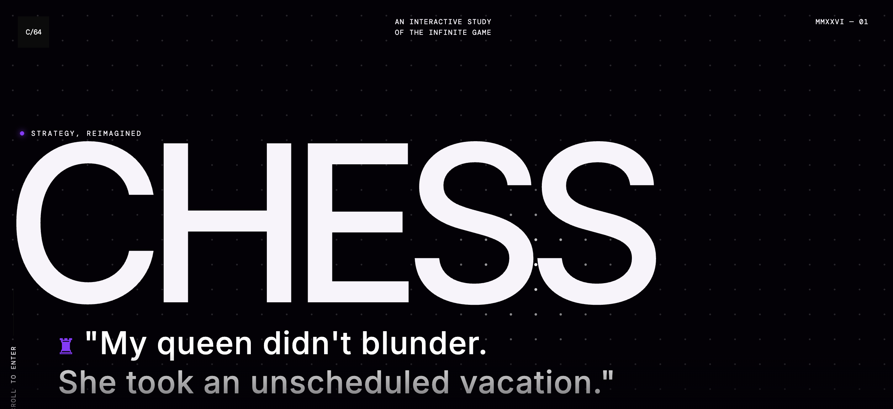
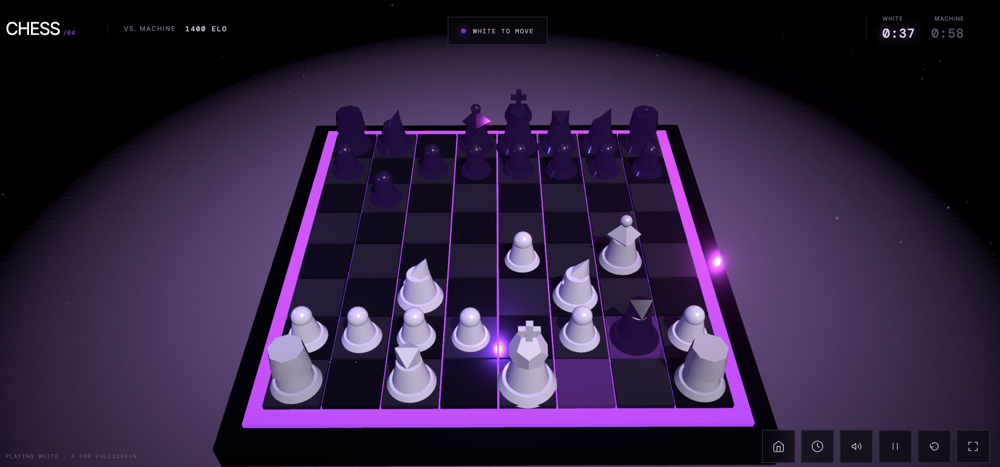
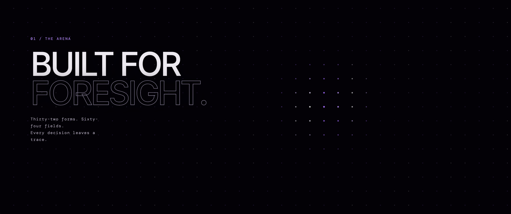
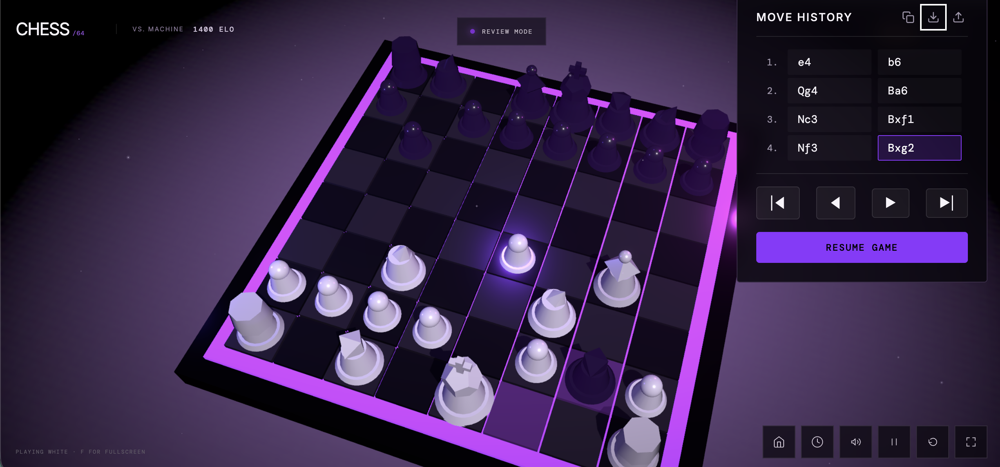
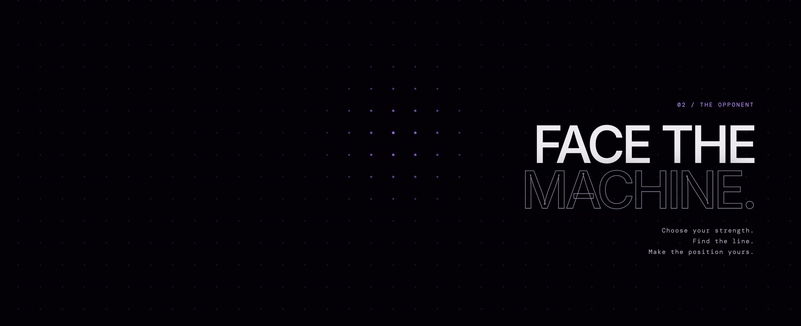
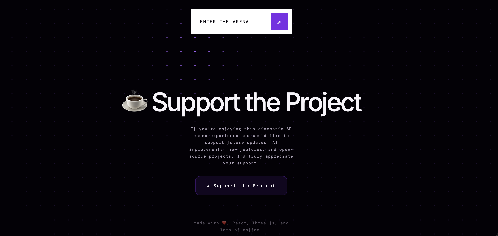

<div align="center">

# ♟️ Cinematic Chess Game 3D

**An interactive study of the infinite game—now extended with real IBM Db2 match memory and analytics for the IBM Db2 TechX project.**

<p align="center">
  
  
  
  
  
</p>

<a href="https://cinematic-chess-game3d.vercel.app" target="_blank">
  
</a>

</div>

> The TechX work is an upgrade of the existing game, not a rewrite. The premium UI, 3D board, animations, chess.js rules, PGN import/export, audio, and Vite development flow remain intact.

## Experience the arena

<div align="center">
  <table>
    <tr>
      <td align="center" width="50%"><br /><em>Cinematic landing experience</em></td>
      <td align="center" width="50%"><br /><em>Interactive 3D chess board</em></td>
    </tr>
    <tr>
      <td align="center" width="50%"><br /><em>Animated dot grid and features</em></td>
      <td align="center" width="50%"><br /><em>Position review and move history</em></td>
    </tr>
    <tr>
      <td align="center" width="50%"><br /><em>Face the machine</em></td>
      <td align="center" width="50%"><br /><em>Support and community</em></td>
    </tr>
  </table>
</div>

## IBM Db2 TechX upgrade

- **Save Game:** stores canonical result metadata, full PGN, server-derived moves, opening, date, and available analysis in IBM Db2.
- **My Games:** retrieves saved matches for PGN review and another Stockfish analysis pass.
- **Live analytics:** queries wins, losses, draws, total games, and most-played openings from Db2.
- **Atomic retries:** a client game UUID is the idempotency key, so retrying the same save cannot double-count opening statistics.
- **Optional AI coaching:** a configurable LangChain adapter can use actual Db2 statistics; it is disabled by default and is not needed for gameplay, saves, or analytics.
- **Honest single-user scope:** this submission has one shared game library and no account/authentication or private multi-user boundary.

### Engine clarification

The playable opponent in `src/ai.ts` is a lightweight ELO-scaled heuristic opponent. Stockfish 18 runs in a browser Web Worker for post-game position evaluation and move classification. The backend stores supplied analysis status and data; it does not pretend the heuristic opponent is Stockfish or require Stockfish on the server.

## Architecture

The browser and backend are separate processes:

```text
React / Vite / Three.js / chess.js / Stockfish Worker
                         │ typed JSON over /api/v1
                         ▼
FastAPI controllers → ChessService → Db2 repository → IBM Db2
                              └────→ optional LangChain coach
```

Db2 is the only persistence implementation. There is no SQLite or in-memory database fallback. `CHESS_GAMES` is authoritative; moves and analysis are child records, while opening statistics are a rebuildable projection. See [architecture.md](architecture.md) for transactions, tables, API contracts, failure behavior, and trust boundaries.

## Prerequisites

- Node.js 22.12+ and npm
- Python 3.11+
- Access to an IBM Db2 database for persistence and live integration checks
- A Db2 user allowed to create the configured schema/tables, or a pre-created schema it can use
- Optional: local Ollama or an OpenAI-compatible account for coaching

Normal chess gameplay and frontend-only checks do not need Db2 or an LLM.

## Setup

### 1. Install frontend dependencies

```bash
git clone https://github.com/srjay999-giT/cinematic-chess-game3D.git
cd cinematic-chess-game3D
git switch feat/ibm-db2-chess-analytics
npm install
```

### 2. Create the Python environment

```bash
python3 -m venv backend/.venv
source backend/.venv/bin/activate
python -m pip install --upgrade pip
python -m pip install -r backend/requirements-dev.txt
```

### 3. Configure IBM Db2

```bash
cp .env.example .env
```

Edit `.env` with your own values. The backend reads a standard `ibm_db` connection string:

```dotenv
DB2_DSN="DATABASE=BLUDB;HOSTNAME=your-host;PORT=50001;PROTOCOL=TCPIP;SECURITY=SSL;"
DB2_USER=your-user
DB2_PASSWORD=your-password
DB2_SCHEMA=CHESS
```

For a locally cataloged database, `DB2_DSN` may instead be its alias. Keep every secret in backend environment variables—never add a Db2 or LLM secret to a `VITE_*` variable, because Vite embeds those values in browser assets.

The backend, maintenance scripts, and live tests load the root `.env` automatically.
Existing shell variables take precedence. Keep passwords quoted in `.env`; the
backend does not expand `${...}` inside values. Restrict local access and then
initialize the real Db2 schema:

```bash
chmod 600 .env
npm run db:init
```

The initializer validates the schema identifier and creates exactly four tables when they are missing.

### 4. Run both development servers

Terminal 1:

```bash
npm run backend:dev
```

Terminal 2:

```bash
npm run dev
```

- Frontend: `http://localhost:5173`
- FastAPI: `http://localhost:8000`
- OpenAPI: `http://localhost:8000/docs`

`VITE_API_BASE_URL` and `API_CORS_ORIGINS` in `.env` can point to different development hosts without changing source code.

### Hosted Db2 on an 8 GB Apple Silicon Mac

IBM documents a local Colima/Rosetta installation, requiring at least 4 GB of
available RAM and 20 GB free disk space. Hosted Db2 leaves more resources for
the 3D browser, VS Code, and FastAPI. The native ARM `ibm_db` client is sufficient;
Docker, Colima, and a local database server are not needed for this option.

1. Sign in to the [IBM Cloud Db2 catalog](https://cloud.ibm.com/catalog/services/db2).
   Reuse an existing service if available. For a new service, select only a
   Free/Lite plan with an explicitly zero price; availability varies by region.
2. Open **Service credentials**, or **Manage → Open Console → Administration →
   Connections**. Copy the actual database name, hostname and TLS port into
   `DB2_DSN`; set `DB2_USER` and `DB2_PASSWORD` to the database credentials, not
   the IBMid account login.
3. Set `DB2_SCHEMA` to the schema assigned to that database user. Free/Lite is
   limited to one schema: do not assume `CHESS`, `CHESS_TEST`, or a new `testdb`
   database can be created. The initializer reuses an existing schema and tables.
4. After connectivity and permissions are verified, set `DB2_TEST_DSN`,
   `DB2_TEST_USER`, `DB2_TEST_PASSWORD`, and `DB2_TEST_SCHEMA` to the verified
   connection. The two existing live tests only check connectivity and table
   presence and may target the assigned application schema.
5. Run `npm run db:init`, `npm run backend:dev`, `npm run test:backend`, and
   `npm run demo:api`. The demo writes a real saved game and checks its retry.

References: [IBM macOS installation](https://ibm.github.io/db2developerextension-about/docs/tips-and-tricks/manual-db2-installation),
[Db2 plans](https://www.ibm.com/products/db2-database/pricing),
[connection information](https://cloud.ibm.com/docs/db2-saas?topic=db2-saas-connect_options).

## Reproducible Db2 demo

With the backend running and the Db2 schema initialized:

```bash
npm run demo:api
```

The demo uses only Python's standard HTTP client. It saves one Scholar's Mate PGN, repeats the same UUID to prove idempotency, retrieves recent games, and queries aggregate analytics. It writes a real row to the configured Db2 schema.

To rebuild the derived opening projection from authoritative games:

```bash
npm run db:rebuild-openings
```

## Optional LangChain coaching

Coaching defaults to `COACH_PROVIDER=disabled`. All other features work in that state.

For a no-paid-API local option:

```bash
source backend/.venv/bin/activate
python -m pip install -r backend/requirements-llm.txt
export COACH_PROVIDER=ollama
export COACH_MODEL=llama3.2
export OLLAMA_BASE_URL=http://localhost:11434
```

For OpenAI, use `COACH_PROVIDER=openai`, set `COACH_MODEL`, and supply `OPENAI_API_KEY` only in the backend environment. Provider packages are imported only when coaching is requested.

## Tests and build

Run commands from the repository root.

```bash
# Deterministic TypeScript policy tests; no Db2 needed
npm run test:unit

# Short Playwright gameplay smoke; starts and stops Vite itself
npm run test:browser

# FastAPI/service/repository tests
npm run test:backend

# TypeScript and Vite production build
npm run build
```

The browser smoke defaults to one game and four deterministic player moves. Increase its scope without editing the test:

```bash
npm run test:browser -- 3
# or
CHESS_SMOKE_GAMES=3 CHESS_SMOKE_PLAYER_MOVES=12 npm run test:browser
```

It can also target an already-running server with `CHESS_EXTERNAL_SERVER=1` and `CHESS_BASE_URL=http://localhost:5173`.

Backend tests that require a real Db2 instance are gated by `DB2_TEST_DSN`, `DB2_TEST_USER`, `DB2_TEST_PASSWORD`, and `DB2_TEST_SCHEMA`. When those are absent, live tests must report a skip; they never substitute another database.

### Verification boundary

| Can be checked without Db2 | Still requires a live IBM Db2 instance |
|---|---|
| TypeScript unit tests, deterministic browser smoke, production build, FastAPI service/controller tests with fakes, PGN parsing | `ibm_db` connectivity, schema creation, Db2 SQL/CLOB behavior, real transaction rollback and idempotency, persisted history/analytics, HTTP demo |

Optional LLM provider calls are a separate opt-in check and are not evidence for Db2 correctness.

## API summary

| Method | Endpoint | Purpose |
|---|---|---|
| `GET` | `/api/v1/health` | Check the actual Db2 dependency |
| `POST` | `/api/v1/games` | Save a game atomically |
| `GET` | `/api/v1/games` | List saved games with pagination |
| `GET` | `/api/v1/games/{game_id}` | Read PGN, moves, and analysis |
| `GET` | `/api/v1/analytics/summary` | Query totals and top openings |
| `POST` | `/api/v1/coaching` | Request optional statistics-grounded coaching |

## Core cinematic features preserved

- Interactive procedural 3D chessboard with dynamic lights, particles, bloom, and cinematic camera motion
- chess.js legal moves, castling, en passant, promotion, check, checkmate, draws, and PGN import/export
- ELO-scaled heuristic opponent and browser Stockfish post-game analysis
- Move history, position review, clocks, audio, fullscreen controls, reduced-motion handling, and responsive layouts
- Existing Vite commands: `npm run dev`, `npm run build`, and `npm run preview`

## Project structure

```text
cinematic-chess-game3D/
├── backend/                 # FastAPI, Db2 adapter, schema, scripts, tests
├── public/engine/           # Stockfish browser worker/WASM
├── src/                     # Existing game plus typed Db2 UI/API adapter
├── tests/                   # Frontend policy tests
├── .env.example             # Placeholder-only configuration contract
├── architecture.md          # Runtime, data, failure, and trust design
├── test-games.mjs           # Deterministic Playwright smoke harness
└── package.json
```

## Support the project

If you enjoy this cinematic 3D chess experience and would like to support future updates, AI improvements, and open-source work, support is welcome.

<a href="https://buymeacoffee.com/jaygadage" target="_blank">
  
</a>

## About the developer

**Hi, I'm Jay Gadage**<br />
*Computer Science Student | Python Developer | Blockchain Enthusiast | AI & Full-Stack Developer | Vibe Coder*

I enjoy building immersive web experiences that combine AI, 3D graphics, blockchain technology, and beautiful user interfaces.

## Copyright

© 2026 Jay Gadage. All Rights Reserved.

This repository is shared for portfolio and educational purposes. Please do not copy, redistribute, modify, or commercially reuse the code without written permission.
