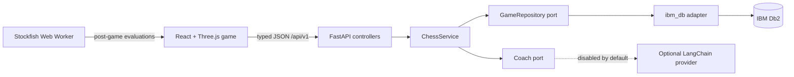

# Cinematic Chess + IBM Db2 architecture

## Scope and decisions

This TechX upgrade extends the existing React/Vite chess game; it does not replace the game loop, Three.js scene, chess.js rules, PGN tools, or browser Stockfish analysis. Persistence is a separate synchronous FastAPI service backed only by IBM Db2 through `ibm_db`. The submission is deliberately a single-user demo: there are no accounts, tenant boundaries, or multiplayer services.

## Container responsibilities

- **React/Vite frontend:** owns interactive gameplay, cinematic rendering, PGN import/export, local Stockfish post-game evaluation, Save Game, My Games, analytics, and all loading/empty/error presentation.
- **FastAPI controllers:** validate HTTP DTOs, expose structured errors, and delegate to the application service. Controllers do not contain SQL or chess policy.
- **`ChessService`:** coordinates PGN parsing, repository operations, aggregate analytics, and optional coaching.
- **Db2 repository:** translates application data to parameterized Db2 SQL and owns connection, transaction, rollback, and row mapping details.
- **Optional coaching adapter:** converts Db2-derived facts to a prompt and calls a configured LangChain provider. It is outside the persistence and ordinary-gameplay path.

## Authoritative and derived state

`CHESS_GAMES` is the authoritative saved-game record. The other rows are children or rebuildable projections of it.

| Db2 table | Responsibility |
|---|---|
| `CHESS_GAMES` | Client UUID, full PGN, canonical result, termination, human color/outcome, opening, time control, source, and timestamps. |
| `CHESS_MOVES` | Server-derived, ordered SAN/UCI/FEN rows keyed by game and ply. The backend parses the submitted PGN rather than trusting a client move list. |
| `CHESS_GAME_ANALYSIS` | Optional per-ply Stockfish result, including evaluated/timeout/error status, engine, depth, score, probability, and classification. |
| `CHESS_OPENING_STATISTICS` | Derived opening totals used for ranked opening queries. It is updated in the save transaction and can be rebuilt from `CHESS_GAMES`. |

The browser remains authoritative only for the active unsaved match. Once a save succeeds, Db2 is authoritative for My Games and aggregate analytics.

## Atomic and idempotent save

1. The frontend creates a UUID and submits PGN plus game metadata and any completed analysis.
2. FastAPI validates the DTO; `python-chess` parses PGN and derives ordered moves and player outcome.
3. The repository disables autocommit and writes the game, moves, analysis, and opening-statistics increment in one transaction.
4. Any failure rolls the whole transaction back.
5. Repeating the same UUID with the same normalized game returns the existing game with `created: false`; reusing it for different content returns `409 game_conflict`.

This makes a retry safe after a lost HTTP response and prevents opening statistics from being counted twice.

## HTTP contract

All routes are under `/api/v1`.

| Method and route | Contract |
|---|---|
| `GET /health` | Checks the real Db2 dependency. |
| `POST /games` | Atomically saves one game; `201` when created, `200` for an idempotent retry. |
| `GET /games?limit=&offset=` | Returns bounded, newest-first saved-game summaries. |
| `GET /games/{game_id}` | Returns PGN, moves, and analysis for review. |
| `GET /analytics/summary` | Queries totals and the most-played opening projection in Db2. |
| `POST /coaching` | Builds optional advice from Db2 statistics and an optional saved game. |

Errors use a stable JSON envelope: `{"error":{"code":"...","detail":"..."}}`. The frontend API adapter owns timeouts and translates transport failures into user-safe messages.

## Runtime and failure behavior

- **Backend unavailable:** local chess, Three.js rendering, PGN, and Stockfish analysis continue. Save/My Games/analytics show a retryable error rather than blocking gameplay.
- **Db2 unavailable:** health and data endpoints return a structured `503`; an in-flight save is rolled back. There is no SQLite or in-memory persistence fallback that could become a second source of truth.
- **Stockfish timeout/error:** the frontend may persist an explicit analysis status; it must not represent a timeout as a real zero evaluation.
- **Coaching disabled or provider unavailable:** only coaching returns a structured `503`. Games, persistence, and analytics require neither LangChain nor a paid key.
- **Duplicate save:** identical UUID and content is a successful idempotent read; conflicting content is rejected.
- **Opening projection drift:** `python -m backend.scripts.rebuild_opening_stats` rebuilds the projection from authoritative games.

## Security and trust boundaries

- The browser is untrusted input. Pydantic validates sizes and enums; `python-chess` validates PGN semantics.
- Values are sent through prepared parameterized SQL. The schema identifier is separately restricted to a valid Db2 identifier before interpolation.
- Db2 and LLM secrets exist only in backend environment variables. No secret may use a `VITE_` prefix because Vite embeds those values in browser assets.
- CORS is an origin control, not authentication. The single-user demo must not be presented as a private multi-user service.
- The optional coaching call is an outbound data boundary. It receives chess statistics and selected-game facts, not Db2 credentials.

## Verification boundary

The following checks do not require a Db2 instance: TypeScript build, frontend unit tests, deterministic browser smoke, backend service/controller tests with fakes, and schema/parser tests.

A live IBM Db2 instance is still required to verify `ibm_db` connectivity, schema creation, Db2 SQL syntax, CLOB round trips, constraints, transaction rollback, idempotent persistence, real analytics queries, and the HTTP demo. Live integration tests are gated by `DB2_TEST_DSN` and must use a disposable test schema; they never substitute SQLite.
