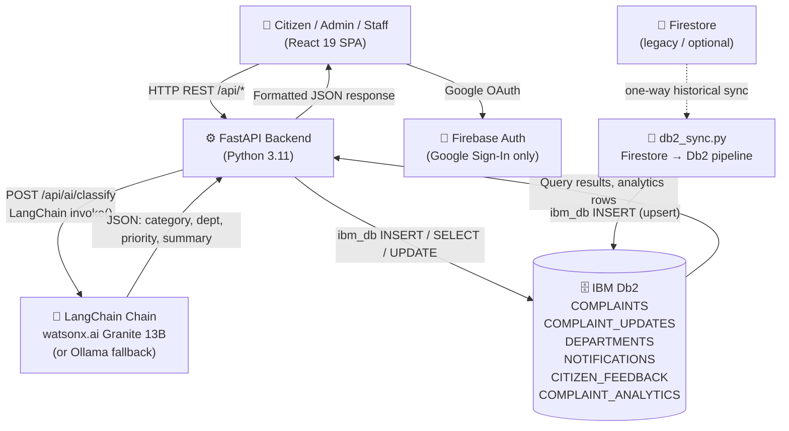

# CivicConnect – System Architecture

## Overview

CivicConnect is a three-tier application: a **React 19 SPA** as the client layer, a **FastAPI + Python backend** as the application server (integrating IBM Db2 via `ibm_db` and LangChain for AI classification), and **IBM Db2** as the persistent data store for all complaints, audit logs, departments, notifications, and analytics.

A Firebase Authentication service handles identity (Google Sign-In), but IBM Db2 — not Firestore — is the source of truth for all complaint and analytics data.

---

## Architecture Diagram



---

## Component Breakdown

### 1. Client Layer — React SPA

- **Framework:** React 19 with TypeScript, TailwindCSS, Vite
- **Role-Based Views:** Three portals — Citizen, Staff (per-department), Admin
- **Complaint Form:** Pre-fills category, department, and priority using the AI classification API before the citizen submits
- **Analytics Dashboard:** Recharts visualisations driven by `/api/analytics/*` endpoints backed by Db2 aggregation queries
- **Demo Mode:** Three demo persona logins (citizen / admin / staff) with no sign-up required for evaluators

### 2. Application Backend — FastAPI

| Endpoint | Method | Description |
|---|---|---|
| `/api/health` | GET | Liveness check |
| `/api/ai/classify` | POST | LangChain AI classification |
| `/api/departments` | GET | Fetch active departments from Db2 |
| `/api/complaints` | POST | Persist new complaint to Db2 |
| `/api/complaints` | GET | List all complaints from Db2 |
| `/api/complaints/{id}/status` | PATCH | Update status + write audit row |
| `/api/analytics/categories` | GET | Category-level Db2 aggregations |
| `/api/analytics/departments` | GET | Department workload from Db2 |

### 3. Database Layer — IBM Db2

Six tables in the `CIVICCONNECT` schema:

| Table | Purpose |
|---|---|
| `DEPARTMENTS` | Master list of 6 municipal departments (seeded on startup) |
| `COMPLAINTS` | All civic complaints with CLOB descriptions and AI metadata |
| `COMPLAINT_UPDATES` | Immutable audit trail — one row per status change |
| `NOTIFICATIONS` | In-app alert messages per user |
| `CITIZEN_FEEDBACK` | Post-resolution satisfaction ratings (1–5 stars) |
| `COMPLAINT_ANALYTICS` | Scheduled aggregation snapshots for trend charts |

Key design choices:
- `COMPLAINT_ID` uses a human-readable format `CCMS-YYYY-NNNN` (unique constraint)
- `DESCRIPTION` and `AI_SUMMARY` use `CLOB` for variable-length civic text
- `COMPLAINT_UPDATES` is insert-only — no UPDATE or DELETE is permitted, preserving audit integrity
- `RESOLVED_AT` is only populated when `STATUS = 'Resolved'`, enabling accurate resolution-time analytics via `TIMESTAMPDIFF`

### 4. AI / Model Orchestration Layer — LangChain

```text
Complaint text (title + description)
        ↓
ChatPromptTemplate (system: civic classification task + 7 categories)
        ↓
WatsonxLLM (ibm/granite-13b-instruct-v2)   ← primary
   OR ChatOllama (granite3.3:8b)             ← offline fallback
   OR _heuristic_classify()                  ← zero-LLM fallback
        ↓
JsonOutputParser → validated dict
        ↓
{ category, department, priority, keywords, summary }
        ↓
ibm_db INSERT into CIVICCONNECT.COMPLAINTS (AI_SUMMARY, AI_KEYWORDS columns)
```

The LangChain prompt is deliberately constrained: the system message lists all exact category strings and priority levels so the model output maps directly to Db2 column values without post-processing ambiguity.

---

## Data Flow

1. **Citizen submits complaint** → React calls `POST /api/ai/classify` with title + description.
2. **LangChain classifies** → Returns category, department assignment, priority, and a one-paragraph administrative summary.
3. **Citizen confirms** → React pre-fills the form; citizen can override any AI suggestion before final submit.
4. **Complaint persisted** → `POST /api/complaints` → FastAPI calls `ibm_db INSERT INTO CIVICCONNECT.COMPLAINTS`.
5. **Audit record written** → Same connection writes to `COMPLAINT_UPDATES` with initial status `Submitted`.
6. **Staff reviews** → Staff dashboard queries Db2 for their department's open complaints.
7. **Status updated** → `PATCH /api/complaints/{id}/status` → Db2 `UPDATE COMPLAINTS` + `INSERT COMPLAINT_UPDATES`.
8. **Admin analytics** → `GET /api/analytics/categories` → Db2 `SELECT CATEGORY, COUNT(*), AVG(TIMESTAMPDIFF(…))`.

---

## IBM Db2 Schema & Storage Design

```sql
-- Schema namespace
CREATE SCHEMA CIVICCONNECT;

-- Core complaint store
CREATE TABLE CIVICCONNECT.COMPLAINTS (
    ID               VARCHAR(128)  NOT NULL,
    COMPLAINT_ID     VARCHAR(64)   NOT NULL UNIQUE,
    USER_ID          VARCHAR(128)  NOT NULL,
    CITIZEN_NAME     VARCHAR(100),
    CITIZEN_EMAIL    VARCHAR(150),
    TITLE            VARCHAR(200)  NOT NULL,
    DESCRIPTION      CLOB(32K),
    CATEGORY         VARCHAR(100),
    DEPARTMENT_ID    VARCHAR(64),
    DEPARTMENT_NAME  VARCHAR(100),
    LOCATION         VARCHAR(255)  NOT NULL,
    LANDMARK         VARCHAR(255),
    IMAGE_URL        VARCHAR(1000),
    PRIORITY         VARCHAR(20)   NOT NULL DEFAULT 'medium',
    STATUS           VARCHAR(50)   NOT NULL DEFAULT 'Submitted',
    AI_SUMMARY       CLOB(8K),
    AI_KEYWORDS      VARCHAR(500),
    REJECTION_REASON VARCHAR(1000),
    REOPEN_REASON    VARCHAR(1000),
    RESOLUTION_NOTES CLOB(8K),
    CREATED_AT       TIMESTAMP     NOT NULL DEFAULT CURRENT_TIMESTAMP,
    UPDATED_AT       TIMESTAMP     NOT NULL DEFAULT CURRENT_TIMESTAMP,
    RESOLVED_AT      TIMESTAMP,
    PRIMARY KEY (ID)
);

-- Immutable audit trail
CREATE TABLE CIVICCONNECT.COMPLAINT_UPDATES (
    ID               VARCHAR(128)  NOT NULL PRIMARY KEY,
    COMPLAINT_ID     VARCHAR(64)   NOT NULL,
    PREVIOUS_STATUS  VARCHAR(50),
    NEW_STATUS       VARCHAR(50)   NOT NULL,
    UPDATED_BY       VARCHAR(100),
    UPDATED_BY_UID   VARCHAR(128),
    ROLE             VARCHAR(50),
    NOTE             CLOB(4K),
    CREATED_AT       TIMESTAMP     NOT NULL DEFAULT CURRENT_TIMESTAMP
);

-- Key analytics query used by the Admin Dashboard
SELECT
    CATEGORY,
    COUNT(*)                                                     AS TOTAL,
    SUM(CASE WHEN STATUS = 'Resolved'  THEN 1 ELSE 0 END)       AS RESOLVED,
    SUM(CASE WHEN STATUS != 'Resolved' THEN 1 ELSE 0 END)       AS PENDING,
    AVG(CASE
        WHEN RESOLVED_AT IS NOT NULL
        THEN TIMESTAMPDIFF(8, CHAR(RESOLVED_AT - CREATED_AT))
        ELSE NULL END)                                           AS AVG_RESOLUTION_HRS
FROM CIVICCONNECT.COMPLAINTS
GROUP BY CATEGORY
ORDER BY TOTAL DESC;
```

---

## Security & Secrets Management

- All IBM Db2 credentials (`DB2_HOST`, `DB2_USER`, `DB2_PASSWORD`) and `WATSONX_API_KEY` are read at runtime from environment variables via `python-dotenv`.
- `.env` is listed in `.gitignore`; only `.env.example` with placeholder values is committed.
- Firebase API keys in the React app are restricted to the project's domain via Firebase Console app restrictions.
- No real passwords, API keys, or connection strings appear anywhere in this repository.
