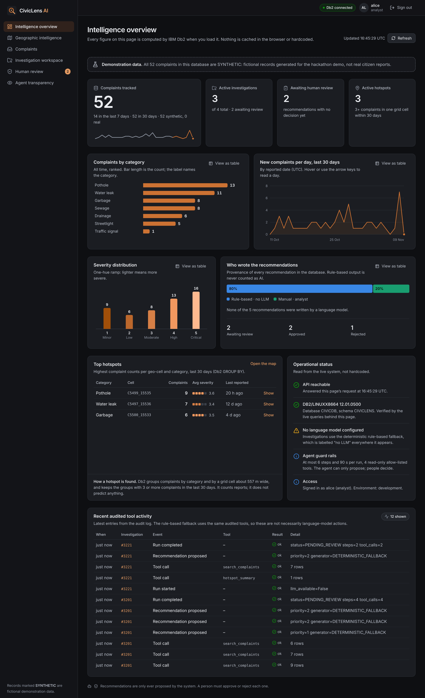
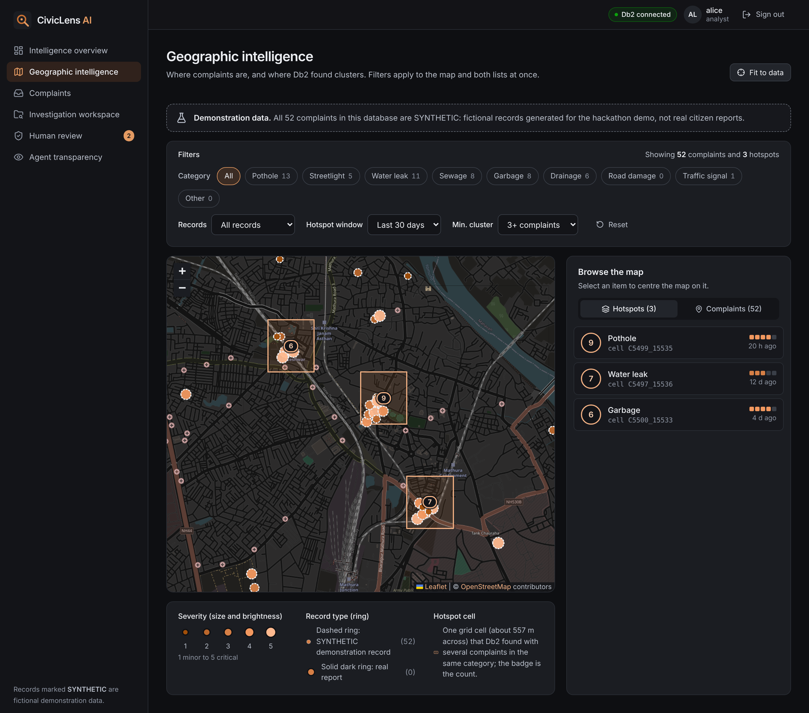
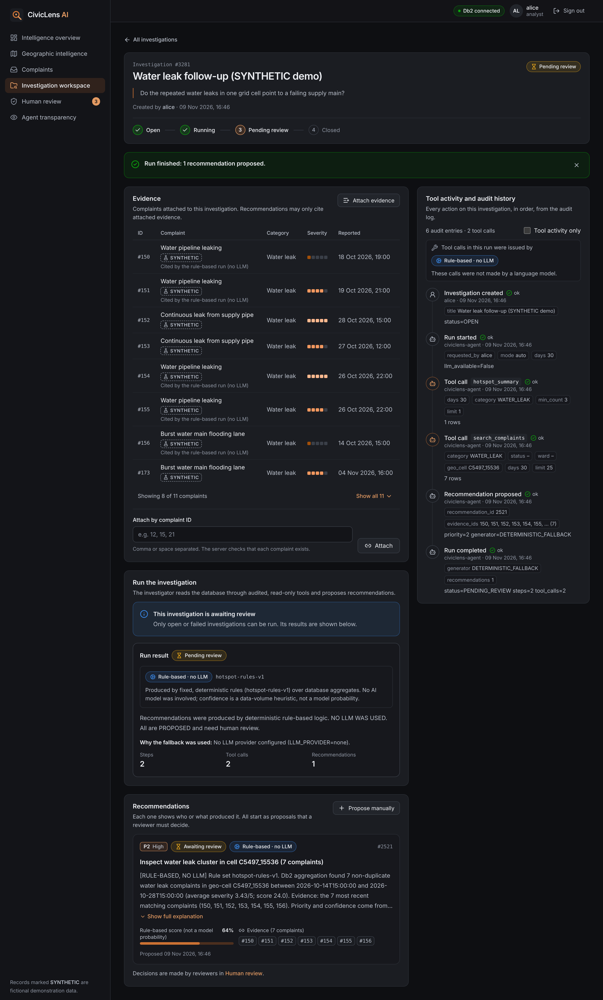
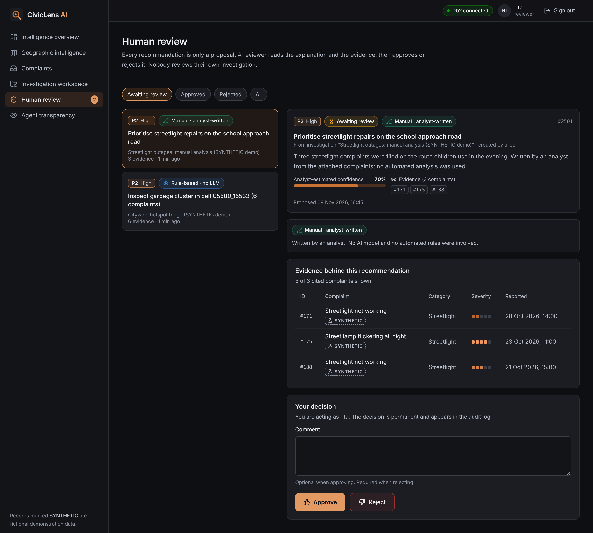
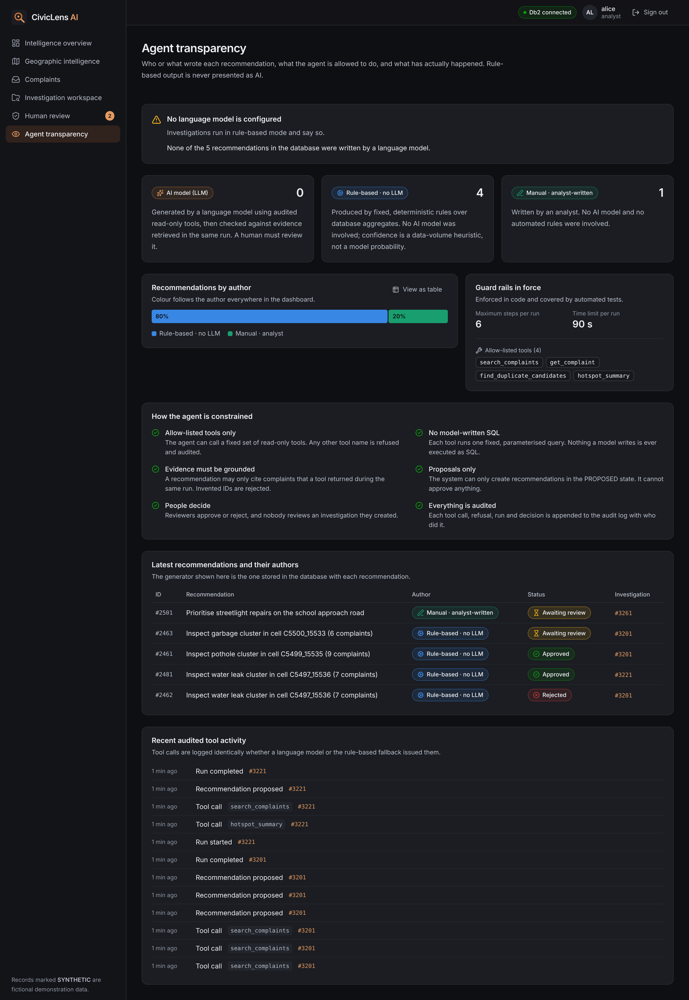
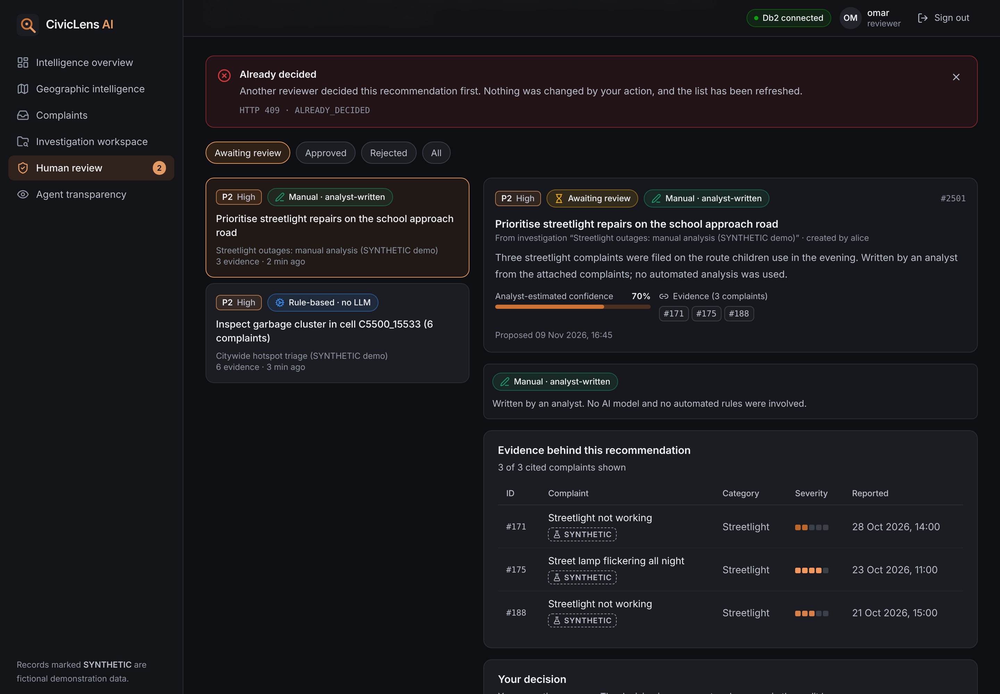

# CivicLens AI

> **One-line pitch:** An agentic investigation platform for city infrastructure complaints. IBM Db2 stores every complaint, finds duplicates with in-database geo-distance queries, identifies hotspots, and keeps an auditable record of every AI tool call and human decision.

> **Status: Phase 02, ready to submit** (see [`docs/PHASE_02_RELEASE_REPORT.md`](docs/PHASE_02_RELEASE_REPORT.md)). On top of the verified IBM Db2 + FastAPI backend there is now a React/TypeScript **intelligence dashboard**: overview, map (Leaflet + OpenStreetMap), complaint browser, investigation workspace, authenticated human review and an agent-transparency page. It was driven end to end in a real browser against the real backend and IBM Db2 (see [Testing](#testing--verification) and the [screenshots](docs/screenshots/README.md)). **The LLM path has still not been run against a real hosted model** (no provider credentials exist in this environment; verification is **BLOCKED**), so every recommendation is labelled `DETERMINISTIC_FALLBACK` or `MANUAL`, and the UI says "Rule-based · no LLM" wherever that is the case. See [`docs/PHASE_01B_REPORT.md`](docs/PHASE_01B_REPORT.md), [`docs/PHASE_01A_REPORT.md`](docs/PHASE_01A_REPORT.md) and [`docs/PHASE_00_REPORT.md`](docs/PHASE_00_REPORT.md).

---

## Table of Contents
- [Problem Statement](#problem-statement)
- [Solution Overview](#solution-overview)
- [IBM Db2 Integration](#ibm-db2-integration)
- [AI / LLM Architecture](#ai--llm-architecture)
- [Tech Stack](#tech-stack)
- [Prerequisites](#prerequisites)
- [Setup & Installation](#setup--installation)
- [Configuration](#configuration)
- [Running the Project](#running-the-project)
- [Testing & Verification](#testing--verification)
- [Screenshots & Demo](#screenshots--demo)
- [Known Limitations & Future Roadmap](#known-limitations--future-roadmap)
- [Team Members & Credits](#team-members--credits)

---

## Problem Statement
- Municipal bodies receive large numbers of complaints about potholes, broken streetlights, water leaks, garbage and drainage. Many are **duplicates** of the same underlying fault, and the patterns, such as clusters in one neighbourhood or failures that recur after repairs, are hard to see one ticket at a time.
- **Target users:** municipal engineers, ward officers, and civic analysts who must decide where to send crews.
- **Gap:** ticketing tools track individual complaints but rarely explain *why* something should be prioritised, and AI assistants that write their own SQL against production data are hard to trust and to audit.

## Solution Overview
CivicLens AI combines a relational system of record in IBM Db2 with an AI investigator that can only use **audited, allow-listed tools**:

| Capability | Status |
|---|---|
| Complaint ingestion API with validation (analyst-only since Phase 01B) | ✅ Implemented, verified on Db2 |
| IBM Db2 schema, migrations, parameterized data access | ✅ Implemented, verified on Db2 |
| Duplicate detection (Db2 haversine distance + time window + text similarity) | ✅ Implemented, verified on Db2 |
| Geo-temporal hotspot analysis (Db2 `GROUP BY` geo-cell × category) | ✅ Implemented, verified on Db2 |
| Investigation audit log + read API | ✅ Verified on Db2 |
| Secure LangChain tools | ✅ 4 read-only tools, verified on Db2 |
| Investigation API (create / get / evidence / audit / recommendations) | ✅ Verified on Db2 over HTTP |
| Evidence-grounded recommendations (always `PROPOSED`) | ✅ Verified; fabricated ids rejected by the app **and** by Db2 constraints |
| Human review: approve / reject, atomic, no double decisions, self-review blocked | ✅ Verified on Db2 incl. a concurrency test |
| Bounded LangChain agent (allow-list, step limit, timeout) | ✅ Loop verified with a scripted test double; ⚠️ **not yet run against a real LLM provider** |
| Rule-based fallback (labelled "NO LLM") | ✅ Verified on Db2 |
| Interactive dashboard: overview, map, complaints, investigation workspace, human review, agent transparency (React/TypeScript/Vite/Tailwind) | ✅ Built and exercised in a real browser against the real backend and Db2 |
| Honest provenance: every recommendation shows its stored generator (LLM / rule-based / manual) | ✅ One wording function, unit-tested; rule-based output is never presented as AI |
| Playwright end-to-end tests (production build, real backend + Db2, axe-core accessibility, responsive checks) | ✅ 63 tests passing |
| Real hosted-LLM run | ⛔ **BLOCKED**: no provider credentials in this environment |

## IBM Db2 Integration
- **Db2 edition and environment:** IBM Db2 Community Edition **12.1.5** in Docker (`icr.io/db2_community/db2`). The same code supports Db2 on Cloud over TLS (`DB2_SECURITY=SSL`); this has not yet been verified against a cloud instance.
- **Connector:** native `ibm_db` 3.3.0 driver, using `prepare` / `execute` with bound parameters only.
- **Schema (`CIVICLENS`):** `COMPLAINTS`, `INVESTIGATIONS`, `INVESTIGATION_EVIDENCE`, `RECOMMENDATIONS`, `REVIEW_DECISIONS`, `AUDIT_LOG`, with CHECK and foreign-key constraints and 5 secondary indexes. DDL: [`src/backend/civiclens/db/schema.sql`](src/backend/civiclens/db/schema.sql).
- **Key operations:**
  - `SELECT … FROM FINAL TABLE (INSERT …)` returns identity keys in a single round-trip.
  - The great-circle (haversine) distance is computed **inside Db2** using `RADIANS`/`SIN`/`COS`/`ASIN`, after a bounding-box filter on the indexed coordinates.
  - Hotspots: `GROUP BY GEO_CELL, CATEGORY HAVING COUNT(*) >= ?` over a time window.
  - Multi-statement writes run in explicit transactions (commit and rollback are both tested).
  - Idempotent migrations check `SYSCAT.SCHEMATA`, `SYSCAT.TABLES` and `SYSCAT.INDEXES` before each `CREATE`.

## AI / LLM Architecture
- **Framework:** LangChain (`langchain-core` `StructuredTool`).
- **Tools (Phase 00, read-only):** `search_complaints`, `get_complaint`, `find_duplicate_candidates`, `hotspot_summary`.
- **Security model:** the LLM never writes SQL. Each tool maps to one fixed, parameterized query. Arguments are validated by Pydantic with hard bounds, and every call (including failures) is written to `AUDIT_LOG` with the investigation id. Future write tools may only create `PROPOSED` recommendations; approval is always a human action.
- **Model provider:** to be selected in Phase 01 (IBM watsonx.ai Granite preferred). No model is called in Phase 00.

## Tech Stack
- **Backend:** Python 3.11+ (verified on 3.13), FastAPI, Pydantic v2, Uvicorn
- **Database:** IBM Db2 (`ibm_db`)
- **AI:** LangChain (`langchain-core`)
- **Frontend:** React 19, TypeScript, Vite, Tailwind CSS v4, TanStack Query, zod (runtime response validation), Leaflet + OpenStreetMap, hand-built SVG charts
- **Quality:** Pytest, Ruff, ESLint, Vitest + React Testing Library + MSW, Playwright + axe-core

## Prerequisites
- Python ≥ 3.11 and `pip`
- Node.js ≥ 22 and `npm` (for the dashboard)
- Docker, with about 4 GB of RAM free, for local Db2 Community Edition. Alternatively, access to an existing Db2 instance.
- Linux/macOS x86_64 or arm64, or Windows. The `ibm_db` wheel bundles the Db2 CLI driver (about 137 MB).

## Setup & Installation
```bash
cd submissions/civiclens-ai
python -m venv ~/.venvs/civiclens    # keep the virtualenv OUTSIDE this folder (see the note under Configuration)
source ~/.venvs/civiclens/bin/activate   # Windows: %USERPROFILE%\.venvs\civiclens\Scripts\activate
pip install -r src/backend/requirements-dev.txt
(cd src/frontend && npm ci)          # dashboard dependencies
```

## Configuration
```bash
cp .env.example .env                 # then set DB2_PASSWORD to a strong local password
```
`.env` is gitignored. Every setting can also be supplied as a process environment variable, or via `CIVICLENS_ENV_FILE=/path/to/file`.

> **Note:** the official `scripts/validate_submission.py` walks the whole submission folder, even untracked files, and fails if it finds a file named `.env` or any `*.pem`, `*.key`, `*.pfx` or `*.p12` file, **including inside a virtualenv** (`certifi/cacert.pem`) or `node_modules`. That is why the virtualenv above lives outside the folder. Before running the validator, also move your secrets file out (`CIVICLENS_ENV_FILE`) or delete it. CI validates a clean checkout, so it is not affected.

> **Security warning:** never commit `.env`, real passwords or API keys.

## Running the Project
```bash
# 1. Start Db2 Community Edition (first start takes ~3–5 minutes)
docker compose -f docker-compose.db2.yml up -d
docker logs -f civiclens-db2         # wait for "(*) Setup has completed."

# 2. Create the schema (idempotent; also upgrades a Phase 00 database) and load the SYNTHETIC demo dataset
python src/backend/scripts/db2_migrate.py
python src/backend/scripts/seed_synthetic.py

# 3. Run the API (needs CIVICLENS_AUTH_TOKENS in .env for the investigation endpoints)
cd src/backend && uvicorn civiclens.api.main:app --port 8000
# OpenAPI docs: http://localhost:8000/docs

# 4. Drive the full workflow over HTTP (prints a transcript; never prints tokens)
python scripts/api_workflow_demo.py

# 5. (optional) create a believable demo workflow THROUGH the real API: investigations in every state,
#    rule-based and manual recommendations, decisions by two reviewers. Everything is labelled SYNTHETIC.
python scripts/seed_demo_workflow.py
```

### Running the dashboard
```bash
cd src/frontend
npm run dev                  # http://127.0.0.1:5173, /api is proxied to http://127.0.0.1:8000
# or a production-like run:
npm run build && npm run verify:bundle && npm run preview     # http://127.0.0.1:4173
```
Open the app and sign in with a token from `CIVICLENS_AUTH_TOKENS` (an `analyst` token creates investigations; a `reviewer` token decides recommendations; nobody reviews their own investigation). Tokens are entered in the browser, kept for that tab only and sent only to the API; no token is in any committed file or in the built bundle. See [`src/frontend/README.md`](src/frontend/README.md) for configuration (`VITE_API_BASE_URL`, `CORS_ORIGINS`), the test commands and the design notes.

### Choosing the investigator: real LLM or rule-based fallback
* `LLM_PROVIDER=none` (default): `mode=auto` uses the **rule-based fallback**. Every result says `generator: DETERMINISTIC_FALLBACK` and `NO LLM WAS USED`; `mode=llm` returns `409 LLM_NOT_CONFIGURED` instead of silently falling back.
* To use a real model: `pip install -r src/backend/requirements-llm.txt`, then set `LLM_PROVIDER` (`openai`, `anthropic` or `watsonx`), `LLM_MODEL` and the provider credentials in `.env`. Recommendations are then stored with `generator_type = LLM` and `model_name = provider:model`.
* In `auto` mode, if the LLM run fails (invalid output, ungrounded evidence, a timeout, or the provider itself failing: wrong key, unknown model, rate limit, network), the labelled fallback is used and `fallback_reason` says why (only the exception class is recorded, never the provider's message). `mode=llm` reports a 502 instead and the investigation can be retried.
* **Readiness check without cost or network:** `python src/backend/scripts/llm_preflight.py` says whether a real provider *could* run (provider, model, credentials by name, package installed). It never contacts a provider; exit code 2 means BLOCKED.

| Endpoint | Description |
|---|---|
| `GET /api/health` | Liveness only: `{"status":"ok"}` (no database access, no version or environment details) |
| `GET /api/health/db` | Readiness: runs a real query against Db2; returns only `{"status":"ok"}` (failure is a generic `503`) |
| `GET /api/me` | any user · the caller's id, role and capabilities (used by the UI to decide which controls to show) |
| `GET /api/overview` | any user · every dashboard aggregate, computed in Db2 per request (counts, trends, provenance split, hotspot total, agent activity, system status) |
| `POST /api/complaints` | **analyst** · validates and stores a complaint, then returns duplicate candidates (public in Phase 00; protected in Phase 01B) |
| `GET /api/complaints` | Lists complaints, filtered by `category`, `status`, `ward`, `synthetic` and `limit` |
| `GET /api/complaints/{id}` | Returns one complaint |
| `GET /api/hotspots` | Geo-cell × category hotspots, filtered by `days`, `category`, `min_count` and `limit` |
| `POST /api/investigations` | **analyst** · create an investigation |
| `GET /api/investigations`, `GET /api/investigations/{id}` | any user · list / retrieve |
| `GET /api/investigations/{id}/evidence` · `POST …/evidence` | any user read · **analyst** attach existing complaints |
| `GET /api/investigations/{id}/audit` | any user · full audit history |
| `GET /api/investigations/{id}/recommendations` · `POST …/recommendations` | any user read · **analyst** manual proposal |
| `POST /api/investigations/{id}/run` | **analyst** · run the agent (`mode`: `auto` \| `llm` \| `fallback`) |
| `GET /api/recommendations` | any user · the review queue across investigations (`status`, `limit`), each item with its stored generator |
| `POST /api/recommendations/{id}/decision` | **reviewer** · `APPROVED` / `REJECTED` (reviewer = authenticated user) |

Authentication is a static bearer token per user (`Authorization: Bearer …`) configured through `CIVICLENS_AUTH_TOKENS`. The Phase 00 **read** endpoints for complaints and hotspots remain public (a documented gap to close before any public deployment, together with rate limiting and real identity). Set `APP_ENV=production` to stop serving `/docs` and `/openapi.json`. See [`architecture.md`](architecture.md#authentication--authorization).

## Testing & Verification
```bash
# backend
pytest                                        # unit tests (no database needed)
CIVICLENS_DB2_TESTS=1 pytest                  # + live Db2 integration tests (needs the .env settings exported)
CIVICLENS_LLM_TESTS=1 CIVICLENS_DB2_TESTS=1 pytest -m llm   # billable real-LLM test (opt-in)
python src/backend/scripts/check_secrets.py --literal-from-env   # committed-secret scan
python src/backend/scripts/db2_smoke_test.py  # end-to-end Db2 evidence → docs/evidence/
ruff check . && ruff format --check .

# frontend (cd src/frontend)
npm run typecheck && npm run lint
npm test                                      # Vitest: components, views, API client, auth, charts, security rules
CIVICLENS_LIVE_API=http://127.0.0.1:8000 npm run test:live   # the real TS client against the real API + Db2
npm run build && npm run verify:bundle        # production build + "no secret or DB identifier in the bundle"
npm run e2e                                   # Playwright on the production build, real backend + Db2, axe-core, responsive
npm run screenshots                           # regenerate docs/screenshots from the running app

# official validator: run from submissions/civiclens-ai inside a checkout of the official repository
python ../../scripts/validate_submission.py .
```
The integration and end-to-end tests use **no mocks** for Db2: they insert, query, aggregate, roll back and audit against the configured Db2 server, and the browser tests drive the production build against the real API. Recorded output from real runs is in [`docs/evidence/`](docs/evidence/): backend `pytest` against live Db2 (149 passed, 1 skipped: the real-LLM test), the live API contract test (8 passed), the Playwright run (63 passed) and the component tests (245 passed). The real-LLM run is **BLOCKED** (no credentials); see [`docs/evidence/llm_verification.txt`](docs/evidence/llm_verification.txt).

## Screenshots & Demo
- **Live demo:** not deployed yet. Public deployment needs approval, a hosted Db2 instance and the hardening listed under *Known Limitations*.
- **Demo video:** [`docs/demo/civiclens-demo.mp4`](docs/demo/civiclens-demo.mp4): a silent, captioned screen recording (3 min 46 s) of the real app, signed in off camera so no credential is ever on screen. It covers the problem, the Db2 architecture, hotspot detection, an investigation, provenance, human review with its audit trail, and the real-LLM versus fallback distinction. Narration script and talking points: [`docs/DEMO.md`](docs/DEMO.md). No language model was used for anything in it.
- **Screenshots:** 28 genuine captures from the running app (production build, real backend, real Db2, real OpenStreetMap tiles; synthetic data, labelled) are indexed in [`docs/screenshots/README.md`](docs/screenshots/README.md). A few of them:

| | |
|---|---|
|  |  |
| *Intelligence overview: every figure is a Db2 aggregate* | *Geographic intelligence: OSM basemap, synthetic markers, hotspot cells* |
|  |  |
| *Workspace: the run says it was rule-based and why; audited tool calls; recommendations* | *Human review: provenance, evidence and the decision controls* |
|  |  |
| *Agent transparency: no LLM configured, so nothing is called AI* | *A real 409: another reviewer decided first; nothing changed* |

- **Recorded evidence:** [`docs/evidence/`](docs/evidence/) (Db2 smoke test, `pytest` against live Db2, API contract test, Playwright results, component tests, bundle scan, palette validation, LLM verification status, dependency audit, endpoint authorization matrix, backend coverage and a from-scratch dry run of the submission procedure).

## Known Limitations & Future Roadmap
- **Synthetic data:** all demo complaints are fictional, generated by `scripts/generate_synthetic.py`, and stored with `IS_SYNTHETIC = 1` and the `[SYNTHETIC]` marker.
- **Not implemented:** rate limiting, per-user token management / OIDC, protection of the Phase 00 read endpoints (`GET /api/complaints`, `/api/hotspots` are public), hosted deployment, and the real-LLM run (**BLOCKED**: the loop is verified with a scripted test double, never with a real provider). Tokens are static. Do not expose this build publicly before closing those gaps.
- **Dashboard:** dark theme only; no forced-colors / texture fallback for the charts; OpenStreetMap's public tile server is fine for a demo but not for production traffic.
- **Duplicate text similarity** uses token Jaccard similarity. Phase 02 may add embeddings stored in Db2 (`VECTOR` type), after verifying feature support on the target edition.
- See [`docs/PHASE_02_RELEASE_REPORT.md`](docs/PHASE_02_RELEASE_REPORT.md) for the release audit: what is verified, the security findings (including the open ones), the real-LLM status and the submission steps. See [`docs/PHASE_01B_REPORT.md`](docs/PHASE_01B_REPORT.md) for the Phase 01B findings, blockers and the remaining submission requirements, and [`docs/PHASE_00_REPORT.md`](docs/PHASE_00_REPORT.md) for the original plan.

## Team Members & Credits
| Name | GitHub Handle | Role / Contribution |
|---|---|---|
| Tej Sagar | [@tej-1916](https://github.com/tej-1916) | Lead developer: Db2 integration, backend, investigation agent, dashboard |

**Project license:** MIT. See [`LICENSE`](LICENSE). All demonstration complaint data is synthetic.

Third-party software (backend): FastAPI (MIT), Pydantic (MIT), LangChain (MIT), Uvicorn (BSD-3), `ibm_db` (Apache-2.0), IBM Db2 Community Edition (IBM license, accepted at container start).

Third-party software (dashboard; licences read from each package's own `package.json`): React, React DOM, React Router, TanStack Query, zod, Tailwind CSS, Vite, Vitest, MSW and Testing Library (MIT); Leaflet (BSD-2-Clause); lucide-react icons (ISC); Inter variable font via Fontsource (SIL OFL-1.1); TypeScript and Playwright (Apache-2.0); `@axe-core/playwright` (MPL-2.0, test-only). Map data © OpenStreetMap contributors (ODbL), shown with attribution on the map; tiles are loaded from the public OpenStreetMap tile server.
