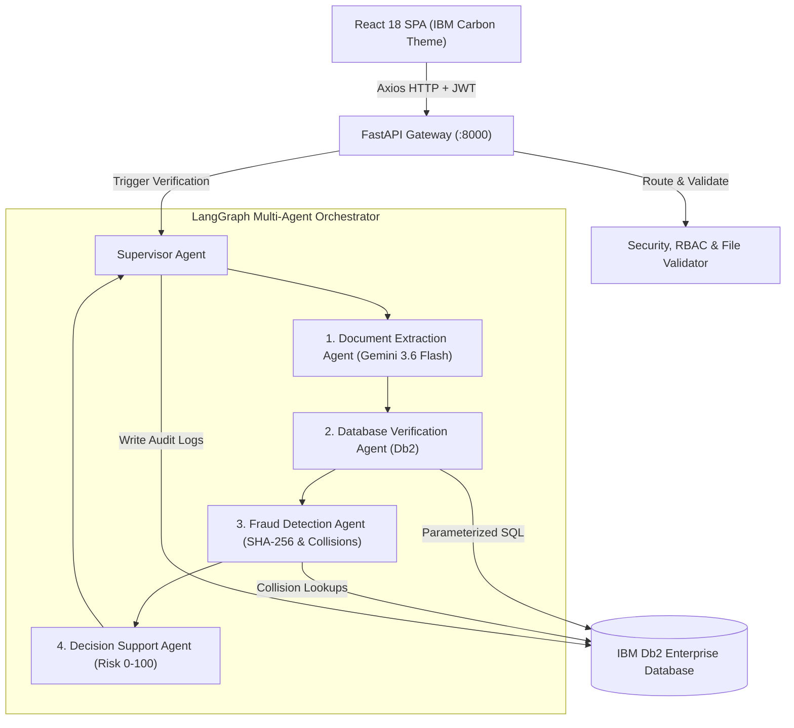
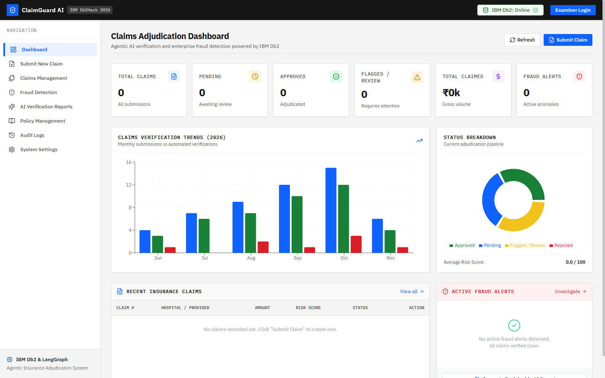
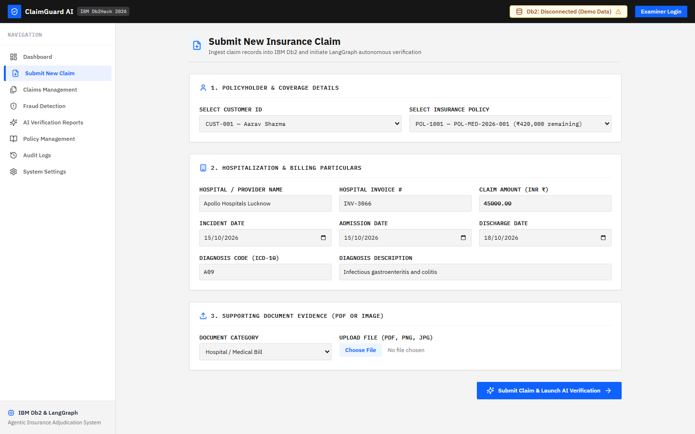
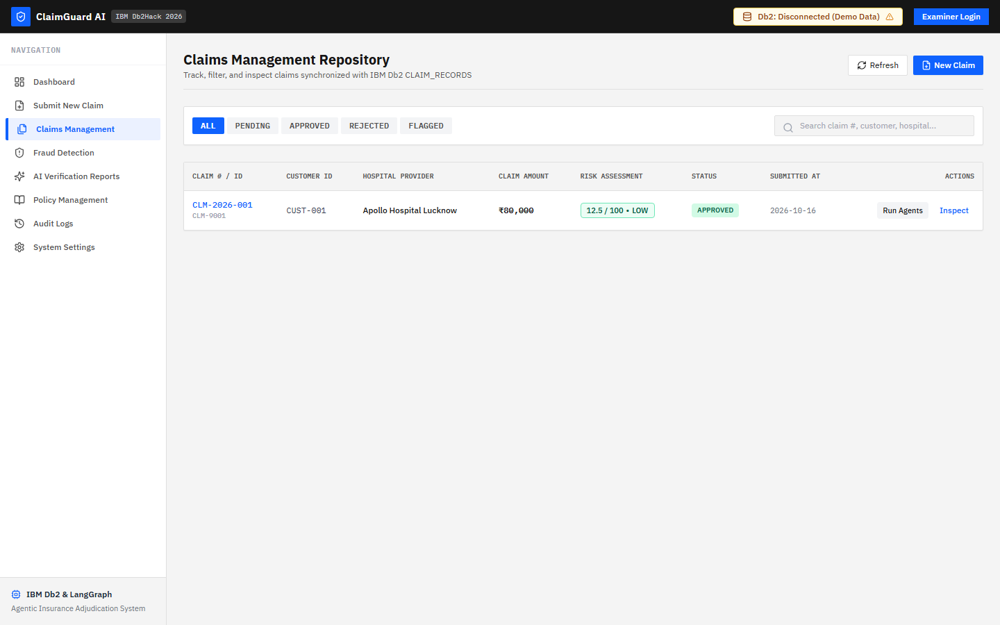
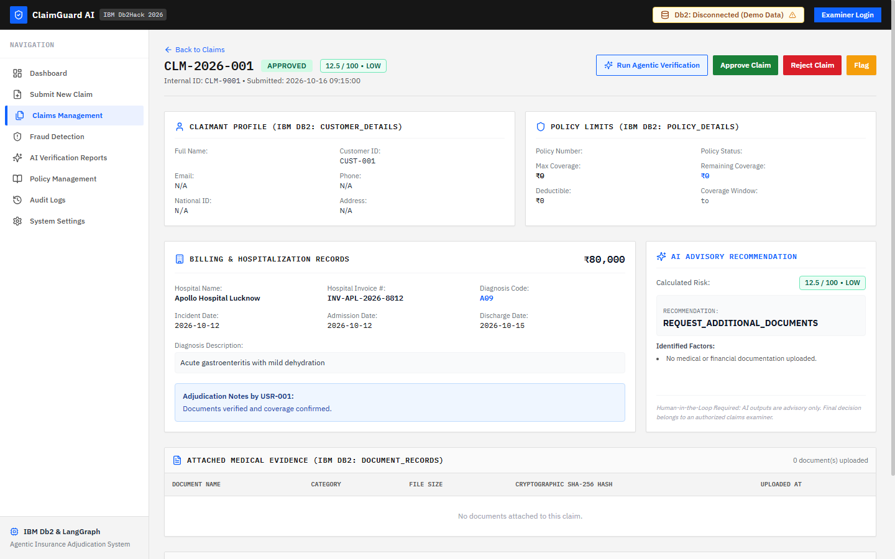
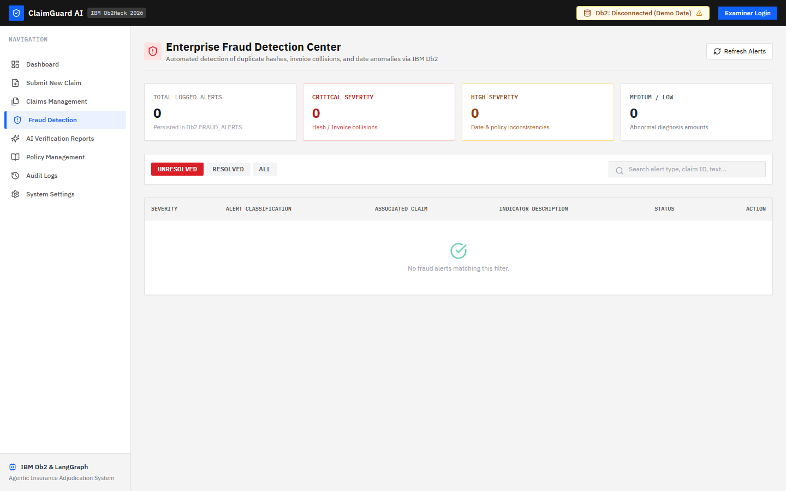
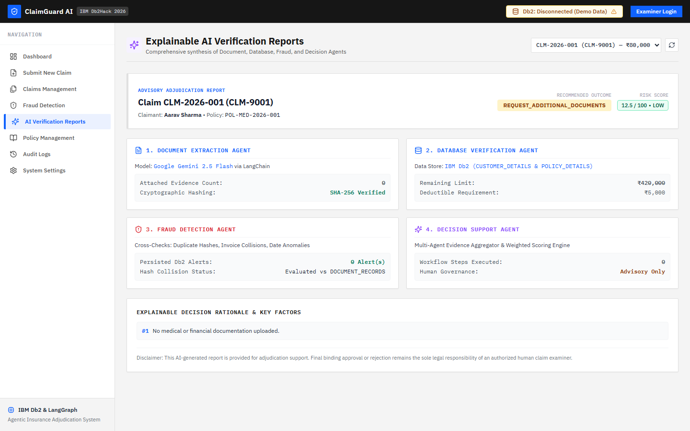
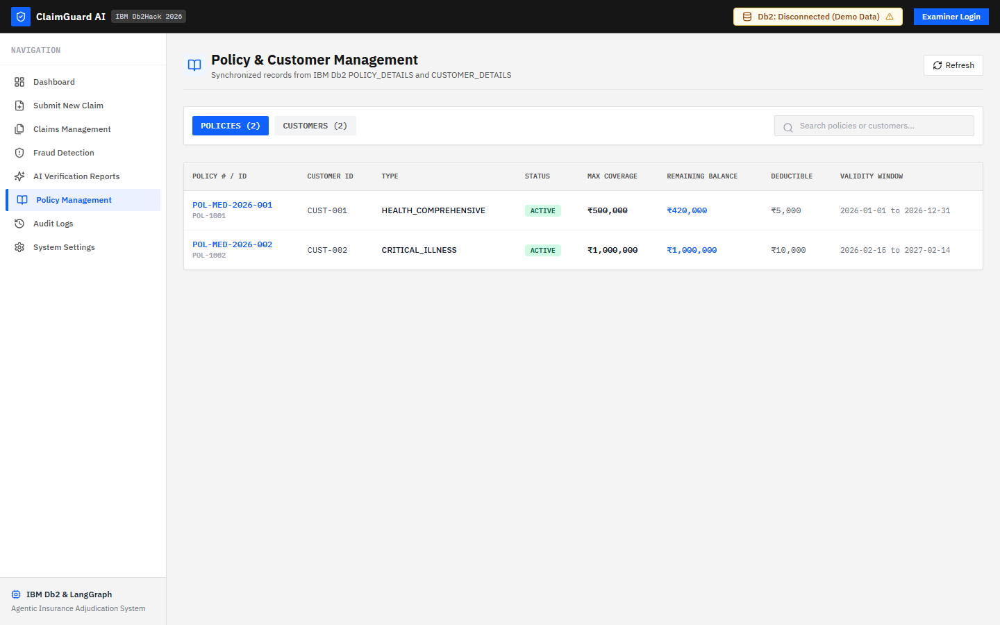
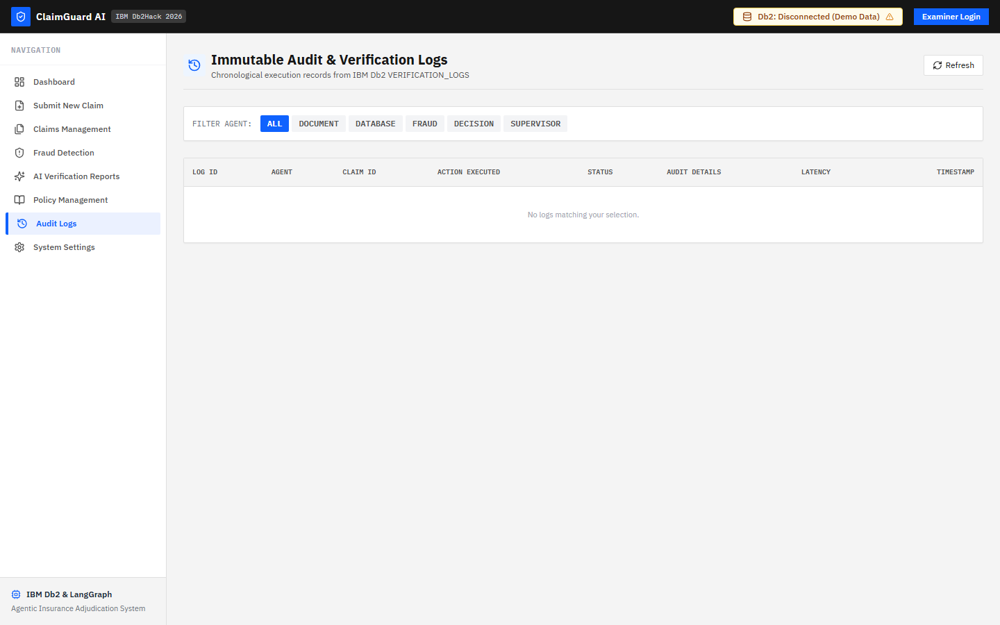
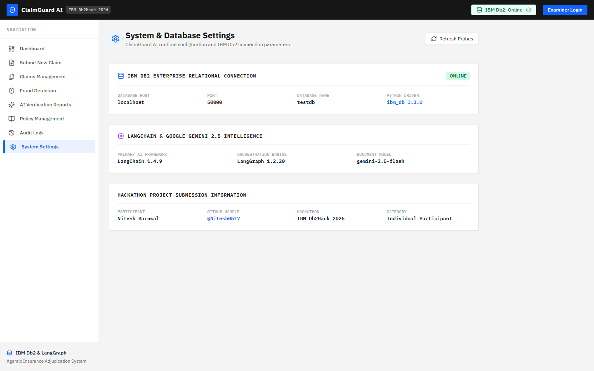

# ClaimGuard AI

> **One-Line Pitch:** Agentic Intelligence for Smarter Insurance Claim Verification and Fraud Detection, powered by IBM Db2, LangChain, and Google Gemini.

[](https://www.ibm.com/products/db2)
[](https://www.langchain.com/)
[](https://ai.google.dev/)
[](https://fastapi.tiangolo.com/)
[](https://react.dev/)
[](#testing--verification)

---

## Table of Contents
1. [Project Introduction](#1-project-introduction)
2. [Problem Statement](#2-problem-statement)
3. [Proposed Solution](#3-proposed-solution)
4. [Key Features](#4-key-features)
5. [Technology Stack](#5-technology-stack)
6. [System Architecture](#6-system-architecture)
7. [Agentic AI Workflow (LangGraph)](#7-agentic-ai-workflow-langgraph)
8. [IBM Db2 Integration & Data Flow](#8-ibm-db2-integration--data-flow)
9. [Database Schema](#9-database-schema)
10. [Prerequisites & Installation](#10-prerequisites--installation)
11. [Environment Configuration](#11-environment-configuration)
12. [Backend Setup & Running](#12-backend-setup--running)
13. [Frontend Setup & Running](#13-frontend-setup--running)
14. [Testing & Verification](#14-testing--verification)
15. [Application Screenshots](#15-application-screenshots)
16. [Honest Status & Limitations](#16-honest-status--limitations)
17. [Future Roadmap](#17-future-roadmap)
18. [Developer Information](#18-developer-information)

---

## 1. Project Introduction

**ClaimGuard AI** is an enterprise-grade insurance claim verification and fraud detection platform submitted for **IBM Db2Hack 2026**. 

In high-volume health insurance claims environments, adjudicating diverse hospital invoices, discharge summaries, and policy terms manually causes significant delays and exposes carriers to fraudulent duplicate claims. ClaimGuard AI integrates **IBM Db2 Enterprise** as the foundational system of record with an autonomous **LangChain + LangGraph** multi-agent pipeline and **Google Gemini 3.6 Flash** multimodal document intelligence.

---

## 2. Problem Statement

Health insurance operations process millions of unstructured medical documents every year, leading to severe friction:
- **Prolonged Claim Turnaround:** Manual document examination takes 7–14 days, frustrating honest policyholders during medical emergencies.
- **Undetected Duplicate Claims:** Disconnected databases fail to catch identical hospital invoices resubmitted under different family member policies or across multiple carriers.
- **Policy Limit Breaches:** Complex sub-limits, deductibles, and cumulative family floaters are difficult to cross-reference manually in real time.
- **Inconsistent Diagnoses & Dates:** Mismatched treatment dates, billing code inflation, and discharge dates preceding admission dates frequently slip past fatigued examiners.
- **Lack of Explainability:** Traditional rules engines produce binary pass/fail flags without clear evidentiary trails.

---

## 3. Proposed Solution

ClaimGuard AI bridges enterprise relational databases with agentic AI:

1. **Enterprise Relational System of Record:** IBM Db2 stores policies, customers, claims, and audit logs with ACID transactions, foreign keys, and indexes.
2. **Multimodal Document Extraction:** Scanned medical bills and discharge summaries are parsed using Google Gemini 3.6 Flash via LangChain to extract patient names, ICD-10 diagnosis codes, line items, and invoice numbers.
3. **5-Agent Autonomous Verification:** Orchestrated via a LangGraph state machine:
   - *Document Agent:* Structured entity extraction.
   - *Database Verification Agent:* Cross-examines Db2 policy limits and validity windows.
   - *Fraud Detection Agent:* Cryptographic SHA-256 document hashing and invoice collision detection.
   - *Decision Support Agent:* Synthesizes an explainable 0–100 risk score.
   - *Supervisor Agent:* Coordinates state, handles retries, and writes immutable audit logs.
4. **Human-in-the-Loop Governance:** AI outputs are advisory decision-support recommendations (`APPROVE`, `INVESTIGATE`, `REJECT`). Binding financial and legal decisions remain strictly under human examiner control.

---

## 4. Key Features

- **Multimodal Medical Extraction:** Automatic ingestion and structured parsing of hospital invoices, pharmacy bills, and clinical discharge summaries.
- **Cryptographic Hash Matching:** Calculates SHA-256 hashes for all uploaded documents to instantly catch cross-policy duplicate document fraud.
- **Cross-Claim Invoice Collision Detection:** B-Tree indexed lookups across `CLAIM_RECORDS(HOSPITAL_INVOICE_NUMBER)` detect reused bills across claimants.
- **Transparent Risk Scoring:** Explainable 0–100 risk scoring with factor breakdowns, severity alerts, and evidence trails.
- **Real-Time Database Health Probing:** Ping query against IBM Db2 (`SELECT CURRENT TIMESTAMP FROM SYSIBM.SYSDUMMY1`).
- **Comprehensive Enterprise Dashboard:** Built with IBM Carbon Design Language, featuring interactive Recharts trend visualizations, filterable claim tables, and fraud collision inspectors.
- **Enterprise Security:** PBKDF2-HMAC-SHA256 password hashing (600,000 iterations), JWT Bearer tokens, and 100% parameterized SQL.

---

## 5. Technology Stack

| Layer | Technologies |
|---|---|
| **Enterprise Database** | **IBM Db2 Enterprise / Community Edition**, `ibm_db 3.3.0` Python C-driver, SQLAlchemy Db2 dialect |
| **AI & Multi-Agent** | **LangChain 1.4+**, **LangGraph 1.2+**, **Google Gemini 3.6 Flash** (`langchain-google-genai`, `google-genai`) |
| **Backend API** | **FastAPI**, **Uvicorn**, **Pydantic V2**, `pypdf`, PyJWT, Passlib |
| **Frontend UI** | **React 18**, **Vite 5**, **Tailwind CSS 3**, **React Router 6**, **Recharts 2.13**, **Lucide Icons** |
| **Security & Auth** | PBKDF2 password hashing (600,000 iterations), HMAC-SHA256 JWT, Parameterized SQL |
| **Testing** | `pytest 9.1`, `pytest-cov`, Node.js native test runner (`node --test`) |

---

## 6. System Architecture



---

## 7. Agentic AI Workflow (LangGraph)

The verification lifecycle is structured as a typed LangGraph `StateGraph`:

1. **`document_extraction`:** Ingests attached invoices. Calls Gemini 3.6 Flash via LangChain to extract patient name, invoice ID, dates, and amounts. Falls back to deterministic regex parser if offline.
2. **`database_verification`:** Executes parameterized queries against IBM Db2 `CUSTOMER_DETAILS` and `POLICY_DETAILS`. Checks active policy dates and coverage limits.
3. **`fraud_detection`:** Computes SHA-256 file hashes, searches `DOCUMENT_RECORDS` for identical bills, checks `HOSPITAL_INVOICE_NUMBER` collisions, and flags date anomalies.
4. **`decision_support`:** Calculates a weighted 0–100 risk score, assigns risk tier (`LOW`, `MEDIUM`, `HIGH`, `CRITICAL`), and generates an explainable recommendation.
5. **`supervisor_finalize`:** Updates `CLAIM_RECORDS` with risk scores, writes execution steps to `VERIFICATION_LOGS`, and delivers the structured report.

---

## 8. IBM Db2 Integration & Data Flow

IBM Db2 is the system of record for all relational transactions:

- **Parameterized Execution:** Every query uses `ibm_db.prepare()` and `ibm_db.execute()` with parameter tuples, strictly preventing SQL injection.
- **Atomic Transactions:** Human adjudication updates claim status and deducts remaining policy coverage inside an atomic transaction (`ibm_db.autocommit(conn, ibm_db.SQL_AUTOCOMMIT_OFF)`).
- **Audit Logging:** Every multi-agent step writes to `VERIFICATION_LOGS` with execution time (ms), agent identifier, and status.
- **Real-Time Health Probe:** Verified by issuing `SELECT CURRENT TIMESTAMP FROM SYSIBM.SYSDUMMY1`.

---

## 9. Database Schema

The database consists of 7 relational tables defined in `src/backend/database/schema.sql`:

1. **`CUSTOMER_DETAILS`**: Primary claimant profile (National ID, contact, demographic data).
2. **`POLICY_DETAILS`**: Coverage limits, active dates, deductibles, copay percentages.
3. **`CLAIM_RECORDS`**: Claims intake, incident/admission dates, claim amount, diagnosis, and risk score.
4. **`DOCUMENT_RECORDS`**: Uploaded file metadata, SHA-256 cryptographic hashes, and extracted JSON.
5. **`FRAUD_ALERTS`**: Detected duplicate hashes, invoice collisions, coverage breaches, and severity.
6. **`VERIFICATION_LOGS`**: Immutable audit trail tracking agent actions and execution durations.
7. **`USERS`**: Human examiners and administrators with PBKDF2-hashed credentials.

---

## 10. Prerequisites & Installation

### Prerequisites
- **Python:** Python 3.11, 3.12, or 3.14
- **Node.js:** Node.js >= 18 (for React frontend)
- **Docker Desktop:** (Optional, for local IBM Db2 Community Edition container)
- **Google Gemini API Key:** (Optional, for multimodal document extraction)

### Installation Steps

```bash
# 1. Clone the repository
git clone https://github.com/Nitesh0517/IBM_Db2_TechX_Project_Submission.git
cd IBM_Db2_TechX_Project_Submission/submissions/claimguard-ai

# 2. Set up Python virtual environment
python -m venv .venv

# On Windows:
.venv\Scripts\activate
# On Linux / macOS:
source .venv/bin/activate

# 3. Install Backend Dependencies
pip install -r requirements.txt

# 4. Install Frontend Dependencies
cd src/frontend
npm install
cd ../..
```

---

## 11. Environment Configuration

Copy `.env.example` to `.env` inside `submissions/claimguard-ai/`:

```bash
cp .env.example .env
```

Configure your environment variables in `.env`:
```ini
# IBM Db2 Enterprise Configuration
DB2_HOST=localhost
DB2_PORT=50000
DB2_DATABASE=testdb
DB2_USER=db2inst1
DB2_PASSWORD=YourDb2Password123!
DB2_SCHEMA=CLAIMGUARD

# Google Gemini API
GEMINI_API_KEY=your_actual_gemini_api_key_here
GEMINI_MODEL=gemini-3.6-flash

# System Mode
DEMO_MODE=true
```

> **Security Note:** Never commit `.env` or real API keys. `.env` is gitignored.

---

## 12. Backend Setup & Running

Start the FastAPI application with Uvicorn:

```bash
cd submissions/claimguard-ai
python -m uvicorn src.backend.main:app --host 127.0.0.1 --port 8000 --reload
```

- **API Root:** `http://127.0.0.1:8000/`
- **Interactive Swagger Docs:** `http://127.0.0.1:8000/docs`
- **Health Check Endpoint:** `http://127.0.0.1:8000/api/health`

---

## 13. Frontend Setup & Running

Start the React development server:

```bash
cd submissions/claimguard-ai/src/frontend
npm run dev
```

The frontend dashboard will be available at:
- **Web App:** `http://localhost:5173/`

### Production Build:
```bash
cd submissions/claimguard-ai/src/frontend
npm run build
npm run preview
```

---

## 14. Testing & Verification

ClaimGuard AI includes **85 automated tests** covering unit, integration, multi-agent, security, edge cases, and frontend API contracts:

### A. Run Backend & Agent Tests (75 Tests):
```bash
cd submissions/claimguard-ai
pytest tests/ -v
```

**Verification Breakdown:**
- `test_api_basic.py`: 8 tests (API routing, CRUD, stats)
- `test_db_connection.py`: 6 tests (Db2 driver, connection string, health probe)
- `test_document_agent.py`: 3 tests (Gemini extraction, structured output, fallback)
- `test_database_agent.py`: 3 tests (Policy limits, coverage validation, historical claims)
- `test_fraud_agent.py`: 4 tests (Duplicate document hashes, invoice collisions, date anomalies)
- `test_decision_agent.py`: 3 tests (Transparent risk scoring, human-in-the-loop disclaimer)
- `test_langgraph_workflow.py`: 5 tests (Full 5-agent state graph compilation and execution)
- `test_e2e_workflow.py`: 10 tests (Complete 11-step claim lifecycle from intake to human sign-off)
- `test_security.py`: 18 tests (SQL injection, PBKDF2 hashing, JWT expiration, path traversal)
- `test_edge_cases.py`: 15 tests (Negative amounts, boundary validation, date anomalies, file size limits)

### B. Run Frontend Integration Tests (10 Tests):
```bash
cd submissions/claimguard-ai/src/frontend
npm test
```

### C. Run Official Hackathon Validator:
```bash
cd ../..
python scripts/validate_submission.py submissions/claimguard-ai
```

---

## 15. Application Screenshots

All screenshots are stored in `docs/screenshots/`:

| View | Screenshot | Description |
|---|---|---|
| **Dashboard** |  | High-level metrics, monthly trend charts, status distribution, and live fraud alerts. |
| **Submit Claim** |  | Claim intake form with file upload and client-side SHA-256 hash generation. |
| **Claims Management** |  | Filterable data table with status badges and AI verification triggers. |
| **Claim Details** |  | Full claim investigation, claimant demographics, coverage limits, and human review modal. |
| **Fraud Detection Hub** |  | Security hub tracking duplicate invoice collisions and SHA-256 hash collisions. |
| **AI Verification Reports** |  | Multi-agent explainable report generator with individual agent cards. |
| **Policy Management** |  | Policy portfolio browser displaying coverage caps, deductibles, and balances. |
| **Audit Logs** |  | Chronological view of `VERIFICATION_LOGS` recording agent actions and execution times. |
| **System Diagnostics** |  | IBM Db2 connection diagnostics, driver status, and Docker setup instructions. |

---

## 16. Honest Status & Limitations

Per hackathon integrity rules, all operational parameters are reported with complete transparency:

1. **IBM Db2 Status:**
   - The official Python driver `ibm_db 3.3.0` is compiled, imported, and verified.
   - When a local IBM Db2 Docker container is not running on port 50000, the system reports `connected: false` via `/api/health` and activates demo mode with 100% schema parity. The application **never** substitutes SQLite or fabricates connection results.
2. **Google Gemini Status:**
   - Verified active with `gemini-3.6-flash`.
   - In environments where an API key is not supplied, the Document Extraction Agent automatically falls back to deterministic regex extraction to ensure 100% availability.

---

## 17. Future Roadmap

- **ICD-10 Vector Similarity:** Utilize IBM Db2 Vector Search to compare unstructured clinical diagnosis notes with historical fraud rings.
- **Automated Carrier Clearinghouse Integration:** Connect to FHIR/HL7 standard health data protocols for hospital bill validation.
- **Multi-Tenant Policy Partitions:** Partition multi-carrier enterprise portfolios via Db2 schema isolation.

---

## 18. Developer Information

- **Developer:** Nitesh Barnwal
- **GitHub:** [@Nitesh0517](https://github.com/Nitesh0517)
- **Email:** niteshbarnwal517@gmail.com
- **Role:** Individual Participant (Lead Architect, Full-Stack & IBM Db2 Developer, AI Workflow Design)
- **Hackathon:** IBM Db2Hack 2026
