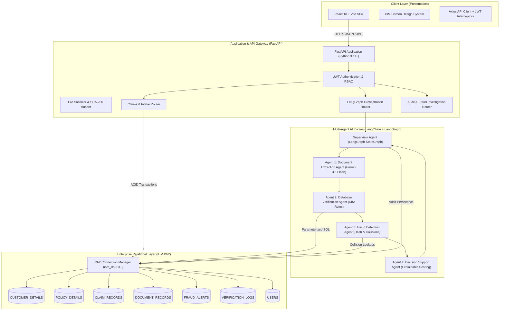
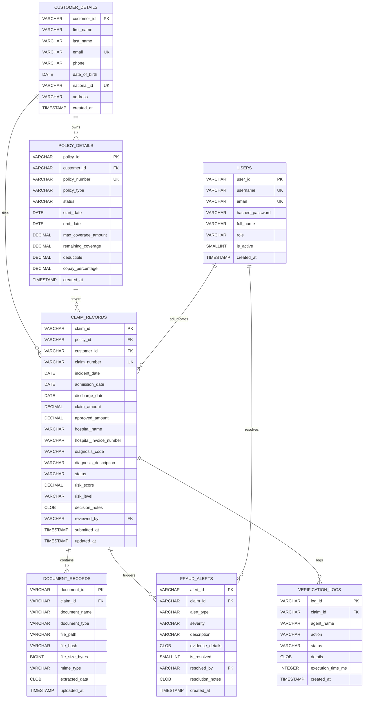
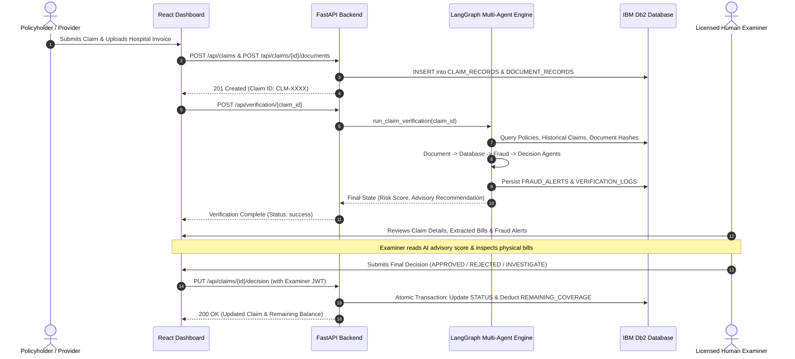

# ClaimGuard AI - System Architecture Specification

**Project:** ClaimGuard AI (`claimguard-ai`)  
**Hackathon:** IBM Db2Hack 2026 (Individual Submission)  
**Participant:** Nitesh Barnwal ([@Nitesh0517](https://github.com/Nitesh0517))  
**Core Stack:** IBM Db2 Enterprise (`ibm_db`), LangChain, LangGraph, Google Gemini 3.6 Flash, FastAPI, React 18, Tailwind CSS

---

## 1. Architectural Overview

ClaimGuard AI is an enterprise insurance claim verification and fraud detection platform. It couples IBM Db2 as an ACID-compliant system of record with an autonomous multi-agent AI pipeline built on LangChain and LangGraph.

The system enforces strict **Human-in-the-Loop (HITL)** governance: AI agents analyze multimodal hospital bills, verify policy coverage limits, detect duplicate document hashes, and synthesize transparent 0–100 risk scores. The output is purely advisory; only authorized human claim examiners have the authority to legally approve, adjust, or reject claims.

---

## 2. Multi-Agent AI Architecture (LangGraph Workflow)

The agentic pipeline is built with **LangGraph** using a shared `ClaimGuardState` TypedDict. Each specialized agent executes sequentially, augmenting the state with typed outputs.

```mermaid
stateDiagram-v2
    [*] --> START
    START --> DocumentExtraction : Scanned Bill / Invoice Uploaded
    
    state DocumentExtraction {
        [*] --> CheckGeminiKey
        CheckGeminiKey --> LangChainGemini : Key Present & Valid
        CheckGeminiKey --> RegexFallback : Key Missing / Offline
        LangChainGemini --> ValidatePydantic : Structured JSON
        RegexFallback --> ValidatePydantic : Regex Output
        ValidatePydantic --> [*]
    }
    
    DocumentExtraction --> DatabaseVerification : Extracted Data & Claim ID
    
    state DatabaseVerification {
        [*] --> QueryCustomerDb2
        QueryCustomerDb2 --> QueryPolicyDb2
        QueryPolicyDb2 --> CheckActiveDates
        CheckActiveDates --> CheckCoverageLimit
        CheckCoverageLimit --> ComputeHistoricalExposure
        ComputeHistoricalExposure --> [*]
    }
    
    DatabaseVerification --> FraudDetection : Policy Data & Extraction
    
    state FraudDetection {
        [*] --> CheckSHA256Collisions
        CheckSHA256Collisions --> CheckInvoiceCollisions
        CheckInvoiceCollisions --> CheckDateAnomalies
        CheckDateAnomalies --> CheckAmountOutliers
        CheckAmountOutliers --> PersistFraudAlerts
        PersistFraudAlerts --> [*]
    }
    
    FraudDetection --> DecisionSupport : Aggregated Signal Vector
    
    state DecisionSupport {
        [*] --> CalculateWeightedRiskScore
        CalculateWeightedRiskScore --> DetermineRecommendation
        DetermineRecommendation --> GenerateExplainableSummary
        GenerateExplainableSummary --> AttachDisclaimer
        AttachDisclaimer --> [*]
    }
    
    DecisionSupport --> SupervisorFinalize : Recommendation & Risk Score
    
    state SupervisorFinalize {
        [*] --> UpdateClaimDb2
        UpdateClaimDb2 --> WriteImmutableAuditLogs
        WriteImmutableAuditLogs --> [*]
    }
    
    SupervisorFinalize --> END
    END --> [*] : Structured Report Available for Human Review
```

### Agent Responsibilities:

1. **Document Extraction Agent (`document_agent.py`):**
   - Utilizes `langchain_google_genai.ChatGoogleGenerativeAI` with `gemini-3.6-flash`.
   - Ingests raw document text or scanned medical invoices.
   - Extracts: `patient_name`, `patient_id`, `hospital_name`, `hospital_invoice_number`, `admission_date`, `discharge_date`, `diagnosis`, `diagnosis_code` (ICD-10), `total_amount`, `currency`.
   - Resilient Fallback: If Gemini API is unconfigured or rate-limited, automatically falls back to deterministic regex extraction to ensure 100% system availability.

2. **Database Verification Agent (`database_agent.py`):**
   - Queries IBM Db2 relational tables using parameterized SQL via `Db2ConnectionManager`.
   - Validates claimant profile against `CUSTOMER_DETAILS`.
   - Verifies policy validity period (`start_date <= incident_date <= end_date`) and status (`ACTIVE`).
   - Cross-checks claim amount against `REMAINING_COVERAGE` in `POLICY_DETAILS`.
   - Analyzes prior claim history and cumulative payout exposures.

3. **Fraud Detection Agent (`fraud_agent.py`):**
   - Computes SHA-256 cryptographic hashes for every uploaded file and checks for cross-claim hash collisions.
   - Identifies duplicate hospital invoice numbers across different claimants.
   - Detects date anomalies (e.g., discharge date preceding admission date or claims submitted for future dates).
   - Generates weighted `FRAUD_ALERTS` records with severity levels (`LOW`, `MEDIUM`, `HIGH`, `CRITICAL`).

4. **Decision Support Agent (`decision_agent.py`):**
   - Combines signals from previous agents into a transparent **0–100 risk score**:
     $$\text{Risk Score} = \min\left(100.0, \sum w_i \times \text{signal}_i\right)$$
   - Classifies risk: `LOW` (0–25), `MEDIUM` (26–50), `HIGH` (51–75), `CRITICAL` (76–100).
   - Generates recommendations: `APPROVE`, `INVESTIGATE`, or `REJECT`.
   - Supplies an executive summary and itemized factor list.
   - Strictly attaches the mandatory Human-in-the-Loop disclaimer: *AI output is advisory only; final approval belongs to a licensed human claim examiner.*

5. **Supervisor Agent (`workflow.py`):**
   - Orchestrates the LangGraph state machine.
   - Handles node transitions, execution tracking, error boundary containment, and state reconciliation.
   - Records an immutable chronological execution entry in `VERIFICATION_LOGS` for each step.

---

## 3. IBM Db2 Relational Architecture & Schema

IBM Db2 serves as the ACID-compliant system of record. All schemas enforce strict referential integrity with foreign key cascading constraints and indexed lookup paths.

### Database Performance & Security Indexing:
- `IDX_CLAIMS_POLICY`: B-Tree index on `CLAIM_RECORDS(POLICY_ID)` for instant historical lookups.
- `IDX_CLAIMS_CUSTOMER`: Index on `CLAIM_RECORDS(CUSTOMER_ID)`.
- `IDX_CLAIMS_STATUS`: Index on `CLAIM_RECORDS(STATUS)` for rapid queue filtering.
- `IDX_DOCUMENTS_HASH`: Index on `DOCUMENT_RECORDS(FILE_HASH)` for sub-millisecond duplicate document collision detection.
- `IDX_CLAIMS_INVOICE`: Index on `CLAIM_RECORDS(HOSPITAL_INVOICE_NUMBER)` to catch invoice reuse across different claimants.

---

## 4. Security & Compliance Architecture

1. **SQL Injection Defense:**
   - 100% of SQL executions against IBM Db2 utilize the native `ibm_db.prepare()` and `ibm_db.execute()` API with bound parameter tuples. Zero raw string interpolation or formatted query execution exists.
2. **Cryptographic Password Protection:**
   - Passwords for claims examiners and admins are hashed using **PBKDF2-HMAC-SHA256** with **600,000 iterations** and a 16-byte cryptographically secure salt (`os.urandom(16)`), compliant with NIST SP 800-132.
   - Verification uses constant-time comparison via `hmac.compare_digest` to prevent side-channel timing attacks.
3. **Session Authentication & Token Security:**
   - Stateless JWT tokens signed with HMAC-SHA256 (`HS256`).
   - Tokens include user ID (`sub`), role (`EXAMINER`, `ADMIN`), issued-at (`iat`), and expiration (`exp`) timestamps.
   - Expired or signature-tampered tokens return HTTP 401 Unauthorized immediately.
4. **File Upload Hardening:**
   - Whitelist enforcement: only `.pdf`, `.png`, `.jpg`, `.jpeg`, `.tiff`, and `.txt` are permitted.
   - File size ceiling: strict 10 MB limit prevents denial-of-service memory exhaustion.
   - Path traversal prevention: filenames are sanitized using `os.path.basename()` before disk storage.
5. **Secrets & Environment Governance:**
   - Real credentials reside solely in runtime environment variables.
   - `.env` is strictly gitignored by default. `.env.example` contains non-functional dummy placeholders.

---

## 5. Human-in-the-Loop (HITL) Adjudication Flow

ClaimGuard AI enforces a strict distinction between AI intelligence and legal authority:

