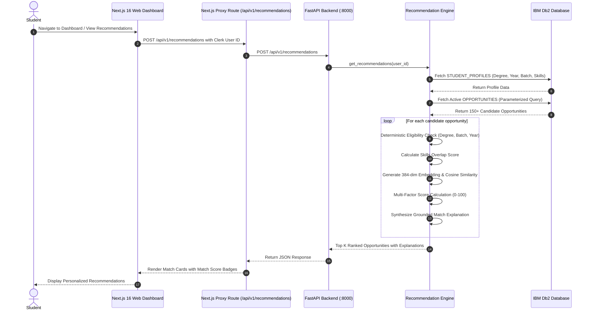

# Cloud Loop — Architecture Specification

## 1. System Overview

Cloud Loop adopts a **Decoupled 3-Tier Enterprise Architecture**:
- **Presentation Tier**: Next.js 16 (App Router), React 19, Tailwind CSS v4, Clerk Authentication.
- **Application & Intelligence Tier**: FastAPI Python microservice running asynchronous endpoints for opportunity querying, multi-factor recommendation scoring, sentence-transformers vector generation, and ingestion telemetry.
- **Enterprise Data Tier**: IBM Db2 relational database with parameterized SQL, foreign keys, and indexes.

---

## 2. Sequence Diagram: Student Recommendation Flow



---

## 3. Database Schemas

```sql
-- 1. OPPORTUNITIES TABLE
CREATE TABLE OPPORTUNITIES (
    ID                  VARCHAR(64)     NOT NULL PRIMARY KEY,
    SLUG                VARCHAR(128)    NOT NULL,
    TITLE               VARCHAR(255)    NOT NULL,
    ORGANIZATION        VARCHAR(128)    NOT NULL,
    OPPORTUNITY_TYPE    VARCHAR(64)     NOT NULL,
    CATEGORY            VARCHAR(64)     NOT NULL,
    DESCRIPTION         CLOB(64K),
    LOCATION            VARCHAR(128),
    LOCATION_TYPE       VARCHAR(32),
    SKILLS              VARCHAR(1024),
    ELIGIBILITY         VARCHAR(512),
    DEADLINE            VARCHAR(64),
    APPLICATION_URL     VARCHAR(1024)   NOT NULL,
    SOURCE_NAME         VARCHAR(64)     DEFAULT 'CloudLoop Scraper',
    SOURCE_URL          VARCHAR(1024),
    VERIFICATION_STATUS VARCHAR(32)     DEFAULT 'verified',
    FETCHED_AT          TIMESTAMP       DEFAULT CURRENT TIMESTAMP,
    CREATED_AT          TIMESTAMP       DEFAULT CURRENT TIMESTAMP,
    UPDATED_AT          TIMESTAMP       DEFAULT CURRENT TIMESTAMP
);

-- 2. STUDENT_PROFILES TABLE
CREATE TABLE STUDENT_PROFILES (
    USER_ID             VARCHAR(128)    NOT NULL PRIMARY KEY,
    EDUCATION           VARCHAR(128),
    DEGREE              VARCHAR(128),
    STUDY_YEAR          INT             DEFAULT 1,
    GRADUATION_BATCH    VARCHAR(16),
    SKILLS              VARCHAR(1024),
    INTERESTS           VARCHAR(1024),
    PREFERRED_DOMAINS   VARCHAR(512),
    PREFERRED_LOCATIONS VARCHAR(512),
    UPDATED_AT          TIMESTAMP       DEFAULT CURRENT TIMESTAMP
);

-- 3. USER_OPPORTUNITY_TRACKING TABLE
CREATE TABLE USER_OPPORTUNITY_TRACKING (
    USER_ID             VARCHAR(128)    NOT NULL,
    OPPORTUNITY_ID      VARCHAR(64)     NOT NULL,
    APPLICATION_STATUS  VARCHAR(32)     DEFAULT 'saved',
    BOOKMARKED          SMALLINT        DEFAULT 1,
    UPDATED_AT          TIMESTAMP       DEFAULT CURRENT TIMESTAMP,
    PRIMARY KEY (USER_ID, OPPORTUNITY_ID),
    CONSTRAINT FK_TRACK_OPP FOREIGN KEY (OPPORTUNITY_ID) REFERENCES OPPORTUNITIES(ID) ON DELETE CASCADE
);

-- 4. INGESTION_RUNS TABLE
CREATE TABLE INGESTION_RUNS (
    ID                  VARCHAR(64)     NOT NULL PRIMARY KEY,
    SOURCE              VARCHAR(64)     NOT NULL,
    RECORDS_PROCESSED   INT             DEFAULT 0,
    RECORDS_INSERTED    INT             DEFAULT 0,
    RECORDS_UPDATED     INT             DEFAULT 0,
    RECORDS_REJECTED    INT             DEFAULT 0,
    STATUS              VARCHAR(32)     DEFAULT 'running',
    ERROR_SUMMARY       VARCHAR(2048),
    STARTED_AT          TIMESTAMP       DEFAULT CURRENT TIMESTAMP,
    COMPLETED_AT        TIMESTAMP
);
```

---

## 4. Multi-Factor Recommendation Math

The composite match score $S \in [10, 99]$ is computed as:

$$S = S_{\text{base}} + S_{\text{skills}} + S_{\text{vector}} + S_{\text{domain}} + S_{\text{eligibility}}$$

Where:
- $S_{\text{base}} = 30.0$ (Verified listing baseline)
- $S_{\text{skills}} = 35.0 \times \frac{|\text{UserSkills} \cap \text{OppSkills}|}{\max(1, |\text{OppSkills}|)}$
- $S_{\text{vector}} = 20.0 \times \frac{\mathbf{u} \cdot \mathbf{v}}{\|\mathbf{u}\|_2 \|\mathbf{v}\|_2}$ (Cosine similarity of 384-dim embeddings)
- $S_{\text{domain}} = 10.0$ if category matches preferred domains
- $S_{\text{eligibility}} = +5.0$ if academic eligibility verified, else $-15.0$
