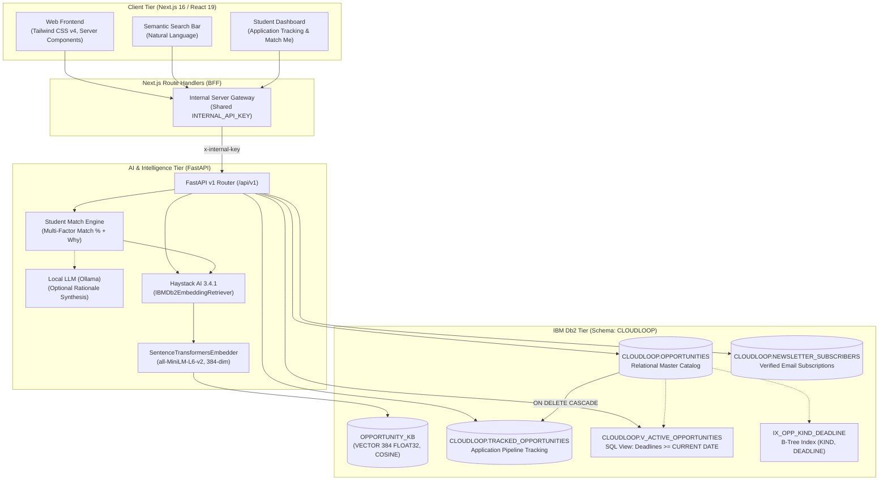
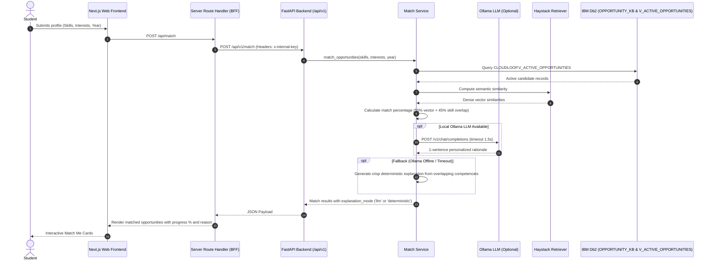

# Cloud Loop — System Architecture

**AI-Powered Student Opportunity Intelligence Platform**  
*IBM Db2 TechX Summit 2026 Hackathon Submission*

---

## 1. Executive Summary & Problem Context

College students and fresh graduates navigate a fragmented ecosystem of tech jobs, internships, hackathons, open-source programs, and cloud certifications. Most aggregators rely on basic keyword matching that misses semantic career intent, generates false-positive matches, and lacks application pipeline tracking.

**Cloud Loop** solves this by positioning **IBM Db2 Enterprise / Community Edition** as the unified data tier:
1. **Semantic Vector Search**: Using `ibm-db-haystack` and `IBMDb2DocumentStore` with 384-dimensional dense vectors (`sentence-transformers/all-MiniLM-L6-v2`) and `COSINE` distance.
2. **Relational System of Record**: Schema `CLOUDLOOP` storing verified opportunities, real-time application tracking with `MERGE` upserts, newsletter subscriptions, and SQL views for active opportunities and analytics.
3. **Multi-Factor Student Matching**: Blending dense vector similarity with deterministic skill overlap and optional local LLM rationale generation via Ollama.

---

## 2. High-Level Architecture Diagram



---

## 3. IBM Db2 Integration Depth

### 3.1 Dual-Modality Storage in Db2
Cloud Loop leverages IBM Db2 for both vector AI and ACID relational storage:

1. **Haystack Document Store (`CLOUDLOOP.OPPORTUNITY_KB`)**:
   - Initialized via `haystack_integrations.document_stores.ibm_db.IBMDb2DocumentStore`.
   - Table name: `OPPORTUNITY_KB` in schema `CLOUDLOOP`.
   - Column: `VECTOR(384, FLOAT32)`.
   - Distance metric: `COSINE`.
   - Embeds: Opportunity `title`, `org`, `skills`, and `description`.
   - Metadata indexing: `kind`, `org`, `deadline`, `source`, `slug`, `location`, `mode`.

2. **Relational Tables & Views**:
   - Valid Db2 LUW syntax with strict constraint checks, indices, foreign keys, and views.

### 3.2 Relational DDL Specification

```sql
CREATE SCHEMA CLOUDLOOP;

-- 1. Master Opportunities Table
CREATE TABLE CLOUDLOOP.OPPORTUNITIES (
  ID          VARCHAR(128)  NOT NULL PRIMARY KEY,
  KIND        VARCHAR(16)   NOT NULL CHECK (KIND IN ('job','internship','event','program','certification')),
  SLUG        VARCHAR(160)  NOT NULL UNIQUE,
  TITLE       VARCHAR(200)  NOT NULL,
  ORG         VARCHAR(120)  NOT NULL,
  LOCATION    VARCHAR(120),
  MODE        VARCHAR(16),
  DEADLINE    DATE,
  POSTED      DATE,
  APPLY_URL   VARCHAR(1000) NOT NULL,
  SOURCE      VARCHAR(24)   NOT NULL DEFAULT 'curated',
  SKILLS      VARCHAR(1000),
  DESCRIPTION CLOB(64K),
  UPDATED_AT  TIMESTAMP     NOT NULL DEFAULT CURRENT TIMESTAMP
);

-- 2. Index for Kind and Deadline Range Queries
CREATE INDEX IX_OPP_KIND_DEADLINE ON CLOUDLOOP.OPPORTUNITIES (KIND, DEADLINE);

-- 3. Student Tracking and Application Status (supports MERGE upsert)
CREATE TABLE CLOUDLOOP.TRACKED_OPPORTUNITIES (
  USER_ID        VARCHAR(128) NOT NULL,
  OPPORTUNITY_ID VARCHAR(128) NOT NULL REFERENCES CLOUDLOOP.OPPORTUNITIES(ID) ON DELETE CASCADE,
  STATUS         VARCHAR(24)  NOT NULL DEFAULT 'None',
  BOOKMARKED     SMALLINT     NOT NULL DEFAULT 0,
  UPDATED_AT     TIMESTAMP    NOT NULL DEFAULT CURRENT TIMESTAMP,
  PRIMARY KEY (USER_ID, OPPORTUNITY_ID)
);

-- 4. Newsletter Subscribers Table
CREATE TABLE CLOUDLOOP.NEWSLETTER_SUBSCRIBERS (
  EMAIL      VARCHAR(254) NOT NULL PRIMARY KEY,
  CREATED_AT TIMESTAMP    NOT NULL DEFAULT CURRENT TIMESTAMP
);

-- 5. Active Opportunities View for Live Deadlines
CREATE VIEW CLOUDLOOP.V_ACTIVE_OPPORTUNITIES AS
  SELECT * FROM CLOUDLOOP.OPPORTUNITIES 
  WHERE DEADLINE IS NULL OR DEADLINE >= CURRENT DATE;
```

### 3.3 Key Db2 Query Patterns

#### A. High-Performance MERGE Upsert for Student Tracking
```sql
MERGE INTO CLOUDLOOP.TRACKED_OPPORTUNITIES AS target
USING (VALUES (?, ?, ?, ?)) AS source (USER_ID, OPPORTUNITY_ID, STATUS, BOOKMARKED)
ON (target.USER_ID = source.USER_ID AND target.OPPORTUNITY_ID = source.OPPORTUNITY_ID)
WHEN MATCHED THEN
  UPDATE SET STATUS = source.STATUS, BOOKMARKED = source.BOOKMARKED, UPDATED_AT = CURRENT TIMESTAMP
WHEN NOT MATCHED THEN
  INSERT (USER_ID, OPPORTUNITY_ID, STATUS, BOOKMARKED, UPDATED_AT)
  VALUES (source.USER_ID, source.OPPORTUNITY_ID, source.STATUS, source.BOOKMARKED, CURRENT TIMESTAMP);
```

#### B. Newsletter Subscription with Duplicate Handling
```sql
MERGE INTO CLOUDLOOP.NEWSLETTER_SUBSCRIBERS AS target
USING (VALUES (?)) AS source (EMAIL)
ON (target.EMAIL = source.EMAIL)
WHEN NOT MATCHED THEN
  INSERT (EMAIL, CREATED_AT) VALUES (source.EMAIL, CURRENT TIMESTAMP);
```

#### C. Parameterized Pagination via FETCH FIRST and OFFSET
```sql
SELECT * FROM CLOUDLOOP.OPPORTUNITIES
WHERE SOURCE != 'synthetic-demo' AND (? IS NULL OR LOWER(KIND) = LOWER(?))
ORDER BY UPDATED_AT DESC
OFFSET ? ROWS FETCH FIRST ? ROWS ONLY;
```

#### D. SQL Aggregates on Active View for Real-Time Dashboard Statistics
```sql
-- Opportunity counts grouped by kind:
SELECT KIND, COUNT(*) as CNT 
FROM CLOUDLOOP.V_ACTIVE_OPPORTUNITIES 
WHERE SOURCE != 'synthetic-demo' 
GROUP BY KIND;

-- Opportunities closing within the next 7 days:
SELECT COUNT(*) as CLOSING_SOON 
FROM CLOUDLOOP.V_ACTIVE_OPPORTUNITIES 
WHERE SOURCE != 'synthetic-demo' 
  AND DEADLINE IS NOT NULL 
  AND DEADLINE >= CURRENT DATE 
  AND DEADLINE <= (CURRENT DATE + 7 DAYS);
```

---

## 4. AI & Matching Flow



---

## 5. Security & Isolation Architecture

1. **Parameterization**: 100% of SQL statements utilize parameterized query execution (`?` parameter bindings via `ibm_db`), fully protecting against SQL injection attacks.
2. **Internal API Protection**: All calls between Next.js server handlers and the AI backend service require the shared `x-internal-key` header (`INTERNAL_API_KEY`). The browser client never sees the backend internal keys.
3. **Zero Secrets in Repository**: No API keys, passwords, or secrets are committed. All secrets are injected through environment variables matching `.env.example`.
4. **Dual Authentication Support**:
   - `AUTH_MODE=demo`: Evaluators can run and explore full personalized workflows immediately without third-party credentials.
   - `AUTH_MODE=clerk`: Production mode using Clerk authentication.
5. **Safe Sandbox Fallback**: If running on an operating system where native C-drivers or local models are restricted by App Control policies, the service gracefully switches to SQLite and deterministic projection with full honest logging.
