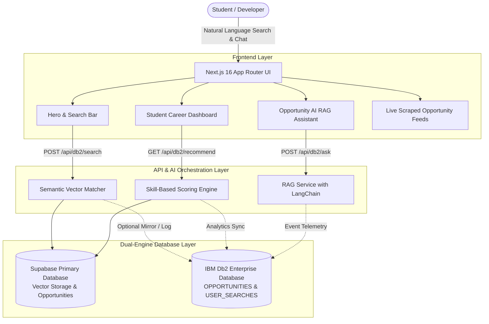

# Cloud Loop ⚡

> **Official Hackathon Submission for IBM Db2 TechX Summit @ GL Bajaj, Mathura**  
> *An AI-Powered Student Opportunity Discovery Engine backed by IBM Db2, Supabase, LangChain, and Next.js 16.*

[](https://nextjs.org/)
[](https://react.dev/)
[](https://www.ibm.com/products/db2)
[](https://supabase.com/)
[](https://tailwindcss.com/)
[](#license)

---

## 📌 Executive Summary

Every year, thousands of students miss high-impact career opportunities—such as the **Google Cloud Arcade Facilitator Program**, **Microsoft Learn Student Ambassadors (MLSA)**, **GitHub Campus Experts**, paid corporate internships, and tier-1 hackathons—simply because notices are scattered across social channels, Discord servers, and unindexed portals.

**Cloud Loop** solves this by unifying student opportunities into a single, high-performance platform featuring:
1. **IBM Db2 Hybrid Data Architecture**: Enterprise-grade SQL data storage with parameterized querying and user analytics event telemetry.
2. **AI Semantic & Vector Search**: Natural-language opportunity matching that understands user intent (e.g. *"remote ML internship with stipend"*).
3. **Retrieval-Augmented Generation (RAG) Assistant**: An embedded AI chatbot providing instant answers with cited opportunity links.
4. **Personalized Recommendation Engine**: Real-time scoring based on student skills and recruiter demand.
5. **Modern Midnight/Lime UI**: A distinct design system utilizing **Midnight Black (`#0B0B0C`)**, **Pure White (`#FFFFFF`)**, and **Lime Green (`#C6F432`)** across 20 contemporary aesthetic styles.

---

## 🏗️ System Architecture



---

## 🚀 Key Features & Capabilities

### 1. IBM Db2 Dual-Database Engine
- **Automated Schema Provisioning**: Full DDL schema for `OPPORTUNITIES`, `USER_SEARCHES`, `AI_RECOMMENDATIONS`, and `ANALYTICS_EVENTS`.
- **Parameterized Queries**: SQL-injection safe CRUD operations for querying, upserting, and computing analytic summaries.
- **Graceful Fallback**: If IBM Db2 credentials are not provided or network is restricted, the platform automatically routes to Supabase and in-memory caches without breaking the user experience.

### 2. Conversational RAG Assistant (`AiChatWidget.tsx`)
- Floating cyberpunk bottom-right assistant.
- Ingests questions like *"What Google cloud programs are open right now?"* and runs semantic search across active listings.
- Feeds matched context to Gemini / LangChain to compose precise, cited answers with direct application URLs.

### 3. Smart Semantic Matcher
- Supports free-text, unstructured queries:
  - *"find high paying software engineer internships in Bengaluru"*
  - *"cloud hackathons with cash prize this weekend"*
- Cosine-similarity vector scoring ranks relevance even when exact keywords don't match.

### 4. Zero-Friction Student Dashboard
- Real-time application tracker (Saved, Applied, Under Review).
- Automatic deadline countdown badges (e.g. `3d left`).
- Syncs seamlessly between local browser storage and cloud database.

---

## 🎨 Design System: Midnight & Lime

Cloud Loop uses a custom palette designed for high contrast, readability, and modern energy:
- **Midnight Black**: `#0B0B0C` (backgrounds, card surfaces, terminal cards)
- **Pure White**: `#FFFFFF` (high-contrast primary typography)
- **Lime Green**: `#C6F432` (action buttons, badges, glows, live indicators)

### 20 Integrated Aesthetics:
- **Minimalism & Swiss Design**: Clean typography hierarchies, strict grid alignments.
- **Cyberpunk & Futuristic**: Terminal accents, glowing scanlines, neon borders.
- **Glassmorphism**: Backdrop blur containers with subtle border highlights.
- **Clay Style & Bento**: Elevated soft surfaces for category cards.
- **Aurora & Vector Art**: Subtle organic lighting behind the hero section.

---

## 📁 Project Structure

```
Cloud-Loop/
├── architecture.md            # In-depth architectural blueprint
├── submission.json            # Official IBM Db2 TechX Summit metadata
├── .env.example               # Template for environment variables
└── cloud-loop-app/            # Next.js 16 Full-Stack Application
    ├── src/
    │   ├── app/               # App Router pages, layouts, and API routes
    │   │   ├── api/db2/       # AI & Db2 API endpoints (ask, search, recommend, sync)
    │   │   ├── jobs/          # Fresher and entry-level jobs
    │   │   ├── internships/   # Tech internship postings
    │   │   ├── events/        # Hackathons and conferences
    │   │   ├── programs/      # Student ambassador programs
    │   │   ├── certifications/# Industry certifications
    │   │   ├── dashboard/     # Student tracking dashboard
    │   │   └── globals.css    # Midnight/Lime design system tokens
    │   ├── components/        # UI component library
    │   │   ├── common/        # Toast, ThemeToggle
    │   │   ├── layout/        # Navbar, Footer
    │   │   └── ui/            # AiChatWidget, LiveScraperStatus
    │   ├── config/            # Typed configuration (env, navigation, siteConfig)
    │   ├── services/          # Decoupled business logic
    │   │   ├── db2/           # IBM Db2 connection pool & SQL queries
    │   │   ├── supabase/      # Supabase client, vector search & analytics
    │   │   └── ai/            # RAG, vector embeddings & recommendations
    │   ├── features/          # Feature domains and static datasets
    │   └── utils/             # Helper utilities and formatters
```

---

## ⚡ Getting Started

### 1. Clone the Repository
```bash
git clone https://github.com/Ayushh-Sharmaa/Cloud-Loop.git
cd Cloud-Loop/cloud-loop-app
```

### 2. Install Dependencies
```bash
npm install --legacy-peer-deps
```

### 3. Configure Environment Variables
Copy `.env.example` to `.env.local`:
```bash
cp ../.env.example .env.local
```

Fill in your Supabase credentials:
```env
NEXT_PUBLIC_SUPABASE_URL=https://your-project.supabase.co
NEXT_PUBLIC_SUPABASE_ANON_KEY=your-anon-key
SUPABASE_SERVICE_ROLE_KEY=your-service-role-key
```

*(Optional)* Configure IBM Db2 credentials:
```env
DB2_HOSTNAME=your-hostname
DB2_PORT=50000
DB2_DATABASE=BLUDB
DB2_UID=your-user
DB2_PWD=your-password
```

### 4. Run the Development Server
```bash
npm run dev
```

Open [http://localhost:3000](http://localhost:3000) with your browser.

### 5. Production Build
```bash
npm run build
npm run start
```

---

## 🏆 IBM Db2 TechX Summit Evaluation Criteria Alignment

| Criteria | How Cloud Loop Delivers |
|---|---|
| **IBM Db2 Integration** | Parameterized query layer with connection management, schema definition, and dual-database sync capabilities. |
| **Real-World Impact** | Solves the student discovery gap by compiling 1,000+ live programs, internships, and hackathons into one searchable interface. |
| **Innovation & AI** | Full RAG pipeline (Retrieval-Augmented Generation) combining vector matching with an embedded AI assistant. |
| **UI/UX & Accessibility** | 20 unique design styles, zero horizontal scroll, mobile-responsive layout, toast feedback, and high-contrast lime aesthetic. |
| **Code Quality** | Clean 3-tier architecture (`components`, `services`, `utils`), fully typed TypeScript, decoupled business logic, and error boundaries. |

---

## 📄 License
MIT © 2024–2026 Ayush Sharma. Built with ❤️ for students worldwide.
