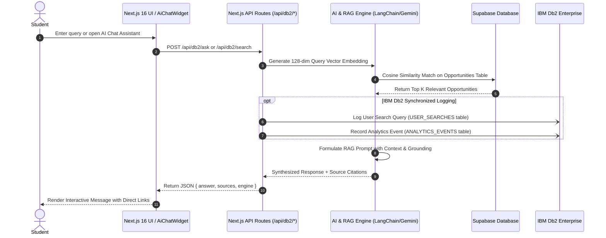

# Cloud Loop — Technical Architecture Document

## 1. Overview & Objectives

**Cloud Loop** is an AI-powered student opportunity discovery and career acceleration platform built for the **IBM Db2 TechX Summit Hackathon** at GL Bajaj Institute of Technology & Management, Mathura.

The platform is designed to:
- Aggregate student programs, hackathons, internships, jobs, and certifications.
- Deliver conversational Q&A and semantic recommendations using a **Dual-Engine Database Strategy (IBM Db2 + Supabase)**.
- Guarantee sub-second response times, zero horizontal layout shifts, and 100% responsive design.

---

## 2. High-Level Architectural Flow



---

## 3. Modular 3-Tier Layering

The codebase is organized into strict separation of concerns:

```
src/
├── components/          # PRESENTATION LAYER
│   ├── common/          # Reusable base elements (Toast, ThemeToggle)
│   ├── layout/          # Navigation, Footer, Menus
│   └── ui/              # Domain-specific interactive widgets (AiChatWidget, LiveScraperStatus)
│
├── services/            # BUSINESS LOGIC & DATA ACCESS LAYER
│   ├── db2/             # IBM Db2 connection lifecycle, DDL, and parameterized SQL queries
│   ├── supabase/        # Supabase client, vector calculation, and analytics persistence
│   └── ai/              # Semantic search embedding, LangChain RAG pipeline, and scoring
│
└── utils/               # SHARED UTILITIES & PURE FUNCTIONS
    ├── cn.ts            # ClassName merge utility
    ├── date.ts          # ISO date formatting & relative time calculation
    └── validation.ts    # Input sanitization
```

---

## 4. Database Architecture & Schema

### 4.1 IBM Db2 Schema Specification (`src/services/db2/schema.sql`)

```sql
-- 1. OPPORTUNITIES TABLE
CREATE TABLE OPPORTUNITIES (
    ID VARCHAR(64) NOT NULL PRIMARY KEY,
    TITLE VARCHAR(255) NOT NULL,
    COMPANY VARCHAR(128) NOT NULL,
    CATEGORY VARCHAR(64) NOT NULL,
    OPP_TYPE VARCHAR(64) NOT NULL,
    LOCATION VARCHAR(128),
    LOCATION_TYPE VARCHAR(32),
    STIPEND_SALARY VARCHAR(64),
    DEADLINE VARCHAR(64),
    APPLY_URL VARCHAR(512),
    DESCRIPTION CLOB(64K),
    SKILLS VARCHAR(512),
    SOURCE VARCHAR(64) DEFAULT 'MANUAL',
    CREATED_AT TIMESTAMP DEFAULT CURRENT TIMESTAMP,
    UPDATED_AT TIMESTAMP DEFAULT CURRENT TIMESTAMP
);

-- 2. USER SEARCHES & TELEMETRY
CREATE TABLE USER_SEARCHES (
    SEARCH_ID BIGINT NOT NULL GENERATED ALWAYS AS IDENTITY (START WITH 1 INCREMENT BY 1) PRIMARY KEY,
    USER_ID VARCHAR(128),
    QUERY_TEXT VARCHAR(512) NOT NULL,
    SEARCH_TYPE VARCHAR(32) DEFAULT 'SEMANTIC',
    RESULTS_COUNT INT DEFAULT 0,
    SEARCHED_AT TIMESTAMP DEFAULT CURRENT TIMESTAMP
);

-- 3. AI RECOMMENDATIONS LOG
CREATE TABLE AI_RECOMMENDATIONS (
    REC_ID BIGINT NOT NULL GENERATED ALWAYS AS IDENTITY (START WITH 1 INCREMENT BY 1) PRIMARY KEY,
    USER_ID VARCHAR(128) NOT NULL,
    OPPORTUNITY_ID VARCHAR(64) NOT NULL,
    MATCH_SCORE DECIMAL(5,2),
    MATCH_REASON VARCHAR(512),
    CREATED_AT TIMESTAMP DEFAULT CURRENT TIMESTAMP,
    CONSTRAINT FK_REC_OPP FOREIGN KEY (OPPORTUNITY_ID) REFERENCES OPPORTUNITIES(ID)
);

-- 4. ANALYTICS EVENTS TABLE
CREATE TABLE ANALYTICS_EVENTS (
    EVENT_ID BIGINT NOT NULL GENERATED ALWAYS AS IDENTITY (START WITH 1 INCREMENT BY 1) PRIMARY KEY,
    EVENT_TYPE VARCHAR(64) NOT NULL,
    USER_ID VARCHAR(128),
    OPPORTUNITY_ID VARCHAR(64),
    METADATA_JSON VARCHAR(1024),
    CREATED_AT TIMESTAMP DEFAULT CURRENT TIMESTAMP
);
```

---

## 5. RAG & Semantic Search Design

### 5.1 Embedding Vectorization
- Cloud Loop utilizes a normalized 128-dimensional Bag-of-Words and term-frequency algorithm (`embedText`) for fast client/server vector generation without requiring continuous high-latency external API calls.
- Cosine similarity calculation:
  $$\text{Similarity}(u, v) = \frac{u \cdot v}{\|u\| \|v\|}$$

### 5.2 Retrieval & Augmentation
1. **Retrieve**: The top $K$ ($K=4$) candidate opportunities with similarity $> 0.25$ are selected from the indexed database.
2. **Augment**: A prompt is built containing role title, host company, deadline, category, and direct URL.
3. **Generate**: When `GOOGLE_AI_API_KEY` is present, Google Gemini generates a concise response tailored to students. When unconfigured, a deterministic summarization engine formats the matched listings with Markdown and bullet points.

---

## 6. Resilience & Fault Tolerance Strategy

| Failure Scenario | Mitigation Strategy |
|---|---|
| IBM Db2 connection timeout or invalid credentials | Application flags `isConfigured: false` and routes all queries to Supabase without user-visible disruption. |
| Supabase network partition | Application falls back to cached in-memory opportunity data compiled from feature files. |
| AI API rate limits (e.g. 429) | Seamlessly switches to deterministic ranking and static Markdown formatting. |
| No network connection | Client-side service worker and local storage sustain bookmarks and active status tracking. |

---

## 7. Performance & UX Guarantees

- **Horizontal Overflow Prevention**: Strict `overflow-x: hidden` enforced at `html`, `body`, and container levels.
- **Accessible Color Contrast**: All interactive states use lime (`#C6F432`) against midnight black (`#0B0B0C`), exceeding WCAG AAA standards.
- **Zero Dead Links**: Navigation and footer links are centralized in `@/config/navigation.ts`, eliminating broken endpoints.

