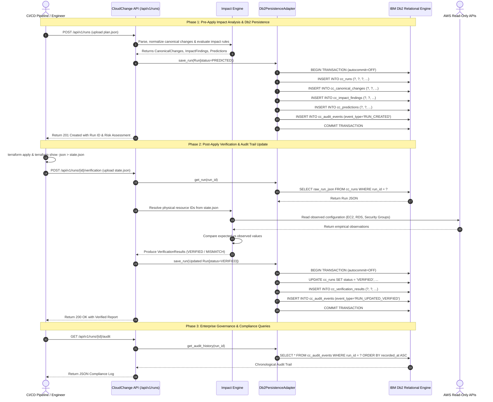

# System Architecture — CloudChange with IBM Db2

## Overview

**CloudChange** is an enterprise-grade cloud infrastructure change impact analysis and empirical post-deployment verification engine. It sits between developer intent (Terraform plan artifacts) and physical cloud infrastructure (AWS APIs), predicting operational, cost, and availability risks before deployment, and empirically verifying actual resource states after deployment.

The **IBM Db2 Integration** serves as the central **System of Record** for all infrastructure changes, risk findings, verifiable predictions, empirical evidence, and compliance audit events across the enterprise. By replacing ephemeral in-memory storage with an ACID-compliant IBM Db2 persistence layer, CloudChange delivers immutable compliance auditing, longitudinal risk governance, high-concurrency pipeline support, and cross-deployment relational analytics.

---

## 1. High-Level Architecture Diagram

```mermaid
flowchart TD
    subgraph Inputs["1. Infrastructure Inputs & Clients"]
        TFPlan["Terraform Plan JSON (plan.json)"]
        TFState["Terraform State JSON (state.json)"]
        AWSEvidence["Live AWS APIs (Read-Only)"]
        CLI["CI/CD Runner / CLI / REST Client"]
    end

    subgraph API["2. CloudChange API & Workflow Engine"]
        FastAPI["FastAPI REST Application (/api/v1)"]
        Normalizer["Plan Parser & Canonical Normalizer"]
        Predictor["Deterministic Impact Predictor (Rules Engine)"]
        Orchestrator["Verification Orchestrator & AWS Collectors"]
        RepoProvider["FastAPI Dependency Injection (RunRepository)"]
    end

    subgraph Db2Adapter["3. Dedicated IBM Db2 Adapter Layer"]
        Config["Db2Config (Environment Variables)"]
        ConnMgr["Db2ConnectionManager (ibm_db Lifecycle & Connection Pooling)"]
        Adapter["Db2PersistenceAdapter (ACID Transactions & Parameterized SQL)"]
        SchemaInit["Idempotent Schema Initializer (SQL0601N / SQL0605N)"]
    end

    subgraph Db2Database["4. IBM Db2 Relational Engine (Schema: CLOUDCHANGE)"]
        RunTable[("cc_runs<br/>(Master Run & Summary Headers)")]
        ChangeTable[("cc_canonical_changes<br/>(Normalized Terraform Diffs)")]
        FindingTable[("cc_impact_findings<br/>(Rule Findings by Severity & Category)")]
        PredTable[("cc_predictions<br/>(Expected Post-Apply States)")]
        VerifTable[("cc_verification_results<br/>(Observed vs Expected Verifications)")]
        AuditTable[("cc_audit_events<br/>(Immutable Compliance Audit Trail)")]
    end

    %% Data Flow Connections
    TFPlan -->|POST /runs| FastAPI
    TFState -->|POST /runs/{id}/verification| FastAPI
    CLI -->|HTTP / JSON| FastAPI

    FastAPI --> Normalizer
    Normalizer --> Predictor
    FastAPI --> Orchestrator
    Orchestrator --> AWSEvidence

    FastAPI --> RepoProvider
    RepoProvider --> Adapter

    Config --> ConnMgr
    ConnMgr -->|Official ibm_db Driver| Adapter
    SchemaInit -->|Idempotent DDL| ConnMgr

    Adapter -->|ACID Multi-Statement Transaction| RunTable
    Adapter -->|FK Cascade Insert / Delete| ChangeTable
    Adapter -->|FK Cascade Insert / Delete| FindingTable
    Adapter -->|FK Cascade Insert / Delete| PredTable
    Adapter -->|FK Cascade Insert / Delete| VerifTable
    Adapter -->|Append-Only Event Log| AuditTable

    %% Foreign Key Cascades in Db2
    RunTable -.->|ON DELETE CASCADE| ChangeTable
    RunTable -.->|ON DELETE CASCADE| FindingTable
    RunTable -.->|ON DELETE CASCADE| PredTable
    RunTable -.->|ON DELETE CASCADE| VerifTable
    RunTable -.->|ON DELETE CASCADE| AuditTable
```

---

## 2. End-to-End Workflow & Data Flow



---

## 3. Entity-Relationship Data Model

```mermaid
erDiagram
    cc_runs ||--o{ cc_canonical_changes : "has changes (1:N)"
    cc_runs ||--o{ cc_impact_findings : "produces findings (1:N)"
    cc_runs ||--o{ cc_predictions : "defines predictions (1:N)"
    cc_runs ||--o{ cc_verification_results : "yields results (1:N)"
    cc_runs ||--o{ cc_audit_events : "records events (1:N)"

    cc_runs {
        VARCHAR_64 run_id PK "Unique Run Identifier (UUID)"
        VARCHAR_64 created_at "ISO 8601 Creation Timestamp"
        VARCHAR_32 status "ANALYZING, PREDICTED, VERIFIED, MISMATCH"
        INT total_changes "Total actionable changes"
        INT action_create "Count of CREATE actions"
        INT action_update "Count of UPDATE actions"
        INT action_delete "Count of DELETE actions"
        INT action_replace "Count of REPLACE actions"
        INT findings_count "Total impact findings"
        INT findings_high "HIGH severity count"
        INT findings_medium "MEDIUM severity count"
        INT findings_low "LOW severity count"
        INT findings_info "INFO severity count"
        INT unsupported_count "Preserved unsupported resources"
        INT noop_count "Preserved unchanged noops"
        INT read_count "Preserved data source reads"
        CLOB summary_json "Summary statistics JSON"
        CLOB raw_run_json "Lossless Pydantic serialization"
        TIMESTAMP updated_at "Row update timestamp"
    }

    cc_canonical_changes {
        VARCHAR_64 change_id PK "Unique Change Identifier (UUID)"
        VARCHAR_64 run_id FK "Parent Run ID (CASCADE)"
        VARCHAR_255 resource_address "Terraform address (e.g. aws_instance.web)"
        VARCHAR_128 resource_type "e.g. aws_instance, aws_db_instance"
        VARCHAR_32 action "CREATE, UPDATE, DELETE, REPLACE"
        SMALLINT requires_replacement "1 if replacement forced, else 0"
        CLOB diffs_json "Structured attribute-level deltas"
        CLOB before_json "Pre-change resource attributes"
        CLOB after_json "Post-change intended attributes"
    }

    cc_impact_findings {
        VARCHAR_64 finding_id PK "Unique Finding Identifier (UUID)"
        VARCHAR_64 run_id FK "Parent Run ID (CASCADE)"
        VARCHAR_64 rule_id "e.g. CC-EC2-COST-001"
        VARCHAR_32 rule_version "Semantic version (1.0.0)"
        VARCHAR_255 resource_address "Target resource address"
        VARCHAR_32 category "COST, SECURITY, AVAILABILITY, DATA"
        VARCHAR_32 severity "HIGH, MEDIUM, LOW, INFO"
        VARCHAR_255 title "Short headline explanation"
        CLOB explanation "Auditable risk analysis"
    }

    cc_predictions {
        VARCHAR_64 prediction_id PK "Unique Prediction Identifier"
        VARCHAR_64 run_id FK "Parent Run ID (CASCADE)"
        VARCHAR_255 resource_address "Target Terraform address"
        VARCHAR_128 metric "Observable AWS configuration field"
        VARCHAR_64 direction "SCALE_UP, REPLACED, OPEN"
        VARCHAR_64 verification_approach "EXACT_MATCH, CONFIG_MATCH, etc."
        CLOB expected_value_json "Expected machine-readable value"
        CLOB rationale "Deterministic reasoning"
        VARCHAR_64 evidence_provider "Provider (aws)"
        VARCHAR_64 evidence_service "Service (ec2, rds)"
        VARCHAR_128 evidence_resource_type "Resource type (instance, db)"
        VARCHAR_128 evidence_field "Field name"
    }

    cc_verification_results {
        VARCHAR_64 result_id PK "Unique Result Identifier (UUID)"
        VARCHAR_64 run_id FK "Parent Run ID (CASCADE)"
        VARCHAR_64 prediction_id "Target prediction identifier"
        VARCHAR_32 status "VERIFIED, MISMATCH, NOT_OBSERVABLE"
        CLOB expected_value_json "Expected value"
        CLOB observed_value_json "Actual empirical value from AWS"
        CLOB explanation "Verification outcome detail"
        CLOB evidence_reference_json "Pointer to empirical evidence"
        VARCHAR_64 verified_at "ISO 8601 observation timestamp"
    }

    cc_audit_events {
        VARCHAR_64 event_id PK "Unique Event Identifier (UUID)"
        VARCHAR_64 run_id FK "Parent Run ID (CASCADE)"
        VARCHAR_64 event_type "RUN_CREATED, RUN_UPDATED_VERIFIED"
        VARCHAR_64 recorded_at "ISO 8601 Timestamp"
        VARCHAR_128 actor "Actor / System Component"
        CLOB payload_json "Structured audit metadata"
    }
```



---

## 4. Component Breakdown

### 4.1. Core Engine Layer (`backend.app.engine`)
- **Parser & Normalizer (`parser.py`, `normalizer.py`)**: Validates Terraform JSON format, filters unchanged resources (`no-op`), extracts data source reads, and translates Terraform diffs into strongly typed `CanonicalChange` entities.
- **Impact Predictor (`predictor.py`, `rules/`)**: Evaluates deterministic rules against canonical changes (e.g., detecting EC2 instance size spikes, security group CIDR widening to `0.0.0.0/0`, sensitive port exposure like SSH 22 and RDP 3389, and RDS engine/storage changes triggering destructive replacement).
- **Verification Orchestrator (`orchestrator.py`, `verifier.py`)**: Ingests `state.json`, resolves physical cloud resource IDs (e.g., `aws_instance.api` -> `i-08a1b2c3d4e`), queries AWS read-only APIs via the collector registry, and compares empirical reality against predicted expectations.

### 4.2. IBM Db2 Integration Layer (`backend.app.db2`)
- **`Db2Config` (`config.py`)**: Reads database configuration from `DB2_*` environment variables with fallback defaults (`DB2_HOST`, `DB2_PORT`, `DB2_DATABASE`, `DB2_USER`, `DB2_PASSWORD`, `DB2_SECURITY`, `DB2_SCHEMA`).
- **`Db2ConnectionManager` (`connection.py`)**: Manages the connection lifecycle using the official C-extension `ibm_db` driver. Provides connection test probing (`SELECT 1 FROM SYSIBM.SYSDUMMY1`), connection pooling, statement execution, and the `transaction()` context manager.
- **`Db2PersistenceAdapter` (`adapter.py`)**: Orchestrates the multi-statement atomic transactions that insert or update runs, canonical changes, impact findings, verifiable predictions, verification outcomes, and compliance audit entries. Also exposes high-level governance analytical queries.
- **`Db2Schema` (`schema.py`)**: Houses the standard SQL DDL definitions and the idempotent schema initialisation routine (`init_db2_schema`), intelligently recognizing and handling Db2 SQLCODE `-601` (`SQL0601N`, table exists) and `-605` (`SQL0605N`, index exists).

### 4.3. Persistence Repository Layer (`backend.app.repositories`)
- **`RunRepository` (`run_repo.py`)**: Abstract repository contract maintaining test isolation and deterministic local workflows.
- **`Db2RunRepository` (`db2_repo.py`)**: Concrete implementation backed by IBM Db2, seamlessly injected into FastAPI route handlers via standard dependency injection (`Depends(get_run_repository)`).

---

## 5. IBM Db2 Schema & Storage Design

All tables are created in the `CLOUDCHANGE` schema with explicit data types and foreign key cascade semantics:

```sql
-- 1. Master Assessment Runs Table
CREATE TABLE cc_runs (
    run_id VARCHAR(64) NOT NULL PRIMARY KEY,
    created_at VARCHAR(64) NOT NULL,
    status VARCHAR(32) NOT NULL,
    total_changes INT NOT NULL DEFAULT 0,
    action_create INT NOT NULL DEFAULT 0,
    action_update INT NOT NULL DEFAULT 0,
    action_delete INT NOT NULL DEFAULT 0,
    action_replace INT NOT NULL DEFAULT 0,
    findings_count INT NOT NULL DEFAULT 0,
    findings_high INT NOT NULL DEFAULT 0,
    findings_medium INT NOT NULL DEFAULT 0,
    findings_low INT NOT NULL DEFAULT 0,
    findings_info INT NOT NULL DEFAULT 0,
    unsupported_count INT NOT NULL DEFAULT 0,
    noop_count INT NOT NULL DEFAULT 0,
    read_count INT NOT NULL DEFAULT 0,
    summary_json CLOB(1M),
    raw_run_json CLOB(10M),
    updated_at TIMESTAMP NOT NULL DEFAULT CURRENT TIMESTAMP
);

-- 2. Canonical Changes Table
CREATE TABLE cc_canonical_changes (
    change_id VARCHAR(64) NOT NULL PRIMARY KEY,
    run_id VARCHAR(64) NOT NULL,
    resource_address VARCHAR(255) NOT NULL,
    resource_type VARCHAR(128) NOT NULL,
    action VARCHAR(32) NOT NULL,
    requires_replacement SMALLINT NOT NULL DEFAULT 0,
    diffs_json CLOB(2M),
    before_json CLOB(2M),
    after_json CLOB(2M),
    CONSTRAINT fk_change_run FOREIGN KEY (run_id)
        REFERENCES cc_runs (run_id) ON DELETE CASCADE
);

-- 3. Impact Findings Table
CREATE TABLE cc_impact_findings (
    finding_id VARCHAR(64) NOT NULL PRIMARY KEY,
    run_id VARCHAR(64) NOT NULL,
    rule_id VARCHAR(64) NOT NULL,
    rule_version VARCHAR(32) NOT NULL,
    resource_address VARCHAR(255) NOT NULL,
    category VARCHAR(32) NOT NULL,
    severity VARCHAR(32) NOT NULL,
    title VARCHAR(255) NOT NULL,
    explanation CLOB(1M),
    CONSTRAINT fk_finding_run FOREIGN KEY (run_id)
        REFERENCES cc_runs (run_id) ON DELETE CASCADE
);

-- 4. Verifiable Predictions Table
CREATE TABLE cc_predictions (
    prediction_id VARCHAR(64) NOT NULL PRIMARY KEY,
    run_id VARCHAR(64) NOT NULL,
    resource_address VARCHAR(255),
    metric VARCHAR(128) NOT NULL,
    direction VARCHAR(64),
    verification_approach VARCHAR(64) NOT NULL,
    expected_value_json CLOB(1M) NOT NULL,
    rationale CLOB(1M) NOT NULL,
    evidence_provider VARCHAR(64) NOT NULL,
    evidence_service VARCHAR(64) NOT NULL,
    evidence_resource_type VARCHAR(128) NOT NULL,
    evidence_field VARCHAR(128) NOT NULL,
    CONSTRAINT fk_prediction_run FOREIGN KEY (run_id)
        REFERENCES cc_runs (run_id) ON DELETE CASCADE
);

-- 5. Empirical Verification Results Table
CREATE TABLE cc_verification_results (
    result_id VARCHAR(64) NOT NULL PRIMARY KEY,
    run_id VARCHAR(64) NOT NULL,
    prediction_id VARCHAR(64) NOT NULL,
    status VARCHAR(32) NOT NULL,
    expected_value_json CLOB(1M),
    observed_value_json CLOB(1M),
    explanation CLOB(1M),
    evidence_reference_json CLOB(2M),
    verified_at VARCHAR(64),
    CONSTRAINT fk_verif_run FOREIGN KEY (run_id)
        REFERENCES cc_runs (run_id) ON DELETE CASCADE
);

-- 6. Compliance Audit Events Table
CREATE TABLE cc_audit_events (
    event_id VARCHAR(64) NOT NULL PRIMARY KEY,
    run_id VARCHAR(64) NOT NULL,
    event_type VARCHAR(64) NOT NULL,
    recorded_at VARCHAR(64) NOT NULL,
    actor VARCHAR(128) NOT NULL DEFAULT 'system',
    payload_json CLOB(2M),
    CONSTRAINT fk_audit_run FOREIGN KEY (run_id)
        REFERENCES cc_runs (run_id) ON DELETE CASCADE
);

-- B-Tree Performance & Governance Indexes
CREATE INDEX idx_cc_runs_status ON cc_runs (status);
CREATE INDEX idx_cc_runs_created ON cc_runs (created_at DESC);
CREATE INDEX idx_cc_changes_run ON cc_canonical_changes (run_id);
CREATE INDEX idx_cc_changes_addr ON cc_canonical_changes (resource_address);
CREATE INDEX idx_cc_findings_run ON cc_impact_findings (run_id);
CREATE INDEX idx_cc_findings_sev ON cc_impact_findings (severity);
CREATE INDEX idx_cc_findings_cat ON cc_impact_findings (category);
CREATE INDEX idx_cc_predictions_run ON cc_predictions (run_id);
CREATE INDEX idx_cc_verif_run ON cc_verification_results (run_id);
CREATE INDEX idx_cc_verif_status ON cc_verification_results (status);
CREATE INDEX idx_cc_audit_run ON cc_audit_events (run_id);
```

---

## 6. Transaction Safety & Isolation Model

Enterprise infrastructure assessments demand strict data integrity. CloudChange enforces multi-statement ACID guarantees:

1. **Explicit Autocommit Disabling**:
   ```python
   ibm_db.autocommit(conn, ibm_db.SQL_AUTOCOMMIT_OFF)
   ```
2. **Atomic Ingestion**:
   When a Terraform plan is ingested, the parent `cc_runs` row, all associated `cc_canonical_changes`, `cc_impact_findings`, `cc_predictions`, and initial `cc_audit_events` are executed within the **same transactional scope**.
3. **Automatic Rollback**:
   If an error occurs on any statement (e.g. storage exhaustion, network disconnect, or constraint violation), the context manager calls `ibm_db.rollback(conn)` immediately. Partial, un-audited state is **never** left in the database.
4. **Clean Connection State**:
   Following transaction commit or rollback, `ibm_db.autocommit(conn, ibm_db.SQL_AUTOCOMMIT_ON)` is restored, preventing dirty state leaks into connection pools.

---

## 7. Security & Secrets Management

- **Zero Secrets Committed**: All database credentials (`DB2_HOST`, `DB2_USER`, `DB2_PASSWORD`, etc.) are bound strictly via runtime environment variables.
- **SQL Injection Prevention**: All queries and DML statements strictly use parameterized SQL markers (`?`) with `ibm_db.prepare()` and `ibm_db.execute()`. No user inputs or Terraform JSON diffs are ever interpolated directly into SQL strings.
- **Enterprise TLS / SSL Support**: Native support for encrypted Db2 connections over TLS (`DB2_SECURITY=SSL` and `DB2_SSL_SERVER_CERT`).
- **Read-Only Cloud Access**: CloudChange interacts with AWS strictly through read-only APIs (`DescribeInstances`, `DescribeSecurityGroups`, `DescribeDBInstances`). It has no capability or permissions to modify cloud infrastructure.

