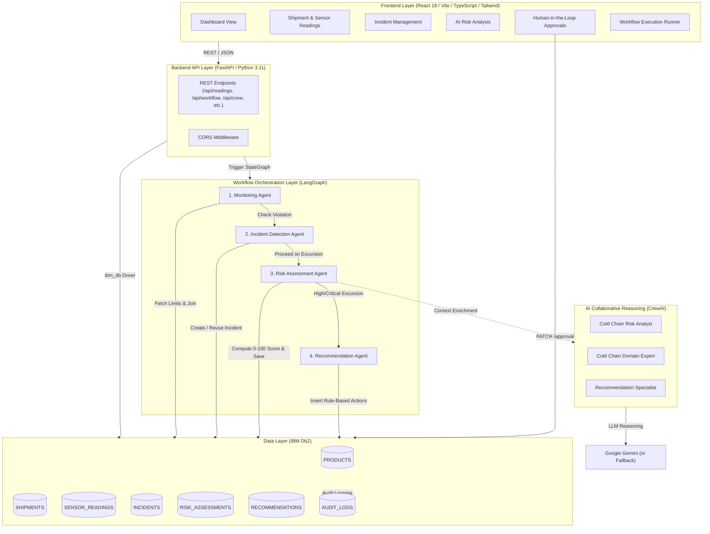

# System Architecture

## Overview

**ColdChain Guardian** is an enterprise-grade agentic AI platform for real-time cold-chain monitoring, automated temperature excursion detection, deterministic risk scoring, and multi-agent AI corrective action planning.

The solution integrates **IBM Db2** as the authoritative single source of truth, **LangGraph** for deterministic workflow state orchestration, **CrewAI** for collaborative multi-agent reasoning, and a modern **React + Vite + TypeScript + Tailwind CSS** dashboard for human-in-the-loop decision making.

---

## High-Level Architecture Diagram



---

## Component Breakdown

### 1. Database Layer (IBM Db2)
- **Single Source of Truth**: All sensor readings, shipments, product temperature thresholds, incidents, risk assessments, and recommendations are persisted exclusively in IBM Db2.
- **Relational Integrity**: Foreign key constraints and IDENTITY columns ensure referential integrity.
- **Audit Trails**: All automated agent actions and human approvals/rejections are logged in `AUDIT_LOGS`.
- **Duplicate Prevention**: Parameterized queries and existence checks ensure repeated workflow runs never generate duplicate incidents, risk assessments, or duplicate recommendation actions.

### 2. Workflow Orchestration Layer (LangGraph)
- **`StateGraph(WorkflowState)`**: Defines a clean directed acyclic graph (DAG) connecting:
  1. `monitoring_node`: Queries IBM Db2 for sensor reading and product temperature thresholds, computing deviation. Normal readings safely terminate the graph at `END`.
  2. `incident_node`: Creates or links existing open incidents for the shipment, evaluating excursion severity.
  3. `risk_node`: Computes a deterministic 0–100 risk score and qualitative risk level (`LOW`, `MEDIUM`, `HIGH`, `CRITICAL`) and writes to `RISK_ASSESSMENTS`.
  4. `recommendation_node`: Generates deterministic, prioritized corrective actions in `RECOMMENDATIONS` with `PENDING` approval status.

### 3. Collaborative AI Reasoning Layer (CrewAI)
- **Risk Analyst Agent**: Evaluates temperature excursion significance and potential product degradation.
- **Domain Expert Agent**: Evaluates cold-chain conditions, identifies excursion root causes, and recommends containment.
- **Recommendation Specialist Agent**: Reviews findings and prioritizes actionable remediation plans.
- **Graceful Fallback**: If LLM API keys are unavailable or rate-limited, CrewAI gracefully falls back to deterministic explanations without interrupting the core LangGraph workflow.

### 4. Backend API Layer (FastAPI)
- Standardized REST endpoints with CORS enabled for frontend communication.
- Comprehensive endpoints covering dashboard aggregation, sensor ingestion, manual workflow triggers (`POST /api/workflow/run/{reading_id}`), and CrewAI analysis (`POST /api/crew/analyse/{incident_id}`).

### 5. Frontend Dashboard (React + TypeScript + Vite + Tailwind CSS)
- **Enterprise Dark Theme**: Styled with a dark navy background (`#0a0f1e`), teal/cyan accents, and clean typography.
- **Real-Time Data**: Directly queries FastAPI endpoints connected to IBM Db2.
- **Human-in-the-Loop**: Interactive recommendation approval (`APPROVED` / `REJECTED`) updating Db2 state.
- **Visual Analytics**: Interactive Recharts pie and line charts displaying shipment sensor trends and fleet risk distributions.

---

## Data Flow Lifecycle

```
[Sensor Device]
       │
       ▼ (POST /api/readings/)
[FastAPI Ingestion]
       │
       ├─► (INSERT SENSOR_READINGS) ──► [IBM Db2]
       │
       ▼ (Execute run_workflow)
[LangGraph Workflow]
       │
       ├─► [Monitoring Agent] ──► Checks limits against [PRODUCTS] in Db2
       │         │
       │         ├── (Normal) ──► Complete (Status: SUCCESS)
       │         │
       │         └── (Violation)
       │                  │
       │                  ▼
       │           [Incident Agent] ──► INSERT/REUSE in [INCIDENTS]
       │                  │
       │                  ▼
       │           [Risk Assessment Agent] ──► INSERT in [RISK_ASSESSMENTS]
       │                  │
       │                  ▼
       │           [Recommendation Agent] ──► INSERT in [RECOMMENDATIONS] (Status: PENDING)
       │                  │
       │                  ▼
       │           [CrewAI Team] ──► Multi-Agent Collaborative Reasoning
       │
       ▼
[React Frontend]
       │
       ├─► Visualizes Fleet Status, Readings, Incidents, & AI Risk Analysis
       │
       └─► Logistics Operator Approves/Rejects Action
                 │
                 ▼ (PATCH /api/recommendations/{id}/approval)
            [IBM Db2] (Status: APPROVED/REJECTED + AUDIT_LOG entry)
```

---

## Security & Credential Management
- **Environment Isolation**: All database credentials (`DB2_HOST`, `DB2_USER`, `DB2_PASSWORD`, `DB2_DATABASE`) and LLM API keys (`GEMINI_API_KEY`) are managed via `.env` files.
- **No Hardcoded Secrets**: Secrets are explicitly excluded from git tracking; `.env.example` provides safe templates for local reproduction.
