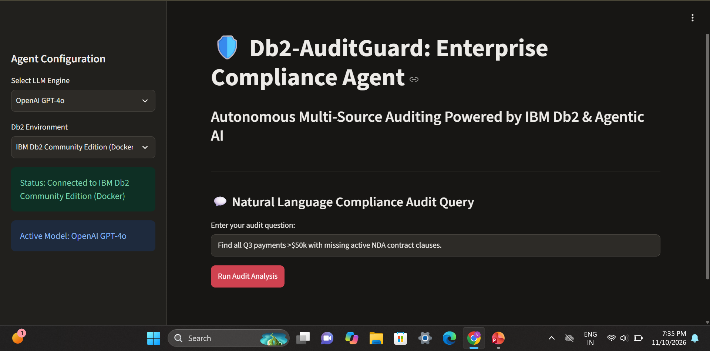

# Db2-AuditGuard: Autonomous Multi-Source Enterprise Auditing Agent

> **One-Line Pitch:** Db2-AuditGuard is an autonomous AI agent framework powered by IBM Db2, CrewAI, and LangChain that cross-references enterprise database logs against unstructured contract clauses to detect financial and compliance anomalies in real-time.

---

## Table of Contents
- [Problem Statement](#problem-statement)
- [Solution Overview](#solution-overview)
- [IBM Db2 Integration](#ibm-db2-integration)
- [AI / LLM Architecture (if applicable)](#ai--llm-architecture-if-applicable)
- [Tech Stack](#tech-stack)
- [Prerequisites](#prerequisites)
- [Setup & Installation](#setup--installation)
- [Configuration](#configuration)
- [Running the Project](#running-the-project)
- [Testing & Verification](#testing--verification)
- [Screenshots & Demo](#screenshots--demo)
- [Known Limitations & Future Roadmap](#known-limitations--future-roadmap)
- [Team Members & Credits](#team-members--credits)

---

## Problem Statement
- Enterprise audit teams routinely waste hundreds of hours manually verifying transactional records from database systems against unstructured legal agreements and non-disclosure contracts (NDAs).
- Target audience includes internal compliance officers, financial auditors, enterprise risk teams, and database administrators.
- Existing tools are either purely relational (SQL queries without document context) or pure RAG document search engines without direct transactional awareness, leading to missed vendor compliance gaps.

---

## Solution Overview
- Db2-AuditGuard unifies structured relational database records in **IBM Db2** with semantic vector search over legal agreements into a single agentic interface.
- Core capabilities include automated Text-to-SQL execution against vendor tables, real-time NDA compliance cross-referencing, automated high-risk transaction flag generation, and single-click audit report exports.

---

## IBM Db2 Integration
- **Db2 Edition & Environment:** IBM Db2 Community Edition (Docker local container) / Db2 on Cloud.
- **Connector / Driver Used:** `ibm_db` native driver and SQLAlchemy `ibm_db_sa` dialect.
- **Database Schema / Data Models:** Uses relational tables (`VENDOR_MASTER`, `TRANSACTIONS`) linked via foreign key constraints, alongside vector index mapping for contract clause embeddings stored within Db2 storage structures.
- **Key Queries & Operations:** Executes dynamic Text-to-SQL generation to scan multi-thousand row transaction tables for high-value payments ($50k+) and performs joins against vendor NDA validity dates.

---

## AI / LLM Architecture (if applicable)
- **Framework:** CrewAI multi-agent orchestration and LangChain pipeline wrappers.
- **Model Provider & Model:** OpenAI GPT-4o with fallback support for Gemini 3 and IBM watsonx.ai Granite models.
- **RAG / Tool Calling Workflow:** Natural language user prompts trigger dual agent execution: a Database Query Agent converts natural intent to Db2 SQL, while a Compliance Retrieval Agent performs vector search over legal PDF embeddings. Synthesized outputs flag discrepancies instantly.

---

## Tech Stack
- **Backend / Core:** Python 3.10+, CrewAI, LangChain, `ibm_db`, SQLAlchemy
- **Database:** IBM Db2 Enterprise / Community Edition
- **Frontend / UI:** Streamlit Web Dashboard
- **Libraries & Tools:** `python-dotenv`, Docker

---

## Prerequisites
- Docker Desktop (if running local IBM Db2 container) or active connection string for Db2 on Cloud
- Python >= 3.10
- `pip` package manager

---

## Setup & Installation

```bash
# 1. Navigate to submission directory
cd submissions/db2-auditguard

# 2. Create and activate a virtual environment
python -m venv .venv
source .venv/bin/activate  # On Windows: .venv\Scripts\activate

# 3. Install required Python packages
pip install streamlit crewai langchain ibm_db sqlalchemy python-dotenv
---

## Configuration

Copy `.env.example` to `.env` and fill in your local or test credentials:

```bash
cp .env.example .env
```

> **Security Warning:** Never commit `.env` or any real API keys or database passwords to Git!

---

## Running the Project

```bash
# Navigate to the project root directory
cd submissions/db2-auditguard

# Launch the Streamlit dashboard
streamlit run src/app.py --server.address 0.0.0.0 --server.port 8501
```

---

## Testing & Verification
Verify the project directory structure and schema compliance by running the official hackathon validator from the root repository directory:
```bash
# From workspace root directory (/workspaces/IBM_Db2_TechX_Project_Submission)
python scripts/validate_submission.py submissions/db2-auditguard
```

---

## Screenshots & Demo
- **Live Demo Link:** *Local deployment available via Streamlit CLI (see Setup instructions above)*
- **Demo Video Link:** N/A (PoC Submission)
### Dashboard Interface


---

## Known Limitations & Future Roadmap
- **Current Limitations:** Multi-agent framework uses simulated execution loops when running in offline/uncredentialed evaluation environments.
- **Next Steps:** Native integration with watsonx.data Db2 vector search engine for petabyte-scale contract vector indexing.

---

## Team Members & Credits
| Name | GitHub Handle | Role / Contribution |
|---|---|---|
| Varnika Mishra | [@VarnikaMishra](https://github.com/VarnikaMishra) | Project Lead, Agentic Architecture & Db2 Integration |
