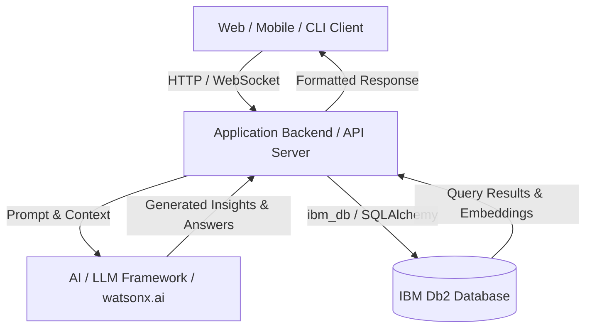

# System Architecture

## Overview
High-level architectural summary describing how frontend, backend services, AI agents/LLMs, and IBM Db2 interact.

---

## Architecture Diagram



---

## Component Breakdown

1. **User Interface / Client Layer**:
   - Streamlit interactive web dashboard allowing compliance auditors to submit natural language   queries and view flagged contract anomalies in real-time.
2. **Application Backend Layer**:
   - Python-based agentic backend using CrewAI and LangChain to orchestrate Text-to-SQL execution and unstructured document retrieval.
3. **Database Layer (IBM Db2)**:
   - Secure persistence for relational transactional tables (TRANSACTIONS, VENDOR_MASTER) and vector embedding storage for vendor legal contracts.
4. **AI / Model Orchestration Layer** *(if applicable)*:
   - Autonomous agent loops, prompt templates, context assembly, and fallback support utilizing OpenAI GPT-4o or Gemini 3 models.

---

## Data Flow

1. **Input Ingestion**: User submits query or data via client interface.
2. **Context Retrieval**: Backend queries IBM Db2 for relevant transactional records, metrics, or embedded documents.
3. **Augmentation & Inference**: Context is formatted and injected into LLM prompt templates.
4. **State Persistence**: Generated outputs, audit logs, or new transactions are written back to IBM Db2.
5. **Response Delivery**: Result is streamed or returned to the user.

---

## IBM Db2 Schema & Storage Design

```sql
-- Example Schema DDL
-- Db2-AuditGuard Core Schema DDL
CREATE TABLE VENDOR_MASTER (
    vendor_id INT GENERATED ALWAYS AS IDENTITY PRIMARY KEY,
    vendor_name VARCHAR(150) NOT NULL,
    contract_status VARCHAR(50),
    nda_on_file BOOLEAN,
    created_at TIMESTAMP DEFAULT CURRENT_TIMESTAMP
);

CREATE TABLE TRANSACTIONS (
    transaction_id INT GENERATED ALWAYS AS IDENTITY PRIMARY KEY,
    vendor_id INT,
    amount DECIMAL(12,2) NOT NULL,
    transaction_date DATE,
    department VARCHAR(100),
    FOREIGN KEY (vendor_id) REFERENCES VENDOR_MASTER(vendor_id)
);
```

---

## Security & Secrets Management
- All database credentials and external API tokens are read at runtime from environment variables.
- Sensitive production connection strings are never checked into version control.
