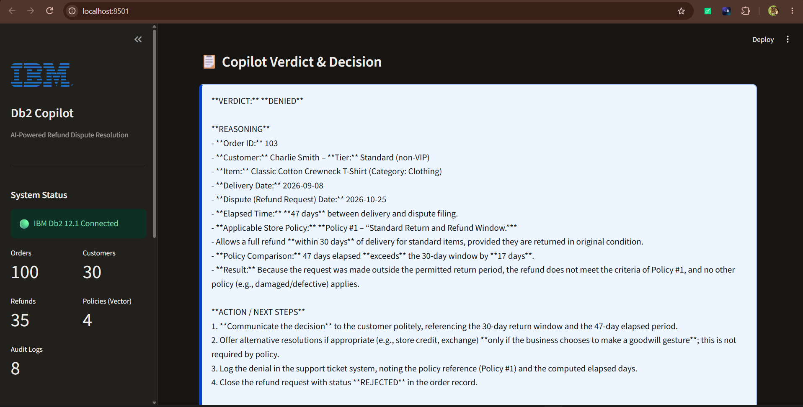
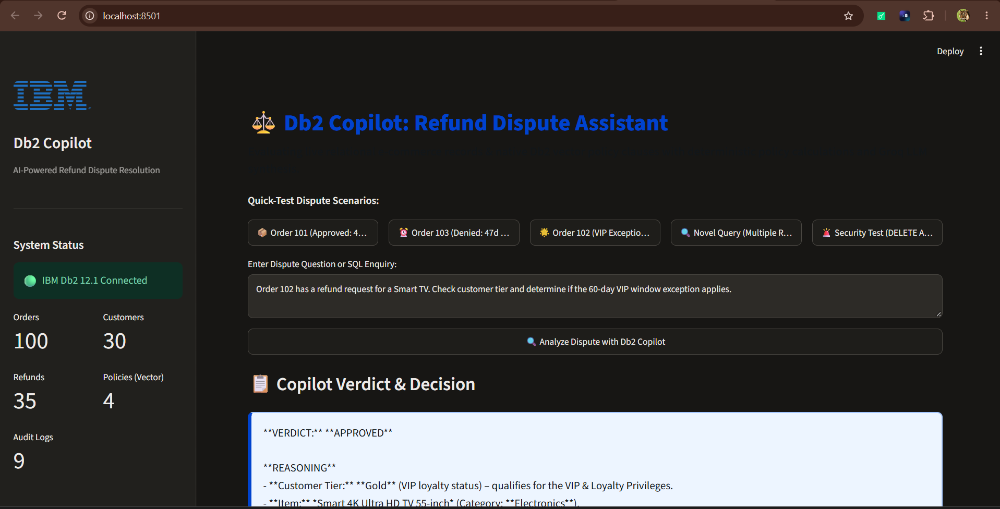
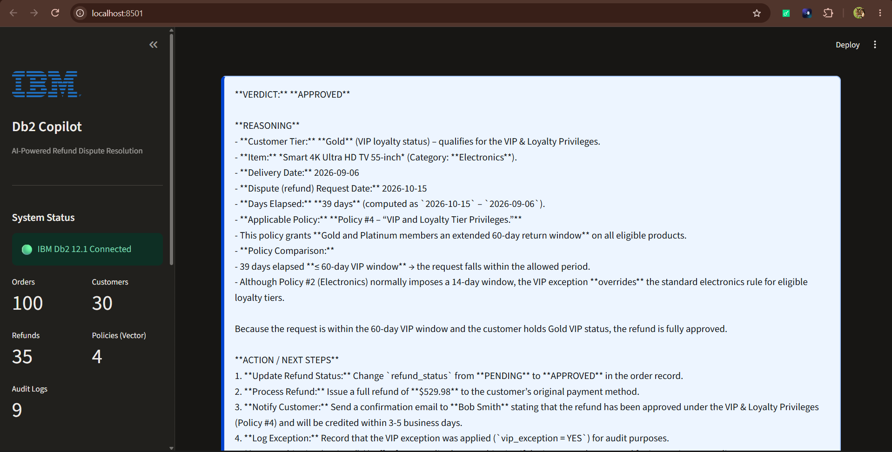
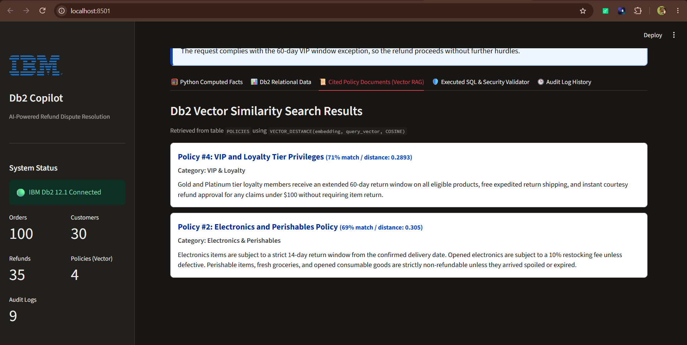

# Db2 Copilot: AI Refund-Dispute Assistant with Native Vector Search & Guardrailed Text-to-SQL

> **One-Line Pitch:** An enterprise e-commerce refund-dispute assistant combining IBM Db2 12.1 relational querying, native Db2 `VECTOR(384, FLOAT32)` similarity search on policy documents, LangChain LCEL chains with ChatGroq (`openai/gpt-oss-120b` / `llama-3.3-70b-versatile`) for Text-to-SQL and verdict synthesis, AST security guardrails, deterministic Python policy window math, and persistent query auditing.

---

## Demo Video
📺 **Watch the Walkthrough & Demo Video:** [https://youtu.be/GtTyib14P7Y](https://youtu.be/GtTyib14P7Y)

---

## License
License: MIT — Copyright (c) 2026 M. Karthik Reddy. See [LICENSE](LICENSE) for details.

---

## Table of Contents
- [Demo Video](#demo-video)
- [License](#license)
- [Problem Statement](#problem-statement)
- [Solution Overview](#solution-overview)
- [Synthetic Data Notice](#synthetic-data-notice)
- [Screenshots](#screenshots)
- [IBM Db2 Integration](#ibm-db2-integration)
- [AI / LLM Architecture](#ai--llm-architecture)
- [Tech Stack](#tech-stack)
- [Prerequisites](#prerequisites)
- [Db2 Setup on Windows (Tested from Scratch)](#db2-setup-on-windows-tested-from-scratch)
- [Project Setup & Installation](#project-setup--installation)
- [Configuration](#configuration)
- [Running the Project](#running-the-project)
- [Testing & Verification](#testing--verification)
- [Security Guardrails & Attack Prevention](#security-guardrails--attack-prevention)
- [Known Limitations & Future Roadmap](#known-limitations--future-roadmap)
- [Team Members & Credits](#team-members--credits)

---

## Problem Statement
E-commerce customer service teams spend hours manually resolving refund disputes. An agent must navigate transactional databases to check order delivery dates, payment statuses, and customer loyalty tiers, while cross-referencing multi-page refund policies (e.g. 14-day windows for electronics, restocking fees, exceptions for perishables, and VIP instant-refund privileges). 

Existing solutions either:
1. Rely exclusively on vector search (ignoring live operational databases like customers, orders, and payments), or
2. Allow unconstrained Text-to-SQL which poses catastrophic database injection risks (e.g., unintended `DELETE`, `UPDATE`, or `DROP` statements), or
3. Rely on LLMs to calculate date arithmetic, leading to frequent hallucination errors regarding policy window compliance.

---

## Solution Overview
**Db2 Copilot** introduces a hybrid RAG + Text-to-SQL architecture with deterministic calculation and enterprise guardrails:
- **Text-to-SQL via LangChain LCEL**: Translates natural language dispute questions into accurate IBM Db2 queries using an LCEL chain (`ChatPromptTemplate | ChatGroq | StrOutputParser`).
- **SQL Security Guardrail (`sql_validator.py`)**: Strictly enforces a single-statement `SELECT` policy against an allow-list (`CUSTOMERS`, `ORDERS`, `PAYMENTS`, `REFUNDS`, `POLICIES`). Instantly blocks and logs any mutation attempts (such as `DELETE`, `DROP`, or stacked queries).
- **Native Db2 Vector Search**: Stores policy documents in a native `VECTOR(384, FLOAT32)` column and retrieves relevant clauses using Db2's `VECTOR_DISTANCE(..., COSINE)` scalar function.
- **Deterministic Python Policy Engine**: Calculates authoritative date differences (`days_elapsed = (requested_at - delivery_date).days`) and evaluates policy window boundaries (7d, 14d, 30d, 60d VIP exception, <$100 VIP courtesy) in pure Python before feeding verified facts to the LLM.
- **Synthesized Verdict via LangChain LCEL**: A second LCEL chain (`ChatPromptTemplate | ChatGroq | StrOutputParser`) produces conclusive, explainable verdicts (Approved, Denied, or Partially Approved) citing exact dates and policy rules.
- **Persistent Governance**: Every enquiry, generated SQL, execution status, and verdict is automatically logged to the `QUERY_AUDIT` table in Db2.
- **Interactive Streamlit UI**: Provides support representatives with an intuitive console with 1-click test scenarios and live audit inspection.

---

## Synthetic Data Notice
> [!NOTE]
> All customer profiles, orders, transactions, disputes, and payment records used in this project are **100% synthetic mock data** generated for demonstration and benchmarking purposes. No real customer or proprietary transaction data is included.

---

## Screenshots

### 1. Streamlit Dashboard Overview

*Real-time Streamlit console displaying live IBM Db2 12.1 connection status, operational table row counts, and 1-click scenario test buttons.*

### 2. Order 103 Dispute Resolution (Denied: Too Late)

*Order 103 dispute evaluation: Python date engine computes 47 elapsed days vs 30-day allowance, resulting in an authoritative DENIED verdict citing Policy #1.*

### 3. Order 102 Dispute Resolution (VIP Exception Query)

*Order 102 dispute scenario query: Evaluating Gold loyalty tier member refund request on a Smart TV.*

### 4. Order 102 Verdict Detail (Approved: VIP Policy Override)

*Order 102 verdict: Full refund approved applying Policy #4 (39 days elapsed $\le$ 60-day VIP window), successfully superseding the standard 14-day electronics limit.*

### 5. Native Db2 Vector Similarity Search Results

*Semantic retrieval of policy clauses from Db2 `POLICIES` table using native `VECTOR_DISTANCE(embedding, query_vector, COSINE)`.*

---

## IBM Db2 Integration
- **Db2 Edition & Environment**: IBM Db2 12.1.5 Community Edition running on Docker (`db2server`, port 50000, database `testdb`).
- **Connector Used**: Native `ibm_db` (pure C/Python driver, zero SQLAlchemy overhead).
- **Database Schema**:
  - `CUSTOMERS` (30 rows): Customer tiering (`Standard`, `Gold`, `Platinum`), emails, and registration dates.
  - `ORDERS` (100 rows): Orders across categories (`Electronics`, `Clothing`, `Perishables`, `Digital`), delivery dates, and prices.
  - `PAYMENTS` (100 rows): Transaction statuses, payment methods, and timestamps.
  - `REFUNDS` (35 rows): Dispute records, reasons (damaged, late, defective), requested_at dispute dates, and statuses.
  - `POLICIES` (4 rows): Official refund policies embedded into native `VECTOR(384, FLOAT32)` columns.
  - `QUERY_AUDIT`: Identity-keyed audit trail recording every enquiry, generated SQL, execution status, and verdict.
- **Key Operations**:
  - Relational joins across operational tables.
  - Cosine distance vector queries via:
    ```sql
    SELECT policy_id, policy_title, category, content,
           VECTOR_DISTANCE(embedding, VECTOR('[-0.012, ...]', 384, FLOAT32), COSINE) AS distance
    FROM POLICIES
    ORDER BY distance ASC
    FETCH FIRST 2 ROWS ONLY
    ```
  - Audit logging with identity columns:
    ```sql
    INSERT INTO QUERY_AUDIT (question, generated_sql, sql_status, verdict)
    VALUES (?, ?, ?, ?)
    ```

---

## AI / LLM Architecture
- **Framework**: **LangChain** (`langchain-core`, `langchain-groq`) using modern LCEL (LangChain Expression Language) pipelines (`prompt | llm | parser`) for all LLM interactions.
- **LCEL Chains**:
  1. **Text-to-SQL Chain**: `ChatPromptTemplate.from_messages([("system", DB_SCHEMA_PROMPT), ("human", "...")]) | ChatGroq | StrOutputParser()`
  2. **Verdict Synthesis Chain**: `ChatPromptTemplate.from_messages([("human", VERDICT_SYSTEM_PROMPT)]) | ChatGroq | StrOutputParser()`
- **Embedding Model**: `BAAI/bge-small-en-v1.5` (384-dimensional dense vectors) running locally via **FastEmbed** ONNX runtime inside Docker (zero network latency, pre-cached into the image).
- **LLM Provider**: **Groq API** utilizing the `openai/gpt-oss-120b` model (with dynamic fallback to `llama-3.3-70b-versatile` / active chat models) via LangChain `ChatGroq` for high-speed Text-to-SQL generation and final verdict synthesis.
- **Error Handling**: If `GROQ_API_KEY` is missing or the API call fails, visible errors are surfaced immediately without silent fallbacks or canned text.

---

## Tech Stack
- **Database**: IBM Db2 12.1.5 Community Edition
- **Database Driver**: `ibm_db` (Native Python driver)
- **AI Framework**: LangChain (`langchain-core`, `langchain-groq`)
- **Embedding Engine**: FastEmbed (`BAAI/bge-small-en-v1.5`)
- **LLM Engine**: ChatGroq via LangChain (`openai/gpt-oss-120b` / `llama-3.3-70b-versatile`)
- **Web UI**: Streamlit 1.35+
- **Containerization**: Docker & Docker Compose

---

## Prerequisites
- Docker & Docker Compose installed.
- Free Groq API Key from [console.groq.com](https://console.groq.com).

---

## Db2 Setup on Windows (Tested from Scratch)

To provision IBM Db2 12.1.5 Community Edition in Docker on Windows:

### 1. Create `.env.db2`
Create a file named `.env.db2` in your root or working directory:
```ini
LICENSE=accept
DB2INSTANCE=db2inst1
DB2INST1_PASSWORD=YourSecurePassword123!
DBNAME=testdb
BLU=false
ENABLE_ORACLE_COMPATIBILITY=false
```

### 2. Start the Db2 Container
Run with `--privileged=true`:
```powershell
docker run -d --name db2server --privileged=true -p 50000:50000 --env-file .env.db2 icr.io/db2_community/db2:latest
```

### 3. Wait for Setup to Complete
Monitor container initialization until you see the completion message:
```powershell
docker logs -f db2server
# Wait until you see: "(*) Setup has completed."
```

---

## Project Setup & Installation

All application Python dependencies are isolated inside Docker, avoiding Windows native binary issues with `ibm_db`.
The build process installs base requirements from `requirements.txt`, pre-caches FastEmbed embeddings, and installs LangChain dependencies from `requirements-langchain.txt` (`langchain-core`, `langchain-groq`):

```powershell
# 1. Navigate to the project directory
cd submissions/db2-copilot

# 2. Build the Docker container image (includes pre-cached FastEmbed model and LangChain)
docker build -t db2copilot .
```

---

## Configuration

Copy `.env.example` to `.env` and fill in your settings:

```powershell
Copy-Item .env.example .env
```

Example `.env` configuration:
```ini
DB2_HOST=host.docker.internal
DB2_PORT=50000
DB2_DATABASE=testdb
DB2_USER=db2inst1
DB2_PASSWORD=YourSecurePassword123!
DB2_SECURITY=false

GROQ_API_KEY=your_groq_api_key_here
GROQ_MODEL=openai/gpt-oss-120b
```

> **Security Note:** `.env` is listed in `.gitignore` and must never be committed to source control.

---

## Running the Project

### Step 1: Seed the Db2 Database
Initialize the schema and seed 265 synthetic relational records along with 4 FastEmbed policy vectors:
```powershell
docker run --rm -v "${PWD}:/app" --env-file .env db2copilot python src/seed_db.py
```

### Step 2: Launch the Application with Docker Compose
Start the Streamlit application in the background:
```powershell
docker compose up -d --build
```
Open your browser at: **`http://localhost:8501`**

To stop the application:
```powershell
docker compose down
```

---

## Testing & Verification

Run the test suite to verify all components from end-to-end:

### 1. Vector Diagnostic & SQL Check
```powershell
docker run --rm -v "${PWD}:/app" --env-file .env db2copilot python src/check_db.py
```
*Expected: Connects to Db2, creates temporary vector table, inserts test vectors, and executes `VECTOR_DISTANCE` with `COSINE`.*

### 2. Full End-to-End Copilot Engine & Security Attack Test
```powershell
docker run --rm -v "${PWD}:/app" --env-file .env db2copilot python src/copilot.py
```
*Expected: Evaluates dispute query, synthesizes verdict with Groq, and blocks a simulated `DELETE FROM ORDERS` attack.*

### 3. Automated Unit Tests
```powershell
docker run --rm -v "${PWD}:/app" --env-file .env db2copilot python tests/test_validator.py
docker run --rm -v "${PWD}:/app" --env-file .env db2copilot python tests/test_vector.py
docker run --rm -v "${PWD}:/app" --env-file .env db2copilot python tests/test_audit.py
```

---

## Security Guardrails & Attack Prevention

Db2 Copilot enforces AST-level guardrails:
- **Single Statement Enforcement**: Multi-statement payloads (`SELECT 1; DROP TABLE CUSTOMERS;`) are rejected. Semicolons inside string literals (e.g. delimiters for `LISTAGG`) are safely distinguished and permitted.
- **Read-Only Restriction**: Only `SELECT` statements are permitted. `INSERT`, `UPDATE`, `DELETE`, `DROP`, `ALTER`, `TRUNCATE`, and administrative procedures are blocked.
- **Catalog Exfiltration Prevention**: Prohibits access to `SYSCAT`, `SYSSTAT`, and sensitive internal catalogs.
- **Table Allow-List**: Only allows access to `CUSTOMERS`, `ORDERS`, `PAYMENTS`, `REFUNDS`, and `POLICIES`.
- **Comment Stripping**: Disallows `--` and `/* */` comment sequences used in SQL injection attacks.

---

## Known Limitations & Future Roadmap
- **Batch Dispute Processing**: Currently processes one dispute at a time; future releases can add batch processing from CSV uploads.
- **Multi-Modal Receipt Uploads**: Incorporate OCR to extract damage photos and receipts directly into the dispute pipeline.
- **Fine-Tuned Domain Adapter**: Fine-tune Granite or Llama specifically on retail dispute arbitration transcripts.

---

## Team Members & Credits
| Name | GitHub Handle | Role |
|---|---|---|
| M.Karthik Reddy | [@karthikreddy06](https://github.com/karthikreddy06) | AI & Database Engineer (Db2 Vectors, Text-to-SQL, Architecture) |
