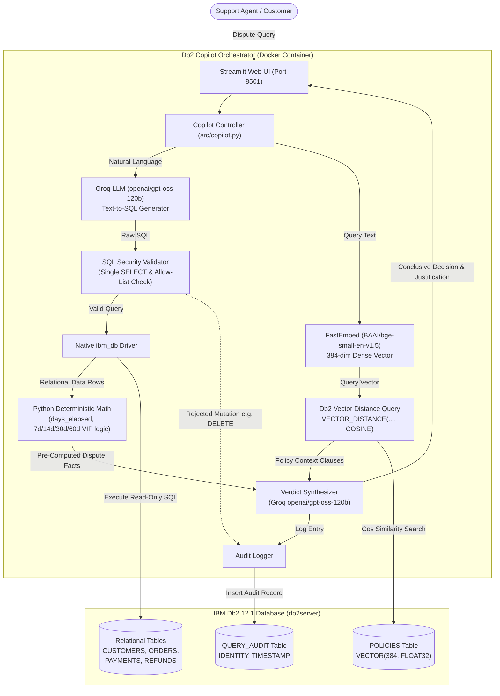

# Db2 Copilot System Architecture

## Overview
**Db2 Copilot** is an enterprise AI assistant designed for e-commerce platforms to automate and accelerate customer refund-dispute resolutions. It combines IBM Db2 12.1's dual superpower:
1. **Relational querying**: High-performance querying of operational e-commerce data (`CUSTOMERS`, `ORDERS`, `PAYMENTS`, `REFUNDS`). All operational data is synthetic test data.
2. **Native Vector Search**: Semantic similarity matching across company refund policy documents stored in native Db2 `VECTOR(384, FLOAT32)` columns using `VECTOR_DISTANCE` with `COSINE` distance metric.

A deterministic Python engine calculates authoritative dispute facts (exact days elapsed, policy window bounds, and tier privileges) before passing them to the Groq LLM (`openai/gpt-oss-120b` / `llama-3.3-70b-versatile`). A strict SQL Security Validator ensures that text-to-SQL generation is limited strictly to single, read-only `SELECT` statements on allow-listed tables, preventing prompt injection or database tampering. All decisions, SQL queries, and verdicts are persistently logged into Db2's `QUERY_AUDIT` table for governance.

---

## Architecture Diagram



---

## Component Breakdown

1. **User Interface Layer (`src/app.py`)**:
   - Built with Streamlit, providing an interactive console with high-contrast typography and auto-wrapping SQL code blocks.
   - Includes instantaneous 1-click test dispute scenarios (damaged goods within 7d, denied beyond 30d, VIP 60-day exception, multiple refund aggregation, and adversarial SQL attacks).
   - Displays real-time Db2 database statistics, visual verdict badges, pre-computed Python facts, relational data tables, vector policy match scores, and the live Db2 audit log.

2. **Security & Validation Layer (`src/sql_validator.py`)**:
   - Inspects generated or provided SQL queries before they touch the database.
   - Enforces a single statement constraint (blocks semicolons outside of string literals and multi-statement execution).
   - Enforces read-only `SELECT` queries only; rejects `DELETE`, `DROP`, `UPDATE`, `INSERT`, `ALTER`, `TRUNCATE`, `CALL`, etc.
   - Restricts accessible tables strictly to the allow-list (`CUSTOMERS`, `ORDERS`, `PAYMENTS`, `REFUNDS`, `POLICIES`, `SYSIBM.SYSDUMMY1`).
   - Strips and rejects suspicious SQL comments (`--`, `/* */`) designed to bypass parsers.

3. **Deterministic Date & Policy Calculation Engine (`src/copilot.py`)**:
   - Computes `days_elapsed = (requested_at - delivery_date).days` purely in Python.
   - Authoritatively applies policy window bounds:
     - Policy 3: Damaged/Defective (7 days)
     - Policy 2: Electronics (14 days, subject to 10% restocking if opened)
     - Policy 2: Perishables (strictly non-refundable unless spoiled)
     - Policy 1: Standard General (30 days)
     - Policy 4: VIP Gold/Platinum (extended 60 days; instant refund courtesy for claims $\le \$100$)
   - Passes these verified facts to the LLM to prevent arithmetic hallucination.

4. **Vector Embedding & Retrieval Layer (`src/policy_retriever.py`)**:
   - Uses `FastEmbed` with `BAAI/bge-small-en-v1.5` to generate 384-dimensional dense vectors on CPU in milliseconds.
   - Executes native IBM Db2 12.1 vector similarity search using `VECTOR_DISTANCE(embedding, VECTOR('...', 384, FLOAT32), COSINE)`.

5. **Text-to-SQL & Synthesis Layer (`src/copilot.py`)**:
   - Connects to Groq's high-speed API utilizing `openai/gpt-oss-120b` (with auto-resolution for `llama-3.3-70b-versatile`).
   - Translates questions into optimized Db2 `SELECT` statements and synthesizes operational facts with official policy rules to output unambiguous dispute verdicts.

6. **Persistence & Audit Layer (`src/db.py`)**:
   - Leverages native `ibm_db` (pure C/Python driver, zero SQLAlchemy overhead) with automatic connection pooling and fallback handling.
   - Every dispute query, whether successfully executed or blocked by the security validator, is logged into the `QUERY_AUDIT` table in Db2.

---

## IBM Db2 Schema & Storage Design

```sql
-- 1. Customers Table
CREATE TABLE CUSTOMERS (
    customer_id INT NOT NULL PRIMARY KEY,
    name VARCHAR(100) NOT NULL,
    email VARCHAR(100) NOT NULL,
    tier VARCHAR(20) NOT NULL, -- 'Standard', 'Gold', 'Platinum'
    created_at DATE NOT NULL
);

-- 2. Orders Table
CREATE TABLE ORDERS (
    order_id INT NOT NULL PRIMARY KEY,
    customer_id INT NOT NULL,
    order_date DATE NOT NULL,
    delivery_date DATE,
    status VARCHAR(30) NOT NULL,
    item_name VARCHAR(120) NOT NULL,
    item_category VARCHAR(50) NOT NULL,
    item_price DECIMAL(10,2) NOT NULL,
    shipping_fee DECIMAL(10,2) NOT NULL,
    total_amount DECIMAL(10,2) NOT NULL,
    CONSTRAINT fk_order_cust FOREIGN KEY (customer_id) REFERENCES CUSTOMERS(customer_id)
);

-- 3. Payments Table
CREATE TABLE PAYMENTS (
    payment_id INT NOT NULL PRIMARY KEY,
    order_id INT NOT NULL,
    payment_method VARCHAR(30) NOT NULL,
    payment_status VARCHAR(20) NOT NULL,
    amount DECIMAL(10,2) NOT NULL,
    transaction_time TIMESTAMP NOT NULL,
    CONSTRAINT fk_pay_order FOREIGN KEY (order_id) REFERENCES ORDERS(order_id)
);

-- 4. Refunds Table
CREATE TABLE REFUNDS (
    refund_id INT NOT NULL PRIMARY KEY,
    order_id INT NOT NULL,
    amount DECIMAL(10,2) NOT NULL,
    reason VARCHAR(200) NOT NULL,
    status VARCHAR(20) NOT NULL,
    requested_at DATE NOT NULL,
    processed_at DATE,
    CONSTRAINT fk_ref_order FOREIGN KEY (order_id) REFERENCES ORDERS(order_id)
);

-- 5. Policies Table with Native Db2 VECTOR Column
CREATE TABLE POLICIES (
    policy_id INT NOT NULL PRIMARY KEY,
    policy_title VARCHAR(100) NOT NULL,
    category VARCHAR(50) NOT NULL,
    content VARCHAR(1500) NOT NULL,
    embedding VECTOR(384, FLOAT32) NOT NULL
);

-- 6. Query Audit Log Table
CREATE TABLE QUERY_AUDIT (
    audit_id INT GENERATED ALWAYS AS IDENTITY PRIMARY KEY,
    question VARCHAR(1000) NOT NULL,
    generated_sql VARCHAR(2000),
    sql_status VARCHAR(50) NOT NULL,
    verdict VARCHAR(8000),
    created_at TIMESTAMP DEFAULT CURRENT TIMESTAMP
);
```

---

## Security & Secrets Management
- All credentials (`DB2_PASSWORD`, `GROQ_API_KEY`) are stored in `.env`, which is strictly ignored via `.gitignore` and never committed.
- The repository provides a sanitized `.env.example` containing only dummy placeholders.
- The AST SQL validator provides defense-in-depth against prompt injection by strictly preventing non-SELECT queries and unauthorized table traversal.
- The `validate_submission.py` script validates that zero credentials or forbidden key files exist in the repository.
