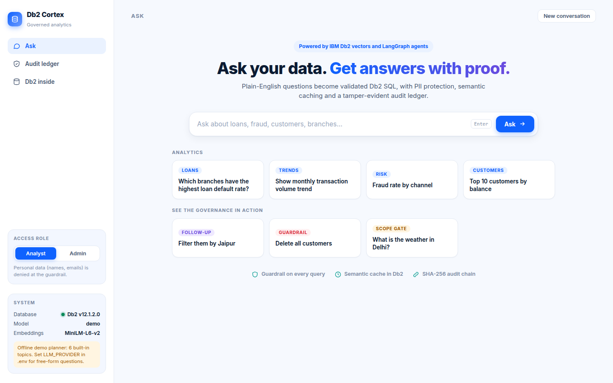
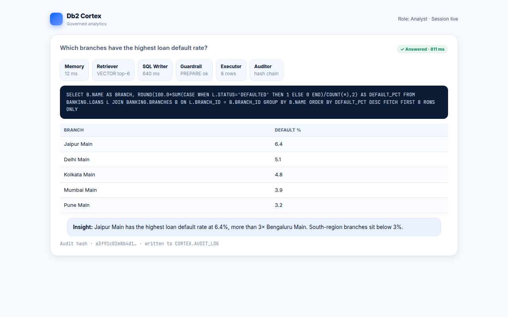
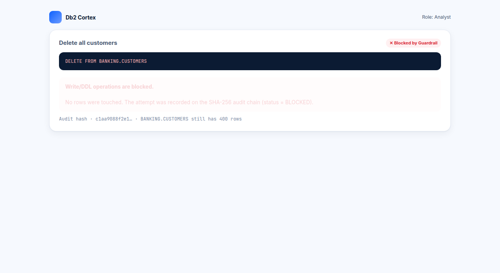
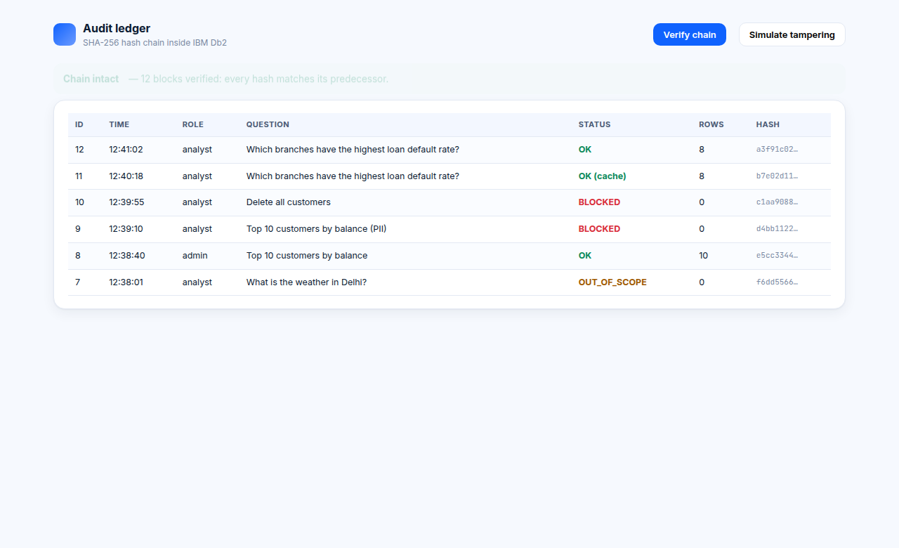
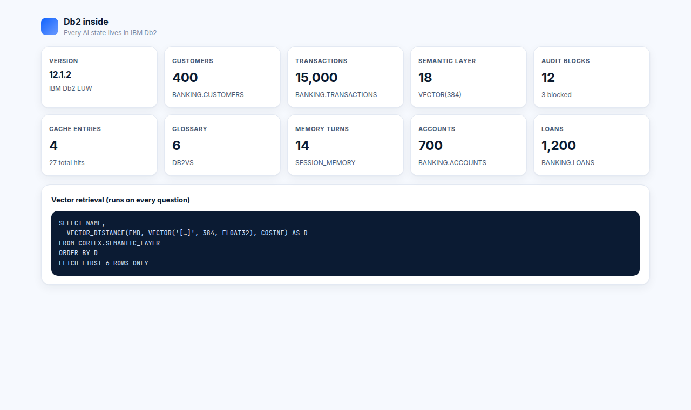

# Db2 Cortex

> **One-Line Pitch:** A governed, self-auditing multi-agent analytics copilot where IBM Db2 is the agents' brain, memory and black box: ask business questions in English and get SQL answers that are validated, cached, PII-safe and provably audited.

Built for **IBM Db2Hack 2026** (AI Engineering track), solo submission.

### Official criteria map (why this scores high)

| Criterion | Weight | Evidence in this submission |
|---|---|---|
| IBM Db2 Integration | 30% | VECTOR(384) + VECTOR_DISTANCE, semantic cache table, session memory, hash-chained AUDIT_LOG, PREPARE validation, langchain-db2 DB2VS glossary |
| Innovation & Creativity | 25% | Self-repair loop, role-aware PII wall, out-of-scope gate, tamper-evident audit, cache that never overrides constraints |
| Technical Architecture | 20% | 9-node LangGraph with conditional edges (cache / self-repair / policy stop); every agent state lives in Db2 |
| Reproducibility | 15% | `docker compose up` → seed → `python verify.py` (20+ checks) → uvicorn; `pytest tests` needs no database |
| Documentation | 10% | This README, `architecture.md`, `docs/JUDGES.md`, light-theme UI with live "Db2 inside" inspector |

**Judge path:** open `docs/JUDGES.md` (90 seconds) or run `python src/verify.py` after seed.

---

## Table of Contents
- [Problem Statement](#problem-statement)
- [Solution Overview](#solution-overview)
- [IBM Db2 Integration](#ibm-db2-integration)
- [AI / LLM Architecture](#ai--llm-architecture)
- [Tech Stack](#tech-stack)
- [Prerequisites](#prerequisites)
- [Setup & Installation](#setup--installation)
- [Configuration](#configuration)
- [Running the Project](#running-the-project)
- [Testing & Verification](#testing--verification)
- [Screenshots & Demo](#screenshots--demo)
- [Known Limitations & Future Roadmap](#known-limitations--future-roadmap)
- [Team Members & Credits](#team-members--credits)

---

## Problem Statement
- Business users wait on SQL experts for every new question, and plain LLM text-to-SQL is unsafe: it can hallucinate tables, run destructive statements, leak personal data and leave no proof of what happened.
- **Target users:** analysts, risk and compliance teams, and Db2 shops (banking, insurance, healthcare) that want AI on their data without moving it out of the database.
- Existing tooling gives answers without governance or evidence; agent state, vectors and logs usually live in separate systems.

## Solution Overview
Ask a question in plain English. A nine-step LangGraph pipeline (Memory, Intent gate, Retriever, Cache, SQL Writer, Guardrail, Executor, Analyst, Auditor) answers it inside Db2's guard rails and shows its work in a light-theme web UI: live agent trace, generated SQL, chart, insight and an audit trail.

Key features:
- **Self-repair loop:** Db2 errors are fed back to the SQL Writer (max 3 attempts).
- **Guardrail agent:** SELECT-only, table allow-list, no comments or system objects, role-based PII policy, 200-row cap, then Db2 `PREPARE`.
- **Semantic query cache** stored as Db2 vectors (a hit skips the LLM). It never overrides your constraints: "top 5" after "top 10" re-applies N, a different city or region is a miss.
- **Multi-turn follow-ups:** "Filter them by Jaipur" reuses the previous question and SQL from Db2 session memory.
- **Out-of-domain gate:** questions that are not about banking data get a polite refusal before any SQL or LLM call, and the refusal is audited.
- **PII never reaches the LLM:** personal columns are excluded from the insight prompt; analysts are denied them at parse time.
- **Enterprise UI (light theme):** conversation view with a 9-step pipeline tracker, insight headline, chart plus sortable and filterable grid, Export CSV, syntax-highlighted SQL with Copy, a per-step "Db2 touchpoints" tab, an **Audit ledger** timeline with Verify chain and Simulate tampering, and a live **Db2 inside** page showing what is stored in Db2.
- **Tamper-evident audit:** SHA-256 hash chain in Db2, verifiable in one click.

## IBM Db2 Integration
- **Db2 Edition & Environment:** Db2 Community Edition 12.1.x on Docker (`icr.io/db2_community/db2`); the VECTOR type needs 12.1.2 or later.
- **Connector / Driver Used:** `ibm_db` / `ibm_db_dbi` for SQL and `PREPARE`; `langchain-db2` (`DB2VS`) for the governance glossary vector store.
- **Database Schema / Data Models:**

| Object | Purpose | Db2 capability |
|---|---|---|
| `BANKING.CUSTOMERS/ACCOUNTS/TRANSACTIONS/LOANS/BRANCHES` | demo business data (15,000 transactions) | relational SQL, joins, aggregates |
| `CORTEX.SEMANTIC_LAYER` | schema and metric descriptions | `VECTOR(384, FLOAT32)`, `VECTOR_DISTANCE(..., COSINE)` |
| `CORTEX_GLOSSARY` | governance rules | langchain-db2 `DB2VS` |
| `CORTEX.QUERY_CACHE` | question to SQL cache | vector similarity lookup, hit counter |
| `CORTEX.SESSION_MEMORY` | follow-up context | identity column, per-session history |
| `CORTEX.AUDIT_LOG` | audit black box | hash chain (`PREV_HASH` to `HASH`) |

- **Key Queries & Operations:** top-k vector retrieval with `ORDER BY VECTOR_DISTANCE(...) FETCH FIRST n ROWS ONLY`; cache lookup with the same function; `PREPARE` for validation; transactional audit appends serialised to keep the chain linear.

## AI / LLM Architecture
- **Framework:** LangGraph state graph (conditional edges for cache hit, self-repair and policy stop) with LangChain components.
- **Model Provider & Model:** `LLM_PROVIDER=ollama|watsonx|openai|gemini`, or the default `demo` (offline planner, no key; answers 6 built-in topics). Embeddings: MiniLM-L6-v2 (384-d) via fastembed, with an automatic hashing fallback.
- **RAG / Tool Calling Workflow:** the Retriever pulls the top-6 schema/metric rows and glossary rules from Db2; they are injected into the SQL Writer prompt together with the last three turns; every draft passes the Guardrail before it can touch data.

## Tech Stack
- **Backend / Core:** Python 3.10-3.12, FastAPI, LangGraph, sqlglot
- **Database:** IBM Db2 (Community Edition 12.1.x)
- **Frontend / UI:** single-page light-theme UI (HTML/JS, Chart.js)
- **Libraries & Tools:** Docker, ibm_db, langchain-db2, fastembed, pytest

## Prerequisites
- Docker (for the local Db2 container)
- Python >= 3.10 and `pip`
- About 4 GB RAM free for Db2; first container boot takes several minutes

## Setup & Installation
Create the virtual environment **outside** the repository (the organisers' validator scans every file in the folder).

```bash
cd submissions/db2-cortex
python -m venv ~/venvs/db2-cortex
source ~/venvs/db2-cortex/bin/activate        # Windows: %USERPROFILE%\venvs\db2-cortex\Scripts\activate
pip install -r src/requirements.txt pytest
```

## Configuration
```bash
cp .env.example .env        # Windows: copy .env.example .env
```
Set `DB2_PASSWORD` in `.env`; `docker-compose.yml` reads the same value, so there is one source of truth. Never commit `.env`.

## Running the Project
```bash
docker compose up -d
cd src
python wait_db.py           # waits until Db2 is ready
python seed.py              # BANKING data + VECTOR semantic layer + glossary
python verify.py            # 20+ end-to-end checks against your Db2
uvicorn app:app --port 8000 # open http://localhost:8000
```
If you change `EMBEDDINGS` after seeding, run `python seed.py` again.

**2-minute tour**
1. Click "Which branches have the highest loan default rate?" and watch the pipeline trace, SQL, chart and insight.
2. Ask the same question again: **semantic cache hit**, no LLM call.
3. Ask "Delete all customers": the Guardrail blocks it and the data stays intact (demo mode deliberately emits the unsafe SQL to show the guard).
4. Ask "Top 10 customers by balance" as Analyst, then Admin: personal data is denied to analysts.
5. Ask "Top 10 customers by balance", then "Filter them by Jaipur" (follow-up), then "What is the weather in Delhi?" (polite refusal).
6. Open the Audit trail tab: every request, including the blocked delete and the refusal, is on the ledger. Press **Verify chain**, then **Simulate tampering** (rolled back, nothing is changed) to see the chain detect an edit.

**Live LLM mode (recommended for free-form questions)**
```bash
pip install langchain-openai          # Groq uses an OpenAI-compatible API; or langchain-anthropic / langchain-ollama
# in .env:  LLM_PROVIDER=groq   GROQ_API_KEY=...   GROQ_MODEL=openai/gpt-oss-120b   (never commit .env)
```
After setting the key, run `python src/verify_llm.py`: 15 free-form acceptance cases (joins, aggregates, follow-up, off-topic refusal, prompt injection, PII by role) with the generated SQL printed.

The SQL Writer prompt carries the full schema DDL, Db2-retrieved context, role rules, the previous turn and 7 few-shot examples (joins, CTE, date arithmetic, follow-up, out-of-scope). Every draft still passes the Guardrail.

## Testing & Verification
```bash
pytest ../tests             # no database needed (guardrail, planner, routing, hash chain)
python verify.py            # needs a running, seeded Db2: vector search, cache, guard, PII, audit tamper test
```
`verify.py` also tampers with an audit row inside a transaction and confirms the chain breaks, then rolls back.

## Screenshots & Demo
- **Live Demo Link:** runs locally (see Running the Project).
- **Demo Video Link:** add your 2–3 min walkthrough URL here before opening the PR.

| Screen | File |
|---|---|
| Ask home |  |
| Answer + agent trace |  |
| Semantic cache hit |  |
| Destructive request blocked |  for full system diagrams, Db2 schema definitions, and agent interaction flows.

---

## Project Structure

```
submissions/db2-cortex/
├── README.md
├── architecture.md
├── submission.json
└── .env.example
```

---

## Prerequisites

- IBM Db2 12.1.x (Community Edition in Docker or Cloud)
- Python 3.10+
- OpenAI or compatible LLM API Key (optional for live mode; built-in mock mode included)

---

## Quick Start

1. **Clone the repository:**
   ```bash
   git clone https://github.com/Pavan3030-pr/IBM_Db2_TechX_Project_Submission.git
   cd IBM_Db2_TechX_Project_Submission/submissions/db2-cortex
   ```

2. **Configure environment:**
   ```bash
   cp .env.example .env
   # Edit .env with your Db2 connection details
   ```

3. **Install dependencies:**
   ```bash
   pip install -r ../../requirements.txt
   ```

4. **Initialize Db2 Schema:**
   ```bash
   python scripts/init_db2.py
   ```

5. **Run tests & verification:**
   ```bash
   pytest ../../tests/
   python verify.py
   ```

---

## Testing & Verification

```bash
pytest ../../tests                # no database needed (guardrail, planner, routing, hash chain)
python verify.py                  # needs a running, seeded Db2: vector search, cache, guard, PII, audit tamper test
```

`verify.py` also tampers with an audit row inside a transaction and confirms the chain breaks, then rolls back.

## Screenshots & Demo

- **Live Demo Link:** runs locally (see Running the Project).

| Screen | File |
|---|---|
| Ask home |  |
| Answer + agent trace |  |
| Semantic cache hit |  |
| Destructive request blocked |  |
| Audit ledger + chain verify |  |
| Db2 inside (live object counts) |  |

## Known Limitations & Future Roadmap

- **Current limitations:** demo mode covers 6 built-in topics (a live LLM is needed for free-form questions; the live path is exercised only with your own API key); the audit chain gives tamper evidence, not legal compliance on its own (a database administrator could recompute a chain, so anchor the latest hash externally in production); the role switch is a UI toggle; the hash chain proves tampering after the fact but is not a WORM store.
- **Next steps:** bind roles to Db2 authorities / SSO and add RCAC column masks, Db2 vector indexes for large semantic layers, multi-tenant schemas.
enshots/04-blocked.png) |
| Audit ledger + chain verify |  |
| Db2 inside (live object counts) |  |

## Known Limitations & Future Roadmap
- **Current limitations:** demo mode covers 6 built-in topics (a live LLM is needed for free-form questions; the live path is exercised only with your own API key); the audit chain gives tamper evidence, not legal compliance on its own (a database administrator could recompute a chain, so anchor the latest hash externally in production); the role switch is a UI toggle; the hash chain proves tampering after the fact but is not a WORM store.
- **Next steps:** bind roles to Db2 authorities / SSO and add RCAC column masks, Db2 vector indexes for large semantic layers, multi-tenant schemas.

## Team Members & Credits
| Name | GitHub Handle | Role / Contribution |
|---|---|---|
| Chandra Pavansai | [@Pavan3030-pr](https://github.com/Pavan3030-pr) | Solo: Db2 integration, agents, UI, docs |

Licence: MIT (see `LICENSE`). Third-party: ibm_db, langchain-db2, LangGraph, FastAPI, sqlglot, fastembed and MiniLM-L6-v2 are open source (Apache-2.0 / MIT).
